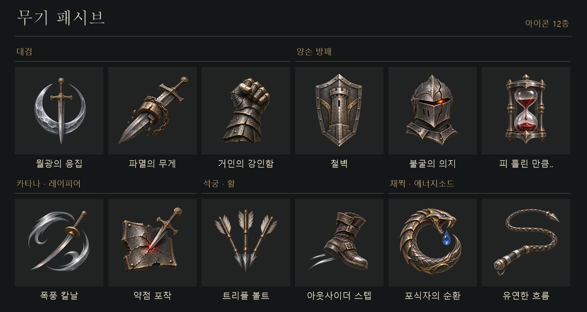

# 스킬 선택 화면 원화

[승인 시안](../../../docs/design/weapon-passives/selection-ui/prototype.png) · [화면 설계](../../../docs/design/weapon-passives/selection-ui.md)



## 파일과 쓰임

| 폴더 | 개수 · 크기 | 연결할 곳 |
|---|---|---|
| [Passives](Passives/) | 12 · 512×512 | 가운데 후보 아이콘. 전용 삽화가 없는 후보는 오른쪽 미리보기에도 같은 텍스처 사용 |
| [Weapons](Weapons/) | 6 · 512×512 | 왼쪽 보유 아이템의 그림. 무기 행의 기존 `Icon` 필드에 연결 |
| [Preview](Preview/T_Preview_WeightOfRuin.png) | 1 · 1536×1024 | 파멸의 무게 전용 상세 삽화. 위젯에서 비율 유지 |
| [Background](Background/T_Background_Armory.png) | 1 · 1672×941 | 시안용 대장간 배경. 맨 아래에 화면을 채우고 그 위에 반투명 암막 배치 |
| [State](State/) | 5 · 64×64 | 현재 조회·초점·장착·잠금·그림 누락을 표시하는 흰색 투명 기호. 색은 위젯에서 지정 |

배경을 제외한 24개 PNG는 투명도 포함. 글자, 체크 상태, 잠금 표시, 금색 초점 테두리는 장비 그림과 분리함
승인 시안과 아이콘 견본은 문서에서만 사용. 게임에서는 개별 텍스처를 불러옴

## 패시브 연결표

현재 작업 트리에서 이름이 일치하는 `BP_Passive_*`와 `DA_Passive_*`가 모두 있는 12종 기준
표의 계열은 최종 무기 기획 기준이며 현재 한손 시험 무기의 후보 설정과 구분함

| 계열 | 게임 표시 이름 | 아이콘 | 식별 그림 |
|---|---|---|---|
| 대검 | 월광의 응집 | [MoonlightCondensation](Passives/T_Passive_MoonlightCondensation.png) | 은빛 초승달과 곧게 선 검 |
| 대검 | 파멸의 무게 | [WeightOfRuin](Passives/T_Passive_WeightOfRuin.png) | 추와 쇠사슬을 두른 대검 |
| 대검 | 거인의 강인함 | [GiantFortitude](Passives/T_Passive_GiantFortitude.png) | 돌처럼 두꺼운 판금 주먹 |
| 카타나·레이피어 | 폭풍 칼날 | [StormBlade](Passives/T_Passive_StormBlade.png) | 칼날을 따라 회전하는 바람 |
| 카타나·레이피어 | 약점 포착 | [WeakPoint](Passives/T_Passive_WeakPoint.png) | 붉게 갈라진 갑옷의 한 점을 찌르는 칼 |
| 양손 방패 | 철벽 | [IronWall](Passives/T_Passive_IronWall.png) | 성탑이 새겨진 방패 |
| 양손 방패 | 불굴의 의지 | [IndomitableWill](Passives/T_Passive_IndomitableWill.png) | 금 간 투구 속에 남은 불빛. 현재 구현된 저체력 피해 감소 표현 |
| 양손 방패 | 피 흘린 만큼.. | [BloodPrice](Passives/T_Passive_BloodPrice.png) | 핏방울이 떨어지는 모래시계 |
| 석궁·활 | 트리플 볼트 | [TripleBolt](Passives/T_Passive_TripleBolt.png) | 부채꼴로 펼친 석궁살 세 발 |
| 석궁·활 | 아웃사이더 스텝 | [OutsiderStep](Passives/T_Passive_OutsiderStep.png) | 잔궤적이 남는 장화 |
| 채찍·에너지소드 | 포식자의 순환 | [PredatorCycle](Passives/T_Passive_PredatorCycle.png) | 푸른 마나 방울을 쫓아 원을 그린 뱀 |
| 채찍·에너지소드 | 유연한 흐름 | [FlexibleFlow](Passives/T_Passive_FlexibleFlow.png) | 한 번 크게 굽이치는 채찍 |

## 무기와 상태 기호

- 무기 그림은 [대검](Weapons/T_Weapon_GreatSword.png), [카타나](Weapons/T_Weapon_Katana.png), [석궁](Weapons/T_Weapon_Crossbow.png), [양손 방패](Weapons/T_Weapon_Greatshield.png), [채찍](Weapons/T_Weapon_Whip.png), [시험용 한손검](Weapons/T_Weapon_OneHandSword.png)으로 구성
- 왼쪽 행은 현재 보유한 **아이템**을 기준으로 생성. 석궁과 활처럼 패시브를 공유해도 무기 행에 등록한 각 아이템의 그림을 사용
- [Browsed](State/T_UI_Browsed.png)는 조회한 무기의 마름모, [Focus](State/T_UI_Focus.png)는 현재 후보의 삼각형, [Equipped](State/T_UI_Equipped.png)는 실제 활성 패시브의 체크, [Locked](State/T_UI_Locked.png)는 미해금 자물쇠, [Unknown](State/T_UI_Unknown.png)은 그림 누락 시 대체 기호
- 마우스·패드·키보드 입력에 따라 달라지는 조작 안내는 CommonUI로 표시. 행의 금색 선과 반투명 배경은 위젯 브러시로 그림

## 언리얼 에디터에서 사용할 때

1. 콘텐츠 브라우저에서 `/Game/UI/Textures/SkillSelection` 아래에 원화와 같은 하위 폴더를 만들고 각 폴더의 PNG만 가져옴
2. `Texture2D`에서 색 그림은 `sRGB` 켜기. 목록·기호는 `Texture Group = UI`, `Compression Settings = UserInterface2D (RGBA)`를 시작값으로 삼고 실제 대상 해상도에서 가장자리를 확인. 배경은 알파가 필요 없어 별도 압축·메모리 예산으로 조정
3. 무기 행은 기존 `Icon`을 사용. 패시브는 화면 설계 1단계에서 표시 필드를 추가한 뒤 해당 스킬 행의 `Icon`에 위 표의 그림을 지정. 파멸의 무게에만 `PreviewImage`도 지정
4. UMG에서 후보 그림 위에 체크·잠금·초점 기호를 별도 배치. 예시에서 파멸의 무게에 초점을 옮기면 삽화가 바뀌고, 적용하기 전에는 월광의 응집에 체크가 남아야 함

## 제작 기준

승인 시안을 참고 그림으로 사용한 ImageGen 원화. 작은 크기에서도 읽히는 실루엣, 닳은 강철·황동 재질, 한 점의 강조색을 공통 기준으로 사용
아이콘은 3열×2행 원화에서 512×512 단위로 나누고, 상태 기호는 같은 굵기로 읽히도록 단색 도형으로 제작

<details>
<summary>ImageGen에 전달한 원화별 프롬프트</summary>

**패시브 원화 1**

```text
Deliverable: one production-ready transparent SPRITE ATLAS for a dark-fantasy action RPG, landscape 3:2 ratio, 1536 x 1024. EXACT regular 3 COLUMN × 2 ROW array of SIX different isolated objects, all 6 equal invisible square logical cells. Each single item centers exactly in its own cell; no other objects, no duplicates, no labels. Nothing crosses a cell boundary. All pixels except items transparent, including gutters and corners. Clear 12% padding inside each cell, subjects fill about 76% on their longest axis, balanced visual weight. Absolutely NO backgrounds, scenery, black tile plates, vignettes, UI, frames, desks, or checkerboard. Use attached UI strictly as metalwork, render style and material art reference, especially the relic in the right pane. Create ORIGINAL art of museum-quality tangible relics: dark forged iron with luminous but not blown-out silver edge highlights, restrained burnished brass engraving, warm/cool contrasts for legibility on charcoal. Hand-painted realism, worn fine edges, large simple silhouettes to survive reduction to 64px. No lettering, runes that look like text, numbers or border. Some negative space within each object is transparent. Distinct identities as follows in exact reading order: TOP LEFT crescent moon of luminous cool silver cradling a single vertical narrow ornate steel sword; TOP CENTER heavy broad greatsword angled bottom-left tip to top-right hilt with a thick broken bronze weight clamped to the blade and a few chain links; TOP RIGHT one colossal battered clenched stone-plated gauntlet, tarnished gold fingertips pointed upwards; BOTTOM LEFT a single curved katana encircled by two sculpted crescent-shaped wind currents forming a spiral, brushed silver; BOTTOM CENTER a single triangular thin dagger precisely piercing a ruby-red weak spot in a broken square of plate armor, emphasized red glint at the puncture; BOTTOM RIGHT exactly three distinct feathered steel crossbow bolts grouped in a fan, points downward, outer bolts angled out. Make the six unambiguously recognizable with no titles.
```

**패시브 원화 2**

```text
Deliverable: one production-ready transparent SPRITE ATLAS for a dark-fantasy action RPG, landscape 3:2 ratio, 1536 x 1024. EXACT regular 3 COLUMN × 2 ROW array of SIX different isolated objects, all 6 equal invisible square logical cells. Each single item centers exactly in its own cell; no other objects, no duplicates, no labels. Nothing crosses a cell boundary. All pixels except items transparent, including gutters and corners. Clear 12% padding inside each cell, subjects fill about 76% on their longest axis, balanced visual weight. Absolutely NO backgrounds, scenery, black tile plates, vignettes, UI, frames, desks, or checkerboard. Use attached UI strictly as metalwork, render style and material art reference, especially the relic in the right pane. Create ORIGINAL art of museum-quality tangible relics: dark forged iron with luminous but not blown-out silver edge highlights, restrained burnished brass engraving, warm/cool contrasts for legibility on charcoal. Hand-painted realism, worn fine edges, large simple silhouettes to survive reduction to 64px. No lettering, runes that look like text, numbers or border. Some negative space within each object is transparent. Distinct identities as follows in exact reading order: TOP LEFT one airborne side-stepping medieval leather boot with a pair of slender silver motion trails streaming off its heel (mobility); TOP CENTER a single monumental broad solidly riveted iron tower shield, face-on, bold central buttress with masonry motif, dark iron and silver (Iron Wall); TOP RIGHT cracked dark knight's closed helmet, with a living amber ember gleaming in the eye slit, upright and defiant (Indomitable Will); BOTTOM LEFT a small medieval hourglass of transparent glass inside a dark steel frame, a deep crimson drop of blood falling between its bulbs, this is a blood-powered clock, bold crimson at center; BOTTOM CENTER the jaw of a fanged armored serpent curled in a near-circle chasing a single sapphire teardrop, aged brass and small blue accent, a clear circular silhouette (Predator Cycle); BOTTOM RIGHT one braided metal-tipped combat whip in a graceful dynamic open S sweep, handle sweeping to lower left with three distinct silver segments reflecting light (Flexible Flow). No names.
```

**무기 원화**

```text
Deliverable: one production-ready transparent SPRITE ATLAS for a dark-fantasy action RPG, landscape 3:2 ratio, 1536 x 1024. EXACT regular 3 COLUMN × 2 ROW array of SIX different isolated objects, all 6 equal invisible square logical cells. Each single item centers exactly in its own cell; no other objects, no duplicates, no labels. Nothing crosses a cell boundary. All pixels except items transparent, including gutters and corners. Clear 12% padding inside each cell, subjects fill about 76% on their longest axis, balanced visual weight. Absolutely NO backgrounds, scenery, black tile plates, vignettes, UI, frames, desks, or checkerboard. Use attached UI strictly as metalwork, render style and material art reference, especially the relic in the right pane. Create ORIGINAL art of museum-quality tangible relics: dark forged iron with luminous but not blown-out silver edge highlights, restrained burnished brass engraving, warm/cool contrasts for legibility on charcoal. Hand-painted realism, worn fine edges, large simple silhouettes to survive reduction to 64px. No lettering, runes that look like text, numbers or border. Some negative space within each object is transparent. Distinct identities as follows in exact reading order: These six are plain owned-weapon inventory icons; no decorative passive powers, no magic VFX. TOP LEFT one broad European steel GREATSWORD, wide blade, long two-handed grip and firm bronze crossguard, blade tip pointing down-left, pommel top-right; TOP CENTER a single distinctly curved sheathed-free KATANA with round tsuba and long wrapped grip, angled; TOP RIGHT one carved wood-and-steel CROSSBOW, heavy stock and visibly wide bow limbs, short bolt seated in its rail seen in three-quarter view; BOTTOM LEFT one broad TWO-HANDED GREATSHIELD with metal rim, old engraved tree motif and squared top tapering to a lower point; BOTTOM CENTER a coiled combat WHIP, dark leather with a steel pommel and clear extending tapered lash, no magical trails; BOTTOM RIGHT one utilitarian ONE-HANDED STRAIGHT SWORD, slender steel blade and very short one-handed leather grip, small simple handguard, no chain. Readable item thumbnails, exactly six.
```

**파멸의 무게 상세 삽화**

```text
Asset for an original dark fantasy game's detail preview panel. Use the attached reference only for the identity of the greatsword on the RIGHT side; regenerate just that individual weapon as clean high-resolution pre-rendered item artwork for UI, no screenshot or words. Wide 3:2 transparent canvas. Whole massive antique greatsword spanning diagonally from bottom-left tip to top-right pommel, heavy battered steel blade clamped in a fractured, partly open bronze cylinder and a short heavy wrapped iron chain. Crumbling weight, a few restrained bronze slivers very near the break, etched engravings, rim lit silver cutting edge, warm brass against cold steel. Well-lit sharp realistic museum-like object illustration, whole object in frame with 8% padding, no clipped tip, textured hand-crafted metal. Isolated transparent background, no landscape, shadow plate, scenery, floor, typesetting, lettering, labels, numbers or UI elements.
```

**대장간 배경**

```text
Wide 16:9 original photoreal environment plate for a dark medieval armory menu, no UI at all. Use the attached screenshot strictly as a mood/lighting reference for the background behind the UI. Immense gloomy ruined stone smithy, distant stone arches and one faint high gothic window in top-right with remarkably cold dusty daylight from upper right, muted charcoal and warm aged iron. Tiny soft out-of-focus orange forge glow on extreme right edge. Left 55% very subdued tonal contrast and broad unlit pillar silhouettes, right quarter has readable vault and anvil shapes soft in depth, minimal embers. Painterly Unreal cinematic naturalism, shallow focus, dark but legible at screen brightness. No foreground weapon, characters, text, emblems, overlays, interface, borders, or logos. Full bleed opaque original background layer for compositing.
```

</details>
