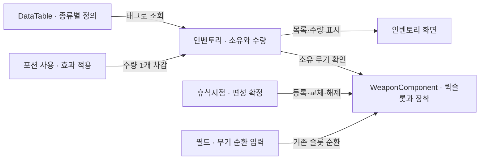

# 플레이어 인벤토리와 휴식지점 무기 편성

2026-11-18 · Maverick / Unreal Engine 5.8 · 구현 전 설계안

플레이 중 `I`를 누르면 첨부 화면처럼 왼쪽에 메뉴가 열리고, 첫 항목인 인벤토리를 선택하면 소지품을 볼 수 있다
검을 획득하면 소지품 목록에 추가된다. 그 검을 무기 퀵슬롯에 넣는 일은 휴식지점에서만 할 수 있다
**첫 구현 단위는 두 화면의 이식과 왕복이다**. 실제 소지품 연결 전에도 화면과 조작을 따로 확인할 수 있다

## 1. 화면과 조작

| 상태 | 플레이어가 보는 것과 할 수 있는 일 |
|---|---|
| 필드 | `I` 한 번에 왼쪽 메뉴 열기. 세계·적·전투 시간은 계속 진행 |
| 왼쪽 메뉴 | 원본 순서대로 Inventory, Equipment, Item Crafting, Status, System 표시. Inventory에 첫 초점. 나머지 네 항목은 어둡게 표시하고 마우스·키보드·패드로 실행하거나 초점을 옮길 수 없게 처리 |
| 인벤토리 | 전체·무기·포션·기타 분류, 소지품 목록, 선택한 아이템의 그림·이름·설명·수량 표시. 무기는 퀵슬롯 번호와 현재 장착 여부를 표시할 수 있음. 슬롯에 넣기·해제·직접 장착·버리기 동작은 제공하지 않음 |
| 돌아가기 | 인벤토리에서 뒤로 가면 왼쪽 메뉴의 Inventory에 초점 복귀. 왼쪽 메뉴에서 뒤로 가거나 어느 페이지에서든 `I`를 누르면 게임으로 복귀 |
| 피격 | 어느 페이지에서든 현재 플레이어에게 피격이 전달되면 메뉴 전체를 닫음. 치명타로 사망 화면도 열리는 경우에는 사망 화면이 입력을 이어받음 |
| 휴식지점 | 기존 거점 메뉴에서 별도 ‘무기 퀵슬롯’ 화면 진입. 소유 무기를 슬롯에 등록·교체·해제. 필드에서는 이미 넣어 둔 무기 사이의 순환만 허용 |

첫 버전의 인벤토리는 **열람용**으로 설계한다. 필드에서 `Tab`을 누르면 기존처럼 퀵슬롯의 무기를 순환하고, 숫자 `1`을 누르면 포션을 마신다
피격 기준은 실제 체력이 줄었는지와 관계없이 **플레이어에게 전달된 적중**이다. 빗나간 공격, 다른 대상의 피격, 단순 체력 회복·비용 지불은 닫기 조건에서 제외한다

## 2. 가져올 UI와 이식 방법

원본 프로젝트는 `I:/Workspace/Unreal/Framework-testbed/FrameworkTest`. 아래 경로는 원본의 `/Game/SoulslikeFramework/Widgets/` 기준

| 원본 자산 | Maverick 적용 |
|---|---|
| `HUD/W_GameMenu`, `HUD/W_GameMenu_Button` | 첨부 화면의 세로 메뉴와 각 버튼. 다섯 아이콘, 순서, 선택 강조, 반투명 배경, 하단 키 안내의 배치 재사용 |
| `Inventory/W_Inventory` | 분류·목록·상세 영역의 배치와 장식 이식. 이름·수량·상세 내용은 Maverick이 공급 |
| `Inventory/W_InventorySlot`, `Inventory/W_Inventory_CategoryEntry` | 아이템 칸과 분류 선택의 외형을 재사용. 선택 시 같은 화면의 상세 정보 갱신 |
| `Inventory/W_InventoryAction`, `Inventory/W_InventoryActionAmount`, `Inventory/W_Inventory_ActionButton` | 원본의 행동 선택·수량 입력용 자산. 첫 버전의 위젯 트리와 입력 경로에서 제외 |

1. 원본 에디터에서 두 상위 위젯의 참조 뷰어를 **각각** 열어 글꼴·아이콘·재질·자식 위젯을 확인한다. 원본 패키지에는 `W_Navigable`, `BPI_Controller`, `AC_InventoryManager`, `PDA_Item` 등 원본의 조작·게임 상태를 전제로 하는 참조도 들어 있다
2. 원본을 보존한 작업 사본에서 화면 배치·장식을 복제한다. 게임 상태를 읽는 바인딩, 원본 입력 판독기, 원본 HUD·장비·아이템 관리자로 가는 호출은 떼어 낸다. 원본 부모의 변수가 얽힌 위젯은 Maverick용 새 위젯에 디자이너 배치를 옮겨 같은 모양을 유지한다
3. 정리한 위젯과 필요한 시각 자산만 에디터의 `Asset Actions > Migrate`로 Maverick의 `Content`에 이식한다. 최종 위치는 `/Game/UI/Inventory`로 정리한다. 기존 `/Game/UI/LevelUp`의 Liberation Serif·Optimus Princeps, 공용 배경 재질·아이콘은 모양이 맞는지 대조해 재사용한다
4. Maverick의 CommonUI 창 하나에 왼쪽 메뉴와 인벤토리 페이지를 둔다. CommonUI는 어떤 창이 입력과 초점을 받을지 관리한다. 뒤의 체력 표시 등은 기존 Maverick HUD를 사용한다. 키 안내도 현재 조작에 맞춰 표시한다

**이식 완료 기준** — Maverick 단독 실행에서 두 페이지가 열리고 원본과 배치·글꼴·선택 강조가 맞는다. 위젯 컴파일 오류, 누락된 시각 자산, 원본 게임 관리자에 대한 실행 의존성이 없어야 한다. 시험용 빈 목록은 이 단계의 정상 화면이다

이식 도구의 자산 보고서와 참조 확인 방법은 Epic 문서를 따른다. [자산 이식](https://dev.epicgames.com/documentation/en-us/unreal-engine/migrating-assets-in-unreal-engine) · [참조 뷰어](https://dev.epicgames.com/documentation/en-us/unreal-engine/reference-viewer-in-unreal-engine)

## 3. 아이템 정의와 소유권

| 책임 | 현재 근거 | 설계 |
|---|---|---|
| 아이템 정의 | [FMVItemTableRow](../../Source/Maverick/Public/Tables/MVItemTableTypes.h)에 `ItemTag`, `ItemType`, `DisplayName`, `Description`, `Icon` 존재 | 한 종류당 하나의 정확한 태그를 사용. 예를 들어 `Item.HealingPotion.Basic`은 기본 회복약. 행 이름은 표 안의 위치, 분류는 목록 필터에 사용 |
| 종류별 수치 | [무기 행](../../Source/Maverick/Public/Tables/MVWeaponTableTypes.h)과 [회복약 행](../../Source/Maverick/Public/Tables/MVHealingPotionTableTypes.h)이 공통 행을 상속 | 무기 공격력·메시, 포션 회복량·기본 수량·최대 수량은 해당 행에서 읽음. 일반 아이템은 공통 행 사용. 같은 아이템 정보를 다른 표에 재입력할 필요 없음 |
| 실제 소지품 | [UMVWeaponComponent](../../Source/Maverick/Components/MVWeaponComponent.cpp)의 `OwnedWeapons`, [UMVPlayerConsumable](../../Source/Maverick/Character/PC/Consumable/MVPlayerConsumable.cpp)의 `HealingPotionState.CurrentCount`에 나뉘어 있음 | 새 `UMVInventoryComponent`가 소유 태그와 수량을 관리. 무기는 태그당 1개, 포션·일반 아이템은 같은 태그의 수량을 합침. UI와 HUD는 변경 알림을 받고 다시 조회 |
| 전투 중 무기 | 무기 컴포넌트가 `QuickSlotWeaponTags`, `ActiveQuickSlotIndex`, `CurrentWeaponState`, `CycleWeapon` 소유 | 슬롯의 태그는 인벤토리 소유 무기를 참조. 슬롯 순서·활성 위치·장착 전환·메시·공격·스킬·패시브는 무기 컴포넌트 담당. 맨손은 내부 기본 장착 상태로 유지 |
| 포션 사용 | `ApplyHealingPotionEffect`에서 회복·차감, [필드 전환](../../Source/Maverick/System/MVFieldTransitionSubsystem.cpp)에서 기본 수량 복구 | 사용 가능 판정·애니메이션·회복은 소비 모듈 담당. 효과가 적용될 때만 인벤토리에서 1개 차감. HUD와 가방은 같은 수량을 읽고, 휴식·부활 시 기존 보충 규칙을 적용 |

- **정의 조회** — [UMVTableManager](../../Source/Maverick/Public/Tables/MVTableManager.h)에 등록된 가방 대상 테이블에서 한 번 `ItemTag → 테이블·행` 색인을 만든다. 대상은 플레이어 무기표 `DT_Weapons_Player`, 회복약 표 `DT_Items_Consumable`, 일반 아이템 표다. 테이블을 다시 읽으면 색인도 갱신한다. 태그 누락·중복, 행 유형 불일치는 테이블과 행 이름을 보고하고 잘못된 항목의 지급을 거절한다
- **수량** — 무기 중복 획득은 거절하고 장착·슬롯은 그대로 둔다. 포션은 기존 최대 수량을 지킨다. 일반 아이템은 양수 수량만 허용하며 수량이 0이면 소지 목록에서 제거한다. 기본 회복약은 0개여도 고정 HUD에 빈 상태를 표시하고 보충 시 같은 태그의 수량을 되살린다
- **기존 호출** — 소유 조회·획득을 쓰는 Blueprint와 스킬·패시브 선택 창은 인벤토리에 위임하거나 직접 구독하도록 옮긴다. `GetOwnedWeapons`가 필요하면 인벤토리에서 얻은 무기 행만 반환한다. `OnOwnedWeaponsChanged`는 실제 무기 보유가 바뀐 뒤 한 번 전달한다
- **기본 장비와 NPC** — 기존 무기 컴포넌트가 붙는 캐릭터에는 같은 소유 자료를 연결해 NPC 기본 장착 경로도 유지한다. 플레이어만 가방 화면·포션·개인 저장을 사용한다. 캐릭터 기본 클래스는 컴포넌트 연결만 담당한다

## 4. 입력·피격과 휴식지점 권한

`IMC_DefaultLocomotion`에 게임 메뉴를 여는 입력 동작을 추가하고 `I`에 연결한다. 기존 `Tab`은 무기 순환(`IA_WeaponSwap`), 숫자 `1`은 회복약 사용을 담당한다

| 경로 | 구현 규칙 |
|---|---|
| 메뉴 열기 | 필드에서 `I`를 처음 누른 순간에 한 번 연다. 메뉴가 열리면 CommonUI 창이 확인·뒤로·닫기를 받는다. 키를 뗐다가 다시 `I`를 누르면 닫는다 |
| 열린 동안 | [UMVUISubsystem](../../Source/Maverick/UI/System/MVUISubsystem.h)의 기존 창 계층을 사용한다. 메뉴 수명 동안 [입력 관리자](../../Source/Maverick/Components/MVInputManagerComponent.cpp)의 게임 입력 차단을 한 번 얻어 이동·시점·공격·무기 순환 입력이 새지 않게 한다. 일시정지·시간 배율·적 AI는 건드리지 않는다 |
| 강제 종료 | 창을 연 플레이어의 [OnDamaged](../../Source/Maverick/Character/MVCharacterBase.cpp)를 구독한다. 체력이 실제로 줄어야 발생하는 `OnDamageApplied`만으로는 피해량 0의 적중을 놓친다. 사망·필드 전환·조종 대상 변경에도 같은 종료 경로를 사용한다 |
| 입력 복구 | 닫는 중 다시 피격되어도 구독·차단을 한 번만 해제한다. 누적된 행동 입력을 비우고, 남은 상위 창 또는 게임으로 초점·커서·조작을 돌린다. 사망·로딩·거점 등 다른 창이 입력을 차지한 동안 `I`로 새 창을 겹쳐 열지 않는다 |
| 슬롯 편성 | [UMVRestPointSubsystem](../../Source/Maverick/Interaction/RestPoint/MVRestPointSubsystem.cpp)의 현재 플레이어·거점·활성 편성 화면을 확인한다. 등록·교체·해제 **확정 순간**에도 거리·세션·`CanUseDetail()`을 검사한다. 거점 가까이 서 있기만 하거나 이미 닫힌 창에서 요청하면 상태 변화 없이 거절한다 |
| 무기 컴포넌트 경계 | 공개된 `SetQuickSlotWeapon`·`ClearQuickSlotWeapon`의 Blueprint 우회 호출까지 차단한다. 기존 `BP_ThirdPersonCharacter` 참조도 함께 정리한다. 슬롯 범위·소유·중복·행동 중 제한과 장착 실패 시 원상 복구는 무기 컴포넌트에 유지한다 |

새 게임 기본 배치, 저장 복원, 소유권 상실로 인한 무효 슬롯 정리는 내부 경로다. 일반 가방 화면에는 슬롯 변경 호출을 연결하지 않는다
소유한 무기를 시스템이 회수할 때는 연결된 슬롯도 비우고, 손에 들고 있었다면 맨손으로 전환한다. 소유·슬롯·장착 상태를 함께 반영한 뒤 저장과 알림을 보낸다

## 5. 저장과 이전 버전 호환

설계 당시 [무기 저장 코드](../../Source/Maverick/Components/MVWeaponProgressSave.cpp)는 소유 무기·슬롯·장착·스킬·패시브를 복원했다. 당시 [월드 저장](../../Source/Maverick/System/MVWorldStateSubsystem.cpp)은 4버전이었으며, 인벤토리 소유권 이전과 함께 5버전으로 변경

1. 다음 저장 형식에 인벤토리 기록 유무와 태그별 수량을 추가한다. 무기 진행 기록에는 퀵슬롯·현재 장착·스킬·패시브를 둔다. 한 번의 저장에 두 상태가 같은 시점의 값으로 들어가게 한다
2. 옛 4버전의 `WeaponProgress.OwnedWeapons`는 기존 테이블·행과 태그를 대조해 각 무기 1개로 변환한다. 옛 저장에 없는 포션 수량은 기존 기본값으로 한 번 초기화한다. 인벤토리 기록이 이미 있으면 **빈 가방도 그대로** 복원한다. 이전 형식은 기존 버전별 승격 규칙을 먼저 따른다
3. 정의 색인 준비 → 소지품 복원 → 퀵슬롯 검증 → 현재 장착과 스킬·패시브 복원 → HUD·창 갱신 순서로 적용한다. 새 게임만 기본 무기를 지급한다. 옛 저장에 유효한 무기 진행 기록이 있으나 소유 목록이 비어 있으면 버린 검을 되살리지 않는다
4. 없어진 정의·중복 슬롯은 이유를 남기고 해당 항목만 제외한다. 유효한 나머지 항목은 살리고 장착할 수 없으면 맨손으로 복귀한다. 복원 중간에는 자동 저장하지 않는다. 저장 실패 뒤 재시도하거나 같은 기록을 두 번 읽어도 수량이 늘지 않아야 한다

## 6. 단계별 구현과 완료 기준

| 단계 | 구현 단위 | 완료를 판단할 장면 |
|---|---|---|
| 1. UI 우선 이식 | 왼쪽 메뉴와 인벤토리의 실제 배치·그림을 옮기고 Maverick 창에서 연결. 빈 목록과 표시 확인용 표본 사용 | Maverick에서 두 화면을 왕복. 네 개의 비활성 항목은 클릭·확인 키 모두 무반응. 누락된 글꼴·그림·원본 관리자 호출 없음 |
| 2. 필드 입력과 피격 | `I`로 메뉴 열기·닫기, 입력 차단·복구, 현재 플레이어 피격 구독 | 필드에서 `Tab`은 무기만 순환하고 메뉴를 열지 않음. 메뉴가 열린 동안 적은 계속 움직이고 공격함. 두 페이지 모두 피격 시 닫힘. `I` 연타·치명타·필드 전환 후 뒤늦은 공격이나 중복 창 없음 |
| 3. 아이템과 가방 | 태그 색인, 소유·수량·변경 알림, 실제 목록·상세 연결. 무기·포션·재료 각 한 종류로 시작 | 실제로 획득한 항목만 표시. 같은 재료 획득 시 수량 합산, 중복 무기·잘못된 태그 거절. 빈 분류·빠진 그림에서도 탐색과 닫기 가능 |
| 4. 무기·포션 소유 이전과 저장 | 무기 소유 조회·획득·회수, 포션 차감·보충, HUD, 저장을 함께 전환. 기존 Blueprint의 필드 편성 호출을 차단하고 스킬 선택·NPC 기본 장비 호출 갱신 | 검 획득으로 슬롯이 바뀌지 않음. 포션이 3개일 때 한 병을 마시면 가방과 HUD 모두 2개 표시. 새 게임·4버전·빈 가방·게임 재시작·부활에서 수량, 슬롯, 장착, 스킬·패시브 일치 |
| 5. 휴식지점 편성 | 기존 거점 상세 목록에 무기 퀵슬롯 편성 추가. 확정 경로에서 세션과 소유권 재검사 | 검을 필드에서 획득해 가방에서 확인 → 거점에서 슬롯에 넣기 → 필드에서 순환 장착. 가방·거점 밖 직접 호출·거점 이탈 직후에는 슬롯이 바뀌지 않음 |
| 6. 통합 검증 | Windows 에디터 빌드, 저장·소유·권한 자동 검사, 에디터 플레이(PIE)에서 실제 입력·피격·복원 확인 | 아래 시나리오 재현. 새로 만든 UI만 닫히는지와 기존 전투·휴식·회복약·패시브 화면까지 확인 |

**통합 확인 장면**

- 적 앞에서 `I` → Inventory → 검 상세. 열린 상태에서 `Tab`을 눌러도 장착 무기는 그대로이고 적 이동·공격과 전투 타이머는 진행. 일반 피격·피해량 0인 적중은 닫히고, 빗나감·다른 대상 피격에는 열린 상태 유지
- 무기 A 장착 중 B 획득 → 가방에서 B 선택·반복 확인. 현재 손의 무기와 두 슬롯 그대로. 거점에서 B 등록 뒤 필드에서 순환. 거점 이탈·피격과 편성 확정이 겹치면 만료된 요청 거절
- 포션 사용 성공·효과 적용 전 취소·0개 사용·휴식·부활 후 가방과 HUD 수량 대조. 일반 재료 수량은 휴식으로 바뀌지 않음
- 옛 저장의 기본 검을 버린 상태, 빈 활성 슬롯, 무효 행을 각각 복원. 다시 저장하고 두 번 읽어도 같은 결과. 다른 저장 슬롯을 열면 이전 캐릭터의 가방·구독이 남지 않음
- 메뉴에서 치명타를 맞으면 사망 화면이 유지되고, 전환 뒤 이동·카메라·공격이 복귀. 새 메뉴 반복 열기, NPC 무기와 기존 스킬·패시브 선택 창의 보유 무기 조회도 확인

### 설계 당시 조사 범위

Windows Codex에서 두 프로젝트의 자산 파일, 원본 위젯에 기록된 참조명, 기본 입력표의 키 연결, Maverick의 C++ 소유·저장·피격·거점 코드를 대조했다
원본 위젯의 전체 참조는 1단계에서 에디터로 확인한다. 위젯 이식·빌드·PIE는 설계 범위에 따라 이번에 실행하지 않았다

## 7. 통합 검증 결과

2026-11-19 · Windows 11 / Unreal Engine 5.8.1 / Win64 Development Editor

| 실행 | 확인 범위 |
|---|---|
| TestMap 에디터 플레이 정상 종료 41개 확인 | `I` 반복·열기·닫기, 게임패드 확인·뒤로, 가방을 보는 동안 적 공격 애니메이션과 월드 시간 진행, `Tab` 차단, 거점에서 슬롯 편성 후 필드 순환, 포션·HUD·휴식·사망·부활, 옛 저장과 빈 가방 |
| TestMap 에디터 플레이 강제 종료 37개 확인 | 휴식 로딩에서 돌아갈 거점이 닫혀도 게임 초점과 `Tab`·`I`가 복구되는 경로를 다시 실행 |
| 새 에디터 프로세스에서 같은 시험 저장 재실행 3개 확인 | 5버전 저장의 두 슬롯, 가방과 장착 무기, 포션·재료 수량과 HUD 복원 |
| 에디터 명령줄 회귀 검사 15개 | 기존 UI 입력, 무기 스킬·패시브, 투사체 실행, 보스 등장과 저장 |

- 인벤토리에서 초점을 가진 항목에 CommonUI 확인 동작을 전달
- 창 스택은 전환 대상이 제거되면 아래쪽 화면으로 복귀
- `TestMap`의 공중 피격 시험을 `Alt+1`로 옮겨 포션 `1`과의 충돌 해소. 두 키 조합 모두 실행 확인
- 키보드·게임패드는 Slate 입력 사건으로 검증. 실물 기기 조작과 적의 자율 경로 선택은 실행하지 않음
- `ST_ShootingTarget`의 기존 동작 트리 초기화 오류는 이번 인벤토리 검증과 별개
