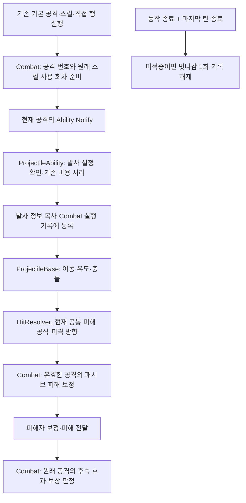

# 투사체의 현재 전투 시스템 연결 설계

- 작성일: 2026-10-27
- 상태: 기존 `AMVProjectileBase`를 현 전투 구조에 연결하는 1~5단계 코드·자산 작업 완료. 사용자 Windows Editor 빌드·자동화 시험·Q 발사와 적중 성공. 실제 패시브 자원 변화와 무기 교체 등 일부 경계 시험은 남음
- 범위: 공용 `UMVProjectileAbility`·`AMVProjectileBase`와 Combat·HitResolver·선택형 패시브 연결
- 사용자 결정: 무기·패시브 교체 후에도 이미 발사한 탄의 기본 피해 유지, 발사자 사망 후에도 이미 발사한 탄은 계속 비행하고 기본 피해 적용
- 작업 분담: Agent는 승인된 C++·문서 작업, 사용자는 Unreal Editor 자산 수정·빌드·PIE 실행

## 1. 설계 당시 확인한 상태

`AMVProjectileBase`와 발사·충돌·유도 기능은 이 작업 전에 이미 있었다. 아래 표는 새 발사체를 만들기 전 조사가 아니라, 기존 발사체를 바뀐 전투 구조에 연결하기 전의 차이 조사다

| 구간 | 현재 코드와 자산에서 확인한 내용 | 설계 판단 |
|---|---|---|
| 공격 진입 | 기본 공격은 `BasicAttackMap`, Q/W/E/R은 `SkillMap<EMVSkillSlot, FMVSkillEntry>`, 직접 행 실행은 `DirectActionEntry` 사용 | 새 진입 경로 유지, 원거리 전용 입력 체계 추가 불필요 |
| 발사 | `TryBuildLaunchContext` → 부모 Ability의 비용 처리 → 지연 생성 → 초기화 → Combat 등록 → 충돌 활성화 | 현재 순서 유지, 실패·중복 Notify·실행 출처 검증 보강 |
| 발사 정보 | `FMVProjectileLaunchContext`에 공격 번호·무기 공격력·공격 종류·계수·강인도 피해·피격 설정 복사 | 이미 있는 정보 재사용, 적중 때 새 무기나 새 스킬 값을 읽지 않음 |
| 지연 적중 | Combat에 `FMVProjectileExecutionRecord`와 원본 Ability의 실행 값 사본 `ExecutionAbility` 존재 | 새 추적 시스템을 만들지 않고 기존 기록 확장 |
| 패시브 교체 | 공격과 투사체 기록에 `PassiveActivationId` 보관, 패시브 행동에서 현재 적용 번호와 비교 | 기존 차단 규칙 유지, 실제 투사체 경로 검증 추가 |
| 피해 보정 | `ApplyOutgoingAttackDamageModifiers`와 월광·파멸의 무게 구독은 존재하지만 현재 Resolver에서 호출하지 않음 | 방어·치명타 계산 뒤, 피해자 보정 전에 연결 필요 |
| 피격 방향 | 투사체는 `IncomingDirection`을 채우지만 Resolver는 공격자→피격자 수평 방향 사용 | 현재 develop의 공통 방향 계약 유지, 옛 투사체 방향 시험 수정 |
| 쿨타임 환원 | `RefundSkillMainCooldownForExecution`이 현재 Ability와 현재 공격 번호를 요구 | 동작 종료 후 적중에서는 원래 쿨타임을 찾도록 수정 필요 |
| 환원 중복 | 포식자의 순환은 마지막 환원 공격 번호 한 개만 기억, 쿨타임 환원 실패와 무관하게 MP 회복 | A 적중→B 적중→A 재적중에서도 공격별 1회만 허용, 부분 환원 방지 |
| 빗나감 | Ability 종료 때 미적중을 기록하고 동작 종료·모든 탄 종료 후 확정 | 여러 Notify·발사 실패·직접 행 실행도 같은 종료 규칙을 따르도록 보강 |
| 사망 | 현재 사망 처리는 R 게이지 초기화, 투사체는 발사자 Actor가 유효하면 계속 비행 | 사용자 결정에 따라 비행 유지, 사망·부활을 넘는 후속 보상만 차단 |
| 시험 자산 | 시험 Ability·발사체·몽타주 파일 존재, 시험 몽타주에는 옛 `ANS_ActiveAbility` 참조가 저장됨 | 새 Notify와의 연결은 Editor에서 확인·정리 |

피격 방향의 현 계약은 [Hit·Stat·HitReaction 위키](../wiki/Features/Hit-Stat-HitReaction/document.md)의 방향 계산 절과 일치
`OnHitConfirmed` 연계는 [스킬 위키](../wiki/Features/Combat/Skill/document.md)의 Ability 활성 구간 제한을 유지

## 2. 목표 흐름과 책임

| 소유자 | 맡을 내용 |
|---|---|
| Combat | 원래 공격 식별, 스킬 사용 회차, 연계·쿨타임, 투사체 기록 수명, 후속 사건 허용 여부 |
| ProjectileAbility | 발사 위치·방향·대상 선택, 비용 처리 호출, 발사 생성·등록 |
| ProjectileBase | 이동·유도·관통·중복 충돌 차단, 공통 적중 요청, 종료 통지 |
| HitResolver | 현재 방어·치명타·강인도 공식과 피격 전달 순서 |
| 패시브 행동 | 선택된 패시브의 발동 조건·확률·중첩·표식 처리 |

## 3. 공격 정보 보관

기존 `FMVProjectileExecutionRecord`를 확장하고 새로운 전역 관리자나 투사체용 스킬 체계는 추가하지 않음
이름은 구현 시 기존 심볼과 대조하되, 아래 의미와 갱신 시점은 유지

| 보관값 | 의미·갱신 시점 |
|---|---|
| `AttackInstanceId` | 실제 한 번의 공격 시도 번호, 새 공격을 시작할 때 갱신 |
| `SourceSkillSlot` | 원래 `EMVSkillSlot`; 기본 공격·직접 행 실행은 `NONE`, 기본 공격 여부는 별도 보관 |
| `SourceRowHandle`, `SourceChainStageIndex` | 발사 공격의 행과 연계 단계 |
| `SourceSlotRevision` | 슬롯의 스킬 구성 버전, 다른 스킬 장착·무기 맵 재생성 때 갱신 |
| `SourceSkillUseId` | 같은 스킬 한 번 사용의 번호, 하나의 연계와 같은 단계 재시도 동안 유지, 다음 새 사용 때 갱신 |
| `SourceWeaponItemTag` | 공격을 준비한 무기 아이템; 발사 시 복사한 무기와 다르면 발사 거절 |
| `PassiveActivationId` | 기존 패시브 적용 번호, 선택 교체·무기 교체 전 공격을 새 패시브에서 제외 |
| `SourceLifeId` | 발사자의 생존 회차, 사망 시 Combat의 현재 회차 갱신; 부활 후에도 옛 탄의 보상 차단 |
| 환원 처리 여부 | 해당 공격이 포식자의 순환 환원을 이미 받았는지 기록; 다른 공격 번호가 사이에 들어와도 유지 |

`ExecutionAbility` 사본은 기존 명중 사건의 Ability 인수와 발사 당시 행·실제 소모 MP를 전달하는 용도로 유지
새 슬롯 판정은 `EMVSkillSlot`으로 수행하고 기존 숫자형 API가 필요한 호출부에는 명시적 변환만 제공; 전역 일괄 치환 제외

무기 공격력·공격 계수·일반/스킬 공격 구분은 발사 때 고정
피해자의 방어·무적·생존 상태와 공통 치명타 계산은 현재 HitResolver의 적중 시점 규칙 유지; 전체 스탯을 별도로 복제하지 않음

## 4. 적중 뒤 처리 규칙

다음 표는 설계 기준이다. 실제로 확인한 시나리오와 남은 시험은 10절에 구분한다
발사자 Actor가 존재하고 피격 대상이 공통 충돌 조건을 통과한 상황을 전제

| 상황 | 기본 피해 | 행의 `OnHitStatusEffects` | 적중 MP·R 게이지 | 선택 패시브 | 연계 전진·쿨타임 환원 |
|---|---|---|---|---|---|
| 원래 동작·무기·패시브 유지 | 발사 정보로 처리 | 발사 행 설정 사용 | 기존 적중 규칙 적용 | 기존 조건에 따라 허용 | 원래 실행 검사 후 허용 |
| Ability 종료 뒤 적중 | 유지 | 유지 | 같은 생존 회차에서 허용 | 같은 무기·패시브 적용 번호면 허용 | 연계 전진 불가, 쿨타임 환원은 원래 사용 회차가 유효하면 허용 |
| 다른 공격 시작 뒤 옛 탄 적중 | 유지 | 유지 | 같은 생존 회차에서 허용 | 원래 패시브 번호가 같으면 기존 조건에 따라 허용 | 새 공격의 연계·쿨타임을 건드리지 않음 |
| 무기 또는 패시브 교체 | 유지 | 발사 행 설정 유지 | 같은 생존 회차에서 기존 규칙 적용 | 옛 탄으로 새 패시브 발동 금지 | 원래 슬롯·사용 회차 검증, 새 장착 스킬 환원 금지 |
| 발사자 사망 이후 | 유지 | 적용하지 않음 | 적용하지 않음 | 적용하지 않음 | 적용하지 않음 |
| 사망 전 탄이 부활 후 적중 | 유지 | 적용하지 않음 | 적용하지 않음 | 적용하지 않음 | 적용하지 않음 |
| 발사자 Actor 파괴·월드 종료 | 기존 종료 경계에 따라 정리 | 없음 | 없음 | 없음 | 없음 |

사용자가 확정한 사망 이후 동작은 비행·기본 피해 유지
사망 이후 후속 보상 차단을 구현했으며, 사망해도 Actor가 남는 경우와 Actor 자체가 파괴되는 경우를 구분
공통 적중 사실의 통지는 유지하면서 Combat의 자원·행 상태 효과 처리와 패시브 행동의 적용 조건을 각각 검사

### 피해 계산 연결

1. `BuildResolvedHitData`에서 현행 무기 피해·일반/스킬 방어·치명타·강인도 계산
2. `ResolveAttackHit`에서 `ApplyOutgoingAttackDamageModifiers` 호출
3. `DispatchResolvedHit`에서 피해자의 받는 피해 보정 후 기존 사건·피해 전달

강인도 특수 구간의 `BuildResolvedHitData` 조기 반환도 2번을 통과하도록 호출 위치를 함수 바깥에 둠
`ResolveDirectDamage`에는 공격 피해 보정을 다시 넣지 않아 트리플 볼트의 추가 피해가 원래 공격으로 중복 집계되지 않게 함

### 연계와 환원

- `OnHitConfirmed`: 현재 활성 Ability·공격 번호·슬롯·단계·입력 창이 모두 일치할 때만 전진
- 입력 창 연장이나 종료된 Ability의 연계 부활 없음; 오래된 탄은 피해만 적용 가능
- 지연 환원: 슬롯 구성 버전과 스킬 사용 회차가 같으면 동작이 끝난 뒤에도 그 사용의 주 쿨타임 환원 가능
- 같은 슬롯을 이미 새로 사용했거나 다른 스킬로 바꿨다면 옛 공격의 환원 거절
- 포식자의 순환은 조건 확인·확률 판정 뒤 공격별 환원 권한을 먼저 소비하고 MP·쿨타임 처리; 처리 중 재진입에도 중복 불가
- MP만 회복하고 쿨타임 출처 확인에 실패하는 부분 성공 제거; 원래 주 쿨타임이 0이거나 이미 끝난 경우는 쿨타임 변경이 필요 없는 유효한 사용으로 처리
- 게이지 방식 R 제외와 실제 지불한 MP 상한은 기존 규칙 유지

### 빗나감·발사 실패

- 하나의 동작에 서로 다른 발사 Notify가 여러 개 있으면 여러 탄을 허용하고 비용은 기존 `bAbilityCostConsumed`로 1회 처리
- 같은 활성 Notify의 중복 시작은 추가 발사·추가 비용 없이 종료
- 동작 또는 발사 기회 종료와 마지막 탄 종료가 모두 확인되고 유효 명중이 없을 때만 빗나감 1회 발행
- 아직 발사하지 못한 설정 오류·생성 실패는 빗나감과 구분해 원인을 기록; 0발을 적 미명중으로 계산하지 않음
- 발사 뒤 동작이 끊겨도 이미 나온 탄은 계속 처리; 뒤에 올 발사 Notify는 이전 실행으로 새 탄을 만들 수 없음
- 발사자 사망 뒤 도착한 Notify는 새 탄을 만들지 않으며, 사망 전에 등록된 탄만 비행 지속
- 기본 공격·스킬·직접 행 실행 모두 종료 통지를 통해 기록 정리; 특정 맵에 Ability가 없다는 이유로 기록을 남기지 않음
- 준비 단계 실패는 비용 소모 전 중단, 비용 지불 뒤 생성 실패의 추가 환급 정책은 이번에 도입하지 않음

## 5. 설계 당시 파일별 변경 계획

아래는 착수 전 계획이다. 실제 수정 파일과 검증 결과는 10절 및 원거리 발사체 위키를 기준으로 확인한다

| 파일 | 변경할 내용 | 확인할 결과 |
|---|---|---|
| `Source/Maverick/Components/MVCombatComponent.h/.cpp` | 기존 실행 기록·스킬 엔트리에 출처 슬롯·구성 버전·사용 회차·생존 회차 추가, 등록·적중·미적중·종료 판단 정리, 현재 Ability 의존 쿨타임 환원 수정 | 동작 종료·다른 공격·무기 교체·사망 뒤에도 원래 공격만 처리 |
| `Source/Maverick/Combat/MVAbilityBase.h/.cpp` | 새 공격 준비 때 확정하는 출처 정보와 공격별 환원 상태를 전달, 기존 비용·종료 동작 유지 | 같은 Ability 객체를 재사용해도 옛 탄 정보 불변 |
| `Source/Maverick/Combat/Projectile/MVProjectileAbility.h/.cpp` | 발사 정보와 원래 실행의 일치 확인, 실패 사유 구분, 등록 전/후 실패 정리, Notify별 발사·동작별 비용 계약 명확화 | 반복 입력·잘못된 소켓·생성 실패에 중복 비용·고아 기록 없음 |
| `Source/Maverick/Combat/Projectile/MVProjectileBase.h/.cpp` | 필요한 추적 로그와 재진입·종료 검증, 사용하지 않는 방향 전달 정리, 발사자 파괴 시 즉시 정리 | 비행·관통·유도 유지, 사망 후 기본 피해 유지, 종료 통지 중복 없음 |
| `Source/Maverick/Combat/MVHitResolverSubsystem.cpp` | 공격자 피해 보정 연결 복구, 새 방향·강인도·방어 공식 유지 | 파멸의 무게·월광 피해 보정 작동, 직접 피해에는 중복 보정 없음 |
| `Source/Maverick/Weapon/Passive/WhipEnergySword/MVPredatorCyclePassiveBehavior.h/.cpp` | 마지막 공격 번호 한 개를 사용하는 중복 방지 제거, 공격별 환원 처리에 위임 | 서로 다른 탄이 번갈아 맞아도 공격마다 최대 1회 환원 |
| `Source/Maverick/Combat/Tests/MVHitResolverMergeTests.cpp` | 패시브를 새 단일 슬롯 경로로 준비, 옛 비행 방향 기대값을 현행 방향 계약에 맞춤 | 시험의 준비 과정·예상 결과가 실제 전투 구조와 일치 |
| `Source/Maverick/Combat/Tests/MVProjectileExecutionTests.cpp` 신규 예정 | 실제 등록→동작 종료→늦은 적중→종료 경로를 임시 월드·시험 행으로 검증 | 실제 활·석궁 제작 전에도 기록 수명과 잘못된 후속 적용 검증 가능 |
| 기존 `MVProjectileCollisionTests.cpp`, `MVProjectileTargetingTests.cpp` | 현재 초기 겹침·자기 자신/아군 제외·유도 대상 시험 재사용, 필요한 경계만 추가 | 이동·충돌·대상 선택의 기존 동작 유지 |

조건부 변경: `MVAnimNotifyState_Ability.h/.cpp`는 이전 몽타주 Notify가 새 실행을 끝내는 현상이 추적으로 확인될 때 실행 식별 검증 보강
같은 클래스 검사만으로 동일 클래스의 이전·다음 실행을 구분할 수는 없으므로, 단순히 Notify 객체에 캐릭터 하나의 상태를 저장하는 방식은 사용하지 않음

`FMVHitResolveRequest`의 옛 방향 속성은 Blueprint 참조 확인 전 삭제하지 않음
`MVProjectileTargeting`의 유도 규칙과 보스 전용 `MVDuelistChainProjectile`의 끌어오기 동작은 공용 원거리 전환의 직접 수정 대상에서 제외하고 공통 Resolver 변경 후 회귀 확인

## 6. 설계 당시 Unreal Editor 확인 대상

아래 표는 착수 전 자산 조사와 제안이었다. 실제 시험에서는 `BP_TestProjectileAbility`가 `BP_TestStraightProjectile`을 발사했고, `Test_OneHand`의 Q 첫 행이 `Yone_Attack.SkillQ`를 거쳐 시험 Ability를 실행했다. 몽타주는 기존 Blueprint `ANS_ActiveAbility`를 사용했다

| 위치 | 현재 확인 범위 | 구현 때 확인·변경할 내용 |
|---|---|---|
| `Content/Characters/Components/Combat/Abilities/BP_TestProjectileAbility` | `MVProjectileAbility` 부모 및 시험 발사체 참조 문자열 존재 | Class Defaults의 `ProjectileClass`, 발사 위치 재정의 또는 `LaunchSocket`, 조준·유도 설정의 실제 값 확인 |
| `Content/Characters/Components/Combat/Projectile/BP_TestStraightProjectile` | `MVProjectileBase` 부모 문자열 존재 | 충돌 반경·채널·이동 속도·관통·수명·유도 실제 값 확인 |
| `Content/ArtAssets/Animations/PC/OneHand/Weapon/Yone/Skills/AM_1H_Yone_SkillA_ProjectileTest` | 옛 Blueprint `ANS_ActiveAbility` 참조 문자열 존재 | Notify 트랙 실제 확인 후 같은 구간을 네이티브 `MV Activate Ability`로 전환, 기존 `AbilityIndex` 확인·보존, `AbilityClass`를 시험 Ability로 제한 |
| `Content/Characters/Components/Combat/Abilities/ANS/ANS_ActiveAbility` | 저장된 부모는 `Engine.AnimNotifyState`, `CurrentAbilityInstance`·Start/End 호출 이름 존재 | 시험 몽타주에서만 새 경로로 전환, 공유 자산을 전체 수정·삭제하지 않음 |
| `Content/Table/Attack/Player/Yone_Attack` | 스킬 행 자료형과 원래 SkillA 몽타주 참조 존재; 시험 몽타주 연결은 확인되지 않음 | 기존 팀원 행 보존, 시험 전용 테이블의 평타·스킬·연계 행으로 시험 Ability·몽타주 연결 |
| `Content/Characters/__Test/Test_OneHand` | `Yone_Attack` 참조 존재 | 시험용 스킬 맵 복사본에서 평타와 Q를 시험 행에 연결, 원래 맵은 보존 |
| `BP_ThirdPersonCharacter`의 WeaponComponent | 이번 설계에서 배열의 현재 값은 Editor로 확인하지 않음 | 시험 맵 사용 전 원래 `WeaponSkillMaps` 값 기록, 검증 후 복원 |

별도 시험 테이블·맵을 만들지 않고 기존 시험 검의 Q 연결로 PIE를 확인했다. 원거리 평타와 최종 활·석궁·채찍 자산의 실행은 확인하지 않았다

## 7. 계획한 구현 순서

아래 단계의 코드 작업은 완료했다. 사용자 실행으로 확인한 범위와 미확인 항목은 10절에 기록한다

| 단계 | Agent 코드 작업 | 사용자 작업·종료 기준 |
|---|---|---|
| 1. 관측과 시험 연결 | `ProjectileCombatTrace`로 준비·발사·등록·Notify 종료·동작 종료·적중·환원·정리 로그 추가 | 현재 시험 자산을 새 진입 경로에 연결, 근거리·원거리 1회씩 실행해 사건 순서 수집 |
| 2. 실행 기록·수명 정리 | 출처 슬롯·사용 회차·생존 회차, 여러 발사·실패·빗나감 정리 구현 | 발사 후 동작 종료·다른 공격·공중 빗나감에서 기록과 비용 확인 |
| 3. 피해 연결 정합성 | 공격자 피해 보정 복구, 현행 방어·강인도·방향 계약 및 관련 시험 정리 | 평타/스킬 방어, 패시브 추가 피해, 피격 방향 확인 |
| 4. 패시브·환원·사망 경계 | 지연 쿨타임 환원, 공격별 중복 방지, 사망 전 탄의 후속 보상 차단 | 무기·패시브 교체, 교차 적중, 사망·부활 시험 |
| 5. 종합 검증과 정리 | 통합 자동화 시험 보강, 확인된 원인의 임시 로그 제거, 실제 결과 기반 위키 갱신 | 사용자 빌드·자동화 시험·PIE, 시험 자산 설정 복원 |

로그 필드: 프레임, 소유자·Combat·탄 이름, 공격 번호, 슬롯·행·연계 단계, 슬롯 버전·사용 회차, 패시브 번호·생존 회차, 남은 탄 수, 비용·적중·종료 상태, 거절 사유
매 Tick 출력 대신 상태 변화 때 출력; 검증이 끝난 임시 로그는 제거

## 8. 검증 기준표

아래는 계획한 기대 결과이며, 모든 행의 시험 통과를 뜻하지 않는다

| 시험 | 기대 결과 |
|---|---|
| 원거리 평타·Q 각각 발사 | 같은 공통 경로, 일반/스킬 방어 구분, 비용은 해당 동작에서 1회 |
| 발사 직후 동작 종료·후속 공격 시작 | 옛 탄의 피해·고유 행 효과는 원래 값, 새 공격의 값·연계는 사용하지 않음 |
| 같은 Ability 객체로 재발사 | 앞선 탄과 새 탄의 공격 번호·무기 정보·지불 MP가 분리 |
| 같은 Notify 중복 및 서로 다른 발사 구간 | 중복 시작은 1발, 의도된 별도 발사 구간은 추가 발사, 동작 비용 중복 없음 |
| 평타 A 발사→패시브 B 선택→적중 | 기본 피해 유지, B 중첩·표식·피해 보정 없음; A→B→A도 동일 |
| 무기 교체 후 적중·같은 스타일 다른 아이템 | 발사 무기 공격력 유지, 새 무기 패시브·새 슬롯 쿨타임에 영향 없음 |
| 늦은 스킬 적중의 포식자 환원 | 원래 사용 회차의 실제 MP·쿨타임 처리, 새 사용 회차에는 영향 없음 |
| 공격 A·B의 탄이 A→B→A 순서로 적중 | 공격별 환원 최대 1회, 관통·다발에도 같은 기준 |
| `OnHitConfirmed` 활성 중/종료 뒤/창 만료 뒤 적중 | 원래 활성 실행·단계·유효 창에서만 연계 전진 |
| 파멸·월광과 트리플 볼트 | 선택된 한 패시브만 보정, 직접 추가 피해의 재귀 발동 없음 |
| 벽·수명 종료·전체 빗나감 | 발사 기회 종료·남은 탄 0일 때 빗나감 최대 1회, 기록 0개 |
| 잘못된 발사 설정·비용 부족·생성 실패 | 사유 확인 가능, 유효하지 않은 탄·중복 비용·미정리 기록 없음 |
| 사망 전 발사→사망→적중 및 부활 뒤 적중 | 탄의 기본 피해 유지, 패시브·MP·R 게이지·행 상태 효과·연계·환원 없음 |
| 발사자 파괴·PIE 종료 | 남은 탄과 실행 기록 정리, 파괴 중 후속 사건 없음 |
| 초기 겹침·자기 자신/아군·관통·유도 | 기존 충돌·대상 선택 계약 유지 |
| 기존 근접·박스 피해·Duelist 사슬 | 공통 Resolver 변경에 따른 피해·피격·끌어오기 회귀 없음 |

자동화 시험은 등록·실행 종료·실제 피해 전달까지 통과하는 통합 경로에 집중
값을 직접 넣고 같은 값을 확인하는 시험으로 지연 적중 처리를 대신하지 않음

## 9. 설계 당시 조사 근거와 한계

- Windows 로컬에서 착수 전 C++·기존 시험·위키·Git 이력·시험 자산 참조 문자열을 읽어 설계. 당시에는 빌드·자동화 시험·PIE를 실행하지 않았음
- Graphify 0.9.38 의존성 확인 성공; 프로젝트 질의 스크립트는 `HostName` 인수 불일치로 갱신 실패, 기존 그래프를 직접 질의하고 현재 소스로 대조
- 착수 전 사용자 빌드와 패시브 선택·교체 확인만으로는 투사체 지연 적중·피해 보정·쿨타임 환원을 증명할 수 없었음
- 자산 문자열은 현재 Editor 속성·그래프 연결·실행 성공의 증거로 사용하지 않음
- 구현 단계에서는 해당 C++ 파일마다 명시적 변경 승인을 받은 뒤 수정

주요 근거 파일: [투사체 Ability](../../Source/Maverick/Combat/Projectile/MVProjectileAbility.cpp), [투사체 Actor](../../Source/Maverick/Combat/Projectile/MVProjectileBase.cpp), [Combat](../../Source/Maverick/Components/MVCombatComponent.cpp), [HitResolver](../../Source/Maverick/Combat/MVHitResolverSubsystem.cpp), [포식자의 순환](../../Source/Maverick/Weapon/Passive/WhipEnergySword/MVPredatorCyclePassiveBehavior.cpp), [기존 피해 시험](../../Source/Maverick/Combat/Tests/MVHitResolverMergeTests.cpp)

## 10. 구현 뒤 확인 범위

- 사용자 Windows Editor에서 최신 코드 빌드 성공, `Maverick.Combat.HitResolver.MergedDamage`와 `Maverick.Combat.Projectile.ExecutionLifetime` 자동화 시험 성공
- `ExecutionLifetime`은 동작 종료 뒤 피해·원래 사용 회차의 주 쿨타임 환원 1회·중복 및 오래된 사용 거절·한 공격의 두 탄 종료 뒤 기록 제거·발사자 사망 뒤 기본 피해와 보상 차단을 확인
- 사용자 PIE에서 시험 Q 발사·적중 성공. 임시 `ProjectileCombatTrace` 로그를 제거한 최신 빌드에서도 같은 결과를 재확인
- `DA_Passive_PredatorCycle.RefundChance=0.1`, 시험 발사체 수명 5초·초기/최대 속도 1200 복원을 사용자 Editor에서 확인
- 실제 패시브 MP 잔량·화면 쿨타임, 비행 중 무기·패시브 교체와 부활 뒤 적중, 발사 실패·복수 Notify·직접 행 실행·선택 패시브 피해 보정의 PIE 결과는 아직 없음
- 시험 코드의 등록·적중·종료 사건과 실제 물리 충돌은 별도 경로다. `ExecutionLifetime` 성공만으로 모든 발사·충돌 자산 연결을 증명하지 않음
- Agent는 사용자 요청에 따라 빌드·Editor 시험·PIE를 직접 실행하지 않았음
