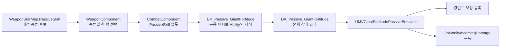

# 거인의 강인함 — 승인된 설계와 구현 단계

- 기록일: 2026-10-30
- 상태: C++ 행동·강인도 보정·네이티브 태그와 Editor 자산 연결 완료, 선택 성공 확인; 실제 수치·경계 검증 보류
- 대상: 대검의 선택형 무기 패시브
- 기획 효과: 강인도 30% 증가, 받는 피해량 15% 증가
- 승인 기준: 권장안으로 구현하고 추후 피드백에 따라 조정
- 진행 순서: 1 / 3 → 다음 [약점 포착](weak-point.md)
- 진행 상태·검증 기록: [순차 구현 작업 메모](../../todo/giant-fortitude-weak-point-iron-wall.md)
- 협업: 에이전트가 C++ 코드를 수정하고, 사용자가 Editor 자산 연결과 빌드·실행 검증 담당

## 승인된 동작

| 항목 | 기준 |
|---|---|
| 활성 조건 | 현재 장착 무기 종류의 선택 패시브가 거인의 강인함인 동안 |
| 강인도 증가 | 기본 강인도와 공격 중 추가 강인도 모두 ×1.30 |
| 받는 피해 증가 | 공통 받는 피해 보정 단계의 체력 피해 ×1.15 |
| 피해 범위 | 평타·스킬, 공통 피해 경로로 들어오는 직접 피해·지속 피해 |
| 피해 보정 제외 | 강인도 피해·그로기 피해·스킬 비용으로 소비하는 체력 |
| 지속·중첩 | 선택·장착 중 상시 유지, 중첩·충전·발동 타이머 없음 |
| 일반 명중·빗나감·피격 | 패시브 유지, 강인도 소모·회복은 기존 전투 규칙 적용 |
| 선택 변경·장착 해제 | 자기 강인도 보정과 받는 피해 사건 구독만 제거 |
| 사망·부활 | 사망 중 피해 보정 제외, 기존 패시브 수명·재적용 경로 준수, 중복 등록 방지 |

## 현재 구조와 연결



- `DT_WeaponPassives`에 전용 행을 추가하고 후보의 `PassiveWeaponTypes`에 대검 종류 태그 지정
- 공용 `UMVStatusEffectPassiveAbility`가 본체 효과의 적용·해제 담당
- 본체 설정: `Infinite`·`OnePerSource`·`NoStack`·`MaxStacks = 1`
- 패시브 행의 HP·스태미너·MP 비용 없음, 연계와 `OnHitStatusEffects` 사용 안 함
- 제거된 `WeaponPassiveComponent`·`WeaponPassiveSet` 경로 사용 안 함
- 새 GameplayTag는 프로젝트의 네이티브 태그 선언·정의 파일에 등록
- 행동·강인도 보정 API·태그 C++와 본체 데이터 자산·Blueprint·패시브 행·시험 후보 연결 완료

## 강인도 계산

`InitialCharacterPoise`는 회복 기준인 기본 강인도, `ConstantPoise`는 소모되는 현재 강인도, `AdditionalPoise`는 공격 중 더해지는 강인도
세 값의 계산·회복·소진 판정이 같은 보정 배율을 사용하도록 `UMVStatComponent`에서 관리

```text
강인도 보정 배율 = 1 + 등록된 강인도 증가율의 합
기본 강인도 = 보정 전 기본 강인도 × 강인도 보정 배율
공격 중 추가 강인도 = 무기 강인도 × 행동 배율 × 강인도 보정 배율
보정 변경 후 현재 강인도 = 변경 전 현재 강인도 × 새 보정 배율 / 이전 보정 배율
```

| 상황 | 결과 |
|---|---|
| 기본 강인도 100, 현재 강인도 40에서 적용 | 기본 130, 현재 52 |
| 위 상태에서 다른 소모 없이 해제 | 기본 100, 현재 40 |
| 보정 전 공격 중 추가 강인도 20 | 적용 중 26 |
| 효과 적용·해제 | 소모량을 초기화하거나 강인도를 완전 회복하지 않음 |

- `AddPoiseModifier`·`RemovePoiseModifier`로 등록별 고유 번호인 `FGuid`를 반환·보관
- 패시브 적용 이전의 전체 수치를 저장해 복원하지 않고, 보정 전 기준값과 현재 남은 상태를 사용해 재계산
- `ConstantPoise`의 음수 상태 보존: 추가 강인도로 버티는 기존 계산을 0으로 강제 보정하지 않음
- `PoiseActionStart`·`PoiseActionEnd`·`SetAdditionalPoise`·`AdjustMinPoise`·`ResetPoise`·`PredictPoiseBreak`·실제 차감 경로에 일관된 최종값 반영
- 기존 회복 지연과 최소 강인도 보장 비율 유지, 보정 변경만으로 회복 타이머 재시작·완료 처리 안 함
- 기본 능력치 재로딩 시 활성 보정을 한 번 반영하고 중복 곱셈 방지

## 보스의 별도 강인도 소진 구간

- `BeginPoiseBreakGroggyWindow`에 전달되는 보스 전용 소진 수치는 고정 규칙 유지
- 해당 구간의 `ConstantPoise`에 일반 강인도 배율을 직접 곱하지 않음
- 구간 중 보정이 바뀌면 종료 시 복원할 일반 강인도 상태에 반영
- `EndPoiseBreakGroggyWindow`의 일반 상태 복원과 저장된 회복 대기 시간 보존
- 보정 변경으로 특수 구간의 소진량·종료 시점이 바뀌거나 해제된 보정이 복원되지 않도록 확인

## 받는 피해 보정과 수명

```text
이번에 받을 체력 피해 = OnModifyIncomingDamage에서 전달받은 체력 피해 × 1.15
```

- 기존 불굴의 의지와 같은 `UMVStatComponent::OnModifyIncomingDamage` 사용
- 본체 효과가 유효하고 피해 대상이 소유자이며 살아 있을 때 한 번 보정
- 체력 피해 100·강인도 피해 20인 입력은 체력 피해 115·강인도 피해 20
- `OnApplied`에서 강인도 보정과 피해 사건 구독 등록, `OnRemoved`에서 자기 핸들·구독만 정리
- 부분 등록 실패 시 이미 등록된 항목도 정리, 반복 해제·소유자 파괴에 안전하게 처리
- 캐릭터 기본 클래스에 패시브 계산을 추가하지 않고 행동·능력치 구성요소의 책임 유지

## 구현 단계

| 단계 | 수정 범위 | 완료 기준 |
|---:|---|---|
| 1 | 본체 행동, 네이티브 태그, 상태 효과·공용 Ability 자식·패시브 후보 | 선택 시 본체 하나 적용, 해제 시 제거 |
| 2 | 강인도 보정 API, 일반 강인도·추가 강인도·회복·소진·특수 구간 복원 연결 | 강인도 증가와 남은 상태 환산, 기존 회복 규칙 유지 |
| 3 | 받는 피해 사건 구독·해제 | 포함 경로의 체력 피해만 ×1.15 |
| 4 | 경계 확인과 임시 로그 정리 | 선택·무기 교체·회복·사망·부활에서 중복과 잔존 없음 |

## 검증 기준

| 확인 항목 | 기대 결과 |
|---|---|
| 반복 선택·해제 | 활성 본체·보정·구독 중복 없음, 다른 보정 유지 |
| 강인도 소모 중 적용·해제 | 위 환산 예시 충족, 무료 완전 회복 없음 |
| 공격 시작·종료·피격·회복 | 추가 강인도와 기본 강인도에 같은 배율, 판정과 차감 일치 |
| 강인도 재로딩·부활 | 활성 보정 한 번 반영, 이전 핸들 잔존 없음 |
| 보스 별도 소진 구간 | 고정 소진 수치 유지, 종료 시 최신 일반 보정 복원 |
| 일반·스킬·직접·지속 피해 | 공통 체력 피해에 15% 증가 |
| 체력 비용·강인도 피해·그로기 피해 | 기존 수치 유지 |

- 구현 시 `GiantFortitudeTrace` 등 전용 임시 로그로 적용·해제·전후 수치 확인 후 정리
- 현재 상태: Windows/Codex에서 C++ 정적 검사 수행; 사용자가 한손 시험 무기의 `SelectPassive = true`를 확인했으나, 강인도 30%·받는 피해 15%와 해제·특수 구간의 실제 수치는 요청에 따라 검증 보류
- 빌드·컴파일·Editor 실행은 사용자 담당이며 에이전트는 수행하지 않음
- 실제 검증 결과는 작업 메모에 기록하고, 구현·검증 후 위키에 실제 동작 반영

## 관련 근거

- [무기 패시브 위키](../../wiki/Features/Combat/Weapon-Passives/document.md)
- [무기 종류별 단일 선택 설계](single-selection.md)
- [능력치·강인도·받는 피해 처리](../../../Source/Maverick/Components/MVStatComponent.cpp)
- [불굴의 의지의 받는 피해 보정](../../../Source/Maverick/Weapon/Passive/TwoHandedShield/MVIndomitableWillPassiveBehavior.cpp)
- [공용 패시브 Ability](../../../Source/Maverick/Combat/Passive/MVStatusEffectPassiveAbility.h)
- [거인의 강인함 C++ 행동](../../../Source/Maverick/Weapon/Passive/GreatSword/MVGiantFortitudePassiveBehavior.h)
