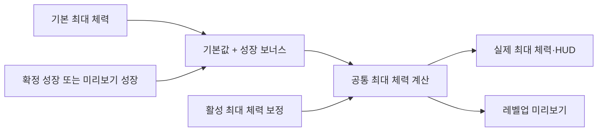

# 철벽 — 승인된 설계와 구현 단계

- 기록일: 2026-10-30
- 상태: 설계 승인·기록 완료, 구현 미착수
- 대상: 양손 방패의 선택형 무기 패시브
- 기획 효과: 방어력 상시 20% 증가, 최대 체력 20% 증가
- 승인 기준: 평타·스킬 방어력 모두 증가, 최대 체력 증가 시 현재 체력 자동 회복 없음, 추후 피드백 반영
- 진행 순서: 3 / 3, 이전 [약점 포착](weak-point.md)
- 진행 상태·검증 기록: [순차 구현 작업 메모](../../todo/giant-fortitude-weak-point-iron-wall.md)
- 협업: 에이전트가 C++ 코드를 단계별로 수정하고, 사용자가 Editor 자산 연결과 빌드·실행 검증 담당

## 승인된 동작

| 항목 | 기준 |
|---|---|
| 활성 조건 | 현재 장착 무기 종류의 선택 패시브가 철벽인 동안 |
| 방어력 | `NormalDefence`·`SkillDefence` 모두 ×1.20 |
| 최대 체력 | 기본 최대 체력과 성장 보너스의 합에 ×1.20 |
| 가드 | 가드 입력·성공 여부와 무관하게 상시 적용 |
| 현재 체력 | 최대값 증가 시 유지, 감소 시 새 상한을 넘는 부분만 제한 |
| 사망 | 최대 체력 재계산으로 현재 체력 0이 회복되지 않음 |
| 유지·해제 | 중첩·충전·타이머 없음, 해제 시 자기 방어력·최대 체력 보정만 제거 |
| 재계산 | 레벨업·기본값 재로딩·무기 교체·패시브 변경 뒤 활성 보정 반영 |

## 현재 구조와 연결

- `DT_WeaponPassives`의 전용 행과 `WeaponSkillMap.PassiveSkill` 후보 등록
- 후보의 `PassiveWeaponTypes`에 양손 방패 종류 태그 지정, 종류별 한 개 선택 유지
- `BP_Passive_IronWall`: 기존 `UMVStatusEffectPassiveAbility`의 자식 Blueprint
- `DA_Passive_IronWall`: `Infinite`·`OnePerSource`·`NoStack`·`MaxStacks = 1`
- `UMVIronWallPassiveBehavior`: 방어력·최대 체력 보정 등록·해제 담당
- 패시브 행의 비용·연계·`OnHitStatusEffects` 없음, 제거된 패시브 세트 경로 사용 안 함
- 새 GameplayTag는 프로젝트의 네이티브 태그 선언·정의 파일에 등록
- 위 이름과 아래 보정 API는 구현할 항목이며 현재 구현 완료를 의미하지 않음

## 방어력 보정

```text
방어력 보정 배율 = 1 + 등록된 방어력 증가율의 합
평타 방어력 = 보정 전 평타 방어력 × 방어력 보정 배율
스킬 방어력 = 보정 전 스킬 방어력 × 방어력 보정 배율
```

- `UMVStatComponent`에 `AddDefenceModifier`·`RemoveDefenceModifier` 형태의 공용 API 추가
- 철벽은 두 방어력에 적용할 증가율 0.20을 등록하고, 반환된 `FGuid`로 자기 보정만 제거
- `SetNormalDefence`·`SetSkillDefence`와 기본 능력치 재로딩에서 보정 전 값과 최종값 구분
- 다른 방어력 보정과 변경된 기본값을 보존하고, 같은 효과를 재계산할 때 중복 곱셈 방지
- 방어력 수치 증가이며 체력 피해에 직접 0.80을 곱하지 않음
- 방어력을 거치지 않는 직접 피해 경로는 기존 처리 유지

| 원래 피해 | 보정 전 방어력 | 철벽 적용 방어력 | 기존 공식의 피해 |
|---:|---:|---:|---|
| 100 | 20 | 24 | 적용 전 90 → 적용 후 88 |

위 예시는 치명타·다른 피해 보정이 없는 `피해 - 방어력 × 0.5` 계산 기준

## 최대 체력과 성장



```text
최대 체력 보정 배율 = 1 + 등록된 최대 체력 증가율의 합
최대 체력 = (기본 최대 체력 + 성장 보너스) × 최대 체력 보정 배율
```

- `AddMaxHPModifier`·`RemoveMaxHPModifier` 형태의 API로 0.20을 등록·해제
- `BaseMaxHP`는 성장 계산의 기준값으로 유지, 철벽 보정을 기본값이나 저장된 성장 투자에 합치지 않음
- 보정 전 최대 체력과 최종 최대 체력을 구분하고 공통 계산 경로에서 활성 보정 반영
- `FMVProgressionStatBinding::TryApplyBonus`와 최대 체력 설정 경로를 연결해 레벨업 시 보정 유지
- 실제 적용과 미리보기가 같은 계산 함수를 사용, 미리보기는 실제 능력치·핸들을 변경하지 않음
- `MVLevelUpWindow::UpdateLevelUpRows`의 단순 `CurrentValue + BonusChange` 계산을 보정이 포함된 후보 최대값 계산으로 연결
- 보정 변경 시 `StatCalculationRevision` 갱신, 열린 미리보기·확정 단계가 오래된 능력치 기준을 사용하지 않도록 처리
- 최종 상한 변경은 기존 `OnHPChanged` 경로로 HUD에 통지, 최소 최대 체력 제한은 기존 정책 유지

| 조건 | 결과 |
|---|---|
| 기본 최대 체력 100 + 성장 보너스 40 | 철벽 적용 중 최대 체력 168 |
| 위 상태에서 성장 보너스 20 추가 | 최대 체력 192, 미리보기·확정 모두 증가량 24 |
| 위 상태에서 철벽 해제 | 최신 성장 보너스 60을 보존해 최대 체력 160 |

## 현재 체력 처리

| 상황 | 변경 전 → 변경 후 |
|---|---|
| 철벽 적용 | `60/100 → 60/120` |
| 철벽 해제, 새 상한 이하 | `60/120 → 60/100` |
| 철벽 해제, 새 상한 초과 | `110/120 → 100/100` |
| 사망 중 적용·재계산 | 현재 체력 0 유지 |

- 현재 체력의 절대값을 유지하고 최대 체력 감소 시 상한만 제한
- 최대 체력 증가·패시브 선택만으로 회복하지 않음
- 상한 제한은 피격·실제 피해 사건으로 처리하지 않으며 피격 기반 패시브를 발동시키지 않음

## 무기 교체 중 한 번 반영

현재 `ApplyEquippedWeaponState`는 무기 아이템이 바뀌면 기존 패시브를 해제하고 같은 종류의 선택을 다시 적용
같은 철벽을 재적용할 때 중간 최대 체력 감소로 현재 체력이 잘리지 않도록 보정 변경을 묶어서 반영

```text
교체 시작: 능력치 보정 변경 묶음 시작
→ 이전 패시브 제거
→ 새 무기 상태와 현재 종류의 선택 패시브 적용
→ 최종 보정 목록으로 최대 체력 한 번 재계산
→ 현재 체력 상한 제한과 변경 통지
```

- `StatComponent`의 공용 일괄 반영 기능과 무기·패시브 교체 경계를 연결
- 같은 철벽을 유지하는 교체에서 `120/120 → 120/120` 유지
- 철벽이 없는 최종 상태로 바뀌면 최종 상한 100에 맞게 `120/120 → 100/100`
- 실제 적용 실패로 최종 슬롯이 비면 보정 없는 최종 상한 반영, 이전 효과가 남지 않도록 정리
- 기존 패시브 적용 번호는 정상 갱신해 이전 무기·지연 공격의 출처 검증 유지
- 반복 선택·일괄 반영 내부의 재계산에서 보정 중복과 불필요한 중간 HP 통지 방지

## 보정 수명과 책임

- 행동은 방어력·최대 체력 보정의 고유 번호만 소유, 전체 능력치의 예전 값을 복원하지 않음
- `OnApplied`에서 보정 등록, `OnRemoved`에서 자기 보정만 제거
- 부분 등록 실패 시 이미 등록된 보정도 정리해 절반만 적용된 상태 방지
- 효과 재적용·소유자 파괴·기본값 재로딩·부활에서 활성 보정 한 번만 반영
- 선택·효과 수명은 기존 무기·전투·공용 Ability가 담당, 수치 계산은 `StatComponent`가 담당
- 캐릭터 기본 클래스나 HUD에 패시브 전용 능력치 계산을 중복 추가하지 않음

## 구현 단계

| 단계 | 수정 범위 | 완료 기준 |
|---:|---|---|
| 1 | 평타·스킬 방어력 보정 API와 기본값 분리 | 두 방어력에 20% 반영, 다른 보정·기본값 유지 |
| 2 | 최대 체력 보정·성장·미리보기·변경 번호 연결 | 성장 포함 20%, 미리보기와 실제 확정 일치 |
| 3 | 본체 행동·태그·상태 효과·공용 Ability 자식·후보 | 선택된 철벽 한 개 적용, 비용·가드 조건 없음 |
| 4 | 교체 중 일괄 반영과 경계 확인·임시 로그 정리 | 같은 철벽 교체 시 HP 손실 없음, 실제 해제 시 상한 제한 |

## 검증 기준

| 확인 항목 | 기대 결과 |
|---|---|
| 평타·스킬 방어력 | 각각 보정 전 값의 1.20배, 방어력 미사용 피해 경로 유지 |
| 최대 체력 증가·감소 | 현재 체력 자동 회복 없음, 감소 시 새 상한 초과분만 제한 |
| 레벨업·기본값 재로딩 | 보정 유지, 성장값 보존, 중복 곱셈 없음 |
| 미리보기·레벨업 확정 | 같은 최종 최대 체력, 보정 변경 시 오래된 미리보기 재계산 |
| 같은 철벽이 선택된 방패 아이템 사이 교체 | 현재 체력·최대 체력 유지, 중간 HP 감소 통지 없음 |
| 다른 패시브로 변경·적용 실패 | 최종 보정 목록에 맞는 상한 반영, 이전 효과 잔존 없음 |
| 반복 선택·해제 | 자기 보정만 제거, 다른 보정 보존 |
| 사망·부활 | 사망 중 0 HP 유지, 부활 경로의 실제 초기 체력 설정 준수, 보정 중복 없음 |

- 구현 시 `IronWallTrace` 등 전용 임시 로그로 보정 전후 방어력·최대/현재 HP·교체 최종값 확인 후 정리
- 기록 시점: Windows/Codex에서 승인된 설계 저장만 수행, 코드·에셋 구현과 게임 동작은 미검증
- 빌드·컴파일·Editor 실행은 사용자 요청에 따라 수행하지 않음
- 실제 검증 결과는 작업 메모에 기록하고, 구현·검증 후 위키에 실제 동작 반영

## 관련 근거

- [무기 패시브 위키](../../wiki/Features/Combat/Weapon-Passives/document.md)
- [무기 종류별 단일 선택 설계](single-selection.md)
- [레벨업 위키](../../wiki/Features/Progression/Level-Up/document.md)
- [방어력·최대 체력·성장 보정](../../../Source/Maverick/Components/MVStatComponent.cpp)
- [성장 수치 연결](../../../Source/Maverick/System/Progression/MVProgressionStatBinding.cpp)
- [레벨업 미리보기](../../../Source/Maverick/UI/Window/MVLevelUpWindow.cpp)
- [무기 교체와 패시브 재적용](../../../Source/Maverick/Components/MVWeaponComponent.cpp)
- [공용 패시브 Ability](../../../Source/Maverick/Combat/Passive/MVStatusEffectPassiveAbility.h)
