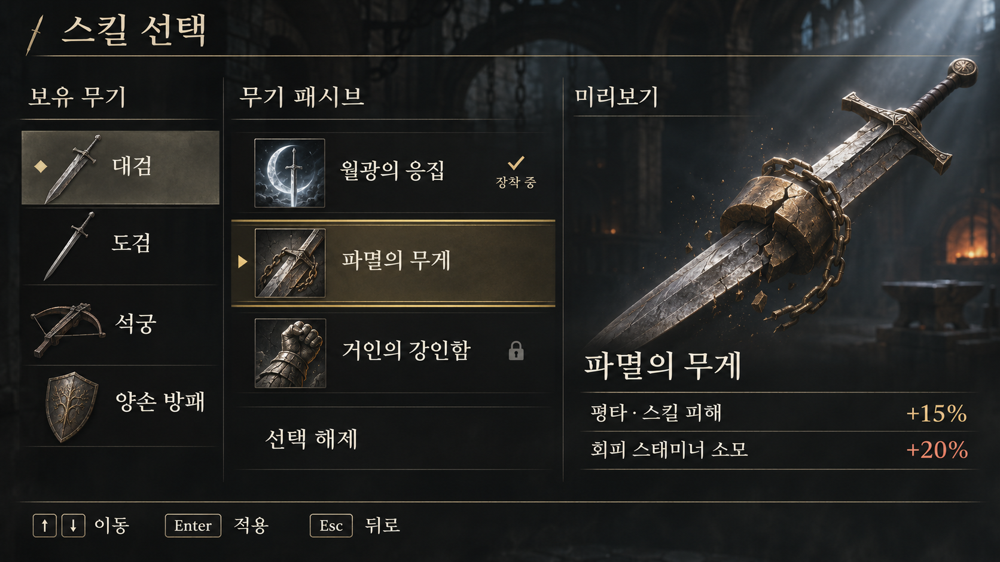
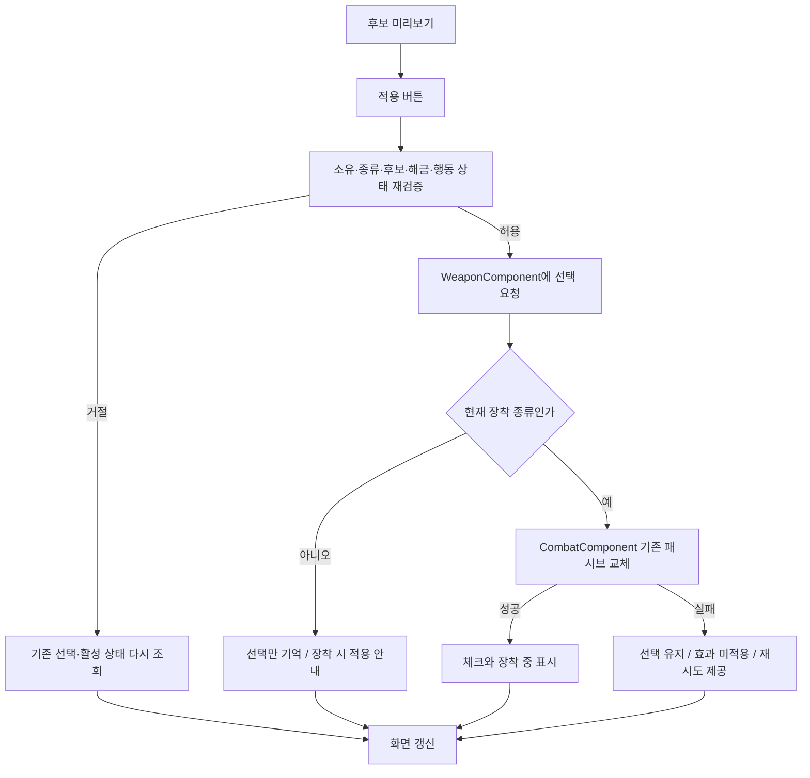

# 무기 패시브 선택 UI 설계안

- 작성일: 2026-11-03
- 갱신일: 2026-11-06
- 상태: 현재 장착 무기 조회와 후보 미리보기 C++·위젯 Blueprint·표시 데이터 연결, 게임 안에서 후보 전환 확인 대기
- 범위: 보유 무기 조회, 종류별 후보 표시, 미리보기, 선택·해제, 실제 적용 상태 표시
- 기준: [단일 선택 구조](single-selection.md), [무기 패시브 위키](../../wiki/Features/Combat/Weapon-Passives/document.md), [기존 UI 구조](../../wiki/Features/UI-and-CommonUI/document.md)
- 시각 기준: [승인 시안](selection-ui/prototype.png) · [패시브 12종 한눈에 보기](selection-ui/passive-icons.png) · [원화 목록과 가져오기](../../../SourceArt/UI/SkillSelection/README.md)

## 1. 기본 방향

- 무기 아이템을 고르면 해당 무기 종류의 패시브 후보 표시
- 같은 종류의 다른 무기 아이템은 선택 공유, 현재 장착 종류의 패시브 한 개만 실제 적용
- 후보 클릭·초점 이동은 설명 미리보기, 하단 적용으로 확정
- 현재 장착하지 않은 무기의 선택도 변경 가능, 그 종류의 무기를 장착할 때 적용
- 후보 수는 3으로 고정하지 않고 현재 API가 반환하는 N개 사용
- 패시브 선택 UI에서 무기 자체를 장착하거나 교체하지 않음
- 선택 상태는 기존 WeaponComponent의 현재 캐릭터 수명 동안 유지, 디스크 저장·캐릭터 재생성 복원은 별도 작업

## 2. 화면 구성

| 영역 | 화면 기준 |
|---|---|
| 제목과 하단 안내 | 제목은 ‘스킬 선택’, 가운데 열 이름은 ‘무기 패시브’ 사용. 하단에 이동·적용·뒤로 표시 |
| 왼쪽 약 22% | 보유 **아이템** 이름과 무기 아이콘 사용. 마름모는 현재 조회 중인 아이템 표시. 실제 장착 아이템과 다르면 장착 여부는 별도 문구로 구분 |
| 가운데 약 34% | 삼각형과 금색 상·하단 선은 후보 초점, 체크와 ‘장착 중’은 현재 활성 패시브, 자물쇠와 ‘잠김’은 미해금. 마지막 ‘선택 해제’ 행으로 해당 종류의 선택 제거 |
| 오른쪽 약 44% | 미리보는 후보의 삽화·이름·효과 표시. 파멸의 무게는 평타·스킬 피해 +15%와 회피 스태미너 소모 +20%를 두 줄에 배치. 비용 증가는 적갈색과 항목명으로 식별 |

- 시안에서 대검의 ‘월광의 응집’은 장착 중이고 ‘파멸의 무게’는 미리보기 상태. 이동만 해도 오른쪽은 갱신되며 적용하기 전까지 체크는 월광의 응집에 유지
- 시안 속 보유 무기 수·후보 순서·잠금 여부는 화면 예시. 실제 목록은 소유, 해금, 현재 활성 행을 조회해 구성
- 배경 → 어두운 반투명 판 → 목록·삽화 → 상태 기호·문자 순서로 합성. 시안 전체를 위젯 배경으로 사용하지 않음
- 16:9에서 목록·설명 너비 비율을 먼저 맞추고 작은 해상도에서는 삽화를 먼저 줄임. 이름·효과·하단 조작 안내 공간을 확보하고 목록과 긴 설명은 따로 스크롤
- 무기·패시브 그림은 비율 유지, 상세 삽화는 영역 안에 맞춤. 테두리·선·행 배경은 위젯 브러시, 키 표시는 현재 입력 장치의 CommonUI 안내 사용

- 무기 이름·아이콘: 기존 무기 행의 `DisplayName`, `Icon` 재사용
- 목록: 보유 무기를 표시하고 장착 무기 우선, 나머지는 안정적인 아이템 태그 순서
- 같은 종류의 아이템 여러 개 표시 허용, 어느 아이템에서 바꿔도 해당 종류의 선택 표시 함께 갱신
- 후보: 아이콘, 이름, 한 줄 상태 표시 / 긴 효과 설명은 오른쪽에서 줄바꿈·스크롤
- 후보가 많으면 목록 스크롤, 이름이 길면 설명 영역에서 전체 이름 확인
- 선택 테두리·초점 테두리·현재 적용 표시 구분, 색상과 함께 문구 사용
- 맨손은 현재 장착 중이고 유효한 종류 키가 있을 때 조회 문맥으로 허용, 소유 무기로 추가하지 않음
- 무기·후보가 없으면 빈 상태 안내와 닫기 제공, 첫 후보 자동 선택 없음

## 3. 열기와 입력

### 진입점

- 신규 `UMVWeaponPassiveSelectionWindow : UMVWindowBase` 사용
- `UMVUISettings`에 창 클래스 등록, `UMVUISubsystem`에 열기·닫기 진입점 추가
- 기존 `ShowLevelUpWindow`처럼 중복 창 확인 후 WindowStack에 표시
- 장비 화면에서 선택한 아이템 태그를 전달할 수 있게 구성, 인수가 없으면 현재 장착 아이템 우선
- 전달한 아이템은 소유 여부 재확인, 사용할 수 없으면 현재 장착 무기 → 첫 보유 무기 → 빈 화면 순서
- 최초 시험은 Blueprint에서 열기 함수 호출, 임시 P/O 직접 패시브 변경 노드와 입력 중복 방지
- 최종 메뉴 배치는 장비·휴식 메뉴에서 같은 진입점을 호출할 수 있게 구성

### 조작 제안

| 입력 | 동작 |
|---|---|
| 마우스 무기 클릭 | 조회할 무기 변경 |
| 마우스 후보 클릭 | 설명·변경 예정 선택 갱신 |
| 방향키·게임패드 방향 입력 | 영역별 후보 이동, 초점 항목 미리보기 |
| 확인 입력 | 후보에 초점이 있으면 이미 미리본 항목을 한 번 확정. 무기 목록에서는 후보 목록으로 이동 |
| 하단 적용 클릭 | 키보드·패드 확인과 같은 확정 요청 사용 |
| 뒤로 입력·닫기 버튼 | 미확정 미리보기 폐기 후 창 닫기 |

- CommonUI의 확인·뒤로 입력과 `CommonActionWidget` 안내 재사용
- 마우스 후보 클릭은 미리보기만 수행. 키보드 Enter·패드 확인과 하단 적용은 같은 요청으로 모으고 입력 한 번에 한 곳에서만 처리
- 화면 진입 시 현재 선택 후보, 없으면 첫 후보에 초점 부여하되 실제 선택은 변경하지 않음
- 비어 있거나 잠긴 목록에서도 닫기로 이동 가능, 설명 스크롤도 패드 조작 지원
- PIE의 Esc 종료 충돌은 별도 뒤로 버튼으로 먼저 확인, 최종 키·패드 매핑은 에디터에서 검증

### 게임 상태

- 메뉴 입력 동안 이동·시점·공격·회피·무기 교체 입력을 게임으로 전달하지 않음
- 창 활성화 시 현재 메인 HUD의 표시 상태를 보관하고 숨김. 닫기·피격·사망·전환·파괴 시 같은 HUD가 현재 등록되어 있으면 이전 상태로 복구. HUD 교체·제거가 있었으면 이전 객체의 복구 생략
- 기존 메뉴와 동일하게 게임 시간을 임의로 멈추지 않음
- 생존한 로컬 플레이어, 유효한 컴포넌트, 스탯 준비, 필드 전환 아님 조건에서 열기 허용
- 공격·회피·피격 등 Action 실행 중 열기·확정 거절, 피격·사망·필드 전환·Pawn 교체 시 닫기
- 입력 차단·초점 복귀는 WindowStack과 기존 GameplayInputWidget의 수명주기 사용
- 최종 휴식 장소 제한 등 추가 게임 규칙은 도입 시 도메인 검증에 연결

## 4. 미리보기·선택·적용 구분

| 상태 | 소유자 | 화면에서의 의미 |
|---|---|---|
| 미리보는 행 | UI의 임시 값 | 지금 설명을 보는 후보, 확정 전에는 게임 상태 변화 없음 |
| 선택된 행 | `WeaponComponent.SelectedPassiveByWeaponType` | 그 무기 종류에 기억한 패시브 |
| 활성 행과 Ability | `CombatComponent` | 현재 실제로 효과를 내는 패시브 |

- UI는 현재 조회 아이템·종류와 미리보기 행만 임시 보관, 실제 선택의 별도 정본을 만들지 않음
- 다른 무기로 목록을 바꾸거나 창을 닫으면 아직 적용하지 않은 미리보기 폐기
- 적용 성공 후 창을 유지하고 표시 갱신, 뒤로 가기는 이미 확정한 선택을 취소하지 않음
- 현재 선택과 같고 정상 적용 중이면 적용 버튼 비활성, 상태 효과 재생성·중첩 초기화 없음
- 현재 종류에서 선택만 있고 활성 효과가 없으면 같은 후보에 `다시 적용` 허용
- `선택 해제`는 UI 전용 항목. 미리본 뒤 확정하면 가짜 스킬 행을 만들지 않고 `ClearSelectedPassive` 호출
- 이미 미선택이면 해제 버튼 비활성

### 상태 문구

| 조건 | 표시·버튼 |
|---|---|
| 현재 종류의 선택 행과 활성 행 일치, Ability 활성 | ✓ 장착 중 |
| 다른 종류에 선택된 행 | 선택됨 · 해당 무기 장착 시 적용 |
| 미해금 후보 | 잠김 · 설명 열람 가능, 적용 불가 |
| 현재 선택 없음 | 선택한 패시브 없음 |
| 다른 후보를 미리보는 중 | 변경할 선택, 적용 버튼 활성 가능 |
| 요청 전 검증 거절 | 현재는 변경할 수 없습니다, 실제 선택 다시 조회 |
| 선택 변경 후 실제 적용 실패 | 선택됐지만 효과가 적용되지 않았습니다 · 다시 적용 |
| 후보 목록 없음 | 이 무기에서 선택할 패시브가 없습니다 |

`선택됨`은 디스크 저장 완료를 뜻하지 않음
잠금은 기존 해금 상태에만 사용하고, 미구현 또는 잘못된 후보 설정을 잠금으로 가장하지 않음
유효한 후보로 등록되지 않은 패시브는 첫 구현에서 표시하지 않음

## 5. 현재 코드 재사용과 필요한 추가

| 구성 | 확인된 현재 상태 | 구현 제안 |
|---|---|---|
| 보유 무기 | `GetOwnedWeapons`, `GetEquippedWeaponState` 존재 | 표시용 목록 생성에 사용 |
| 후보 | `GetPassiveCandidates(WeaponTypeTag)`가 유효 행·필요 포인트·해금 상태 반환 | 그대로 사용, 테이블 경로·행 이름 순서 유지 |
| 선택 | `GetSelectedPassive`, `SelectPassive`, `ClearSelectedPassive` 존재 | UI가 호출하는 유일한 선택 경로 |
| 실제 적용 | `GetActivePassiveSkill`, `GetActivePassiveSkillRowHandle` 존재 | 활성 객체·활성 여부·행·장착 종류를 함께 확인 |
| 표시 정보 | 스킬 행의 이름·설명·아이콘·상세 그림을 조회 창에서 사용 | 효과별 수치 표시 확장 가능 |
| 변경 통지 | 소유·장착 무기 변경 통지 존재 | 선택·해금·실제 활성 상태 변경 통지 추가 |
| 실패 결과 | 선택 API는 bool 반환 | 상세 결과를 반환하는 API 추가, 기존 bool 호출 호환 유지 |
| UI 틀 | CommonUI 창·열기·닫기·메뉴 입력 경로 존재 | 레벨업 창의 구성 방식 재사용 |

### 표시 데이터

- `FMVSkillDataTableColumn`의 UI 범주에 `FText DisplayName`, `FText Description`, `TSoftObjectPtr<UTexture2D> Icon`, 선택적 `PreviewImage` 사용
- 상세 삽화 우선순위는 `PreviewImage → Icon → T_UI_Unknown`. 파멸의 무게만 전용 가로 삽화 사용, 나머지 11종은 투명 정사각 아이콘 재사용
- 시안의 두 수치 행은 선택적 표시 목록(항목명·표시값·이점/비용/일반)으로 구성. 예를 들어 회피 소모 +20%는 비용으로 표시. 부호에서 유불리를 추측하지 않고 문장형 효과는 설명만 표시
- 후보 식별자는 기존 `FDataTableRowHandle` 유지, 이름·아이콘을 UI Blueprint에 후보별로 복제하지 않음
- 별도 패시브 후보 테이블을 새로 만들지 않고 기존 `Test_*.PassiveSkill`과 스킬 행 사용
- 상태 효과 Definition의 이름·아이콘은 개별 효과 표시용으로 유지, 패시브 선택 UI가 본체·중첩 효과를 따라가며 설명을 합성하지 않음
- 설명은 현재 구현된 효과·조건·불이익만 기록, 불굴의 의지의 미구현 가드 효과 등은 적용되는 것처럼 표시하지 않음
- 설명 수치는 효과 설정 변경 시 함께 검토, 첫 구현에 모든 Behavior를 해석하는 자동 설명 생성기는 포함하지 않음
- 아이콘 누락은 기본 아이콘, 이름·설명 누락은 중립 안내 문구 사용과 에디터 검증 경고
- 내부 RowName·에셋 경로를 일반 플레이 화면에 노출하지 않음

### 해금

- 첫 구현은 선택 UI에 집중, 잠긴 후보는 설명·기존 필요 포인트만 표시
- 이 화면에서 `UnlockSkill`을 자동 호출하거나 포인트를 소비하지 않음
- 시험 후보는 기존 무료 해금 설정 활용, 유료 후보를 임의로 무료 처리하지 않음
- 이후 해금 UI가 추가되면 별도 명시적 해금 동작으로 연결

## 6. 확정과 실패 처리

현재 `SelectPassive`는 유효한 후보를 찾으면 선택 행을 먼저 기록한 뒤, 현재 장착 종류일 때 실제 적용을 시도
따라서 false라도 선택 행이 바뀌었을 수 있으며, 이전 패시브가 계속 적용된다고 가정할 수 없음
현재 `ApplyPassiveSkill` 계약은 교체 실패 시 이전 효과를 복구하지 않고 활성 슬롯을 비우는 방식

- 신규 상세 요청 결과 제안: `Applied`, `SelectedForLater`, `Cleared`, `Unchanged`, `Rejected`, `ApplyFailed`
- 거절 사유 제안: 생존·전환·Action 상태, 소유 무기·종류 무효, 후보 없음, 잠김, 설정 오류
- `CanSelectPassive` 성격의 변경 없는 검사와 확정 요청이 동일한 검증 로직 사용
- 기존 `SelectPassive`·`ClearSelectedPassive`는 공용 내부 경로에 위임, 기존 호출부의 bool 의미 유지
- UI에서 실패 사유를 추측하기 위해 비활성 버튼마다 실제 선택 함수를 호출하지 않음
- 성공·실패 모두 요청 종료 후 선택과 활성 상태 재조회, 반환값 하나로 체크 표시 변경 금지
- 요청 처리 중 입력 중복 차단, 자동 재시도 없음
- 재시도는 현재 선택·현재 장착 종류·현재 후보·해금 상태 재검증 후 기존 적용 경로 사용
- UI는 상태 효과 직접 추가·제거, 패시브 Ability 직접 생성, 전투 수치 직접 변경 금지

## 7. 책임과 변경 통지

| 구성 제안 | 책임 |
|---|---|
| `UMVWeaponPassiveSelectionWindow` | 조회 문맥·미리보기·목록 구성·확정·초점·안내·구독 수명 |
| `UMVPassiveCandidateEntryWidget` | 후보 하나의 표시와 클릭·초점 사건 전달 |
| `UMVPassiveWeaponEntryWidget` | 보유 무기 하나의 표시와 조회 요청 |
| `WeaponComponent` | 후보·소유·해금·종류별 선택, 상세 요청 결과와 게임 규칙 검사 |
| `CombatComponent` | 활성 패시브 한 개, 적용·해제·실패·외부 종료 통지 |
| `UISubsystem` | 창 클래스 조회·중복 방지·열기·닫기 |
| 자식 Widget Blueprint | 배치·색·아이콘·애니메이션·텍스트 연결 |

- 조회 창과 공용 목록 행을 C++로 구현. 무기·패시브 목록은 같은 행 BP에서 이름·아이콘·상태 표시를 재사용
- 2026-11-09 구현 연결은 아래와 같으며 신규 입력·알림의 실제 실행 검증은 후속 확인
  - WeaponComponent의 OnPassiveOptionsChanged는 선택 요청 완료·해제·패시브 해금 성공 시 발생
  - CombatComponent의 OnActivePassiveChanged는 적용 요청 종료·활성 해제·기본 EndAbility를 통한 외부 종료 시 발생
  - 창은 알림을 다음 틱의 한 번 갱신으로 모으고 직접 적용 요청 중에는 요청 종료 후 최종 상태를 조회
  - CommonUI 기본 확인 입력을 사용하며 누름에서 한 번 실행. 반복·뗌은 소비하고 위젯의 추가 확인 동작을 차단
  - 무기 초점 이동은 조회, 확인은 후보로 이동. 후보 초점에서 확인하면 적용 요청. 닫기 초점에서 확인하면 종료
  - 현재 bool API와 실제 선택·활성 상태 재조회로 결과 안내 구성. 상세 결과 enum API는 추가 전 상태
- 기존 소유·장착 무기 변경 통지 구독, 새 선택·해금 변경 통지는 WeaponComponent에 배치
- 활성 변경 통지는 CombatComponent에서 성공·제거·실패·외부 Ability 종료까지 포함
- 교체 중간 정리로 화면이 흔들리지 않도록 요청 완료 시 최종 상태 재조회, 재진입 요청 차단
- Action 시작·종료 통지로 적용 가능 상태 갱신, 확정 순간에도 다시 검사
- 외부 선택 변경 시 새 선택을 표시하고 미리보기 재설정, 이미 사라진 후보·무기 확정 차단
- 매 프레임 후보 재검색 없이 활성화와 관련 사건에서 갱신
- 창 활성화 시 구독, 비활성화·파괴 시 해제 / Pawn 소멸·변경은 창 종료 후 새로 열 때 다시 연결
- GameInstance 수명의 UISubsystem에 플레이어 컴포넌트 영구 보관 금지

## 8. 단계별 구현과 확인

| 단계 | 코드 작업 | 사용자 에디터 작업 | 확인할 결과 |
|---|---|---|---|
| 0. 시각 원화 | 원화 25개와 시안·연결표 준비 | 후속 단계에서 PNG를 Texture2D로 가져오기 | 대검 예시를 만들 원화와 12종 후보 아이콘을 개별 파일로 확인 |
| 1. 조회·표시 기반 | 스킬 표시 필드, 창 부모·UI 설정·열기/닫기, 현재 무기 후보 읽기 | 시험 후보 이름·설명·아이콘 입력, 최소 창 BP 등록 | 현재 한손 무기의 후보 이름·설명 표시, 닫은 뒤 조작 복구 |
| 2. 미리보기 | 후보 Entry와 상세 표시·초점, 임시 선택만 갱신 | 후보 목록·상세 영역·버튼 배치 | 클릭·이동으로 설명 변경, 실제 패시브와 중첩은 유지 |
| 3. 선택·해제 | 상세 결과·공통 검사, 적용·해제·재시도 연결 | 상태 표시·적용·닫기 연결 | 한 개만 적용, 같은 선택 중복 없음, 취소와 적용 실패 구분 |
| 4. 보유 무기 조회 | 아이템 목록·종류별 선택·미장착 선택, 변경 통지 | 보유 무기 목록 배치 | 같은 종류 공유, 다른 종류 분리, 미장착 선택이 현재 효과에 영향 없음 |
| 5. 입력·수명 마감 | 패드 초점·스크롤, 외부 변경·피격·사망·전환 처리 | 키 안내·빈 화면·오류 문구 구성 | 반복 열기·닫기, 게임 입력 누출 없음, 종료 후 입력 복구 |
| 6. 문서·정리 | 임시 로그 정리, 검증된 계약 위키 갱신 | 최종 자산 저장·실행 확인 | 검증 범위·후속 실제 무기 연결·저장 범위 명확화 |

- 단계마다 사용자가 빌드·실행한 결과를 확인한 뒤 다음 단계 진행
- 현재 한손 시험 무기로 1~3단계 진행, 테스트용 후보 종류 설정 사용
- 종류별 격리·동일 종류 아이템 공유는 서로 다른 종류·같은 종류의 복수 시험 행이 있어야 실행 검증 가능
- 실제 대검·방패·활 등이 없으면 해당 외형·최종 데이터 연결은 완료로 기록하지 않음

### 조회 전용 창의 에디터 설정

2026-11-06 아래 창·후보 행 BP 생성과 원화 가져오기, 스킬 행 12개의 표시 필드, UI 설정 등록 완료
디자이너에서 후보 목록은 비어 있으며 게임에서 현재 장착 무기의 후보를 채움. 창 BP 컴파일과 저장·배치는 Windows 에디터에서 확인

아래 위치는 콘텐츠 브라우저의 가상 경로 기준. 창과 행은 **위젯 블루프린트**로 생성하고 각 디자이너 위젯의 이름과 형식을 표에 맞춤
별도 안내가 없는 이름은 필수 바인딩이며, 각 위젯에서 `Is Variable`을 켬

| 위치 · 변경 전 | 변경 후 |
|---|---|
| `/Game/UI/Windows` · 후보 행 BP 신규 | `WBP_PassiveCandidateEntry`, 부모 `MVPassiveCandidateEntryWidget`. 가로 상자 안에 Image `CandidateIcon`, Text Block `CandidateName`, Text Block `CandidateState`. 선택적 Image `PreviewMarker`에는 삼각형 기호 배치. 행 자체가 버튼이므로 내부에 버튼 추가 없이 사용 |
| 같은 폴더 · 창 BP 신규 | `WBP_WeaponPassiveSelection`, 부모 `MVWeaponPassiveSelectionWindow`. 왼쪽 Text Block `WeaponName`(선택적 Image `WeaponIcon`), 가운데 빈 Scroll Box `CandidateList`, 오른쪽 Image `PreviewImage`·Text Block `PreviewName`·Text Block `PreviewDescription`, 하단 Button `CloseButton`에 ‘닫기’ 텍스트 |
| 창 BP → Class Defaults → Maverick / UI / Weapon Passive · 클래스 미지정 | `Candidate Entry Class = WBP_PassiveCandidateEntry`. `Missing Artwork = T_UI_Unknown` 지정 가능 |
| Project Settings → Maverick UI Settings → Window · 창 클래스 미지정 | `Weapon Passive Selection Window Class = WBP_WeaponPassiveSelection` |
| `/Game/Table/Weapons/Player/DT_WeaponPassives` → 시험 후보 행 → UI · 신규 필드 기본값은 빈 텍스트·None | 한손 시험 무기에 이미 등록된 후보 두 개의 `Display Name`, `Description`, `Icon` 설정. 파멸의 무게만 전용 `Preview Image` 지정. 나머지는 후보 아이콘을 상세에도 사용 |
| `BP_ThirdPersonCharacter` → Event Graph · 기존 P/O 패시브 시험과 다른 미사용 입력 | 예: `Debug Key J (Pressed)` → 게임 인스턴스 서브시스템 `MVUISubsystem`의 `Show Weapon Passive Selection Window`. 닫기 버튼·CommonUI 뒤로 입력은 C++에서 처리 |

- 최소 배치: 창 전체에 세로 상자 → 가운데 가로 상자에 무기·후보·상세 3열 → 아래에 닫기 버튼. 아이콘은 Size Box 안에, 상세 삽화는 크기가 제한된 Scale Box(`Scale To Fit`) 안에 배치. 설명은 자동 줄바꿈
- 예시 행: 철벽은 ‘방어력과 최대 체력이 각각 20% 증가함’과 `T_Passive_IronWall`, 약점 포착은 ‘체력 30% 이하인 적을 공격하면 치명타 확률이 20%p 증가함’과 `T_Passive_WeakPoint`
- 시험 입력은 캐릭터 BP의 J에 연결·저장됨. 실행 순서: PIE 시작 → 게임 화면 클릭 → 한손 무기를 들고 정지 상태에서 J → 두 후보를 각각 클릭하거나 방향키로 이동 → 오른쪽 이름·설명·그림 변경 확인 → 장착 표시 유지 → 닫은 뒤 이동·공격 및 재진입 확인
- 후보가 비면 `/Game/Characters/__Test/Test_OneHand`의 `PassiveSkill`에서 유효한 스킬 행과 현재 무기의 `Weapon Type Tag`가 `Passive Weapon Types`에 정확히 들어 있는지 확인. 잠긴 유효 후보도 열람 가능
- 창 BP·행 BP는 디자이너 배치만 필요. 후보 배열 구성, 클릭·초점 처리, 닫기 버튼에 추가 그래프 불필요

## 9. 검증 기준

| 확인 대상 | 기대 결과 |
|---|---|
| 현재 무기·후보 표시 | API와 동일한 후보·순서·해금 상태 |
| 후보 0개·1개·3개 초과 | 빈 안내·정상 선택·스크롤, 배열 범위 오류 없음 |
| 후보 미리보기 후 닫기 | 기존 선택·효과·누적 중첩 변화 없음 |
| 다른 패시브 확정 | 이전 효과·구독 정리, 새 패시브 한 개만 적용 |
| 같은 정상 패시브 | 적용 버튼 비활성 또는 변화 없음, 중첩 유지 |
| 선택 해제 | 해당 종류 선택 해제, 장착 종류면 실제 효과도 해제 |
| 잠긴 후보 | 설명은 열람 가능, 요청은 거절 |
| 미장착 종류 선택 | 선택만 기억, 현재 무기의 실제 효과 유지 |
| 같은 종류의 다른 아이템 | 같은 선택 표시, 실제 아이템 교체 시 기존 런타임 규칙 적용 |
| 적용 실패와 재시도 | 실제 미적용 표시, 이전 효과 유지로 오인하지 않음, 재시도 중복 효과 없음 |
| 외부 선택·소유·해금 변경 | 열린 화면 갱신, 오래된 미리보기 확정 차단 |
| Action 실행·피격·사망·필드 전환 | 변경 거절 또는 닫기, 게임 상태와 UI 모순 없음 |
| 키보드·마우스·패드 | 초점·스크롤·뒤로 복구, 한 입력에 중복 확정 없음 |
| 창 재진입·캐릭터 재생성 | 재진입은 실제 상태 재조회, 재생성 뒤 영구 복원을 주장하지 않음 |

신규 자동화 시험은 결과 구분·거절 시 상태 보존·미장착 종류 격리처럼 회귀 위험이 있는 규칙에 한정
기존 `Maverick.Combat.PassiveSkill.Lifecycle`·`FailedReplacementLeavesVacancy`의 교체 계약 유지
화면 배치·포커스·입력 복귀·Blueprint 연결은 Windows Unreal Editor에서 사용자가 직접 확인

## 10. 조사 근거와 검증 한계

- Windows 작업 폴더의 스킬·무기 행, 패시브 Ability와 본체 효과 12쌍을 대조해 원화 범위 확정. 불굴의 의지는 구현된 저체력 피해 감소를 표현하며 가드 보류 상태 유지
- Graphify 의존성 검사 성공: 프로젝트 Python 환경의 `0.9.38` 확인, 게임 코드의 빌드 성공을 뜻하지 않음
- Graphify 자동 갱신 진입점은 `HostName` 매개변수 불일치로 실패, 기존 그래프 직접 질의 결과는 현재 소스로 재확인
- 원본 코드 기준으로 선택·적용의 차이와 CommonUI 사용 경로 확인, 신규 화면 동작·자산 현재 값·실행 안정성은 미검증
- 원화·설계 단계의 검증은 파일과 문서 대상. 가져오기 후 색·투명도·가독성, 실제 행 연결과 입력 동작은 Windows 에디터에서 확인
- 구현 완료 후 위키 갱신 대상: `Features/Combat/Weapon-Passives`, `Features/UI-and-CommonUI`

### 확인한 원본

- [후보·선택 API와 상태](../../../Source/Maverick/Components/MVWeaponComponent.h)
- [선택·해제·정렬·해금 처리](../../../Source/Maverick/Components/MVWeaponComponent.cpp)
- [실제 패시브 적용과 실패 계약](../../../Source/Maverick/Components/MVCombatComponent.cpp)
- [스킬 행](../../../Source/Maverick/Public/Tables/MVSkillDataTableColumn.h)
- [무기 표시 데이터](../../../Source/Maverick/Public/Tables/MVItemTableTypes.h)
- [창 기반 클래스](../../../Source/Maverick/UI/Base/MVWindowBase.cpp)
- [레벨업 창의 수명·입력 사례](../../../Source/Maverick/UI/Window/MVLevelUpWindow.cpp)
- [UI 진입점](../../../Source/Maverick/UI/System/MVUISubsystem.cpp)
