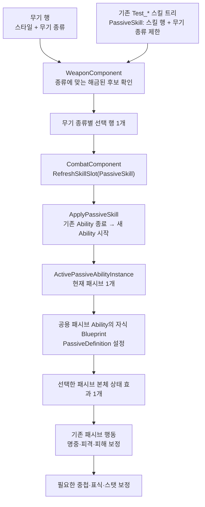
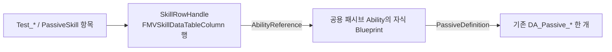

# 무기 종류별 패시브 한 개 선택 — 전환 설계

- 기록·개정일: 2026-10-27
- 상태: 단일 선택 코드·시험 자산·구형 경로 제거와 7단계 위키 갱신 완료. 사용자 Windows Editor 빌드·재저장과 검↔맨손 PIE 재검증 성공. 최종 무기 종류별 자산·패시브의 지연 적중 경계 검증과 UI는 남음
- 이번 범위: 적용 방식, 구현 경계, 이전·삭제 순서와 검증 기록.
- 확정 요구: 무기 종류별로 후보 N개를 두고 플레이어가 선택한 한 종류만 적용한다. 같은 종류의 무기 아이템은 후보와 선택을 공유한다.
- 분류 기준: 대검·양손 방패·활 같은 무기 종류. `OneHand/TwoHand/DualWield` 같은 손 사용 스타일과 구분한다.
- 적용 경로: 현재 `CombatComponent`의 `PassiveSkill` 슬롯과 패시브 Ability 인스턴스를 사용한다.
- 개정 방향: 공용 패시브 Ability에 기존 상태 효과를 설정하고, 기존 `Test_*` 스킬 트리의 `PassiveSkill`에 스킬 행을 등록한다. 별도 `WeaponPassiveSet` 후보집 전환안은 폐기한다.
- UI: 패시브 선택 화면은 후속 작업으로 분리한다.

## 1. 전환 시작 때 확인한 구조

| 구성 | 현재 동작 | 전환 판단 |
|---|---|---|
| `UMVWeaponSkillMap::PassiveSkill` | 스타일별 패시브 후보 스킬 행 집합 | 유지하고 후보별 무기 종류 제한 추가 |
| `FMVSkillTreeState::EquippedSkill[PassiveSkill]` | 스타일별로 선택한 행 한 개 | 무기 종류별 선택 상태로 이전 |
| `FMVSkillTreeState::UnlockedSkills`, `RequiredPoints` | 스타일별 해금 상태와 후보별 필요 포인트 | 재사용. 무료 해금과 자동 장착은 분리 |
| `UMVCombatComponent::RefreshSkillSlot(PassiveSkill)` | 선택한 행을 조회해 `ApplyPassiveSkill` 호출 | 단일 적용 진입점 유지, 행 조회 원천 변경 |
| `ApplyPassiveSkill / ClearPassiveSkill` | 별도 Ability 한 개를 시작·종료 | 재사용 |
| `ActivePassiveAbilityInstance` | 현재 패시브 실행 객체 한 개 | 실제 적용 상태의 유일한 소유자 |
| `UMVWeaponPassiveComponent` | 무기 세트의 모든 `PassiveDefinitions`를 상태 효과로 동시 적용 | 이전 후 삭제 |
| `UMVStatusEffectBehavior` 파생 클래스 | 명중·피격 등을 받아 패시브 효과 실행 | 선택된 패시브 Ability 아래에서 재사용 |

현재 패시브는 Q/W/E/R과 같은 `EMVSkillSlot` 체계에 포함된다. 다만 Q/W/E/R의 공격 실행용 `SkillMap`과 `CurrentAbilityInstance`에 넣는 방식은 아니다. `RefreshSkillSlot`이 패시브를 따로 분기하고, `ActivePassiveAbilityInstance`에 보관한다. 따라서 공격을 시작하거나 끝내도 장착 패시브는 계속 살아 있을 수 있다.

`ApplyPassiveSkill`은 같은 행이 이미 활성 상태면 기존 객체를 재사용한다. 다른 행으로 바꿀 때는 기존 패시브를 먼저 종료하며, 새 적용이 실패하면 실행 슬롯을 비운다. 이 교체 계약은 기존 자동화 시험에도 명시되어 있다.

현재 문제는 이 단일 슬롯 외에 `WeaponPassiveComponent`의 세트 전체 적용 경로가 함께 남아 있다는 점이다. 최종 구조에서는 패시브를 켜는 경로를 단일 슬롯으로 모은다.

### 기존 Test 스킬 트리 검토

`Content/Characters/__Test/`의 아래 네 파일은 저장된 패키지 메타데이터에서 모두 `/Script/Maverick.MVWeaponSkillMap`으로 확인했다. 사용자가 지칭한 `Test_BaseHand`의 실제 파일명은 `Test_BareHand`다.

| 기존 애셋 | 재사용할 역할 |
|---|---|
| `Test_BareHand` | 맨손 스타일의 기본 공격·스킬·패시브 후보 데이터 |
| `Test_OneHand` | 한손 스타일의 기본 공격·스킬·패시브 후보 데이터 |
| `Test_TwoHand` | 양손 스타일의 기본 공격·스킬·패시브 후보 데이터 |
| `Test_DualWield` | 쌍수 스타일의 기본 공격·스킬·패시브 후보 데이터 |

`BP_ThirdPersonCharacter` 패키지에서도 `Test_*` 경로 참조가 확인된다. 에디터 실행 중 연결과 각 후보 행의 현재 값까지 확인한 결과는 아니다.

`WeaponComponent::BeginPlay`는 `WeaponStyle`마다 스킬 트리 한 개만 등록하고 중복 스타일은 무시한다. 따라서 대검용·방패용 `TwoHand` 애셋을 각각 추가하는 방식으로 종류를 분리하지 않는다. 기존 스타일 트리 안에서 후보에 무기 종류를 지정한다.

### 1단계: 저장된 자산과 코드에서 확인한 이전 대상

| 대상 | 현재 확인한 내용 | 확인 범위 |
|---|---|---|
| `BP_ThirdPersonCharacter` | `WeaponComponent.WeaponSkillMaps` 이름과 네 `Test_*` 경로 참조, `DefaultWeaponRow` 속성 존재 | 저장 패키지 문자열. 배열 값·기본 행 값은 에디터 확인 필요 |
| 네 `Test_*` 스킬 트리 | 모두 `UMVWeaponSkillMap`; 저장 패키지에는 일부 `PassiveSkill` 속성 이름이 남음 | 사용자가 에디터에서 현재 패시브 후보 값이 모두 비어 있다고 확인. 기존 시험 후보 행 이전 불필요 |
| `DT_Weapons_Player` | `BareHand_Fist`, `OneHand_TestSword`, `DualSword_TestSword` 행 이름과 이전 `DA_WhipEnergySword_PassiveSet` 참조 문자열이 저장됨 | 사용자는 에디터의 관련 값이 비어 있다고 확인하고 새 설정으로 채우기로 함. 저장 패키지의 남은 참조는 현재 적용 값으로 단정하지 않음 |
| 5개 `DA_*_PassiveSet` | 아래 9개 본체 자산 경로를 참조 | 저장 패키지의 참조 문자열. `PassiveDefinitions`의 실제 배열 값·순서는 에디터에서 확인 |
| 무기 종류 식별자 | 무기 행·현재 장착 상태에 `EquippedStyle`과 `ItemTag`는 있지만 종류별 `WeaponTypeTag`는 아직 없음 | 현재 C++ 선언과 장착 복사 경로 확인 |

현재 플레이어 무기 테이블에는 위 세 시험 행 이름만 확인된다. 대검·방패·활 등 실제 무기 행의 스타일을 추정하여 지정하지 않는다. 수정 상태인 `DT_Weapons_Player`와 미추적 `DA_Katana_PassiveSet`도 이전 조사에 포함한다. 3단계에서 실제 애셋을 새 값으로 저장할 때 남은 구 세트 참조를 함께 정리한다.

## 2. 목표와 기본 동작

- 후보는 무기 종류마다 N개이며, N을 3으로 고정하지 않는다.
- 현재 장착 무기의 종류에서 선택한 패시브 한 개만 캐릭터에 적용한다.
- 다른 무기 종류에 저장한 선택은 기억하되, 그 무기를 들기 전에는 적용하지 않는다.
- 선택 전·후보 없음·적용 실패 상태는 활성 패시브 0개를 허용한다. 유효한 선택의 적용에 성공하면 1개다.
- 새 캐릭터의 초기 선택은 비워 두는 안을 권장한다. 후보 목록의 첫 항목을 자동 선택하지 않는다. UI가 없는 동안은 시험 코드나 Blueprint에서 선택 API를 명시적으로 호출한다.
- 한 패시브가 만드는 속도 중첩·적 표식·추가 피해는 그 패시브의 내부 효과다. 상태 효과 인스턴스 수 전체를 1개로 제한하지 않는다.
- 기존 패시브의 수치와 발동 조건은 이번 구조 전환으로 바꾸지 않는다.

초기 미선택과 뒤의 교체·실패 처리 세부 규칙은 이 문서의 설계안이다. 사용자 요구인 후보 N개, 무기 종류별 선택 공유, 한 종류 적용, 기존 슬롯 사용, UI 후속 분리를 유지하며 공용 Ability와 기존 스킬 트리 재사용 제안을 반영한다.

## 3. 적용 경로와 책임



| 소유자 | 책임 |
|---|---|
| 기존 `UMVWeaponSkillMap` 애셋 | 스타일별 스킬 후보·해금 비용, 패시브 후보별 사용 가능한 무기 종류 |
| 무기 행·장착 상태 | 현재 아이템의 스타일과 무기 종류 식별자 |
| `WeaponComponent` | 후보 검증, 종류별 선택 보관, 장착 무기와 선택의 동기화 |
| `CombatComponent` | 현재 패시브 Ability 한 개의 생성·시작·교체·종료 |
| 새 `UMVStatusEffectPassiveAbility` — 가칭 | 기존 상태 효과 본체 한 개를 적용하고 자신이 적용한 핸들을 해제 |
| 기존 패시브 행동 | 패시브별 규칙, 사건 구독, 자신이 만든 파생 효과 정리 |
| `StatusEffectComponent` | 공통 효과 인스턴스·중첩·지속시간·핸들 관리 |
| 추후 UI | 후보 표시와 선택 요청, 선택·적용 상태 표시 |

`WeaponPassiveComponent`를 제거하는 이유는 패시브 수가 한 개라서만은 아니다. 적용 객체의 소유권과 시작·종료 책임을 이미 `CombatComponent`가 갖고 있으므로, 별도 컴포넌트를 유지하면 같은 역할을 두 곳에서 수행하게 된다.

## 4. 기존 스킬 트리의 후보와 선택 데이터

### 등록 경로

`Test_*`의 `PassiveSkill` 항목은 `FMVWeaponSkillMapData`이며 `SkillRowHandle`과 `RequiredPoints`를 받는다. `DA_Passive_*` 상태 효과를 이 자리에 직접 넣는 형식은 아니다.



스킬 행 형식과 `AbilityReference`를 그대로 사용한다. 패시브 효과마다 데이터를 설정한 자식 Blueprint와 스킬 행을 준비하며, 개별 효과를 위한 C++ Ability 클래스를 각각 만들지 않는다.

### 무기 종류 구분을 위한 최소 확장

`Test_OneHand/Test_TwoHand`는 손 사용 스타일을 나눈다. 후보 등록만 하면 같은 스타일의 대검·방패가 후보와 선택을 공유하므로, 기존 애셋에 아래 정보를 추가한다. 필드명·태그 이름은 구현 시 사용할 설계안이다.

| 위치 | 추가·유지할 데이터 |
|---|---|
| `FMVWeaponTableRow`, `FMVEquippedWeaponState` | `WeaponTypeTag`: 대검·양손 방패·활 등 종류 키 |
| `FMVWeaponSkillMapData` | `PassiveWeaponTypes`: `FGameplayTagContainer`, 해당 패시브 후보를 사용할 수 있는 종류 목록 |
| `UMVWeaponSkillMap::PassiveSkill` | 기존 `TSet<FMVWeaponSkillMapData>` 유지, 스킬 행과 필요 포인트 재사용 |
| `FMVSkillTreeState::UnlockedSkills` | 현재 스타일별 해금 상태 재사용 |
| `WeaponComponent` | `SelectedPassiveByWeaponType`: 종류별 선택 행 한 개 |

`PassiveWeaponTypes`는 패시브 후보에서만 해석하며 Q/W/E/R 후보에는 적용하지 않는다. 같은 행을 여러 종류에서 공유할 때는 항목을 중복 추가하지 않고 종류 목록에 함께 지정한다. 기존 행 기준 동등성·해시를 유지한다.

현재 장착 상태의 스타일로 스킬 트리를 찾고, 그 안의 `PassiveSkill`에서 무기 종류가 정확히 일치하는 후보만 제공한다. 종류 키나 허용 목록이 비어 있으면 모든 무기 공용으로 추측하지 않고 잘못된 설정으로 처리한다.

예를 들어 `Test_TwoHand.PassiveSkill`에는 대검용 월광의 응집·파멸의 무게와 방패용 피 흘린 만큼·불굴의 의지를 함께 등록할 수 있다. 대검을 선택하면 앞의 두 후보만, 방패를 선택하면 뒤의 두 후보만 반환한다. 이는 등록 예시이며 실제 무기 행의 스타일은 이전 때 대조한다.

같은 종류의 아이템·강화 단계는 동일한 종류 키와 스타일을 사용한다. 종류별 조회용 색인은 기존 `WeaponSkillMaps`에서 파생하며 별도 후보집을 편집하지 않는다. 같은 종류 키가 서로 다른 스타일 트리에 걸쳐 등록되면 임의 선택하지 않고 데이터 오류로 처리한다. 한 종류의 여러 전투 자세 지원은 이번 범위에 포함하지 않는다.

1단계에서 정한 종류 키는 `Weapon.Type.Katana`, `Weapon.Type.Rapier`, `Weapon.Type.GreatSword`, `Weapon.Type.TwoHandedShield`, `Weapon.Type.Crossbow`, `Weapon.Type.Bow`, `Weapon.Type.Whip`, `Weapon.Type.EnergySword`다. 아직 미등록이며 3단계에서 프로젝트의 C++ GameplayTag 선언·정의 파일에 등록한다. `ItemTag` 문자열로 종류를 추측하지 않는다.

사용자 결정에 따라 석궁·활, 채찍·에너지소드의 **후보 효과는 재사용할 수 있어도 선택 상태는 각각 독립**한다. 기획 문서에서 함께 묶은 카타나·레이피어도 별도 종류 키와 선택을 사용한다. 두 종류에 같은 후보를 제공할 때는 한 `PassiveSkill` 항목의 `PassiveWeaponTypes`에 두 종류를 적는다.

### 해금과 선택 상태

기존 `RequiredPoints`, `UnlockSkill`, `UnlockedSkills`는 재사용한다. 이번에 옮기는 기존 패시브 9종은 `RequiredPoints = 0`으로 준비하고, 기존 스킬의 유료 해금 설정은 보존한다. 선택 함수는 후보 소속과 해금 여부를 모두 검사한다.

무료 후보의 자동 해금과 자동 장착은 분리한다. `InitSkillTreeStates`는 무료 패시브를 해금하되 첫 후보를 장착하지 않는다. `TSet`의 순회 순서로 기본 선택이나 UI 표시 순서를 정하지 않는다. 조회 결과는 DataTable 경로와 RowName을 기준으로 안정적으로 정렬한다.

`SelectedPassiveByWeaponType`의 형태는 `TMap<FGameplayTag, FDataTableRowHandle>`이며 선택의 유일한 정본이다. `FMVSkillTreeState::EquippedSkill[PassiveSkill]`에 같은 값을 중복 저장하지 않는다. Ability 객체·효과 핸들·중첩 수는 선택 상태에 넣지 않는다.

현재 시험 스킬 트리의 패시브 후보 값은 사용자 에디터 확인 결과 비어 있어 이전할 후보 행이 없다. 향후 다른 저장 상태에서 스타일별 패시브 선택이 발견되면 새 무기 종류와 후보 소속을 확인해 이전하며, 소속을 하나로 결정할 수 없는 값을 모든 종류에 자동 복제하지 않는다. 기본 공격·Q/W/E/R의 후보와 장착 상태는 현재 구조를 따른다.

### 조회·변경 함수

현재 구현된 `UMVWeaponComponent`의 함수 이름이다.

| 함수 | 계약 |
|---|---|
| `GetPassiveCandidates(WeaponTypeTag)` | 기존 스킬 트리에서 종류에 맞는 유효 후보와 해금 상태 반환 |
| `GetSelectedPassive(WeaponTypeTag, Output)` | 그 종류에 저장된 선택 행 반환 |
| `SelectPassive(WeaponTypeTag, RowHandle)` | 후보 소속·행·해금 여부 검증 후 선택, 현재 장착 종류이면 슬롯 동기화 |
| `ClearSelectedPassive(WeaponTypeTag)` | 선택 제거, 현재 장착 종류이면 패시브 종료 |
| `GetEquippedWeaponPassiveRow(Output)` | 현재 장착 종류에 저장된 선택 행 확인 |
| 기존 `GetActivePassiveSkill / GetActivePassiveSkillRowHandle` | 실제 적용에 성공한 Ability와 행 조회 |

`RefreshSkillSlot(PassiveSkill)`은 새 현재 무기 조회를 사용한다. 기존 `EquipSkill`과 스타일 기반 조회의 패시브 분기는 현재 장착 종류가 분명하면 새 API로 위임하고, 종류를 결정할 수 없으면 거절한다. 옛 스타일별 선택 저장 경로는 차단한다. Q/W/E/R 분기는 유지한다.

선택과 실제 적용은 구분한다. 잘못된 후보·미해금 요청은 이전 선택을 유지한다. 유효한 새 선택을 저장한 뒤 Ability 생성·효과 적용이 실패하면 새 선택은 남기되 실제 패시브는 0개이며 실패 이유를 반환한다. 같은 선택의 재시도는 허용하고 이미 정상 적용 중이면 객체와 중첩을 유지한다.

종류별 선택의 세션 내 보존은 이번 전환에 포함한다. SaveGame과 새 캐릭터로의 복원은 별도 연동 작업이다. 저장할 값은 종류 키와 선택 행이며 실행 객체와 일시 중첩은 저장하지 않는다.

## 5. 기존 효과를 패시브 Ability에 연결

새 `UMVStatusEffectPassiveAbility : UMVAbilityBase`는 모든 기존 패시브가 공유하는 적용·해제 구현이다. 제안 위치는 `Source/Maverick/Combat/Passive/`다.

```text
UMVAbilityBase
└─ UMVStatusEffectPassiveAbility          공용 C++ 구현
   ├─ BP_Passive_StormBlade               PassiveDefinition = DA_Passive_StormBlade
   ├─ BP_Passive_MoonlightCondensation    PassiveDefinition = DA_Passive_MoonlightCondensation
   └─ 나머지 패시브                       같은 부모, 정의만 교체
```

이름에 해당하는 Blueprint 9개는 `Content/Characters/Components/Combat/Abilities/Passive/` 아래 종류별 폴더에 저장됐다. 저장된 참조 문자열에서 공용 부모와 대응하는 `DA_Passive_*` 본체 참조를 확인했다. 자식 Blueprint는 기본값만 지정하며 개별 시작·종료 그래프를 복제하지 않는다. 실제 패시브 규칙은 기존 `UMVStatusEffectBehavior`에 남긴다.

- 설정: `PassiveDefinition` 한 개. 정의 배열을 다시 만들지 않는다.
- 실행 상태: 자신이 적용한 `FMVStatusEffectHandle` 한 개와 상태 효과 컴포넌트 참조.
- 각 패시브는 이 클래스를 부모로 하는 Blueprint 기본값에 기존 `DA_Passive_*` 한 개를 지정하고, 스킬 행의 `AbilityReference`에서 그 Blueprint를 참조한다.
- 스킬 행은 비용 0·연계 없음으로 설정한다. 공격 적중 시 효과를 추가하는 `OnHitStatusEffects`에 패시브 본체를 넣지 않는다. 공용 Ability의 `PassiveDefinition`만 본체 적용 원천으로 사용한다.
- `StartAbility`: 소유자·정의·실행 조건을 검증하고 `SourceActor = 소유 캐릭터`로 본체 효과 적용. 효과 적용에 성공했을 때만 활성 상태로 남는다.
- 본체 정의의 `Infinite`, `OnePerSource`, `NoStack/AddStack` 제약과 기존 중첩 의미를 유지한다.
- 같은 정의가 다른 경로에서 이미 활성화됐다면 그 핸들을 가져다 소유하지 않는다. 중복 경로 오류로 처리한다.
- `EndAbility`: 자신의 핸들을 먼저 분리해 보관한 뒤 해당 효과를 제거하고 부모 종료 처리를 수행한다. 반복 호출·부분 적용 실패에서도 다른 효과를 지우지 않는다.
- 다른 경로가 본체 효과를 먼저 제거하면 제거 사건을 받아 자신의 실행 상태와 Combat 패시브 슬롯을 비운다.
- 본체 제거로 호출되는 기존 행동의 `OnRemoved`가 사건 구독·스탯 보정·대상 표식·중첩을 정리한다.
- 패시브는 공격 실행 객체가 아니므로 공격 번호 발급, 공격 Ability 교체, 몽타주 Notify, 공격 비용·연계 경로에 넣지 않는다.

기존 패시브 행동을 모두 Ability로 다시 작성할 필요는 없다. 선택된 Ability 한 개가 행동의 수명을 소유하도록 연결하면 현재의 단일 패시브 슬롯 계약과 기존 효과 코드를 함께 사용할 수 있다.

### 2단계 에디터 자산 설정

공용 C++ 클래스와 아래 자산은 저장됐다. 다음 표의 속성 값은 저장된 파일 문자열만으로 확정할 수 없으므로 Editor에서 확인한다. 기존 `DA_Passive_*` 본체는 유지한다.

| 에디터 위치 | 생성 전 | 생성 후 |
|---|---|---|
| `Content/Characters/Components/Combat/Abilities/Passive/`의 종류별 폴더 | Blueprint 9개 저장 확인 | 각 부모 `MVStatusEffectPassiveAbility`와 본체 연결을 Editor에서 확인 |
| 각 `BP_Passive_*`의 Class Defaults → `Maverick|Combat|Passive` | 대응 `DA_Passive_*` 참조 문자열 확인, 현재 속성 값 미확인 | `PassiveDefinition`에 해당 본체 한 개, Event Graph의 시작·종료 재구현 없음 |
| `Content/Table/Weapons/Player/DT_WeaponPassives` | DataTable 저장 및 Row Structure 이름 확인 | 9개 행의 클래스와 값 확인 |
| 각 패시브 행 | 행 이름·Blueprint 참조 문자열 확인, 현재 속성 값 미확인 | `AbilityReference` = 해당 `BP_Passive_*` 클래스; `HpCost`, `StaminaCost`, `MpCost` = `0`; `bIsChained` = `false`; `NextChainName` = `None`; `OnHitStatusEffects` = 빈 배열 |

본체 정의의 `DurationPolicy = Infinite`, `InstanceScope = OnePerSource`, `StackPolicy = NoStack` 또는 `AddStack`을 Editor에서 확인한다. 현재 값을 확인하지 못한 경우 임의로 바꾸지 않는다. 이 단계에서는 스킬 행을 `Test_*.PassiveSkill`에 등록하지 않으며 후보 연결은 3단계에서 한다.

저장된 행 이름은 접두사 없는 `StormBlade` 형식이다. 초기 조사 때 불굴의 의지 행은 `ImdomitableWill`로 보였으나, 현재 저장된 표와 Blueprint 이름은 `IndomitableWill`이다. 후보 연결에는 현재 행 이름을 사용한다.

### 3단계 에디터 후보 연결

코드에 `WeaponTypeTag`, `PassiveWeaponTypes`와 종류별 선택 API가 추가됐다. `Test_*` 네 애셋의 현재 `PassiveSkill` 항목 값은 저장 파일만으로 확정할 수 없다. Editor에서 각 항목을 먼저 확인한 뒤 다음 값으로 등록한다.

| `DT_WeaponPassives` 행 이름 | `PassiveWeaponTypes`에 넣을 태그 |
|---|---|
| `StormBlade` | `Weapon.Type.Katana`, `Weapon.Type.Rapier` |
| `MoonlightCondensation`, `WeightOfRuin` | `Weapon.Type.GreatSword` |
| `FlexibleFlow`, `PredatorCycle` | `Weapon.Type.Whip`, `Weapon.Type.EnergySword` |
| `OutsiderStep`, `TripleBolt` | `Weapon.Type.Crossbow`, `Weapon.Type.Bow` |
| `BloodPrice`, `IndomitableWill` | `Weapon.Type.TwoHandedShield` |

- 위치: `Content/Characters/__Test/Test_BareHand`, `Test_OneHand`, `Test_TwoHand`, `Test_DualWield` → `PassiveSkill`
- 변경 전: 사용자가 앞서 모두 비어 있다고 확인했으나, 현재 저장값은 Editor에서 다시 확인 필요
- 변경 후: 위 행마다 `SkillRowHandle.DataTable = DT_WeaponPassives`, `SkillRowHandle.RowName = 표의 행 이름`, `RequiredPoints = 0`, `PassiveWeaponTypes = 표의 태그`를 한 항목으로 추가. 해당 무기 행의 `EquippedStyle`과 같은 `WeaponStyle`의 `Test_*`에 등록. 기본 공격과 Q/W/E/R 항목은 유지
- 위치: `Content/Table/Weapons/Player/DT_Weapons_Player`의 각 무기 행 → `WeaponTypeTag`, 필요하면 캐릭터의 `WeaponComponent.BareHandWeapon.WeaponTypeTag`
- 변경 전: 새 필드이므로 기본값은 비어 있음. 기존 세 시험 행의 실제 무기 종류는 확인되지 않음
- 변경 후: 종류가 확정된 무기 행에 위 표의 해당 `Weapon.Type.*` 하나를 지정. 같은 종류 아이템에는 같은 태그를 사용. 현재 세 시험 행에 임의 종류를 배정하지 않음

`SelectPassive(WeaponTypeTag, RowHandle)`는 소유 중인 무기 종류, 후보 등록, 해금 여부와 스킬 행의 기본 유효성을 확인하고 종류별 선택값을 저장한다. `GetPassiveCandidates`는 해당 종류 후보와 해금 상태를 반환한다. 초기 선택은 비어 있다. 사용자는 기능 확인을 위해 임시 무기 종류 값을 등록했으며 최종 무기 종류 설정은 아직 확정되지 않았다.

### 4단계 단일 슬롯 연결

현재 장착 무기의 패시브를 선택하거나 해제하면 `WeaponComponent`가 `CombatComponent::RefreshSkillSlot(PassiveSkill)`을 호출한다. Combat는 종류별 선택 행을 읽고 기존 `ApplyPassiveSkill` 또는 `ClearPassiveSkill`로 실행 객체 한 개를 관리한다. 같은 행 재선택도 슬롯을 확인하므로 정상 활성 상태는 유지하고 적용 실패 상태는 재시도할 수 있다.

`GetEquippedSkill`과 `GetEquippedSkillRow`의 패시브 조회도 현재 장착한 종류의 선택을 반환한다. Q/W/E/R 조회는 스타일별 상태를 계속 사용한다. 구형 `WeaponPassiveComponent`의 참조와 클래스는 6단계에서 제거했다.

5단계 코드에서는 장착 아이템·종류·스타일이 바뀔 때 기존 패시브를 먼저 종료한다. 스타일 변경이면 전체 전투 맵을, 같은 스타일에서 아이템이나 종류만 변경되면 패시브 슬롯만 갱신한다. 같은 아이템 상태를 다시 통지하면 패시브 실행 객체를 유지한다. UI가 없으므로 시험 시에는 플레이어 Blueprint의 `WeaponComponent.SelectPassive`를 명시적으로 호출해 선택한다. 사용자 Windows Editor 빌드와 검↔맨손 교체 PIE는 성공했으며, 같은 스타일의 서로 다른 무기 아이템 교체와 늦은 투사체의 패시브 발동은 아직 시험하지 않았다.

## 6. 교체와 종료 규칙

| 상황 | 선택 상태 | 실행 처리 |
|---|---|---|
| 같은 종류에서 A → B 선택 | 해당 종류의 선택을 B로 변경 | A 종료와 파생 효과 정리 완료 후 B 시작. 두 본체가 동시에 켜지는 구간 없음 |
| 같은 무기에서 같은 A 재선택 | 유지 | 정상 활성 중이면 객체·중첩 유지. 이전 적용이 실패했다면 재시도 |
| 대검 → 방패 장착 | 두 종류의 선택 각각 유지 | 대검 패시브 종료 후 방패의 저장된 선택 적용 |
| 같은 종류의 다른 아이템 장착 | 그 종류의 선택 유지 | 기존 아이템의 실행 상태·중첩·표식을 정리하고 선택한 패시브를 새 장착 문맥으로 시작 |
| 같은 아이템 상태를 단순 재통지 | 유지 | 중복 적용·불필요한 중첩 초기화 없음 |
| 미선택 종류·유효 후보 없는 맨손·잘못된 종류 설정 | 선택 없음 또는 적용 오류 | 실제 패시브 0개. 맨손도 종류 키와 후보가 있으면 같은 선택 규칙 적용 |
| 소유자 사망, 같은 Actor 유지 | 선택 유지 | 현재 Combat의 사망 시 자동 해제하지 않는 계약 유지. 각 행동은 기존 사망 초기화와 사망 중 발동 제외 규칙을 따름 |
| `EndPlay`·캐릭터 파괴 | 필요 시 저장 계층에 선택만 전달 | 패시브 Ability 종료, 본체·파생 효과와 구독 해제 |
| 새 행 적용 실패 | 새 선택 유지, 적용 실패 표시 | 이전 패시브 자동 부활 없음. 실제 슬롯은 비움 |

현재 `ApplyEquippedWeaponState`는 손 사용 스타일이 달라질 때만 전투 맵을 갱신한다. 같은 `TwoHand`의 대검과 방패를 바꿔도 패시브는 바뀌어야 하므로, 패시브 동기화 조건은 별도로 무기 종류와 장착 아이템을 비교해야 한다. 같은 행이어도 아이템이 실제로 바뀌면 기존 `ApplyPassiveSkill`의 동일 행 조기 반환을 우회해 종료 후 재시작한다.

공격 동작이 실행 중일 때 패시브 선택 변경은 거절하는 안을 권장한다. 이는 새 API의 실행 조건으로 처리하며 UI 자체에 판단을 맡기지 않는다. 날아가는 투사체가 남아 있는 경우는 다음 규칙으로 다룬다.

### 지연 적중과 패시브 교체

현재 투사체 후속 효과는 발사 무기 `ItemTag`와 현재 무기가 같은지 확인한다. 같은 무기에서 패시브만 A → B로 바꾸면 이 검사만으로는 A 때 발사한 탄이 B의 효과를 발동시킬 수 있다.

이를 막기 위해 Combat에 패시브 적용 식별값 `ActivePassiveActivationId`를 둔다. 실제 종료 시 0으로 비우고 새 적용 때 이전과 다른 번호를 부여한다. 정상 활성 중인 동일 선택 재요청에는 번호를 바꾸지 않는다. 공격 준비 시 Combat의 현재 공격에 번호를 기록하고 발사체 실행 기록에도 보존한다. 당시 패시브가 없었다면 0을 기록한다.

각 패시브 행동은 적중·빗나감·공격 피해 보정 전에 기존 무기·공격 출처 검사와 함께 해당 공격의 번호가 현재 패시브 번호와 같은지 확인한다. A → B → A로 돌아왔어도 이전 A의 탄은 새 A의 효과를 발동시키지 않는다. 발사 당시 패시브가 없던 탄에 나중에 선택한 패시브를 붙이지 않는다.

기본 투사체 피해와 공통 전투 사건의 발행은 기존 흐름대로 유지한다. 조사한 C++ 구독자는 모두 패시브 행동이지만 Blueprint 구독 가능성도 있으므로 사건 발행 자체를 막지 않고 패시브 행동 안에서 적용 여부를 판단한다. 직접 피해가 다시 평타 명중으로 집계되지 않는 기존 출처 구분도 유지한다.

## 7. 기존 구현 이전 목록

아래는 현재 소스와 자산 파일이 확인된 9종이다. 자산 내부 속성·모든 동작의 정상 여부까지 확인한 목록은 아니다.

| 패시브 / 새 행 이름 | 새 Blueprint 이름 | 재사용할 본체 자산 | 재사용할 행동 | 등록할 후보 종류 |
|---|---|---|---|---|
| 폭풍 칼날 / `StormBlade` | `BP_Passive_StormBlade` | `Katana/DA_Passive_StormBlade` | `UMVStormBladePassiveBehavior` | 카타나, 레이피어 |
| 월광의 응집 / `MoonlightCondensation` | `BP_Passive_MoonlightCondensation` | `GreatSword/DA_Passive_MoonlightCondensation` | `UMVMoonlightCondPassiveBehavior` | 대검 |
| 파멸의 무게 / `WeightOfRuin` | `BP_Passive_WeightOfRuin` | `GreatSword/DA_Passive_WeightOfRuin` | `UMVWeightOfRuinPassiveBehavior` | 대검 |
| 유연한 흐름 / `FlexibleFlow` | `BP_Passive_FlexibleFlow` | `WhipEnergySword/DA_Passive_FlexibleFlow` | `UMVConsecutiveHitPassiveBehavior` | 채찍, 에너지소드 |
| 아웃사이더 스텝 / `OutsiderStep` | `BP_Passive_OutsiderStep` | `CrossbowBow/DA_Passive_OutsiderStep` | `UMVConsecutiveHitPassiveBehavior` | 석궁, 활 |
| 트리플 볼트 / `TripleBolt` | `BP_Passive_TripleBolt` | `CrossbowBow/DA_Passive_TripleBolt` | `UMVTripleBoltPassiveBehavior` | 석궁, 활 |
| 피 흘린 만큼.. / `BloodPrice` | `BP_Passive_BloodPrice` | `TwoHandedShield/DA_Passive_BloodPrice` | `UMVBloodPricePassiveBehavior` | 양손 방패 |
| 불굴의 의지 / `IndomitableWill` | `BP_Passive_IndomitableWill` | `TwoHandedShield/DA_Passive_IndomitableWill` | `UMVIndomitableWillPassiveBehavior` | 양손 방패 |
| 포식자의 순환 / `PredatorCycle` | `BP_Passive_PredatorCycle` | `WhipEnergySword/DA_Passive_PredatorCycle` | `UMVPredatorCyclePassiveBehavior` | 채찍, 에너지소드 |

본체 자산 상대 경로의 기준은 `Content/Miscellaneous/Weapon/Passive/`, Blueprint 경로 기준은 `Content/Characters/Components/Combat/Abilities/Passive/`다. 후보 종류 열은 **새 등록 계획**이며 현 자산의 `WeaponTypeTag` 값이 아니다. 공용 Ability의 자식 Blueprint에서 필요한 본체 자산을 참조하고, 스킬 트리 후보에 사용 가능한 종류를 지정한다.

파생 효과인 `DA_Effect_FlexibleFlowStacks`, `DA_Effect_OutsiderStepStacks`, `DA_Effect_TripleBoltMark`와 기존 속도·피해·회피 비용 보정 코드는 유지한다. 패시브 수가 한 개라는 이유로 지우지 않는다. 불굴의 의지의 가드 비용 효과 등 기존 미구현 항목은 기존 보류 상태를 유지한다.

## 8. 제거·수정 범위

| 대상 | 최종 조치와 조건 |
|---|---|
| `Components/MVWeaponPassiveComponent.h/.cpp` | 자동 일괄 적용 경로를 전환한 뒤 삭제 |
| `MVCharacterBase`의 `WeaponPassiveComponent` 멤버·생성·include | 기본 서브오브젝트와 참조 제거. 파생 Blueprint의 직렬화 참조도 확인 |
| `MVWeaponPassiveSet.h/.cpp`, `DA_*_PassiveSet` | 기존 정의·참조를 Ability와 스킬 트리로 이전한 뒤 제거. 후보집으로 재사용하지 않음 |
| 무기 행·장착 상태의 `PassiveSet` 참조 | 데이터 이전 후 제거. `WeaponTypeTag`를 새 종류 식별 원천으로 사용 |
| `MVWeaponSkillMap::PassiveSkill`, `FMVWeaponSkillMapData` | 후보 목록과 행·포인트 유지, 후보별 무기 종류 제한 추가 |
| `Test_BareHand/OneHand/TwoHand/DualWield` | 기존 애셋 재사용, 기존 후보 조사 후 패시브 행 등록. 기본 공격·Q/W/E/R 설정 보존 |
| `FMVSkillTreeState`의 패시브 장착·해금 항목 | 장착 선택만 종류별 상태로 이전. 해금 상태·포인트 체계 유지 |
| `InitSkillTreeStates`, `InitSkillSlotState` | 패시브 무료 해금은 유지, 첫 무료 후보 자동 장착만 분리·제거 |
| `FindSkillSlot`, `GetRequiredPointsForSkill`, `UnlockSkill` | 기존 스킬 트리 조회·해금 경로 유지, 후보 검증에 재사용 |
| `EquipSkill`과 스타일별 장착 조회 | 패시브일 때 종류가 명확한 요청만 새 선택 API로 위임, Q/W/E/R 유지 |
| `CombatComponent::RefreshSkillSlot(PassiveSkill)` | 종류별 현재 선택 행을 읽고 기존 `ApplyPassiveSkill / ClearPassiveSkill` 사용 |
| 개별 `DA_Passive_*`와 행동 클래스 | 그대로 이전하고 수명 종료 시 정리 동작 점검 |
| 개별 공격 행의 패시브 중복 적용·시험용 직접 적용 | 실제 자산 검사에서 발견된 경우 새 단일 경로로 통합 |
| 기존 패시브 문서의 “세트 전체 적용” 안내 | 구현 검증 후 새 구조로 교체. 효과 수치·개별 검증 기록은 보존 |

`.uasset` 참조는 소스 검색만으로 확정하지 않는다. Editor의 참조 조회와 자산 저장을 완료한 뒤 오래된 필드·클래스를 제거한다. 현재 수정·삭제·미추적 상태인 사용자 자산도 이전 목록에 포함하고 일괄 삭제하지 않는다.

6단계 Editor 확인에서 `DT_Weapons_Player`의 `BareHand_Fist`·`DualSword_TestSword`는 `PassiveSet=None`, `OneHand_TestSword`만 `DA_WhipEnergySword_PassiveSet`을 참조한다. `BP_ThirdPersonCharacter`의 사용자 그래프에는 `WeaponPassiveComponent` 검색 노드가 없다. 저장 파일 조사에서는 다섯 `DA_*_PassiveSet`에 기존 9개 본체 자산 이름, 9개 `BP_Passive_*`에도 각각 대응하는 본체 자산 이름이 남아 있다. 이 문자열은 해당 Blueprint의 실제 `PassiveDefinition` 값이나 다른 자산 참조 부재를 증명하지 않는다.

제거 경과: Editor에서 무기 행·캐릭터 Blueprint 사용자 그래프 참조 확인 → C++의 기본 `WeaponPassiveComponent` 생성 제거 → `OneHand_TestSword.PassiveSet`을 `None`으로 저장하고 사용자 빌드 후 Blueprint 재컴파일·저장 → 다섯 세트 자산 참조 조회·제거를 사용자가 오류 없이 완료 → C++의 `PassiveSet` 필드·구형 컴포넌트와 세트 클래스 제거. 마지막 C++ 삭제 뒤 사용자 빌드·Editor 재저장은 오류 없이 완료됐다고 보고됐고, PIE에서 검 P `FlexibleFlow/1`·O `None/0`·맨손 `None/0`·검 재장착 직후 `FlexibleFlow/1`을 재확인했다. 개별 `DA_Passive_*`, `BP_Passive_*`, 행동과 파생 효과는 유지한다.

`Test_*`에 이미 등록된 팀원 패시브는 소속과 Ability를 확인해 함께 이전한다. 기존 스킬 트리 전체를 새 9종으로 덮어쓰거나, 공용 Ability를 부모로 하지 않는다는 이유만으로 기존 패시브를 삭제하지 않는다.

## 9. 구현 순서와 완료 조건

총 7단계. 이전 계획의 별도 후보집 전환·기존 `PassiveSkill` 삭제를 기존 스킬 트리 재사용으로 교체한다.

| 단계 | 작업 | 완료 기준 |
|---|---|---|
| 1. 기존 데이터와 이전 대상 확정 | Editor에서 `Test_*` 후보·캐릭터 연결·무기 행·패시브 세트를 대조하고 종류 키와 스킬 행 대응 작성 | 기존 설정을 보존할 이전 목록과 종류별 후보 확정 |
| 2. 공용 패시브 Ability 구현 | `UMVAbilityBase` 상속 클래스 한 개, 기존 9종의 설정용 자식 Blueprint와 스킬 행 준비 | 정의 한 개 적용·종료·실패 정리 가능, 개별 C++ Ability 중복 없음 |
| 3. 기존 스킬 트리와 종류별 선택 확장 | `Test_*.PassiveSkill`에 행 등록, 무기 종류 키·후보 종류 제한·종류별 선택 API 추가, 해금 재사용 | 같은 스타일의 대검·방패 후보와 선택 분리, 같은 종류 아이템은 공유 |
| 4. Combat 패시브 슬롯 전환 | 새 선택 조회를 기존 `ApplyPassiveSkill`에 연결, 첫 후보 자동 장착과 기존 전체 동시 적용 중지 | 선택한 한 개만 실행, Q/W/E/R과 공존 |
| 5. 교체·지연 공격 처리 | 무기·패시브 교체, 재선택·실패 재시도·해제, 투사체 적용 세대 처리 | 이전 효과 잔존·중복 적용·늦은 탄의 새 패시브 발동 없음 |
| 6. 이전 구조 제거 | 참조 이전·저장 후 `WeaponPassiveComponent`, `WeaponPassiveSet`, 세트 참조와 옛 장착 상태 정리 | 제거한 항목 참조 없음, 기존 본체·행동·파생 효과 보존 |
| 7. 검증과 위키 갱신 | 아래 시나리오 확인, 사용자 빌드·실행 결과 반영, 실제 구현 위키 갱신 | 확인 범위와 남은 문제 명확화, UI는 별도 후속 유지 |

| 확인 시나리오 | 완료 기준 |
|---|---|
| 후보 N개·초기 미선택 | 목록은 N개, 활성 본체는 0개 |
| A 선택 후 B 선택 | B 본체만 남고 A의 구독·보정·중첩·적 표식은 제거 |
| 같은 A 반복 선택 | 인스턴스·효과 핸들 중복 없음, 중첩 유지 |
| 대검·방패가 모두 TwoHand | 종류별 선택이 다르고 교체 시 각각 한 개만 적용 |
| 같은 `Test_TwoHand` 안의 종류별 후보 | 대검에서 방패 전용 후보 선택 불가, 각 종류 후보만 조회 |
| 기존 해금·포인트·무료 후보 | 미해금 선택 거절, 무료 패시브 자동 장착 없음, 기존 유료 스킬 비용 유지 |
| 같은 종류의 무기 아이템 교체 | 선택은 공유, 이전 아이템의 일시 상태는 초기화 |
| 장착하지 않은 종류의 선택 변경 | 현재 패시브에 영향 없고 해당 종류 장착 때 적용 |
| 후보 밖·다른 종류의 행 요청 | 요청 거절, 기존 선택 유지 |
| 적용 실패·같은 선택 재시도 | 실패 시 실제 슬롯 공석, 재시도 성공 시 한 개만 적용 |
| A 발사 → B 선택 → 적중, A → B → A | 늦은 탄이 새 패시브의 명중·빗나감·피해 보정을 발동시키지 않음 |
| 사망·EndPlay·반복 해제 | 기존 사망 초기화 유지, 파괴·해제 후 남은 구독과 자신 소유 효과 없음 |
| 공격·회피·Q/W/E/R | 기존 공격 Ability와 패시브 Ability가 서로 덮어쓰지 않음 |
| 자산 이전 완료 | 기존 `Test_*`와 `PassiveSkill` 후보 유지, 제거한 컴포넌트·세트 참조와 옛 전체 적용 경로 없음 |

기존 `Maverick.Combat.PassiveSkill.Lifecycle`과 `FailedReplacementLeavesVacancy` 시험은 계속 활용한다. 새 시험은 종류별 선택 격리, 실제 본체·파생 효과 해제, 지연 적중 경계에 집중한다. 빌드는 사용자가 수행한다.

## 10. 후속 UI와 조사 근거

UI에서는 무기를 고르면 기존 스킬 트리에서 해당 종류로 걸러진 후보 N개를 보여 주고 한 개를 선택하게 한다. 표시와 입력은 WeaponComponent의 후보·선택 API를 사용하고, 효과를 직접 적용하거나 별도 선택 상태를 보관하지 않는다. 구체적인 화면·입력·확인 흐름은 후속 UI 작업에서 정한다.

현재 구조의 근거:

- [패시브 슬롯 적용·해제](../../../Source/Maverick/Components/MVCombatComponent.cpp)
- [무기 선택·스킬 상태·장착 갱신](../../../Source/Maverick/Components/MVWeaponComponent.cpp)
- 기존 일괄 적용 컴포넌트와 세트 자료형은 6단계에서 제거
- [스타일별 스킬 후보](../../../Source/Maverick/Public/DataAsset/MVWeaponSkillMap.h)
- [기존 후보·해금 비용 조회](../../../Source/Maverick/Private/DataAsset/MVWeaponSkillMap.cpp)
- [스킬 행의 AbilityReference](../../../Source/Maverick/Public/Tables/MVSkillDataTableColumn.h)
- [상속할 Ability 기본 클래스](../../../Source/Maverick/Combat/MVAbilityBase.h)
- [공용 패시브 Ability](../../../Source/Maverick/Combat/Passive/MVStatusEffectPassiveAbility.h)
- [기존 스킬 트리 애셋 폴더](../../../Content/Characters/__Test)
- [현재 손 사용 스타일 열거형](../../../Source/Maverick/Public/Enum/MVEquipmentEnums.h)
- [패시브 Ability 수명 시험](../../../Source/Maverick/Combat/Tests/MVCombatPassiveSkillTests.cpp)
- [현재 무기 패시브 위키](../../wiki/Features/Combat/Weapon-Passives/document.md)

초기 Windows 로컬 조사에서 소스·호출부와 저장된 `Test_*`·캐릭터 Blueprint·무기 테이블·패시브 세트 패키지의 참조 문자열을 대조했다. 당시에는 에디터 자산 값과 실행 연결을 확인하지 못했지만, 이후 사용자가 시험 후보와 무기 종류를 입력하고 빌드·PIE에서 `FlexibleFlow` 선택·해제·검↔맨손 교체를 확인했다. 나머지 후보의 실제 동작과 최종 무기 종류별 연결은 별도 확인이 필요하다.

Graphify 실행 스크립트는 `HostName` 인수 불일치로 실패해 기존 그래프를 직접 질의했다. 오래된 그래프의 관계는 현재 소스로 재확인했다. 2단계에서 공용 C++ Ability와 9개 Blueprint·스킬 DataTable 저장 파일을 확인했다. 3단계에서 종류별 후보·선택 코드를 추가했다. 사용자는 6단계 최종 C++ 빌드·Editor 재저장 성공과 삭제 후 시험 무기 선택·해제·교체 PIE 결과를 보고했다. 실제 무기 종류별 자산 연결과 지연 투사체 경계는 검증되지 않았으며, Agent는 사용자 요청에 따라 빌드를 실행하지 않았다.
