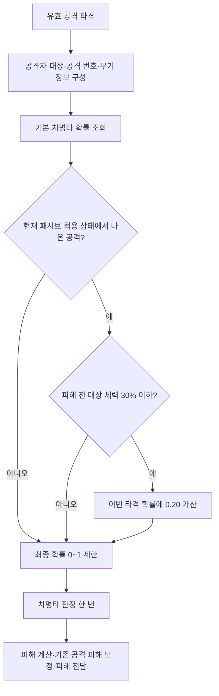

# 약점 포착 — 승인된 설계와 구현 단계

- 기록일: 2026-10-30
- 상태: 기본 공격·높고 낮은 체력의 확률 보정·해제·재선택 확인, 임시 로그 제거 후 사용자 재빌드 대기
- 대상: 카타나·레이피어의 선택형 무기 패시브
- 기획 효과: 적 체력이 30% 이하일 때 치명타 확률 20% 증가
- 승인 기준: 증가량은 20%포인트 가산, 권장안으로 구현하고 추후 피드백에 따라 조정
- 진행 순서: 2 / 3, 이전 [거인의 강인함](giant-fortitude.md) → 다음 [철벽](iron-wall.md)
- 진행 상태·검증 기록: [순차 구현 작업 메모](../../todo/giant-fortitude-weak-point-iron-wall.md)
- 협업: 에이전트가 C++ 코드를 한 단계씩 수정, 사용자가 각 단계의 빌드·실행과 Editor 자산 연결 담당

## 승인된 동작

| 항목 | 기준 |
|---|---|
| 활성 조건 | 현재 장착 무기 종류의 선택 패시브가 약점 포착인 동안 |
| 대상 체력 | 이번 타격의 피해 적용 전, 살아 있는 대상의 `CurrentHP <= MaxHP × 0.30` |
| 확률 증가 | 이번 타격의 치명타 확률에 0.20 가산, 최종 확률은 0~1로 제한 |
| 적용 공격 | 현재 패시브 적용 상태에서 나온 유효한 평타·스킬 공격 충돌 |
| 근접·투사체 | 동일한 체력 기준, 기존 공격 출처·생존 주기·패시브 적용 번호 검증 유지 |
| 다단·광역 공격 | 각 타격·대상별로 피해 전 체력을 다시 확인 |
| 직접 피해·지속 피해 | 치명타 계산 경로를 새로 추가하지 않음 |
| 유지·해제 | 중첩·충전·타이머 없음, 해제 시 자기 사건 구독 제거 |

| 기본 치명타 확률 | 대상 체력 | 이번 타격의 최종 확률 |
|---:|---:|---:|
| 10% | 31% | 10% |
| 10% | 30% | 30% |
| 10% | 29% | 30% |
| 90% | 30% 이하 | 100% |

대상이 31%에서 이번 타격으로 29%가 된 경우 이번 타격에는 추가 확률 없음
다음 타격부터 낮아진 체력을 기준으로 검사

## 현재 구조와 연결

- `DT_WeaponPassives`의 전용 행과 `WeaponSkillMap.PassiveSkill` 후보 등록
- 후보의 `PassiveWeaponTypes`에 카타나·레이피어 종류 태그 지정, 종류별 한 개 선택 유지
- `BP_Passive_WeakPoint`: 기존 `UMVStatusEffectPassiveAbility`의 자식 Blueprint
- `DA_Passive_WeakPoint`: `Infinite`·`OnePerSource`·`NoStack`·`MaxStacks = 1`
- `UMVWeakPointPassiveBehavior`: 치명타 확률 보정 사건 구독·조건 검사·해제 담당
- 패시브 행의 비용·연계·`OnHitStatusEffects` 없음, 제거된 패시브 세트 경로 사용 안 함
- 현 적용 경로는 `EffectId`가 아닌 정의 자산·출처로 본체를 식별하므로, 미사용 GameplayTag를 새로 등록하지 않음
- 치명타 사건과 행동 C++, 본체 데이터 자산·Blueprint·패시브 행·한손 시험 후보 연결 완료

## 치명타 판정 전 보정

현재 `ResolveFinalDamage`에서 치명타를 판정한 뒤 `OnModifyOutgoingAttackDamage`를 호출
약점 포착은 치명타를 뽑기 전에 확률을 바꿔야 하므로 `UMVCombatComponent`에 전용 사건 `OnModifyOutgoingCriticalChance` 추가

- `UMVHitResolverSubsystem`에서 식별 정보를 먼저 구성하고 치명타 판정 전 보정 함수 호출
- 치명타 계산 함수는 보정 완료된 이번 타격의 확률 사용
- 공격자의 `CriticalPercent` 원본은 변경하지 않음
- 사건에 전달하는 타격 정보로 대상별 임시 확률을 계산, 매 프레임 대상 체력 감시 불필요
- 기존 방어력 계산·치명타 배율·이후 피해 보정 순서 유지
- 기존 직접 피해 경로에 치명타를 적용하거나 이미 계산한 치명타를 다시 추첨하지 않음

## 공격 출처와 수명

- 기존 `IsAttackFromCurrentPassiveActivation`의 공격 번호·생존 주기·무기·패시브 적용 번호 검증 공유
- 투사체는 발사 때 기록한 실행 정보와 무기 정보를 사용, 현재 재생 중인 근접 공격 정보만으로 판정하지 않음
- 검사에 필요한 식별 정보를 치명타 판정 전에 준비하고 기존 검증 코드를 재사용하도록 연결
- 패시브 선택 전에 발사한 탄, 선택 변경 후 돌아온 탄, 사망 전 발사한 탄은 새 약점 포착 보정을 받지 않음
- 위 조건은 패시브 보정의 허용 여부이며 해당 공격의 기본 피해 처리 여부는 기존 전투 규칙 유지
- 소유자·대상·본체 효과가 유효하고 소유자와 대상이 살아 있을 때만 체력 비율 검사
- `OnApplied`에서 사건 구독, `OnRemoved`에서 자기 구독만 해제
- 선택 반복·적용 실패·소유자 파괴 시 중복 구독과 잔존 구독 방지

## 구현 단계

| 단계 | 수정 범위 | 완료 기준 |
|---:|---|---|
| 1 | 치명타 판정 전 사건과 타격 식별 정보 연결 | 보정 없는 기존 공격 결과 유지, 공격 출처 검증 가능 |
| 2 | 약점 포착 행동과 체력 조건·확률 가산 | 30% 경계와 20%포인트 증가, 상한 100% |
| 3 | 본체 상태 효과·공용 Ability 자식·무기 종류 후보 | 선택된 한 개만 동작, 해제 후 보정 없음 |
| 4 | 다중 대상·투사체·사망 경계 확인과 임시 로그 정리 | 대상별 확률 독립, 이전 공격이 새 보정을 받지 않음 |

## 검증 기준

| 확인 항목 | 기대 결과 |
|---|---|
| 체력 30% 초과·정확히 30%·미만 | 초과는 기본 확률, 이하만 +20%포인트 |
| 체력 경계를 넘기는 타격 | 타격 전 체력 기준, 이번 피해로 넘어가면 다음 타격부터 적용 |
| 기본 확률 90%, 대상 체력 30% 이하 | 최종 100%, 범위 초과 없음 |
| 한 공격으로 높은 체력·낮은 체력 대상 동시 적중 | 각 대상의 조건만 해당 타격에 반영 |
| 다단 공격 | 타격마다 그 시점의 체력 재검사, 확률 누적 없음 |
| 투사체 발사 후 패시브 변경·원래 선택으로 복귀 | 이전 적용 번호의 탄에 새 패시브 보정 없음 |
| 사망·부활 후 이전 탄 적중 | 이전 생존 주기의 탄에 새 보정 없음 |
| 적용·반복 선택·해제 | 기본 `CriticalPercent` 유지, 구독 중복·잔존 없음 |
| 직접·지속 피해 | 기존 피해 경로 유지, 추가 치명타 없음 |

- 검증에 사용한 `WeakPointTrace` 적용·해제·확률 로그는 확인 후 제거
- 적은 타격 횟수의 치명타 발생 빈도만으로 확률 정확성을 판정하지 않음
- `CriticalDamage = 1`이면 성공해도 피해가 같으므로 최종 확률과 성공 결과를 함께 확인
- 현재 상태: Windows/Codex에서 1단계 사용자 빌드·기본 공격 확인을 전달받고 2단계 행동 C++ 작성; 사용자 로그에서 대상 HP 1403.50/4000.00은 확률 0→0, HP 1034.00/4000.00은 0→0.20 확인, 해제·재선택·중복 없음은 사용자 보고; 로그 제거 후 재빌드·실제 치명타·정확히 30% 경계·투사체는 미검증
- 빌드·컴파일·Editor 실행은 사용자 담당이며 에이전트는 수행하지 않음
- 실제 검증 결과는 작업 메모에 기록하고, 구현·검증 후 위키에 실제 동작 반영

## 관련 근거

- [무기 패시브 위키](../../wiki/Features/Combat/Weapon-Passives/document.md)
- [무기 종류별 단일 선택 설계](single-selection.md)
- [치명타·공격 피해 계산](../../../Source/Maverick/Combat/MVHitResolverSubsystem.cpp)
- [패시브 적용 번호와 공격 출처 검사](../../../Source/Maverick/Components/MVCombatComponent.cpp)
- [타격 정보](../../../Source/Maverick/Public/Struct/MVHitTypes.h)
- [공용 패시브 Ability](../../../Source/Maverick/Combat/Passive/MVStatusEffectPassiveAbility.h)
