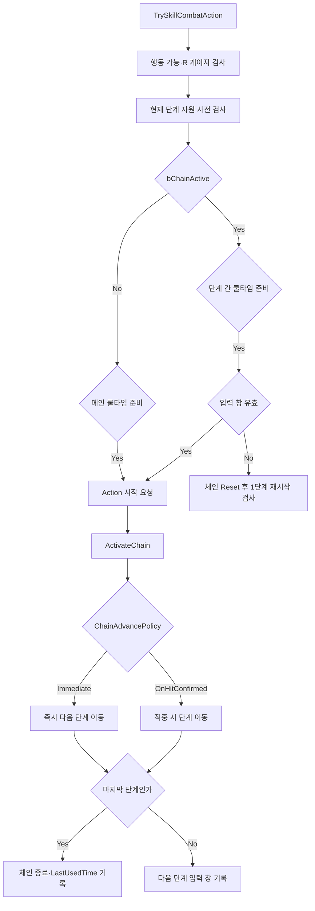

# Combat Component 쿨타임 컨텍스트

- 목표: `UMVCombatComponent`의 Skill 쿨타임·체인 만료 구조와 수정 전 위험 지점 정리
- 상태: 코드 경로 분석 완료, 정책 결정·재현 로그·자동화 테스트·구현 대기
- 결정: `SkillMap`의 활성 Skill을 주 범위로 두고 `FMVSkillEntry`를 공유하는 기본 공격은 정책 차이만 비교
- 위키 검토: `변경 불필요: 구현 전 조사 컨텍스트이며 확정된 계약 변경 없음`
- 검증: `MVCombatComponent.h/.cpp`, `MVSkillDataTableColumn.h`, `MVAbilityBase.h/.cpp`, HUD 투영 코드 정적 분석 완료, 쿨타임 전용 자동화·PIE 미실행

## 범위와 정본

- 활성 Skill 슬롯 정본: `TMap<EMVSkillSlot, FMVSkillEntry> SkillMap`
- 슬롯 엔트리 구성: `RefreshSkillSlot()` → `BuildSkillEntryFromRowHandle()`
- 실행 진입점: `TrySkillCombatAction()` → `TrySkill()` → `TryStartActionWithAbility()`
- 시간 기준: `UWorld::GetTimeSeconds()`의 `float`
- 데이터 원본: `FMVSkillDataTableColumn`
  - 전체 Skill·체인 쿨타임: 시작 Row의 `CooldownDuration`
  - 단계 간 대기: 현재로 간주되는 Row의 `InterStageCooldown`
  - 후속 입력 허용 길이: 현재로 간주되는 Row의 `InputWindowDuration`
  - 진행 시점: `ChainAdvancePolicy`의 `Immediate` 또는 `OnHitConfirmed`
- Passive는 `SkillMap` 실행 경로 밖에서 별도 적용되므로 쿨타임 대상 아님
- 기본 공격은 `FMVSkillEntry`를 공유하지만 `TryBasicAttack()`이 `ResetBasicAttackTime` 중심 정책을 사용하며 Skill의 메인 쿨타임 판정을 사용하지 않음

## 런타임 상태

| 상태 | 의미 | 주요 기록 지점 |
| --- | --- | --- |
| `MainCooldownDuration` | 전체 Skill 또는 완주 체인의 메인 쿨타임 | 체인 시작 Row의 `CooldownDuration` |
| `LastUsedTime` | 메인 쿨타임 기준 시각 | 단일 Skill 시작, 체인 완료 |
| `CurrentChainStageIndex` | 다음 실행 대상으로 취급되는 체인 단계 | `ActivateChain()`, `TryAdvanceChainStage()` |
| `bChainActive` | 체인 진행 상태 보유 여부 | `ActivateChain()`, `TryAdvanceChainStage()`, `ResetChain()` |
| `LastStageActivationTime` | 단계 간 쿨타임 기준 시각 | 체인 활성·진행·Ability 종료 |
| `InputWindowCloseTime` | 입력 창 절대 종료 시각 | 체인 활성·진행·Ability 종료 |
| `bCurrentStageHitConfirmed` | 현재 단계의 중복 적중 진행 방지 | `HandleHitResolved()` |

`FMVSkillEntry` 하나에 정적 정의, 생성된 Ability 배열, 쿨타임, 체인 진행 상태가 함께 들어 있음

## 쿨타임과 체인 흐름

### 메인 쿨타임 시작점

| 형태 | 현재 시작점 |
| --- | --- |
| 단일 Skill | Action 시작 성공 직후 `ActivateChain()`에서 기록 |
| `Immediate` 체인 | 마지막 단계 Action 시작 성공 직후 `TryAdvanceChainStage()`에서 기록 |
| `OnHitConfirmed` 체인 | 마지막 단계 적중 시 `HandleHitResolved()`에서 기록 |
| 미완주·빗나간 `OnHitConfirmed` 체인 | `LastUsedTime`을 기록하지 않은 채 입력 창 만료 가능 |

Ability의 실제 활성화와 비용 소모는 이후 AnimNotify의 `UMVAbilityBase::StartAbility()`에서 발생함

## Ability 종료와 입력 창

- `UMVAbilityBase::EndAbility()` → `HandleAbilityEnded()` → `StartPostAbilityResetWindow()`
- 일반 체인은 Ability 종료 시 `LastStageActivationTime`과 입력 창 종료 시각을 다시 계산
- `OnHitConfirmed` 단계는 Ability 종료 시 `LastStageActivationTime`만 갱신하고 `InputWindowCloseTime`은 유지
- Action 종료 시 Ability가 아직 활성 상태면 강제 `EndAbility()` 호출
- Ability가 시작되지 않았어도 `bCurrentAbilityAwaitingCompletion`이 남아 있으면 `HandleAbilityEnded()`를 직접 호출
- `HandleActionEnded()`는 전달받은 `bInterrupted`를 사용하지 않음

## UI 투영

- `UMVPlayerSkillHUDWidget::NativeTick()`이 매 프레임 `GetSkillSlotRuntimeState()` 호출
- 체인 상태는 `bChainActive && IsInputWindowValid()`일 때만 UI의 활성 체인으로 표시
- 내부 `bChainActive`가 남아 있으면 입력 창이 만료돼도 UI 계산은 체인 분기를 사용
- 실행 중인 Ability가 슬롯에 속하면 `CooldownRemaining`을 전체 `CooldownDuration`으로 강제
- 메인 쿨타임은 `LastUsedTime > 0`일 때만 UI 남은 시간을 계산

## 발생 가능한 문제점

### 1. 만료 체인의 이전 단계 비용이 1단계 재시작을 차단

- `TrySkill()`이 입력 창 만료 처리보다 먼저 현재 단계의 `CanConsumeActionCost()` 실행
- 예: 2단계 비용은 부족하지만 1단계 비용은 충분한 상태에서 체인 만료
- 현재 결과: 2단계 비용 검사에서 반환되어 `ResetChain()`과 1단계 재시작에 도달하지 못함
- 부수 효과: 만료된 `bChainActive`가 계속 남아 동일 실패 반복 가능

### 2. 만료 정리가 입력 시점까지 지연

- 입력 창 종료용 Timer나 Tick 정리 없음
- UI는 만료된 체인을 비활성으로 표시하지만 `FMVSkillEntry::bChainActive`는 `true` 유지
- 이후 쿨타임 계산, 비용 검사, 슬롯 교체가 UI와 다른 내부 상태를 관찰 가능

### 3. 단계 간 쿨타임 검사가 만료 처리보다 선행

- 활성 체인 분기 진입 직후 `IsInterStageCooldownValid()` 실패 시 반환
- 만료된 체인도 단계 쿨타임이 준비될 때까지 정리되지 않을 수 있음
- 같은 검사가 만료 검사 뒤에도 다시 실행되어 분기 의미가 중복됨

### 4. 월드 시간 `0`이 미사용 Sentinel과 충돌

- `IsMainCooldownReady()`는 `LastUsedTime == 0`을 미사용 상태로 판정
- 월드 시간 `0`에 단일 Skill 사용 또는 체인 완료 시 실제 사용 기록과 미사용 상태 구분 불가
- UI도 `LastUsedTime > 0` 조건으로 인해 해당 쿨타임을 표시하지 않음

### 5. 쿨타임 시작 의미가 Skill 형태별로 다름

- 단일 Skill은 Action 시작 시점, `Immediate` 체인은 마지막 Action 시작 시점, `OnHitConfirmed` 체인은 마지막 적중 시점
- 최종 단계 빗나감·피격 중단·Notify 누락 시 메인 쿨타임이 시작되지 않을 수 있음
- 의도된 보상 정책인지 실행 실패 악용 경로인지 계약 확정 필요

### 6. Action 시작과 Ability 활성·비용 소모가 원자적이지 않음

- Action 시작 성공 직후 체인 활성·진행·메인 쿨타임 변경
- 실제 Ability 활성과 비용 소모는 후속 AnimNotify에서 수행
- Notify 미호출 또는 `TryConsumeAbilityCost()` 실패 시 공격은 활성화되지 않았지만 체인·쿨타임은 진행 가능
- Action 종료가 먼저 오면 미활성 Ability에도 종료 후 입력 창 처리가 실행 가능

### 7. 중단된 Action이 정상 종료와 같은 체인 창을 생성

- `HandleActionEnded()`가 `bInterrupted` 무시
- 회피·피격·강제 전환으로 중단된 Skill도 정상 종료와 같은 `StartPostAbilityResetWindow()` 적용 가능
- 중단 시 체인 유지·초기화·메인 쿨타임 적용 중 원하는 정책 확정 필요

### 8. 마지막 `OnHitConfirmed` 단계 미적중 시 쿨타임 미기록

- 마지막 단계는 적중해야 `TryAdvanceChainStage()`가 완료 분기로 진입
- 미적중 상태에서 Ability가 끝나면 체인은 활성 상태로 남고 메인 쿨타임은 시작되지 않음
- 입력 창 만료 후 1단계 즉시 재시작이 가능해질 수 있음

### 9. 맵 재구성으로 진행 상태와 쿨타임 소실

- `ResetSkillMap()`은 전체 `SkillMap`을 비운 뒤 새 엔트리 생성
- `RefreshSkillSlot()`도 대상 슬롯을 제거한 뒤 새 엔트리 생성
- 무기 변경·장착 Skill 갱신으로 `LastUsedTime`, 체인 단계, 입력 창이 모두 초기화되어 쿨타임 우회 가능
- 실행 중 Ability가 교체 전 엔트리에 속하면 `HandleAbilityEnded()`가 새 맵에서 엔트리를 찾지 못해 종료 상태 반영 누락 가능

### 10. 체인 구축 실패가 부분 성공으로 등록

- 중간 Row·`AbilityReference` 누락 시 구축 중단 후 앞부분 Ability가 하나라도 있으면 성공 반환
- 순환 Chain은 최대 100개까지 중복 인스턴스를 만든 뒤 등록 가능
- 잘린 체인의 마지막 단계와 쿨타임 완료 의미가 원본 데이터 의도와 달라질 수 있음

### 11. 단계 시간 설정의 소유 Row가 직관적이지 않음

- `TryAdvanceChainStage()`는 인덱스를 먼저 증가한 뒤 새 현재 Row의 `InterStageCooldown`·`InputWindowDuration` 사용
- 실질적으로 후속 단계 Row가 자신에게 진입하기 전 대기·입력 창을 정의
- 기획자가 완료한 이전 단계 Row의 설정으로 이해하면 데이터와 런타임 불일치 발생

### 12. 실행 중 UI와 실제 준비 시점 불일치 가능

- UI는 Ability 실행 중 남은 쿨타임을 항상 전체 길이로 표시
- 실제 `LastStageActivationTime` 기준 시간은 계속 흐르며 긴 Action 도중 단계 쿨타임이 준비될 수 있음
- `Immediate` 진행은 실행 Ability와 `CurrentChainStageIndex`가 서로 다른 단계를 가리킬 수 있음

### 13. 시간 기준 정책 미확정

- `GetTimeSeconds()` 기반이므로 Pause와 Global Time Dilation의 영향을 받음
- 실시간 기준 쿨타임이 요구되면 현재 구현과 불일치

## 우선 결정 사항

- [ ] 메인 쿨타임 시작 이벤트: Action 승인, Ability 실제 시작, Ability 종료, 마지막 단계 완료 중 하나로 통일
- [ ] 미적중·중단·Notify 실패 시 쿨타임과 체인 유지 정책 확정
- [ ] 입력 창 만료 정리 방식: 입력 시 Lazy 정리, Timer, 조건부 Tick 중 선택
- [ ] `InterStageCooldown`·`InputWindowDuration`의 소유 Row 계약 확정
- [ ] 무기·장착 Skill 변경 시 기존 쿨타임 이전 또는 취소 정책 확정
- [ ] Pause·Time Dilation 영향을 받는 게임 시간 사용 여부 확정

## 우선 검증 시나리오

- [ ] 월드 시간 `0`에서 단일 Skill 사용 후 메인 쿨타임 차단·UI 표시
- [ ] 비싼 2단계에서 입력 창 만료 후 저렴한 1단계 재시작
- [ ] 단계 쿨타임보다 짧거나 `0`인 입력 창의 경계 시각 처리
- [ ] `OnHitConfirmed` 마지막 단계 명중·미적중·중단 비교
- [ ] Action 시작 성공 후 Ability Notify 누락 또는 비용 소모 실패
- [ ] 쿨타임·체인 진행 중 무기 변경과 동일 슬롯 Skill 교체
- [ ] 실행 중 Skill 교체 후 기존 Ability 종료 이벤트 처리
- [ ] 중간 Row 누락·Ability 누락·자기 순환·다중 Row 순환 Chain 등록 거부
- [ ] HUD의 `bUsable`, 체인 Timer, 실제 `TrySkill()` 결과 일치
- [ ] Pause·Time Dilation 중 남은 시간 변화 확인

## 관련 코드

- `Source/Maverick/Components/MVCombatComponent.h`
- `Source/Maverick/Components/MVCombatComponent.cpp`
- `Source/Maverick/Public/Tables/MVSkillDataTableColumn.h`
- `Source/Maverick/Combat/MVAbilityBase.h`
- `Source/Maverick/Combat/MVAbilityBase.cpp`
- `Source/Maverick/UI/HUD/MVPlayerSkillHUDWidget.cpp`

