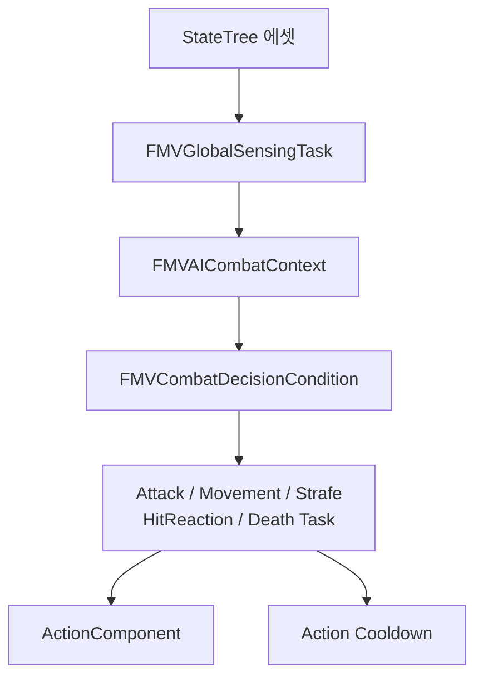
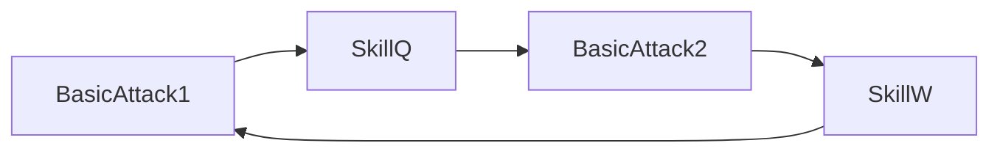

# AI StateTree

## 실행 흐름

## 문맥과 실행 경계

- `FMVGlobalSensingTask`: 거리, 각도, LOS, 전투 영역, 이동 경로, 실행 상태, Cooldown 갱신
- Condition: 공유 문맥 판정
- 상태 우선순위·Property Binding: StateTree 에셋 순서 소유
- 공격 경로 A: `EnemyCombatAction -> Enemy -> CombatComponent -> ActionComponent`
- 공격 경로 B: `SelectAndExecuteAttack -> ActionComponent`
- `AMVAIController` AIPerception `TargetActor`: Controller 감지 경로
- GlobalSensing 현재 플레이어 탐색: 별도 타깃 탐색 경로
- StateTree Component 조립·배치: Blueprint 책임
- 탐색 순서: Controller BrainComponent → 기타 Controller Component → Pawn Component

## StateTree 계약

### 공격 예고 이벤트

- `UMVAnimNotify_AttackNotice`: 전방 박스와 겹치는 `AMVEnemy`에 호출당 한 번 예고 전달, 게임 월드에서만 실행
- `AMVEnemy::ReceiveAttackNotice`: Controller Brain → Controller 컴포넌트 → Pawn 컴포넌트 순서의 첫 실행 중 StateTree에 전송
- 이벤트 태그: `AI.Event.AttackNotice`, 데이터: `FMVAIDodgeRequest`
- 전달 값: `ThreatActor`, `ThreatLocation`, `DistanceToThreat`, `AngleToThreat`; 각도는 적 로컬 전방 기준 부호 있는 도 단위
- `Direction`: 기본 `Back`, `ThreatActionType`: 미지정; 실제 회피 판단·방향 선택은 StateTree 책임
- 로그 `EventSent=1`: 이벤트 전달 경로 호출 완료; 전환 선택이나 회피 동작 성공의 증거와 구분
- 예고 박스 검출은 실제 피해 적중과 별도, 적의 충돌 쿼리 활성화 필요

### 상태 선택

- 상위 상태 우선 성립 시 하위 MoveToTarget·Strafe 차단
- 상태 순서와 후보 범위의 동시 설계
- `GlobalSensing.CombatContext`: Condition·Task 방향 Binding
- 공격 Task `LastAttackTag`: GlobalSensing 방향 Binding
- 공격 가능 범위: 후보별 거리·각도
- `CombatMaxDistance`: 이동 상태 분기 기준, 공격 사거리와 분리
- Focusing: 지속 부모 또는 이동 상태 소유
- 공격 중 강제 회전 제외 시 공격 상태 Focusing 미배치
- GlobalSensing과 Global Action Cooldown Task의 Cooldown Component Tick 단일 소유

### Duelist 추적 후 공격 전환

- `ST_DuelistBossAIStateTree.Alive.Chase`: 기존 `STT_Chase`와 `FMVChaseDistanceAttackTask` 병렬 실행, `Any` 완료 판정과 기존 성공 → `Attack` 전이 사용
- 감시 대상: 소유 `AMVAIController.TargetActor`, 거리: Pawn·대상 원점 간 3차원 cm 거리
- `Distance Hold Attack`의 `MinAttackDistance = 300cm`, `RequiredDuration = 1초`; 최소 거리 이상을 동일 대상으로 연속 유지하면 성공 반환
- 거리 미달·대상 부재·대상 변경·새 Chase 진입 시 누적 시간 초기화; 유지 진입에서는 시간 보존, Chase 종료 시 `StopMovement`
- 기존 `AI MoveTo` 도착 성공도 즉시 공격 전환 가능; 감시 성공 이후 공격 종류 선택·공격 사거리 검사는 기존 공격 트리 책임
- 공용 `STT_Chase` 수정 없이 Duelist 메인 AI에만 감시 Task 배치

### Duelist 범위 밖 SkillQ 선택

- `FMVBossSelectAttackTask`: 새 진입 시 Controller의 Pawn·`TargetActor` 원점 간 3차원 거리 판정, `NormalAttackRange` 초과 시 `OutOfRangeAttackName`과 같은 후보 우선 선택
- `ST_DuelistBoss_Attack.BossAttack`: `NormalAttackRange = 300cm`, `OutOfRangeAttackName = AttackQ`; 300cm 이하는 후보 배열 순서 선택
- `AttackQ`: 선택 후보 이름, 연결 상태 `SkillQ`의 실행 행 이름 `SkillQ`와 구분; 현재 실행 몽타주 `AM_Duelist_Q`
- 부모 선택 방식 `TryEnterState`: 기본 자식의 선행 실행 없이 선택 Task부터 진입, 실제 하위 상태 전이는 기존 다음 Tick 경로 사용
- `SkillQ` 실행 Task의 `AttackRange = 0`: 거리 초과 생략 해제; 양수 `AttackRange`의 기존 사거리 검사와 대상·공격 행 검증 보존
- 기본 `OutOfRangeAttackName = None` 또는 대상·지정 후보 부재: 배열 순서 선택; 무작위 선택 제거
- Chase의 1초 거리 유지 판정과 별도: 공격 트리 진입 이후 추가 대기 시간 없음

### Duelist 기본 공격·스킬 교대

- `BossAttack.Choices` 후보 배열: `BaseAttack1`, `AttackQ`, `BaseAttack2`, `AttackW`; 공격 이름과 연결 상태를 함께 유지하는 순서 편집
- `AMVAIController.NextBossAttackChoiceIndex`: Controller별 다음 후보 위치, 공격 트리 종료·재진입 중 보존, `OnPossess`에서 0으로 초기화
- 범위 안 선택 시 다음 위치 전진·배열 끝에서 0으로 순환, 유지 진입은 재선택·전진 제외
- 범위 밖 지정 SkillQ 선택 시 순서 위치 보존, 범위 복귀 후 대기 중 후보부터 교대 재개
- 순서 전진 기준: 선택 Task 진입 시 후보 선택; 이후 실행 실패·공격 중단에 대한 순서 되돌리기 제외
- `AMVAIController` 소유자 필수, Controller 부재 또는 후보 없는 선택은 실패 반환; 공격 사거리·실행 종료는 하위 Task 책임

### 보스 공격 종료

- Duelist의 이전 `Resonance` 몽타주 분기 제거, `SkillW` 완료 전이는 공격 트리 성공 종료로 정리
- HP 50% 조건의 공명 폭주는 선택 Task의 우선 링크와 전용 `Resonanace` Task만 사용, 일반 공격마다 추가 몽타주 실행 경로 제거

- `ST_DuelistBoss_Attack.BossAttack.Resonanace`: 공명 폭주 전용 `FMVDuelistResonanceTask`, 실행·그로기 회복 감시와 종료 브리지
- HP 감소로 50% 이하 도달 시 다음 선택에서 `ResonanceState` 우선, 범위 밖 SkillQ 예외·교대 순서 위치보다 높은 우선순위
- 수치·도약·실패 피해·화면 효과: `BP_Duelist.Resonance` 컴포넌트 책임, 채널링 파훼 계약은 [공명 폭주](../Duelist-Resonance/document.md) 참조

- `FMVBossExecuteAttackTask`: 양수 사거리 밖 공격 생략과 시작한 몽타주·액션 종료 모두 명시적 `RequestTransition(Succeeded)` 후 성공 반환
- 완료 판정 제외 Task의 성공 반환만으로 공격 트리 종료 보장 불가, 생략 시 후속 Tick 없는 경로까지 종료 요청 필요
- `ST_DuelistBoss_Attack.BasicAttack1`의 완료 판정 제외 설정에서 범위 생략 후 액션 없는 `Running` 재현, 명시적 성공 전이로 해소
- `ST_DuelistBossAIStateTree.Alive.Attack`: 연결 공격 트리 완료 후 `Chase` 복귀, 복귀 목적지는 에셋 전이 책임

### 적 대상 회전

- `AMVEnemy::GetTargetRotation`: `AttackTarget` 위치 기준 수평 Yaw 계산, 현재 Pitch·Roll 유지; 대상 부재·파괴·동일 수평 위치에서는 현재 회전 반환
- `STT_turnTarget.ContextActor`: `MVEnemy` 계열 적 Binding 필수, 유효한 적 변환 실패 시 `FinishTask(false)`
- Task Tick: `RInterpTo_Constant` 초당 720° 회전, 실행 구간은 활성 State 소유; `RotatingMovementComponent` 추가·Tick 토글 제거
- `ANS_RotateActor`: 적은 C++ 함수 직접 호출과 기존 `InterpSpeed` 보간, 그 외 Actor는 기존 `BPI_RotateActor` 경로 유지
- `BP_TutorialBoss`·`BP_NameLessPuppet`: 반환 서명이 충돌하는 회전 인터페이스와 구현 그래프 제거, `MVEnemy` 함수 상속; 플레이어 회전 인터페이스·공격 데이터 인터페이스 보존
- 기존 `ST_AIReaction`의 `BP_BaseBoss` 문맥은 `Character` 기반으로 새 Task 사용 대상 제외; 현재 Duelist 공격 트리에 회전 Task 신규 배치 제외

## 적 대상 회전 검증

2026-10-07 / Codex / Windows / Unreal Engine 5.8.3 실제 실행

- 일반 `MaverickEditor Win64 Development` 빌드·새 Editor 프로세스의 C++ 함수 노드 등록 통과, 패키징·네트워크 실행 범위 제외
- Task·Notify·Duelist·TutorialBoss·TutorialBoss1·NameLessPuppet의 Blueprint 컴파일 통과, 연결 StateTree 2개 Editor 컴파일 통과; 기존 Character 문맥의 적 변환 성공 보장 범위 제외
- PIE의 실제 `BP_Duelist`에서 C++ 대상 계산·Task Tick·Notify Tick 직접 호출 11항목 통과: 대상 이동·부재·파괴·동일 수평 위치, Pitch·Roll 보존, 0.05초당 36° Task 회전과 45° Notify 회전
- 플레이어 호환 검증 범위: 대기 상태의 기존 인터페이스 반환과 Notify 결과 일치; 이동·타깃 고정·전체 몽타주 구간과 실제 StateTree 전이 실행 미검증
- 보조 관측 오류: Python 비노출 함수·Rotator 위치 인자·정적 컴포넌트 이동성·ContextActor 편집 제한을 반사 호출·명시적 필드·가동성 수정으로 보정 후 최종 11항목 통과
- `BP_Duelist` 디스크 해시 동일, 플레이어 Blueprint 미저장 상태 보존·디스크 저장 제외

검증 요약: [enemy-target-rotation-validation.json](attachments/enemy-target-rotation-validation.json)
원본 관측·수정 전 백업: `Saved/EnemyTargetRotation`, Git 제외

## Duelist 교대 공격 검증

2026-10-10 / Codex / Windows / Unreal Engine 5.8.3 실제 실행

- 최종 일반 `MaverickEditor Win64 Development` 빌드·새 Editor 프로세스 실행 통과, C++ 컴파일·링크와 Blueprint의 순서 기록 속성 등록 확인; 패키징·네트워크 실행 미실행
- 실제 배치 `BP_Duelist`의 메인 `ST_DuelistBossAIStateTree` PIE: 300cm에서 8개 액션을 교대 순서대로 실행, 각 몽타주·서로 다른 액션 ID·다음 후보 위치 확인
- 첫 7개 액션의 종료 후 추적·다음 공격 연결 확인, 8번째 SkillW 시작 후 범위 예외 시험을 위해 의도적 중단; 두 번째 SkillW의 자연 종료 검증 범위 제외
- 공격 트리 분리 시험: 800·3000cm에서 SkillQ 실행·다음 위치 0 보존, 이후 300cm에서 BasicAttack1 실행·다음 위치 1로 전진 확인
- 검증용 PIE에서만 이동·충돌 비활성화·메시 자세 갱신 강제 적용; 실제 이동·피해·시각 품질·복수 보스의 동시 실행 검증 범위 제외
- 초기 Live Coding 컴파일·패치 성공과 별개로 임시 구조체 유형 불일치·Blueprint 새 속성 미등록 관측, 미저장 에셋 없는 상태에서 일반 빌드·재시작으로 복구; `.voltbl` 도구 진단 근본 해결 범위 제외
- 관측 보조 스크립트의 숨겨진 EditorData 조회·읽기 전용 속성 쓰기 실패를 공식 EditorData 조회·초기값 읽기로 교체, 최종 관측 오류 없음
- 범위 외 오류: `ST_BaseAIStateTree.Search` 파라미터 바인딩·`CHT_Attack_Player` 속성 바인딩 누락; 두 에셋 수정 제외, 해당 바인딩 재연결·컴파일이 별도 복구 경로
- 저장 후 일반 Editor 재시작·MCP 조회에서 교대 후보 순서와 정식 구조체 경로 유지 확인, 임시 로컬 Python 실행 설정 비활성 복구·검증 관측 종료

검증 요약: [boss-alternating-attacks-validation.json](attachments/boss-alternating-attacks-validation.json)
원본 관측·에셋 백업: `Saved/BossAlternatingAttack`, Git 제외

## Duelist 범위 밖 SkillQ 검증

2026-10-09 / Codex / Windows / Unreal Engine 5.8.3 실제 실행

- 임시 에셋 설정 도구 제거 후 최종 `MaverickEditor Win64 Development` 일반 빌드 통과, C++ 컴파일·Editor 모듈 링크 확인; 패키징·네트워크 실행 미실행
- `ST_DuelistBoss_Attack`의 선택 후보·부모 `TryEnterState`·SkillQ 사거리 설정 저장과 StateTree 컴파일 통과; 다른 연결 트리의 전체 유효성 보장 범위 제외
- 실제 배치 `BP_Duelist` PIE의 컴포넌트에 공격 트리 직접 연결, 299·300cm에서 `ForcedRangeAttack=0`과 기본 공격 실행 확인
- 301·800·3000cm에서 `ForcedRangeAttack=1`, 후보 `AttackQ`, 행 `SkillQ`, `AM_Duelist_Q` 실행 확인; 최초 액션 관측은 진입 후 각각 약 0.0155·0.0153·0.0152초
- 거리 고정을 위한 PIE 이동·충돌 비활성화와 NullRHI 실행 사용; 선택·액션 시작 검증 범위, 메인 AI 전체 전이·몽타주 종료·피해·공격 이동·시각 품질 미검증
- 범위 외 에셋 오류 관측: `ST_BaseAIStateTree.Search`의 Boss·Boss AIController 파라미터 바인딩으로 컴파일·링크 실패, `CHT_Attack_Player`의 속성 바인딩 누락; 두 에셋 수정 제외, 각 에셋의 해당 바인딩 재연결·컴파일이 별도 복구 경로
- 자동 관측·PIE·검증용 Editor 종료 완료, 임시 C++ 설정 코드 제거; 사용자 DataTable·몽타주 저장 제외

검증 요약: [boss-out-of-range-skill-q-validation.json](attachments/boss-out-of-range-skill-q-validation.json)
원본 관측·에셋 백업: `Saved/BossOutOfRangeSkillQ`, Git 제외

## Duelist 추적 전환 검증

2026-10-08 / Codex / Windows / Unreal Engine 5.8.3 실제 실행

- C++ Live Coding 컴파일·패치와 최종 Duelist StateTree Editor 컴파일·저장 통과; 사용자 미저장 에셋 보존을 위해 일반 Editor 빌드·재시작 미실행, 새 프로세스·패키징·네트워크 실행 미검증
- 최종 Live Coding의 `.voltbl` 메타데이터 진단과 별개로 패치 생성 성공 확인; 해당 도구 진단의 근본 해결은 검증 범위 제외
- 실제 배치 `BP_Duelist` PIE: Chase 진입 1.400초 → 거리 413.125cm·누적 1.000초에서 2.400초 동일 프레임 종료·공격 선택 확인, 이후 기존 도착 성공과 `BasicAttack1` 몽타주 실행 확인
- 초기화 분리 시험: 이동 Task만 임시 비활성화·PIE 충돌 비활성화, 200cm에서 기존 0.333초 초기화 후 800cm 새 누적 1.000초에 공격 선택; 최종 이동 Task 활성화·컴파일·저장 복구 완료
- 임시 C++ 추적 로그 제거 후 최종 컴파일·패치 통과; 자동 관측 종료와 PIE 종료 완료, 대상 변경·파괴의 실제 재현 및 모든 거리·공격 조합 검증 범위 제외

검증 요약: [duelist-chase-attack-validation.json](attachments/duelist-chase-attack-validation.json)
원본 관측·에셋 백업: `Saved/DuelistChaseAttack`, Git 제외

## 보스 공격 정지 수정 검증

2026-10-07 / Codex / Windows / Unreal Engine 5.8.3 실제 실행

- 임시 C++ 추적 로그로 실행 순서 확인 후 제거, 최종 변경은 범위 생략 분기의 성공 전이 1곳
- 배치된 `BP_Duelist`의 PIE 컴포넌트에 공격 트리만 연결한 350cm 시험: 수정 전 3.125초까지 액션 없는 `Running`, 수정 후 첫 관측 0.218초부터 `Succeeded`
- 공격 트리의 실행 결과는 `GetStateTreeRunStatus` 기준, 수정 후에도 참인 BrainComponent `IsRunning` 플래그와 구분
- 메인 AI 20초·61개 표본과 추적 로그: 사슬 공격·기본 공격·페이즈 동작 종료, 추적 복귀·다음 공격 연결 확인; 모든 공격·거리 조합의 무정지 보장 범위 제외
- 최초 관측 보조 스크립트의 보호 속성 `bAbilityActive` 조회 실패, 공개 상태값 관측으로 변경 후 61개 표본 수집 성공; 보조 스크립트 오류와 게임 동작 구분
- 최종 Windows Live Coding 컴파일·패치 통과, 사용자 DataTable 미저장 편집 보존을 위해 일반 Editor 빌드·프로세스 재시작 미실행; 새 프로세스 로딩·네트워크·패키징 보장 범위 제외
- 별도 에셋 결함: `DT_DuelistBossCombatAttack.SkillW`의 `AM_Duelist_SkillW` 누락으로 재생 실패 확인, 대체 공격 미지정으로 자동 교체·DataTable 저장 제외

검증 요약: [boss-attack-stall-validation.json](attachments/boss-attack-stall-validation.json)
원본 재현·관측 기록: `Saved/BossAttackStall`, Git 제외
