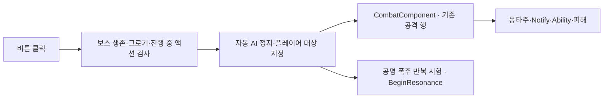

# 보스 공격 시험 UI

## 배치·연결

- C++: `Source/Maverick/UI/BossHUD/MVBossAttackTestWidget.h`·`.cpp`
- 위젯: `/Game/UI/HUD/WBP_BossAttackTest`, 기존 `WBP_MainHUD`의 자식 배치 유지
- `TestBoss`: 직접 지정 또는 `SetTestBoss`, 미지정 시 플레이어와 가장 가까운 공명 폭주 컴포넌트 보유 Duelist 탐색
- `AttackTable`: 기본 `DT_DuelistBossCombatAttack`, 위젯 기본값에서 변경 가능

| 사용자 제작 버튼 | 실행 대상 |
|---|---|
| `BaseAttackButton` | `BasicAttack1` |
| `QAttackButton` | `SkillQ` |
| `WAttackButton` | `SkillW`, 기존 돌진·사슬 Ability·발사 Notify |
| `PazeChangeAttackButton` | `StartResonanceForTest`, 기존 공명 폭주 실행 경로 |

## 실행·수명 계약

- 일반 공격: `TryStartCombatActionFromRowHandle`, DataTable의 대미지·재생 속도·자원 비용과 기존 Notify 판정 재사용
- 사망·그로기·액션·공명 폭주 진행 중 버튼 비활성화와 요청 차단, 종료 후 재활성화
- 등장 블록 진입 전·자동 AI 실행 중에도 준비 상태의 시험 버튼 사용 허용, 실제 시퀀스 재생 중에만 등장 연출 차단 적용
- 첫 클릭부터 수동 시험 제어 유지: 기존 StateTree 실행 여부·두 공격 대상 보관 후 트리 정지, 컨트롤러 Tick 유지로 `K`·`L` 입력 처리 지속
- `OnBossCombatControlRequested`: K/L·등장 연출 등 명시적 전투 제어 요청 직전에 시험 액션·공명 정리와 수동 소유권 해제, 요청자가 이후 대상·AI 상태 적용
- `K`: 기존 대상 유지·AI 시작, 대상 부재 시 기존 패트롤 경로 사용; `L`: 플레이어 대상 지정·AI 시작, K 선입력 없이 사용 가능
- 위젯 제거·보스 교체: 진행 중 시험 액션·공명 폭주 정리·기존 대상 복원, 이전 실행 중인 트리는 실제 시퀀스 재생 외 구간에서만 재시작
- 마우스 소유 경로: `UMVBossAttackTestWidget::NativeTick`의 입력 판정 → `SetUIMouseMode` → `EnsureMouseInput`
- 초기 UI 조작 상태: 커서 표시·`GameAndUI`·`CaptureDuringMouseDown`·`DoNotLock`, `J` 키도 같은 상태 선택
- 게임 배경 좌클릭: 커서 숨김·`GameOnly`·`CapturePermanently_IncludingInitialMouseDown`·`LockAlways`, 게임 화면 안 고정
- UI가 처리한 버튼 클릭은 PlayerInput의 배경 클릭 판정에서 제외, UI 조작 상태 유지; 보스 AI·수동 시험 상태 변경은 선택한 마우스 모드 변경 사유에서 제외
- 실제 보스 연출 또는 CommonUI의 다른 활성 창이 입력 소유 시 전환·강제 설정 제외, 창 종료 후 선택한 상태 복구
- `bUIMouseMode`: 현재 선택 상태, `SetUIMouseMode(bool)`: 같은 보호 조건을 적용하는 Blueprint 호출 경로
- CommonUI 기본 게임 입력 복구 이후 선택 상태 재적용, 제거 시 기존 커서 상태와 원래 커서 미표시 상태의 기본 게임 입력 복원
- 보스 탐색 이후 입력 상태 확인, 표시·잡기·고정 설정 일치 시 재설정 생략; PIE의 편집기 초점 전환은 엔진 기본 동작 유지
- 버튼 키보드 초점 제외, 플레이어 게임 입력과 공존하는 시험 패널

## 공명 폭주 반복 시험

- `StartResonanceForTest`·일반 `StartResonance`는 동일한 `BeginResonance`·도약·채널링·피해·암전 경로 사용
- 시험 시작: HP 50% 예약·1회 사용 표식 변경 제외, 생존·그로기·이미 활성 상태 검사 유지
- 실제 전투: HP 50% 예약·1회 사용 제한·StateTree `Resonanace` 경로 보존, 시험 실행 중 일반 경로의 중복 시작 차단
- 시험 중 발생한 정상 HP 예약은 보존; 위젯 제거 후 자동 AI에서 원래 기믹 실행 가능
- 실패 피해와 플레이어 사망도 실제 전투와 동일, 시험 버튼의 자동 체력 회복 제외

## K/L·상시 시험 검증 · 2026-11-02 · 마우스 정책 변경 전

- Windows·Codex·UE 5.8.3 일반 Editor 빌드와 자동 검사 11개 실행, 대기 중 실제 PlayerInput K/L 이벤트·연출 중 차단·중단 후 복구 확인
- 실제 `BaseBossTestLevel` PIE의 기존 위젯에서 버튼 4개의 `OnClicked` 방송으로 기본 공격·Q·W·공명 시작, 각 시험의 Controller Tick 유지·StateTree 정지와 명시적 AI 복귀 확인
- 실제 시퀀스 시작 시 시험 액션 정리·요청 차단, 중단 후 다음 UI 갱신에서 버튼 4개·커서 복구, 자동 AI 실행 중 준비 버튼·커서 유지 확인
- 운영체제 키 입력 시험은 다른 앱 전면 상태에서 입력 전 중단, Slate 합성 키는 보스 활성화 미관측; 키 경로의 증거는 자동 검사의 실제 PlayerInput 처리 기준, 운영체제 초점·물리 클릭·Windows 마우스 제한 영역 보장 제외
- 사용자 저장 파일의 실행 전 백업·종료 후 바이트와 수정 시각 복원·SHA256 일치 확인, 검증 슬롯 2개 삭제; 기존 사용자 에셋 4개 디스크 해시 동일
- 빌드 경고: 기존 PropertyBindingUtils 의존성 선언·UButton 직접 속성 접근·XGE 비활성 라이선스, 자동 검사 경고: 격리 게임 화면 부재·기존 사망 행 부재; 패키징·네트워크 미실행

검증 자료: [debug-controls-validation.json](attachments/debug-controls-validation.json)
원본 빌드·자동 검사·PIE 추적·백업: `Saved/BossDebugControls/`, Git 제외

## 클릭·J 마우스 전환 검증 · 2026-11-02

- Windows·Codex·UE 5.8.3 일반 Editor 빌드와 자동 검사 11개 통과, 실제 PlayerInput 좌클릭·J 이벤트와 위젯 Tick으로 전환·다음 프레임 유지·연출 중 변경 차단 확인
- 초기 격리 위젯에 Slate 구성이 없어 표시 조건 검사 실패, 실제 Slate 위젯 생성 후 최종 검사 통과; 게임 화면 부재·기존 사망 행 부재 경고 포함
- 실제 `BaseBossTestLevel` PIE의 공개 모드 선택 함수로 커서 숨김·표시와 여러 프레임 유지, AI 활성화 후 게임 모드 보존·시험 버튼 이벤트 후 UI 모드 보존 확인
- 보스 연출 중 커서 제어 유지·중단 후 복구, CommonUI 로딩 창 우선권·창 종료 후 선택한 게임 모드 복구 확인
- 키·좌클릭 경로의 증거는 PlayerInput 자동 검사, PIE 모드 유지와 버튼은 API·이벤트 방송 기준; 운영체제 물리 입력·버튼의 전체 Slate 적중 경로·Windows 마우스 제한 영역·패키징·네트워크 미검증
- 사용자 저장 파일 실행 전 백업·종료 후 원본 바이트와 수정 시각 복원·SHA256 일치, 검증 슬롯 삭제·원격 Python 설정 복구·Editor 미저장 패키지 없음

검증 자료: [mouse-input-mode-validation.json](attachments/mouse-input-mode-validation.json)
원본 빌드·자동 검사·PIE 추적·백업: `Saved/MouseInputMode/`, Git 제외

## 검증 · 2026-10-12

현재 Windows·Codex·Unreal Engine 5.8.3에서 실행한 범위와 한계: [검증 자료](attachments/validation.json)
AI 활성 전후 마우스 상태·Windows 제한 영역·Live Coding 검증: [마우스 고정 검증](attachments/mouse-lock-validation.json)
원시 자료·사용자 파일 백업: `Saved/BossAttackTest`, Git 제외

## develop 통합 기준

- 대상: `codex/boss-reference-assets` → `develop`, [PR #99](https://github.com/DreamersStudio3/Maverick/pull/99)
- C++ 검증 기준: `05862340`, Windows UE 5.8.3 일반 Editor 빌드·전투 자동 검사 3개 통과; 이후 문서 커밋의 실행 코드 변경 제외
- 일반 피해·박스 검사·공명 고정 피해의 머지 정합성: [검증 자료](../Hit-Stat-HitReaction/attachments/merge-build-validation.json)
- 임시 참고 에셋 사용·검증 범위: [[Research/Grave-Warden-Duelist-Reference/document|묘지기 투사 참고 에셋]]
