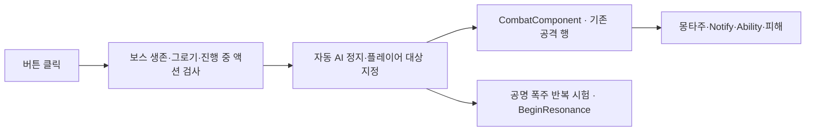

# 보스 공격 시험 UI

## 배치·연결

- C++: `Source/Maverick/UI/BossHUD/MVBossAttackTestWidget.h`·`.cpp`
- 위젯: `/Game/UI/HUD/WBP_BossAttackTest`, 기존 `WBP_MainHUD`의 자식 배치 유지
- `TestBoss`: 직접 지정 또는 `SetTestBoss`, 미지정 시 플레이어와 가장 가까운 공명 폭주 컴포넌트 보유 Duelist 탐색
- `AttackTable`: 기본 `DT_DuelistBossCombatAttack`, 위젯 기본값에서 변경 가능

| 사용자 제작 버튼 | 실행 대상 |
|---|---|
| `BaseAttackButton` | `BasicAttack1` |
| `QAttackButton` | `SkillQ` |
| `WAttackButton` | `SkillW`, 기존 돌진·사슬 Ability·발사 Notify |
| `PazeChangeAttackButton` | `StartResonanceForTest`, 기존 공명 폭주 실행 경로 |

## 실행·수명 계약

- 일반 공격: `TryStartCombatActionFromRowHandle`, DataTable의 대미지·재생 속도·자원 비용과 기존 Notify 판정 재사용
- 사망·그로기·액션·공명 폭주 진행 중 버튼 비활성화와 요청 차단, 종료 후 재활성화
- 첫 클릭부터 수동 시험 제어 유지: 기존 StateTree 실행 여부·컨트롤러 Tick·두 공격 대상 보관 후 자동 AI 정지, `K`·`L` 디버그 입력과 충돌 차단
- 위젯 제거·보스 교체: 진행 중 시험 액션·공명 폭주 정리, 기존 대상·Tick 복원, 이전에 실행 중인 트리만 재시작
- 마우스: `BossPlayStart=true` 및 수동 제어 미보유 시 커서 숨김·`GameOnly`·`CapturePermanently_IncludingInitialMouseDown`·`LockAlways`, 게임 화면 내부 고정
- AI 비활성·수동 시험: 커서 표시·`GameAndUI`·`DoNotLock`, CommonUI 기본 게임 입력 복구 이후 후속 클릭 복구; 제거 시 기존 커서 상태와 원래 커서 미표시 상태의 기본 게임 입력 복원
- 보스 탐색 이후 입력 상태 확인, 표시·잡기·고정 설정 일치 시 재설정 생략; PIE의 편집기 초점 전환은 엔진 기본 동작 유지
- 버튼 키보드 초점 제외, 플레이어 게임 입력과 공존하는 시험 패널

## 공명 폭주 반복 시험

- `StartResonanceForTest`·일반 `StartResonance`는 동일한 `BeginResonance`·도약·채널링·피해·암전 경로 사용
- 시험 시작: HP 50% 예약·1회 사용 표식 변경 제외, 생존·그로기·이미 활성 상태 검사 유지
- 실제 전투: HP 50% 예약·1회 사용 제한·StateTree `Resonanace` 경로 보존, 시험 실행 중 일반 경로의 중복 시작 차단
- 시험 중 발생한 정상 HP 예약은 보존; 위젯 제거 후 자동 AI에서 원래 기믹 실행 가능
- 실패 피해와 플레이어 사망도 실제 전투와 동일, 시험 버튼의 자동 체력 회복 제외

## 검증 · 2026-10-12

현재 Windows·Codex·Unreal Engine 5.8.3에서 실행한 범위와 한계: [검증 자료](attachments/validation.json)
AI 활성 전후 마우스 상태·Windows 제한 영역·Live Coding 검증: [마우스 고정 검증](attachments/mouse-lock-validation.json)
원시 자료·사용자 파일 백업: `Saved/BossAttackTest`, Git 제외
