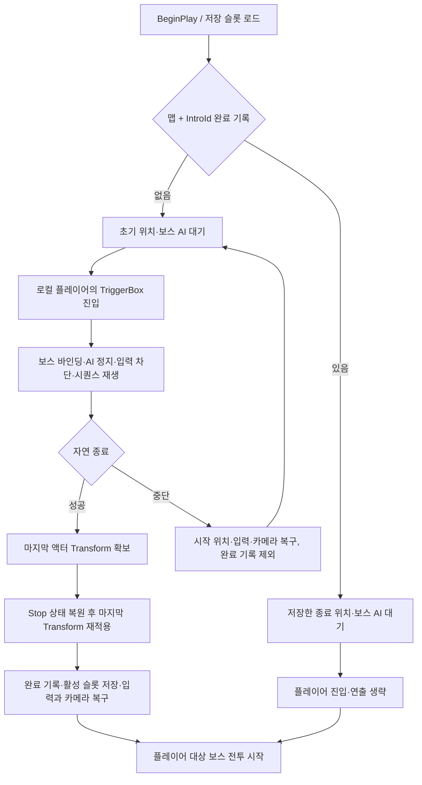

# 최초 보스 등장 연출

## 배치와 설정

| 항목 | 계약 / 현재 Duelist 예제 |
|---|---|
| 트리거 부모 | `AMVBossIntroTrigger`, `Source/Maverick/Cinematics/Boss/` |
| Blueprint | `/Game/DuelistComplete/BP_BossIntroTrigger` |
| 배치 레벨 | `/Game/Characters/NPC/BaseBoss/Level/BaseBossTestLevel`, 사용자가 배치한 액터 재사용 |
| `Boss` | 같은 레벨의 `BP_Duelist`, 배치 인스턴스에서 지정 |
| `Intro Sequence` | `/Game/DuelistComplete/Intro/LS_Duelist_Intro`, 30fps·6초 예제 |
| `Intro Id` | `Duelist_001`, 맵 내 보스별 고유 값 |
| `Boss Binding Tag` | `Boss`, 시퀀스의 보스 액터 바인딩 태그와 동일 값 |
| `TriggerBox` | `Box Extent`로 진입 범위 설정, Pawn 겹침·겹침 이벤트 활성화 유지 |

- 보스 하나당 트리거 하나 배치, 다른 보스에서도 같은 부모와 별도 `Boss`·시퀀스·식별자 재사용
- `LS_Duelist_Intro`: 보스 액터 Transform·메시 애니메이션·생성 카메라·Camera Cuts 포함
- 보스 액터 바인딩 우클릭 → `Tags`에 `Boss` 지정, 메시 애니메이션 바인딩은 해당 액터의 자식
- 종료 위치는 보스 액터·캡슐 Transform 기준, 메시 애니메이션만의 이동은 저장 위치에 미포함
- 예제 구성 도구: `Scripts/Editor/ConfigureDuelistIntro.py`, `BaseBossTestLevel`에서만 실행; 기존 트리거 위치·범위와 기존 시퀀스 트랙 보존, Camera Cuts 부재 시 예제 카메라 추가

## 실행 흐름

## 수명과 책임

- `AMVBossIntroTrigger`: 겹침·시퀀스·입력 차단·복구·AI 전투 시작 브리지 소유, 단일 로컬 플레이어 기준
- `bPauseAtEnd`로 마지막 평가 Transform 확보, `ForceRestoreState`와 `Stop` 이후 해당 Transform 재적용
- 대기·재생 중 `AMVAIController.bBossIntroBlocked` 활성, K/L·수동 공격 시험의 전투 시작 우회 차단
- 입력 차단은 InputManager 별도 횟수·PlayerController 이동과 시점 차단·Pawn 입력 비활성화 사용, 기존 차단 횟수 보존
- 중단·플레이어 변경·사망·트리거 제거: 입력·카메라·생성 시퀀스 정리, 중단 연출의 관람 기록 제외
- 완료 후 같은 전투의 재진입: 재생·저장 위치 순간 이동 제외, 기존 전투 지속
- 종료 위치 복원 후 전투 활성화부터 기존 AI의 추적·이동 허용
- `OnIntroStarted`, `OnIntroEnded(bCompleted)`: 보스별 Blueprint 연출 연결 지점

## 저장 계약

- `FMVWorldSaveData.BossIntros`: `IntroId`·PIE 접두사 제외 맵 이름·최종 `FTransform`, 액터 참조 없음
- 자연 종료에만 `RecordBossIntroCompleted`와 활성 슬롯 저장, 첫 완료 위치 보존
- GameInstance 초기화에서 기존 기본 슬롯 자동 로드, 다른 프로필 선택은 `LoadFromSlot` 사용
- `SaveVersion = 3`, 이전 슬롯의 새 배열은 기본 빈 값, 기존 성장 데이터 업그레이드 유지
- 슬롯 쓰기 실패: 현재 실행의 관람 기록 유지·경고 출력, 다음 실행의 관람 상태 유지 보장 제외
- 새 게임: `ResetSaveData` 후 해당 슬롯 저장·맵 재진입 또는 별도 빈 슬롯 사용; 기존 디스크 기록 미갱신 상태의 실행 재시작은 원래 완료 기록 로드
- 개발 중 재관람 시험: 별도 저장 슬롯 권장, `Intro Id` 변경은 별도 보스 기록으로 처리

## 검증

2026-10-13 / Codex / Windows / Unreal Engine 5.8.3 실제 실행

- 일반 `MaverickEditor Win64 Development` 빌드 통과: XGE 라이선스 비활성 경고 동반, C++ 컴파일·링크 확인; 패키징·네트워크 실행 미실행으로 해당 환경 보장 제외
- 자동 검사 11개 통과: 등장 1·전투 3·성장 7; 2개 검사에서 경고 포함, 격리 월드의 게임 화면 부재 2건과 기존 사망 행 부재 1건, 실제 게임 화면·최종 사망 표현의 증거 범위 제외
- 등장 자동 검사: 최초 진입·중복 차단·중단과 재시도·입력 차단 횟수·자연 종료 위치·저장/로드·새 GameInstance·트리거 제거 확인
- 실제 `BaseBossTestLevel` PIE: 사용자가 배치한 박스에 플레이어 이동으로 겹침 발생, 시퀀스 재생·CineCamera 전환·입력 차단·자연 종료·보스 AI 시작 확인
- 실제 종료 위치 `(900, -60, 88)` 저장, 바닥 보정 이후 캡슐 높이 `89.65`; 저장 기록과 전투 시작 후 AI 이동 위치의 구분
- 같은 전투 재진입에서 시퀀스 생성·입력 차단·보스 순간 이동 없음, 새 PIE GameInstance에서 검증 슬롯 로드 후 종료 위치 복원·연출 없는 전투 시작 확인
- 검증 전용 슬롯 생성·정리, 사용자 기본 슬롯 쓰기 제외; 다른 프로필의 자동 기본 슬롯 시작 경로와 전체 저장 기능 회귀 보장 제외
- 초기 Live Coding 재적용 중 LockOnTarget 테스트 월드 종료 경로의 Editor 종료 관측, 테스트 액터 선행 정리와 일반 빌드·새 프로세스로 복구; 해당 플러그인의 일반 Live Coding 안정성 검증 범위 제외
- 기존 `ST_BaseAIStateTree` 바인딩 오류 수정 제외, 현재 배치 Duelist의 StateTree 실행은 PIE에서 확인

검증 요약: [boss-intro-validation.json](attachments/boss-intro-validation.json)
원본 검사 보고서·PIE 관측·레벨 백업: `Saved/BossIntro/`, Git 제외
