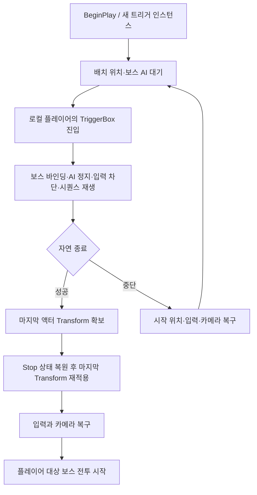

# 보스 등장 연출

## 배치와 설정

| 항목 | 계약 / 현재 Duelist 예제 |
|---|---|
| 트리거 부모 | `AMVBossIntroTrigger`, `Source/Maverick/Cinematics/Boss/` |
| Blueprint | `/Game/DuelistComplete/BP_BossIntroTrigger` |
| 배치 레벨 | `/Game/Characters/NPC/BaseBoss/Level/BaseBossTestLevel`, 사용자가 배치한 액터 재사용 |
| `Boss` | 같은 레벨의 `BP_Duelist`, 배치 인스턴스에서 지정 |
| `Intro Sequence` | `/Game/DuelistComplete/Intro/MasterLS`, 30fps·494프레임·약 16.47초 |
| `Intro Id` | `Duelist_001`, 기존 에셋 호환용 필드, 재생 조건에서 미사용 |
| `Boss Binding Tag` | `Boss`, 시퀀스의 보스 액터 바인딩 태그와 동일 값 |
| `TriggerBox` | `Box Extent`로 진입 범위 설정, Pawn 겹침·겹침 이벤트 활성화 유지 |

- 보스 하나당 트리거 하나 배치, 다른 보스에서도 같은 부모와 별도 `Boss`·시퀀스 재사용
- `MasterLS`: `LS_Duelist1`·`LS_Duelist2` 샷 참조, 실제 보스·메시·카메라 바인딩은 각 하위 시퀀스 소유
- 단일 시퀀스: 보스 액터 바인딩 우클릭 → `Tags`에 `Boss` 지정, 메시 애니메이션 바인딩은 해당 액터의 자식
- 종료 위치 유지는 보스 액터·캡슐 Transform 기준, 메시 애니메이션만의 이동은 유지 위치에 미포함
- 최초 예제 구성 도구: `Scripts/Editor/ConfigureDuelistIntro.py`, 원래 `LS_Duelist_Intro` 경로 기준; 현재 MasterLS 편집·바인딩 연결 용도에서 제외

## MasterLS의 하위 보스 연결

1. `MasterLS` 열기 → `Actions` → `Open Binding Tag Manager`
2. `LS_Duelist1`·`LS_Duelist2` 각각의 보스 **액터** 행 선택, 메시·카메라 행 제외
3. 선택 행 우클릭 → `ADD TAG`에 `Boss` 입력, 추가 후 MasterLS 저장
4. 배치 트리거의 `Intro Sequence = MasterLS`, `Boss Binding Tag = Boss`, `Boss = BP_Duelist` 확인 후 레벨 저장

- 루트 MasterLS의 `Boss` 태그에 두 하위 시퀀스의 계층 바인딩 ID 등록, `SetBindingByTag`에서 같은 배치 보스로 교체
- 하위 시퀀스에만 저장된 태그는 루트 조회 대상에서 제외, 트리거의 `FindNamedBindings` 검증에는 MasterLS 등록 필요
- MasterLS 자체의 추가 보스 트랙 불필요, 하위 샷의 기존 Transform·애니메이션·카메라 구성 유지
- 새 샷의 보스 바인딩 추가 시 MasterLS 태그 관리 창에서 해당 행에도 `Boss` 등록 필요
- 마지막 위치 유지 전제: MasterLS 마지막 평가 시점까지 보스 액터 Transform 유지, 샷 종료 후 상태 복원 구간은 완료 위치에도 반영

## 실행 흐름

## 수명과 책임

- `AMVBossIntroTrigger`: 겹침·시퀀스·입력 차단·복구·AI 전투 시작 브리지 소유, 단일 로컬 플레이어 기준
- 새 플레이·맵 재진입의 새 트리거는 `Waiting`에서 시작, 기존 관람 완료 기록과 무관하게 첫 박스 진입에서 재생
- `bPauseAtEnd`로 마지막 평가 Transform 확보, `ForceRestoreState`와 `Stop` 이후 해당 Transform 재적용
- 등장 대기에는 `SetBossCombatEnabled(false, nullptr)`로 자동 AI만 정지, K/L·준비 상태의 수동 공격 시험 허용
- 실제 재생 구간에만 `AMVAIController.bBossIntroBlocked` 활성, K/L·수동 공격 시험 차단; 중단·완료 시 차단 해제
- 재생 시작의 명시적 AI 정지 요청은 `OnBossCombatControlRequested`로 기존 수동 시험 정리
- 입력 차단은 InputManager 별도 횟수·PlayerController 이동과 시점 차단·Pawn 입력 비활성화 사용, 기존 차단 횟수 보존
- 중단·플레이어 변경·사망·트리거 제거: 입력·카메라·생성 시퀀스 정리, 중단 후 `Waiting`에서 재시도
- 완료 후 같은 전투의 재진입: `bEncounterActivated`로 재생·순간 이동 차단, 기존 전투 지속
- 종료 위치 복원 후 전투 활성화부터 기존 AI의 추적·이동 허용
- `OnIntroStarted`, `OnIntroEnded(bCompleted)`: 보스별 Blueprint 연출 연결 지점
- K/L·시험 위젯의 입력·AI 소유권과 2026-11-02 검증: [[Features/Boss-Attack-Test/document|보스 공격 시험 UI]] 참조

## 저장 데이터 호환

- 사용자 요청에 따른 관람 후 생략 기능 제거, 트리거의 `WorldState` 의존성·기록 조회·기록 저장·슬롯 쓰기·로드 이벤트 구독 제거
- `FMVWorldSaveData.BossIntros`와 `SaveVersion = 3` 구조는 기존 슬롯 호환용으로 유지, 기존 성장·퀘스트·체크포인트 데이터 삭제 없음
- 기존 `IntroId`·맵 이름·최종 `FTransform` 기록이 남아 있어도 현재 트리거의 재생·배치 위치에 영향 없음
- `Intro Id` 변경·저장 슬롯 삭제·`ResetSaveData` 없이 새 플레이에서 재관람 가능

## 미재생 진단

- 확인 순서: 보스·시퀀스 참조 → 루트 시퀀스의 `Boss` 태그 → 실제 Pawn 겹침 → `State`·현재 전투 활성·시퀀스 생성 여부
- 재생 중·같은 전투의 완료 이후 진입은 중복 차단, 중단한 연출은 재시도 허용
- `BossIntro: invalid duration / binding` 경고: 루트 MasterLS 태그 등록과 재생 구간 확인
- 기존 기록의 생략이 계속되는 경우 수정 전 바이너리 실행 여부 확인, 헤더 변경 후 일반 빌드와 Editor 재시작 필요

### 이전 관람 기록 연동 구조의 분석

다음 기록은 2026-11-02 생략 기능 제거 이전의 원인 분석 자료, 현재 재생 계약에서는 제외

2026-10-19 / Codex / Windows / Unreal Engine 5.8.3 실제 PIE 분석

- 기본 슬롯 `MaverickDefault`의 `BaseBossTestLevel + Duelist_001` 완료 기록 확인, 실제 겹침 후 `Completed` 유지·시퀀스 액터 0개·AI 시작 재현
- 복제한 검증 슬롯의 해당 기록만 제거한 대조: `Waiting → Playing → Completed`, 카메라·입력 차단·자연 종료·입력 복구와 AI 시작 확인
- 임시 추적은 PIE 겹침·연출 시작/종료 이벤트의 Python 구독과 `BossIntroTrace` 로그 사용, C++·에셋 저장 없이 분석; C++ 변경 부재로 빌드 재실행 제외
- 관람 기록을 포함한 기본 슬롯의 종료 시 상태 확인, 검증 중 기본 슬롯 저장 시각·파일 해시 변경 관측; 슬롯 분리가 PIE 초기화 이후인 검증의 바이트 보존 보장 제외
- 검증 슬롯 2개 삭제·PIE 종료·임시 이벤트 구독 해제·Python 원격 실행 설정 복구, 사용자 시퀀스의 미저장 편집 보존
- 검증 범위: 현재 레벨·배치 Duelist의 기록별 분기와 자연 종료, 패키징·네트워크·기본 슬롯 전체 필드 전후 동일성 미검증

분석 요약: [boss-intro-completed-skip-diagnosis.json](attachments/boss-intro-completed-skip-diagnosis.json)
원본 실행 관측: `Saved/BossIntroDiagnosis/`, Git 제외

## 검증

### 관람 후 생략 제거

2026-11-02 / Codex / Windows / Unreal Engine 5.8.3 실제 실행

- 일반 `MaverickEditor Win64 Development` 빌드 통과, XGE 라이선스 비활성 경고 1건; 현재 Windows Editor 컴파일·링크 확인
- `Maverick.Cinematics.BossIntro` 자동 검사 통과: 기존 관람 기록 무시·저장 위치 미복원·로드 이후 재생·식별자 없는 재생·중단/재시도·입력 복구·같은 전투 중복 차단 확인
- 자동 검사 경고 2건은 격리 월드의 게임 화면 부재, 실제 화면 표현 보장 제외
- 실제 `BaseBossTestLevel`의 기본 슬롯에 기존 `Duelist_001` 기록이 있는 상태에서 `Waiting → Playing → Completed` 확인, MasterLS 카메라 전환·입력 복구·전투 시작 확인
- 첫 PIE 종료 후 새 PIE에서도 같은 기존 기록과 원래 `IntroId`로 재생 확인, 중단 시 입력 복구 확인
- 시험 슬롯만 사용 후 정리, 원본 저장 파일 SHA256·수정 시각 일치와 레벨 파일 바이트 동일성 확인; 임시 추적 해제·PIE 종료·Python 원격 실행 설정 복구
- 기존 약 5.67초 빈 구간과 마지막 샷 위치 유지 한계는 사용자 시퀀스 편집 보존으로 미보정, 패키징·네트워크 실행 미실행으로 해당 환경 검증 제외

검증 요약: [boss-intro-replay-validation.json](attachments/boss-intro-replay-validation.json)
원본 재현·빌드·검사·PIE 관측: `Saved/BossIntroPlaybackDiagnosis/`, Git 제외

### 이전 구조의 태그 연결·저장 검증

2026-11-02 / Codex / Windows / Unreal Engine 5.8.3 실제 Editor·PIE 실행, 관람 기록 연동 제거 이전

- MasterLS 루트 `Boss` 태그 2개 등록·MasterLS와 배치 맵 저장 확인, 하위 보스 바인딩 두 개 모두 PIE의 같은 `BP_Duelist_C_1`로 교체 확인
- 실제 플레이어 박스 겹침으로 약 16.47초 재생, 첫 카메라·둘째 카메라 전환과 자연 종료 후 플레이어 카메라·이동/시점 입력 복구 확인
- 종료 후 관람 기록 생성·보스 전투 활성 플래그 확인, 전체 공격·AI 전이 회귀 검증 범위 제외
- 위치 유지 한계 재현: 마지막 샷 종료 324프레임·MasterLS 종료 494프레임, 약 5.67초 빈 구간에서 보스 원래 위치 복원; 완료 시 해당 위치 저장, 마지막 샷 자세·위치 유지 미충족
- 이번 변경 범위는 태그·트리거 연결, 사용자 샷 범위·카메라·애니메이션 보존; 빈 구간과 마지막 Transform 평가 범위 보정 제외
- 별도 시험 슬롯 사용, 시험 전 백업한 기본 슬롯 바이트·최종 수정 시각 복원 및 SHA256 일치 확인, 시험 슬롯 2개 정리·PIE 종료·Python 원격 실행 설정 복구
- C++ 변경 부재로 빌드·자동 검사 재실행 제외, 현재 Windows Editor의 실제 연결·재생 검증만 수행; 패키징·네트워크 실행 미검증

검증 요약: [master-sequence-binding-validation.json](attachments/master-sequence-binding-validation.json)
원본 관측·MasterLS/맵 백업: `Saved/MasterSequenceBinding/`, Git 제외

2026-10-13 / Codex / Windows / Unreal Engine 5.8.3 실제 실행

- 일반 `MaverickEditor Win64 Development` 빌드 통과: XGE 라이선스 비활성 경고 동반, C++ 컴파일·링크 확인; 패키징·네트워크 실행 미실행으로 해당 환경 보장 제외
- 자동 검사 11개 통과: 등장 1·전투 3·성장 7; 2개 검사에서 경고 포함, 격리 월드의 게임 화면 부재 2건과 기존 사망 행 부재 1건, 실제 게임 화면·최종 사망 표현의 증거 범위 제외
- 등장 자동 검사: 최초 진입·중복 차단·중단과 재시도·입력 차단 횟수·자연 종료 위치·저장/로드·새 GameInstance·트리거 제거 확인
- 실제 `BaseBossTestLevel` PIE: 사용자가 배치한 박스에 플레이어 이동으로 겹침 발생, 시퀀스 재생·CineCamera 전환·입력 차단·자연 종료·보스 AI 시작 확인
- 실제 종료 위치 `(900, -60, 88)` 저장, 바닥 보정 이후 캡슐 높이 `89.65`; 저장 기록과 전투 시작 후 AI 이동 위치의 구분
- 같은 전투 재진입에서 시퀀스 생성·입력 차단·보스 순간 이동 없음, 새 PIE GameInstance에서 검증 슬롯 로드 후 종료 위치 복원·연출 없는 전투 시작 확인
- 검증 전용 슬롯 생성·정리, 사용자 기본 슬롯 쓰기 제외; 다른 프로필의 자동 기본 슬롯 시작 경로와 전체 저장 기능 회귀 보장 제외
- 초기 Live Coding 재적용 중 LockOnTarget 테스트 월드 종료 경로의 Editor 종료 관측, 테스트 액터 선행 정리와 일반 빌드·새 프로세스로 복구; 해당 플러그인의 일반 Live Coding 안정성 검증 범위 제외
- 기존 `ST_BaseAIStateTree` 바인딩 오류 수정 제외, 현재 배치 Duelist의 StateTree 실행은 PIE에서 확인

검증 요약: [boss-intro-validation.json](attachments/boss-intro-validation.json)
원본 검사 보고서·PIE 관측·레벨 백업: `Saved/BossIntro/`, Git 제외
