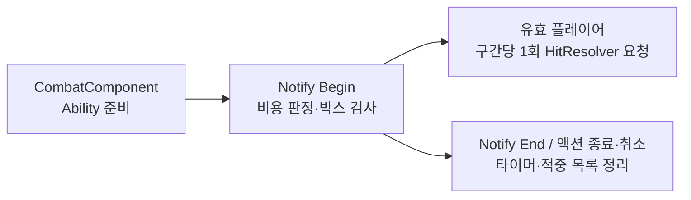

# 박스 범위 피해 Ability

## 사용 위치

- C++: `Source/Maverick/Combat/MVBoxDamageAbility.h`, `MVBoxDamageAbility.cpp`
- Blueprint: `/Game/Characters/Components/Combat/Abilities/BP_BoxCollision`
- 부모 클래스: `UMVBoxDamageAbility`
- 에어본 설정: `BP_BoxCollision_Airborne`, `BP_BoxCollision`의 자식 Blueprint
- 두 Blueprint는 설정만 보유, 타이머·충돌·중복 적중·종료는 C++ 한 곳에서 처리

## 범위 설정

`BP_BoxCollision`의 `Class Defaults`에서 조절

| 항목 | 기본값 | 의미 |
|---|---|---|
| `BoxSize` | `(200, 200, 200)` | 전후·좌우·높이의 전체 길이, cm 단위 |
| `BoxOffset` | `(150, 0, 0)` | 액터 중심에서 전방·우측·위 방향의 박스 중심 이동, cm 단위 |
| `bDrawDebug` | `true` | 실제 판정과 동일한 박스 표시, 해당 검사에서 유효 적중 시 초록색·그 외 노란색 |
| `HitReactionType` | `None` | 순수 HP 피해 또는 기존 피격 유형 선택 |

`BP_BoxCollision_Airborne`: 크기 `(220, 400, 200)`, 중심 `(100, 0, 0)`, `Airborne`, 상승 속도 `600 cm/s`·시간 `0.5 s`
기존 전방 `0~200 cm` BoxTrace와 반경 `(10, 200, 100)`의 전체 부피를 단일 박스로 표현

- 캐릭터 액터의 위치·회전 추적, 메시 크기와 무관한 범위
- `BoxSize` 각 축의 최솟값: 1cm
- 활성 시작 즉시 검사, 이후 초당 60회 검사
- 벽 가림 판정 제외, 박스와 플레이어 충돌 형상의 겹침 기준
- 디버그 표시: `ENABLE_DRAW_DEBUG` 활성 빌드 대상

## 피해 계약

- 대상: 플레이어가 조종하는 `AMVCharacterBase`, 충돌 오브젝트 유형 `Pawn`
- 자기 자신·무적·사망·파괴 중인 캐릭터 제외
- 같은 활성 구간의 플레이어별 최대 1회 피해, 다음 구간에서 재타격 허용
- 기존 `HitResolver` 계산 사용: `max(0, 장착 무기 공격력 × 행의 DamageMultiplier − 대상 선택 방어력 × 0.5)`, 소수점 첫째 자리까지 절삭 후 치명타 적용
- 현재 박스 요청의 `AttackTypes` 기본값 `NormalAttack`, 대상 `NormalDefence` 선택
- 2026-10-12 Windows UE 5.8.3 격리 검사 통과: 무기 공격력 10·계수 2·일반 방어력 5에서 구간당 HP 피해 17.5; [머지 정합성 검증](../../Hit-Stat-HitReaction/attachments/merge-build-validation.json)
- `HitReactionType=None`: 그로기 배율·자세 피해·밀림 요청 0, 상속받은 `HitLaunchData`와 행의 `GroggyDamageMultiplier` 무시
- 그 외 피격 유형: 행의 그로기 배율·기존 `HitLaunchData` 전달, 실제 동작은 피격 시스템 책임
- 기존 HP 감소·사망·적중 이벤트 처리 유지
- 공격 행의 `OnHitStatusEffects`는 공통 적중 경로 대상, 순수 HP 피해 구성 시 빈 배열 사용

## 공격 연결

1. 공격 데이터 행의 `AbilityReference`에 `BP_BoxCollision` 또는 에어본 자식 지정
2. 공격 몽타주의 타격 구간에 기존 `MV Activate Ability` NotifyState 배치
3. Notify의 `AbilityClass` 사용 시 선택한 클래스 또는 공통 부모 지정, `AbilityIndex`는 기본값 0 사용
4. 같은 구간의 별도 피해 Notify·트레이스 중복 제외

공격 행의 `AbilityReference`는 단일 Ability 생성 경로, 사슬 공격을 박스 Ability로 교체하면 사슬 발사 경로 제외

- 소유 캐릭터 사망·파괴 감지 시 검사 종료, Ability 소멸 시 타이머 정리

## 통합과 검증

2026-10-08 / Codex / Windows / Unreal Engine 5.8.3 실제 실행

- `BP_BoxDamage`를 기존 `BP_BoxCollision`으로 통합·삭제, 중복 Blueprint 함수·이벤트 그래프·변수 제거
- Duelist 기본 공격 3개·Q의 클래스 참조만 교체, 나머지 행 필드와 `SkillW` 값 동일 확인
- 기존 박스 에셋의 미존재 옛 패키지 참조 제거, 정식 에셋 경로 유지·임시 경로와 정리 C++ 제거
- 기존 E1 테이블의 에어본 에셋 경로·Launch 기본값 유지
- 일반 Editor 빌드 통과, 두 설정 Blueprint 컴파일·저장 통과
- `Maverick.Combat.BoxDamageAbility` 통과: 기존 범위·종료·HP 전용 검사와 에어본의 공통 피해·그로기·구간당 1회 검사
- 자동 검사 오류 0, 경고 5개는 기존 `AirborneTrace` 경고 수준 추적 출력
- 배치된 Duelist의 전투 행 실행 PIE에서 기본 공격·Q 각각 피해 2회, 피격 유형 `None`·그로기와 Launch 0 확인
- 에어본 설정 에셋의 직접 실행 PIE에서 `Airborne`·상승 속도 `600`·피해·그로기 전달 확인
- 실제 플레이어 상승은 이번 PIE에서 미발생, 기존 `MVPlayerCharacter::BindDamageHandlers`의 C++ 피격 연결 주석 상태 유지
- 네트워크·패키징·디버그 박스 화면 검증은 이번 Windows Editor 범위에서 미실행, 해당 환경·표현 보장 제외

검증 요약: [통합 검증](attachments/skill-simplification-validation.json)
원시 기록·통합 전 에셋 백업: `Saved/DuelistSkillSimplification`, Git 제외

## 초기 제작 검증

2026-10-07, Codex의 Windows 환경·Unreal Engine 5.8.3에서 실제 실행

| 대상 | 결과 | 증명 범위 |
|---|---|---|
| `MaverickEditor Win64 Development` 빌드 | 통과 | 새 C++ 클래스·자동화 검사 컴파일과 링크 |
| 수정한 검사 코드의 Live Coding 컴파일 | 통과 | 신규 타이머 등록 프레임을 반영한 검사 코드의 Editor 적용 |
| `Maverick.Combat.BoxDamageAbility` | 통과, 오류·경고 0 | 격리 게임 월드의 범위 내외·비플레이어·회전·높이·무적·중복·종료·비용 부족과 HP 피해·그로기 유지·피격 동작 없음·속도 0 |
| `BP_BoxDamage` | 컴파일·저장 통과 | 새 부모 클래스 연결, 기본 범위·디버그 활성값 확인, Blueprint 컴파일 경고·오류 없음 |

- 기존 공격 몽타주에 새 Ability를 연결한 PIE 동작: 미실행, 추가 에셋 제작 요청에 특정 공격 선택 없음
- 패키징·네트워크 플레이·디버그 박스의 화면 표시: 미검증, 이번 실행 범위는 로컬 Editor 빌드와 격리 게임 월드 검사
- 검증 기록: [박스 피해 Ability 검증](attachments/validation.json)
