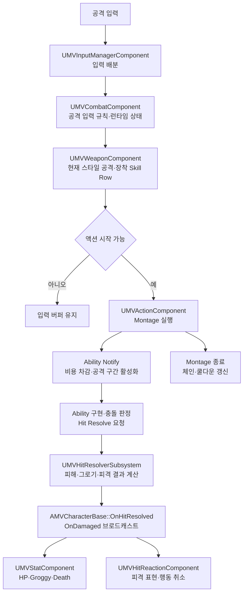
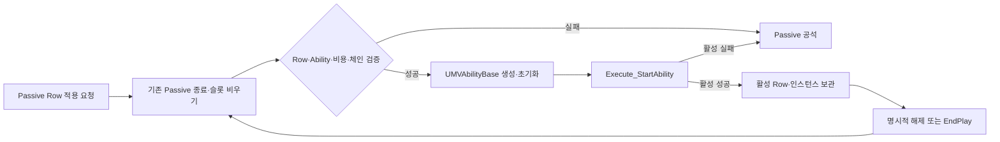

# Maverick 전투 시스템

## 전투 흐름

## 공격 종류

무기 교체·스타일별 공격 선택·듀얼 소드 손별 판정: [[Features/Combat/Weapon-Swap/document|플레이어 무기 교체]]

| 분류 | 현재 동작 |
|---|---|
| 약공격 | 연속 Row 기반 기본 연계 |
| 강공격 | 연속 Row 기반 강공격과 누르기 유지 조기 해제 분기 |
| 차지공격 | 누르기 유지 후 확정 시간 도달 시 실행 |
| 전력질주 공격 | 전력질주 문맥에서 약·강 입력을 전용 Row로 치환 |
| 회피 공격 | 회피 문맥에서 약·강 입력을 전용 Row로 치환 |

## 스킬 시스템

- 입력 인덱스: Q `Skill0`, R `Skill1`, W `Skill2`, E `Skill3`
- 런타임 맵 키: Q `QSkill`, R `RSkill`, W `WSkill`, E `ESkill`
- 조합 입력: Shift+좌클릭 W, Shift+우클릭 E
- 현재 무기 스타일과 슬롯을 기준으로 WeaponComponent의 장착 Row 조회
- 미등록·미지원 스킬 입력 즉시 소비로 Action 종료·무기 교체 후 지연 실행 차단
- `NextChainName`으로 단일 스킬과 연속 스킬 구성
- Chain 진행은 DataTable Row `FName`과 현재 단계 인덱스로 관리하며 런타임 맵 키와 분리
- `ChainAdvancePolicy`: Row별 `Immediate`·`OnHitConfirmed` 단계 전진 정책
- 주 쿨다운·단계 간격·입력 창으로 연속 단계 제어
- Ability Notify 최초 시작 시 비용 차감, 종료 시 체인·쿨다운 갱신
- HUD에 사용 가능 상태·연속 단계·입력 창·남은 쿨다운 투영
- Q 적중 연계·R 게이지·W/E 조합 입력 계약: [[Features/Combat/Skill/document|플레이어 스킬 구조]]

## Passive 스킬 생명주기

- `UMVCombatComponent`가 QWER 실행 상태와 분리된 Passive 단일 슬롯 소유
- 기존 `FMVSkillDataTableColumn`과 `UMVAbilityBase` 재사용
- Passive Row의 HP·Stamina·MP 비용과 `NextChainName` 기반 체인 사용 금지
- 동일 Row 재적용은 현재 인스턴스를 유지하고 성공 반환
- 교체 실패 시 이전 Passive 복구 없이 공석 유지
- 사망 시 유지, 현재 스타일의 Passive 장착 변경 시 해당 슬롯만 다시 적용
