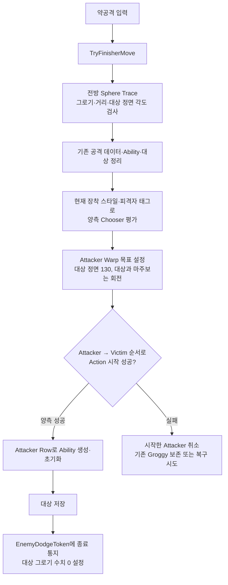

# 그로기 Finisher

## 핵심

- `UMVFinisherComponent`: 그로기 대상 탐색과 Attacker·Victim 짝 애니메이션 실행 요청 담당
- `BeginPlay`에서 약공격 입력 처리기로 등록, `EndPlay`에서 해제

## 실행 흐름

## 기준

- 탐색: 전방 200·반경 50의 단일 Sphere Trace, `ECC_GameTraceChannel1` 사용
- 조건은 생존 중인 `IsGroggy()` 대상, 2D 거리 `DetectDistance` 이내, 대상 정면 기준 `DetectAngle` 이내이며 기본값은 200·45도
- Chooser: 양측에 같은 `WeaponType`·`VictimTag` 입력 사용, 출력 Row 우선·Row 이름 누락 또는 DataTable 반환 시 `FallBack` 사용
- 데이터: Attacker는 `FMVSkillDataTableColumn`, Victim은 `FMVActionRow`; 실제 애니메이션 실행은 각 `UMVActionComponent` 담당

## Victim 인계

- Finisher는 선택한 Victim Row의 교체를 대상 ActionComponent에 요청
- ActionComponent는 기존 실행의 이동·회전 제한을 성공한 Victim 실행에 인계하고, 이전 실행 ID·섹션과 교체 결과를 방송
- HitReaction은 Action의 교체 결과에서 자신의 Groggy 실행을 확인해 성공 시 기록 정리, 실패로 기존 실행이 중단됐을 때 같은 Row·섹션 복구 시도
- Victim 실행은 Stat의 그로기 해제 뒤에도 유지되며, 인계된 제한은 Victim 실행 종료 시 해제
- 양측 시작이 확인되면 공격 데이터·대상을 기록하고 그로기 게이지를 0으로 설정

## 구현 근거

[MVFinisherComponent.h](../../../../../Source/Maverick/Components/MVFinisherComponent.h) · [MVFinisherComponent.cpp](../../../../../Source/Maverick/Components/MVFinisherComponent.cpp)

현재 C++ 구현 기준 문서이며 Chooser·Montage 에셋 연결과 실제 재생 타이밍은 Editor 검증 범위
