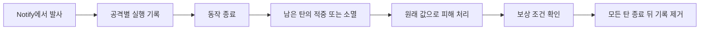

# 원거리 발사체와 자동 유도 대상 선택

## 발사와 기록

- 기존 기본 공격·Q/W/E/R·직접 행 실행이 선택한 Ability를 애니메이션 Notify 구간에서 시작
- `UMVProjectileAbility`가 발사 위치·방향·팀·공격 종류·발사 당시 무기 피해 자료를 확정하고, 비용을 지불한 뒤 투사체를 생성
- `UMVCombatComponent`가 공격 번호별 실행 기록에 원래 Ability의 실행 값, 행·슬롯·연계 단계, 슬롯 구성 버전·사용 회차, 무기·패시브·생존 회차를 저장
- 같은 공격에서 여러 탄을 등록할 수 있으며, 동작과 모든 탄이 끝난 뒤 기록을 제거
- 발사 설정·생성·활성화가 실패해 실제 활성화한 탄이 없으면 빗나감 사건을 내지 않음

## 적중과 종료

- `AMVProjectileBase`가 적·아군 판별, 중복 적중, 관통, 지형 충돌, 수명 종료를 담당하고 적중을 공통 `UMVHitResolverSubsystem`으로 전달
- 피해는 발사 때 저장한 무기 공격력·계수와 현재 공통 방어·치명타·피격 방향 규칙으로 계산
- 동작이 끝나거나 다른 공격을 시작해도 이미 발사한 탄은 원래 무기의 기본 피해를 전달
- 공격 기회가 끝나고 모든 활성 탄이 소멸했으며 적중이 없을 때만 빗나감을 한 번 확정
- 현재 스킬의 연계 적중 확인은 원래 실행·단계·유효 입력 창이 맞을 때만 처리

## 패시브·환원·사망

- 패시브는 현재 장착 무기의 선택된 한 종류만 활성화하며, 오래된 탄은 발사 때의 패시브 적용 번호와 현재 번호가 일치할 때만 그 효과를 사용
- 포식자의 순환은 지연 적중에서도 원래 스킬 슬롯의 구성 버전·사용 회차·무기를 확인해 주 쿨타임을 환원하고, 같은 공격의 중복 환원을 막음
- 무기 또는 패시브를 바꿔도 이미 날아간 탄의 기본 피해는 유지하며 새 패시브·새 스킬 사용에 보상을 주지 않음
- 발사자가 사망해도 남아 있는 탄은 계속 비행하고 기본 피해를 전달하되, 사망 전 실행의 MP·게이지·패시브·상태 효과·연계·쿨타임 보상은 차단
- 발사자 Actor가 파괴되거나 월드가 끝나면 남은 탄과 실행 기록을 정리

## 유도 대상

- `ProvidedOnly`는 전달된 대상을 사용하고, 자동 모드는 명시 대상·현재 대상·주변 적 순서로 발사 시 한 번 선택
- 주변 후보는 생존·적대·무적 여부와 거리·정면·가림 설정으로 선별
- 비행 중 대상 재선택 없음; 관통탄이 유도 대상에 맞으면 유도만 해제하고 현재 속도로 진행

## 확인 범위

- 사용자 Windows Editor의 PIE에서 시험 Q 투사체 발사·적중, 동작 종료 뒤 적중의 `RefundAccepted`, 발사자 사망 뒤 적중의 `HitRewardsSkipped`와 기록 제거를 확인
- 사용자 Windows Editor 자동화 시험 `Maverick.Combat.HitResolver.MergedDamage` 1건 성공; 공통 피해 9→18→20.70과 방어·치명타·공격자 보정 순서를 확인
- 사용자 Windows Editor에서 `Maverick.Combat.Projectile.ExecutionLifetime` 재실행 1건 성공·실패 0건; 늦은 적중의 피해·쿨타임 환원 1회·중복/오래된 사용 거절·한 공격의 두 탄 종료 뒤 기록 제거·발사자 사망 뒤 적 체력 감소와 보상 차단 확인
- 첫 실행은 자동화 월드의 `Destroy()`가 종료 사건을 즉시 보내지 않아 기록 정리 검사 3곳 실패; 시험에서 종료 사건을 직접 전달한 뒤 성공
- 현재 시험 몽타주는 옛 Blueprint `ANS_ActiveAbility` Notify를 사용하며, 네이티브 `MVAnimNotifyState_Ability` 경로는 별도 확인 필요
- 위 결과는 실제 패시브의 MP 잔량·화면 쿨타임 변화와 다발 적중 때 패시브 환원 횟수까지 확인한 것은 아님
- 임시 `ProjectileCombatTrace` 로그는 시험 성공 뒤 제거; 사용자 Windows Editor에서 로그 제거본 빌드·`ExecutionLifetime` 1건 성공·실패 0건, PIE의 Q 발사·적중 성공
