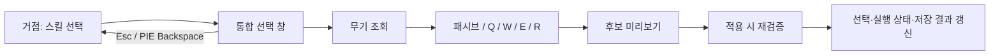

# 패시브·QWER 통합 스킬 선택 설계

## 범위와 상태

- 상태: 1~7단계 구현과 Windows 통합 검증 완료. 완성되지 않은 스킬은 선택·저장·그림 표시까지 지원하며 실제 사용은 차단. 물리 입력 장치·맵 간 이동 등 검증 한계는 7단계 결과 참고
- 조사 기준: 2026-11-16 Windows 작업 트리의 C++와 기존 위키, 커밋되지 않은 입력·닫기 수정 포함
- 최초 결과물: 설계 문서와 구현 순서, 1단계 실제 변경·검증은 아래 적용 결과 참고
- 목표: 기존 패시브 선택 창을 `스킬 선택`으로 확장해 패시브와 Q·W·E·R의 후보를 선택·교체
- 유지: 패시브의 후보 제한·해금·선택·해제 규칙, 일반 실행 Esc·PIE Backspace 복귀, 휴식 거점 입력 차단
- 제외: 새 전투 스킬 완성, 스킬 간 균형 조정, 새 해금 상점, 스킬을 아무 슬롯에 넣는 자유 배치, 여러 사람이 접속하는 기능

## 최초 조사 구조와 재사용 근거

| 영역 | 현재 원본에서 확인한 내용 | 확장 방향 |
|---|---|---|
| 슬롯 | `EMVSkillSlot`에 Passive·Q·W·E·R 존재 | 기존 열거형 재사용, 표시 순서는 명시적으로 지정 |
| 후보 | `UMVWeaponSkillMap`에 다섯 슬롯의 후보 목록과 필요 포인트 존재 | 별도 후보 저장소 없이 공통 조회 추가 |
| 패시브 상태 | `SelectedPassiveByWeaponType`, 종류별 후보 조회·선택·해제 제공 | 기존 처리에 위임 |
| QWER 상태 | `SkillTreeStates`에 스타일별 해금 목록과 슬롯별 선택 행 저장 | 명시적 슬롯 검증과 변경 결과 추가 |
| 실행 반영 | `EquipSkill` 이후 현재 스타일의 `RefreshSkillSlot` 호출 | 새 스킬 구성 성공을 확인한 뒤 기존 실행 상태 교체 |
| 저장 | `MVWeaponProgressSave.cpp`가 스타일별 `EquippedRows`와 패시브를 저장 데이터에 반영 | 동일한 행 식별자·저장 구조 재사용 |
| 선택 화면 | 무기 목록·후보 목록·상세·적용 버튼, 패시브 전용 조회 | 슬롯 탭과 공통 후보 표시로 확장 |
| 전투 화면 | `MVPlayerSkillHUDWidget`이 Q·R 및 Q 연계 표시, 별도 아이콘 배열 사용 | QWER 전체와 실제 선택 행의 그림 연결 |
| 미완성 상태 | 스킬 행에 이름·설명·그림·Ability가 있지만 명시적인 준비 상태 없음 | 그림 유무와 분리된 구현 상태 추가 |

현재 `StoreWeaponProgress()`의 기본값은 즉시 파일 저장하지 않음
메모리의 저장 데이터 반영과 `SaveActiveSlot()`의 디스크 기록을 구분해야 하며, 기존 문서의 과거 저장 설명보다 아래 원본을 기준으로 설계

### 주요 원본

- [슬롯 정의](../../../../../Source/Maverick/Public/Enum/MVSkillSlot.h), [후보 정의](../../../../../Source/Maverick/Public/DataAsset/MVWeaponSkillMap.h), [스킬 행](../../../../../Source/Maverick/Public/Tables/MVSkillDataTableColumn.h)
- [선택·해금·초기화](../../../../../Source/Maverick/Components/MVWeaponComponent.cpp): `GetPassiveCandidates`, `EquipSkill`, `UnlockSkill`, `InitSkillSlotState`
- [저장·복원](../../../../../Source/Maverick/Components/MVWeaponProgressSave.cpp): `StoreWeaponProgress`, `RestoreWeaponProgress`
- [전투 슬롯 구성](../../../../../Source/Maverick/Components/MVCombatComponent.cpp): `RefreshSkillSlot`, `BuildSkillEntryFromRowHandle`, `TrySkill`
- [패시브 선택 창](../../../../../Source/Maverick/UI/Window/MVWeaponPassiveSelectionWindow.cpp), [전투 스킬 표시](../../../../../Source/Maverick/UI/HUD/MVPlayerSkillHUDWidget.cpp), [닫기 입력](../../../../../Source/Maverick/UI/System/MVCommonUIInputData.cpp)

## 선택 기준

무기 종류는 같은 종류의 무기 묶음, 무기 스타일은 전투 동작을 공유하는 더 큰 묶음
화면을 합쳐도 이 두 선택 기준을 하나로 바꾸지 않음

| 구분 | 후보와 선택을 공유하는 기준 | 화면 안내 |
|---|---|---|
| 패시브 | `Weapon.Type.*` 무기 종류 | `이 무기 종류에 공통 적용` |
| QWER | `EMVEquippedStyle` 무기 스타일 | `이 무기 스타일에 공통 적용` |

- 무기 목록에서 고른 항목은 조회 대상이며, 전투 중 장착 무기를 바로 바꾸지 않음
- 같은 스타일의 다른 무기도 QWER 선택을 공유하는 기존 규칙 유지
- Q 후보는 Q에만 적용, W·E·R도 각 후보 목록의 슬롯으로 제한
- 다른 스타일을 보고 변경하면 선택만 기억하고, 그 스타일의 무기를 장착할 때 전투에 반영
- QWER까지 무기 종류별로 나누는 변경은 이번 범위 밖이며, 필요 시 선택 식별자와 저장 자료 이전을 별도 설계

### 슬롯 이름과 실제 키

QWER은 이번 설계에서 슬롯 이름이며 키 재설정 요청으로 취급하지 않음
기존 스킬 문서의 입력은 Q·R, W=Shift+좌클릭, E=Shift+우클릭이며, 실제 입력 자산은 구현 단계에서 에디터로 대조

- 화면 순서: `패시브 → Q → W → E → R`
- 기존 입력 인덱스 `Skill0=Q, Skill1=R, Skill2=W, Skill3=E`를 화면 순서로 사용하지 않음
- 슬롯 옆 사용 키는 실제 입력 설정에서 조회, W·E를 문자 키로 고정해 이동 키와 충돌시키지 않음

## 화면 구성과 사용 흐름

| 위치 | 표시와 동작 |
|---|---|
| 제목 | `스킬 선택`, 조회 중인 무기 이름과 공유 범위 |
| 왼쪽 | 기존 보유 무기 목록 |
| 위쪽 | 패시브·Q·W·E·R 탭, 각 슬롯의 현재 선택 아이콘 |
| 가운데 | 현재 탭의 후보, 선택됨·장착 중·잠김·준비 중 표시 |
| 오른쪽 | 미리 보는 후보의 큰 그림·이름·설명·사용 가능 상태 |
| 아래쪽 | 적용 버튼·결과 안내·공통 확인 및 돌아가기 키 안내 |

- 처음에는 현재 무기와 패시브 탭 표시, 같은 창에서 무기를 바꿀 때 현재 탭 유지
- 현재 무기와 탭의 선택 후보를 첫 줄에 표시하고 나머지 후보는 기존 상대 순서 유지. 패시브의 `선택 해제`는 마지막 행
- 후보 클릭은 미리보기만 변경, 적용 버튼을 눌렀을 때 한 슬롯만 확정
- 탭 이동·창 닫기는 미확정 미리보기만 버림, 이미 적용한 선택은 유지
- 패시브의 기존 `선택 해제` 유지, QWER의 수동 빈 슬롯 만들기는 초기 범위에서 제외
- 후보 없는 탭도 열 수 있게 유지하고 `등록된 스킬 없음` 표시, 적용 버튼 비활성화
- 잠긴 후보는 설명과 필요한 포인트만 표시, 기존 해금 규칙을 우회하거나 적용과 함께 자동 구매하지 않음
- 닫기 버튼 재추가 없음, 키보드·마우스·게임패드의 기존 공통 탐색과 복귀 사용
- 탭 전환은 한 창의 내용만 갱신, 새 창을 쌓거나 닫아 게임 입력이 잠시 풀리지 않게 구성
- 탭을 바꾸거나 적용에 성공하면 첫 후보에 미리보기와 초점을 맞춤. 후보가 없으면 탭에 초점
- Windows UE 5.8.1 TestMap의 에디터 플레이·독립 게임에서 Q·R 첫 줄, 미리보기, 교체·저장을 확인. 새 독립 실행에서 저장한 Q를 복원
- TestMap 기본 한손 검은 종류 태그가 비어 패시브 후보 없음. 실행 중 종류와 후보 세 개를 연결한 별도 시험에서 선택 우선, 나머지 순서, 마지막 해제 행 확인
- UI 활성 중 스킬·공격·이동 입력과 누르고 있던 키의 지연 실행 차단 유지

## 임시 아이콘과 미완성 스킬

| 후보 상태 | 선택·저장 | 전투 사용 | 표시 |
|---|---|---|---|
| 완성 스킬, 정식 그림 있음 | 기존 해금 조건 충족 시 가능 | 가능 | 정식 아이콘 |
| 완성 스킬, 그림이 임시이거나 없음 | 기존 해금 조건 충족 시 가능 | 가능 | 임시 아이콘, 기능은 정상 |
| 미완성 스킬 | 해금된 경우 가능 | 불가 | `준비 중 · 선택 가능 · 전투 사용 불가` |
| 잘못된 행·호환되지 않는 후보 | 불가 | 불가 | 목록에서 제외, 데이터 검사 오류 |

- `FMVSkillDataTableColumn`에 구현 상태 `Ready / Prototype` 추가, 기존 행의 기본값은 `Ready`
- `Prototype`은 이번 단계에서 QWER 전용, 기존 패시브 후보 검사 규칙 유지
- `Prototype`은 명시적으로 등록된 유효 행이어야 하며, Ability가 없다는 이유만으로 모든 잘못된 행을 임시 후보로 허용하지 않음
- 임시 그림은 공통 기본 그림에 슬롯 문자·후보 번호를 함께 표시, 색만으로 후보를 구분하지 않음
- 상세 그림: `PreviewImage → Icon → 공통 기본 그림` 순서, 그림 로드 실패도 같은 처리
- 시험용 임시 후보는 별도 데이터 표에 슬롯별 최소 2개, 이름 예시는 `Q 시험 스킬 01`, 포인트 0으로 교체 시험 가능
- 시험 후보는 시험용 무기 설정에만 연결, 개발·배포 구분만으로 숨겨 저장된 선택이 갑자기 사라지는 방식 금지
- 향후 완성할 때 표 경로·행 이름을 유지하고 상태·Ability·그림을 교체하면 기존 선택 유지
- 공식 행으로 옮기거나 이름을 바꾸는 경우는 별도 행 식별자 이전 필요

### 전투 실행 금지 지점

- `Prototype` 선택은 선택 상태에는 남지만 실행 가능한 Ability는 만들지 않음
- 입력 태그·직접 `TrySkill` 호출·입력 버퍼 재생 모두 같은 사용 가능 판정을 거침
- 준비 중 입력은 즉시 소비, HP·MP·스태미나·R 게이지 소비와 재사용 대기시간·행동·투사체 생성 없음
- `Ready`의 Ability 또는 연계 행이 잘못되면 구성 실패로 처리, `Prototype`으로 자동 변경하지 않음
- 연계 중간 행 누락·순환 참조를 전체 검증, 앞부분만 만들어 성공으로 처리하지 않음

## 코드 책임과 확장 구조

아래 이름은 구현할 책임과 자료 모양을 나타내는 설계 식별자
후보 수가 늘어도 스킬마다 UI 클래스나 조건문을 추가하지 않는 구조를 기준으로 구현

| 구성 | 책임 | 두지 않을 책임 |
|---|---|---|
| `FMVSkillSlotDefinition` | 슬롯·표시 순서·이름·입력 태그·기본 그림, 슬롯 목록을 한 곳에서 정의 | 스킬 해금·선택 상태 |
| `FMVSkillSelectionContext` | 조회 무기 식별자·종류·스타일·슬롯 | 전투 무기 강제 교체 |
| `FMVSkillSelectionCandidate` | 행 식별자·표시 자료·해금·현재 선택·구현 상태 | 별도 영구 저장 |
| `FMVSkillSelectionResult` | 변경 성공·거절 이유·실행 가능 여부·저장 결과 구분 | UI에서 오류 이유 추측 |
| `Weapon/Skill` 도메인 파일 | 후보 구성·문맥 검증·기본 선택 결정, 기존 패시브와 QWER 처리 연결 | 캐릭터 공통 생명주기 |
| `UMVWeaponComponent` | 기존 후보 원본과 선택 상태 소유, 공통 조회·변경 진입점 제공 | 화면 배치·미리보기 |
| `UMVCombatComponent` | 실행 자료 사전 구성, 해당 슬롯 교체·사용 가능 판정 | 후보 화면·디스크 저장 |
| 선택 창·후보 위젯 | 표시·초점·미리보기·선택 요청 | 직접 포인트 차감·상태 맵 수정 |

- 공통 진입점: `GetSkillCandidates(Context)`, `GetSelectedSkill(Context)`, `TrySelectSkill(Context, Row)`
- 패시브 분기는 도메인 경계에서 기존 `GetPassiveCandidates`·`SelectPassive`·`ClearSelectedPassive`로 위임
- QWER 분기는 기존 스타일별 상태를 사용하되, 요청한 슬롯과 후보 소속을 함께 검사
- `UMVWeaponSkillMap`을 후보의 유일한 원본으로 유지, UI 전용 후보 목록·저장 사본 금지
- 슬롯별 공통 자료는 목록으로 순회, Q 연계와 R 게이지처럼 실제로 다른 표시 정책만 분리
- 선택 변경 알림에 스타일·무기 종류·슬롯 포함, 해당 화면과 전투 표시만 갱신
- 표시 위젯이 활성화될 때 구독하고 비활성화·파괴 시 해제, 오래된 플레이어를 참조하지 않게 약한 참조 사용
- 새 주요 타입의 책임·수명 문서 블록과 파일별 고유 로컬 헬퍼 이름은 프로젝트 규칙 적용

### 데이터 검사와 기본 선택

- 동일한 행을 한 무기 설정의 여러 슬롯에 중복 등록하면 오류, 현재 `FindSkillSlot`의 첫 일치에 의존하지 않음
- 슬롯별 기본 행을 무기 설정에 명시, 기본 행은 해당 목록 소속·해금 가능·`Ready` 조건 충족
- 복원 순서: 유효한 저장 선택 → 설정된 기본 행 → 무료 `Ready` 후보의 표 경로·행 이름 정렬 첫 항목 → 빈 슬롯
- 저장된 `Prototype` 선택은 유효하면 그대로 유지, 새 `Prototype`을 기본으로 자동 장착하지 않음
- `TSet`의 내부 순회 순서로 기본 장착이나 후보 표시 순서를 정하지 않음
- 후보가 없거나 미완성 후보만 있는 슬롯의 초기 빈 상태는 정상 처리

## 적용과 저장 계약

### 적용 순서

1. 적용 클릭 시 플레이어 생존·거점 세션·필드 전환·무기 소유를 다시 검사
2. 요청 문맥과 현재 자료를 대조해 스타일·슬롯·후보 소속·해금 상태 확인
3. 같은 행을 다시 고른 요청은 성공하되 실행 자료 재생성·중복 알림 없음
4. 현재 스타일의 QWER 변경은 해당 슬롯의 재사용 대기·연계·진행 중 투사체 결과가 남아 있으면 거절하고 이유 표시
5. `Ready` 후보의 전체 실행 자료를 임시로 구성·검증, 실패하면 이전 선택과 전투 자료 유지
6. 검증 성공 후 선택 상태와 해당 실행 슬롯을 함께 교체, `Prototype`은 실행 불가 상태로 교체
7. 저장용 상태 반영·변경 알림·디스크 저장 요청 후 각각의 결과 표시

- 현재 `EquipSkill`의 선반영과 `RefreshSkillSlot`의 기존 항목 선삭제 순서를 그대로 확장하지 않음
- 다른 슬롯·기본 공격·패시브·R 누적 게이지는 QWER 하나를 교체한 이유로 초기화하지 않음
- 다른 스타일 선택 변경은 현재 전투 자료를 갱신하지 않으며, 무기 교체 시 동일한 유효성 검사를 사용
- 투사체의 `LoadoutRevision` 검사 유지, 예전 발사 결과가 새 스킬의 연계·대기시간을 수정하지 않게 검증
- 이미 존재하는 무기 교체 전체의 대기시간 정책 변경은 범위 밖, 이번 선택 기능이 새 초기화 경로를 만들지 않는지 검사
- 죽음·거리 이탈·무기 소유 상실·필드 전환으로 문맥이 무효가 되면 적용 금지, 기존 거점 종료 흐름 사용

### 저장 결과와 호환

- QWER은 기존 `SkillStyles[Style].EquippedRows[Slot]`, 패시브는 `SelectedPassives[WeaponType]` 유지
- 영구 식별자는 기존 표 경로와 행 이름 사용, 아이콘·탭 번호·후보 목록 순번을 저장하지 않음
- 기존 저장 버전은 4, 기존 구조에 선택 행만 추가하는 범위에서는 버전 증가 불필요
- 슬롯 표시 정의·구현 상태는 자산 자료이므로 저장 파일에 복제하지 않음
- 새 화면의 변경 성공은 메모리 반영 뒤 `SaveActiveSlot()`을 명시적으로 요청, 거점에서 나갈 때까지 저장을 미루지 않음
- 디스크 저장 실패: 현재 선택 유지, `적용됨 · 저장 실패` 표시, 저장 재시도 제공, 전투 재적용 없이 저장만 반복
- 저장 성공으로 표시한 선택만 재실행 후 유지된다고 안내, 초기화 중 복원 과정에서는 자동 저장 요청 금지
- 삭제된 행·슬롯 이동·권한 없는 후보는 복원에서 제외하고 위 기본 선택 규칙 적용, 다른 슬롯과 패시브 기록 보존

## 화면·거점·전투 표시 연결

- `UMVWeaponSkillSelectionWindow`에 공통 동작을 두고 기존 `UMVWeaponPassiveSelectionWindow`는 이전 호출·자산 호환용 얇은 자식 클래스로 유지
- `WBP_WeaponPassiveSelection` 경로를 유지하며 탭과 공통 후보 표시 추가, 동일 기능 자산을 통째로 복제하지 않음
- 새 열기 진입점 `ShowWeaponSkillSelectionWindow` 추가, 기존 진입점은 같은 창으로 연결해 중복 창 방지
- `MVUISettings`의 클래스 연결과 거점의 상세 창 확인·복귀 연결을 함께 검증, 표시 문구는 `패시브 스킬`에서 `스킬 선택`으로 변경
- `MVPlayerSkillHUDWidget`과 `MVSkillSlotWidget`은 공통 슬롯 정의를 사용해 QWER 선택을 표시
- 선택 행의 `Icon` 사용, Q 연계 단계는 각 연계 행의 그림과 기존 연계 시간 표시 유지, R은 기존 게이지 표시 유지
- `Prototype`은 선택한 그림과 준비 중 상태를 함께 표시, 단순한 대기시간 중으로 보이지 않게 구분
- 선택·무기 변경 알림에서 그림과 이름 갱신, 매 프레임 갱신은 대기시간·게이지처럼 연속 값에 한정
- 공통 UI의 입력 차단·커서 소유·닫기 키 판정 재사용, 창별 별도 `SetInputMode` 추가 금지

## 단계별 구현 계획

1~7단계 완료. 아래는 구현 당시의 순서와 완료 조건이며, 실제 실행 결과는 단계별 적용 결과에 기록
각 단계는 앞 단계의 완료 조건을 충족한 뒤 진행, 코드·자산 변경 범위 승인 후 착수

### 1단계 — 자료 계약과 임시 후보

- 변경: `MVSkillDataTableColumn`, `MVWeaponSkillMap`, `Weapon/Skill` 자료 타입과 검사, 시험용 스킬 표·슬롯 정의
- 내용: 구현 상태·공통 조회 자료·슬롯별 기본 행 정의, 슬롯별 임시 후보 2개와 기본 아이콘 연결
- 검증: 기존 행이 `Ready`로 유지, 행 형식·슬롯 중복·기본 행 오류 검출, 후보 정렬과 초기 선택의 반복 일치
- 완료 조건: UI 없이도 기존 후보와 미완성 후보를 구분하고, 새 시험 후보가 기존 선택을 자동 덮어쓰지 않음

### 2단계 — 공통 후보 조회와 선택 요청

- 변경: `Weapon/Skill` 처리 파일, `MVWeaponComponent` 공통 API·변경 알림
- 내용: 다섯 슬롯을 같은 방식으로 조회, 패시브 기존 처리 위임, QWER 슬롯·소유·해금·공유 범위 검증
- 검증: 같은 종류의 패시브 공유, 같은 스타일의 QWER 공유, 다른 스타일 분리, 잘못된 슬롯·잠금·중복 요청
- 완료 조건: 한 슬롯의 요청이 다른 슬롯이나 무기 장착 상태를 바꾸지 않고, 거절 이유를 명시적으로 반환

### 3단계 — 전투 반영과 미완성 사용 차단

- 변경: `MVCombatComponent`의 슬롯 준비·교체·입력 판정, 필요한 투사체 상태 조회
- 내용: 준비 성공 뒤 교체, 전체 연계 검증, 준비 중 입력 소비, 대기·연계·투사체 진행 시 변경 차단
- 검증: 구성 실패 시 이전 상태 유지, 미완성 스킬의 비용·게이지·대기시간·행동 발생 0건, 지연 입력·예전 투사체 영향 차단
- 완료 조건: 실제 사용 가능한 스킬은 변경된 동작으로 실행되고, 미완성 선택은 안전하게 사용 불가로 유지

### 4단계 — 저장·복원 연결

- 변경: `MVWeaponProgressSave`, 선택 결과와 `MVWorldStateSubsystem` 저장 호출 연결
- 내용: 기존 버전 4 형식 재사용, 적용 직후 저장 결과 전달, 결정적인 기본 선택·잘못된 행 복원 처리
- 검증: 기존 저장·새 선택·미완성 선택의 재시작 복원, 행 삭제, 저장 실패·저장만 재시도, 다른 기록 보존
- 완료 조건: 저장 성공한 다섯 슬롯이 다시 열기·무기 교체·재실행 후 일치, 실패를 성공으로 표시하지 않음

### 5단계 — 통합 창과 거점 연결

- 변경: 공통 선택 창·후보 위젯, `WBP_WeaponPassiveSelection`, `MVUISubsystem`, `MVUISettings`, 거점 창·세션
- 내용: 다섯 탭·공유 범위·미리보기·상태 표시, 기존 호출 호환, 거점 메뉴 이름 변경
- 검증: 각 슬롯의 선택·취소·빈 후보·잠금 표시, 패시브 선택 해제, 마우스·키보드·게임패드 초점, 일반 Esc·PIE Backspace 복귀
- 완료 조건: 하나의 창에서 다섯 슬롯을 다루고, 닫기 버튼 없이 거점으로 복귀하며 전환 중 게임 조작이 풀리지 않음

### 6단계 — 전투 아이콘과 사용 키 표시

- 변경: `MVPlayerSkillHUDWidget`, `MVSkillSlotWidget`, 필요한 HUD 자산·입력 안내
- 내용: QWER 전체 표시, 선택 행 기반 아이콘, 준비 중 상태·실제 사용 키, Q 연계·R 게이지 보존
- 검증: 후보 변경·스타일 교체마다 그림 일치, 그림 누락 대체, 연계 단계·R 게이지·기존 대기시간 표시 유지
- 완료 조건: 선택 창에서 확정한 내용과 전투 화면이 일치하고, W·E 사용 키가 실제 입력과 일치

### 7단계 — 통합 검증과 정리

- 변경: 필요한 회귀 검사·분리 시험 도구, 관련 위키의 현재 동작 설명
- 내용: Windows UE 5.8 Editor 빌드·위젯 컴파일, 분리 저장을 쓰는 PIE와 일반 게임 실행에서 아래 표 검증
- 검증: 반복 전환·달리기 중 거점 진입·눌린 키 해제·사망·거리 이탈·필드 전환·저장 복원 확인
- 완료 조건: 결과별 실제 실행 환경과 미검증 범위 기록, 임시 추적 로그·진행 TODO 정리, 실제 사용자 저장 보존

## 필수 회귀 검증표

| 대상 | 시험 | 완료 판단 |
|---|---|---|
| 기존 패시브 | 선택·해제·미보유 무기·잠긴 후보 | 기존 제한·적용·해제 결과 유지 |
| QWER | 슬롯별 후보 A→B→A, 같은 행 재적용 | 목표 슬롯만 변경, 중복 적용으로 상태 초기화 없음 |
| 공유 범위 | 같은 스타일의 다른 종류 무기, 다른 스타일 무기 | 패시브와 QWER의 공유 기준이 문서와 일치 |
| 임시 자료 | 그림만 임시인 Ready, 실제 Prototype | 앞은 정상 실행, 뒤는 선택·저장만 가능 |
| 실행 실패 | 잘못된 Ability·연계 행 누락·순환 | 이전 선택·실행 자료 유지, 부분 성공 없음 |
| 진행 중 전투 | 대기시간·연계·투사체가 남은 상태의 변경 | 거절 이유 표시, 타 슬롯·R 게이지 보존 |
| 저장 | 버전 4·행 삭제·저장 실패·재시도·재시작 | 유효 선택 보존, 기본 선택 일관, 실패 안내 정확 |
| 화면 입력 | 달리기·공격 키를 누른 채 진입, 탭·레벨업·거점 왕복 | 커서 유지, 게임 입력·닫힌 뒤 지연 행동 발생 없음 |
| 닫기·중단 | PIE Backspace·일반 Esc·게임패드, 사망·거리 이탈·필드 전환 | 해당 복귀 또는 세션 종료, 입력 차단 누수 없음 |
| 그림·전투 표시 | QWER 선택, Q 연계·R 게이지, 그림 로드 실패 | 선택과 표시 일치, 기본 그림 대체, 기존 기능 유지 |

## 최초 설계 작성 당시 확인 범위

| 결과 | Windows 로컬에서 실제 수행한 내용 | 확인 범위와 한계 |
|---|---|---|
| 통과 | `Ensure-AgentDependencies.ps1`, Graphify 0.9.38 확인 | 설치된 의존성 확인, 게임 동작 검증 아님 |
| 실패 후 우회 | Graphify 래퍼가 `HostName` 매개변수 오류, 동일 설치의 직접 CLI 갱신·조회 성공 | 래퍼는 수정하지 않음, 코드 그래프 갱신·조회만 확인 |
| 제한 | 그래프 추출에 문법 오류 248개 파일·빈 결과 39개 파일 경고 | 그래프만으로 결론 내리지 않고 관련 C++ 원본 대조, 전체 코드 분석 완전성 미증명 |
| 통과 | 관련 C++·기존 위키 정적 조사 | 현재 선택·저장·실행 경로 확인, 제안 API는 미구현 |
| 통과 | UTF-8로 문서 링크·필수 메타데이터·7단계·연결 문서 검사 | 원본·관련 문서 경로와 문서 구조 확인, 화면 표시·게임 동작은 미증명 |
| 미실행 | 빌드·UI 자산 편집·PIE·일반 게임 시험 | 문서만 작성한 범위이므로 실행하지 않음, 위 단계별 완료 조건으로 실제 동작 검증 예정 |

## 1단계 적용 결과 — 2026-11-16

### 구현 범위

- `FMVSkillDataTableColumn::ImplementationState`: `Ready / Prototype`, 기존 행의 기본값 `Ready`
- `Weapon/Skill/MVSkillSelectionTypes.h`: 슬롯 정의·조회 문맥·표시 후보 자료, 적용 결과 계약은 아래 2단계에서 추가
- `MVSkillSelectionData::GetSlots`: 패시브·Q·W·E·R 순서와 기존 입력 태그, 기본 그림의 공통 정의
- `UMVWeaponSkillMap`: 슬롯별 조회·유효 후보 정렬·명시적 기본 행·자료 검사, 에디터 `IsDataValid` 연결
- `MVSkillSelectionData::InitializeActiveSlot`: 무료 후보 해금, 기존 선택 보존, 명시적 무료 Ready 기본 행 또는 정렬된 무료 Ready 후보 선택
- 후보 행 부재·다른 행 구조·Ready의 Ability 누락·여러 슬롯 중복·미완성 패시브·유료/미완성 기본 행 거절
- 후보가 없거나 Prototype뿐인 슬롯은 자동 장착 없이 빈 상태 유지, 패시브의 기존 초기화·선택 경로 유지
- `UMVWeaponComponent::InitSkillSlotState`의 QWER 초기화에 공통 처리 연결

### 분리 시험 자산

| 경로 | 내용 |
|---|---|
| `/Game/Tests/SkillSelection/DT_SkillSelectionPrototypes` | QWER별 2개, 총 8행, 무료·Prototype·Ability 없음 |
| `/Game/Tests/SkillSelection/DA_SkillSelectionPrototypes` | 각 슬롯에 위 행 2개 연결, 패시브·명시적 기본 행 없음 |
| `/Game/Tests/SkillSelection/Icons/T_{Q,W,E,R}_{1,2}` | 슬롯 문자와 번호를 그린 구분용 아이콘 8개 |

시험 자산은 기존 플레이어·무기 설정에 연결하지 않음
현재 화면에서 미완성 스킬을 선택하거나 전투 입력을 처리하는 기능은 아직 없으며, 공통 API 이후 3~6단계에서 순서대로 연결

### 실행 검증

실행 환경: Windows 11, UE 5.8.1, Win64 Development Editor, 명령줄 Editor와 화면 렌더링을 생략하는 NullRHI 사용

| 결과 | 실제 수행 | 증명 범위와 한계 |
|---|---|---|
| 통과 | `MaverickEditor Win64 Development` 최종 빌드 | C++·리플렉션·링크 성공, 화면·실제 전투 동작 미증명 |
| 통과 | `Maverick.Combat.WeaponSkillMap.BasicAttackRows` | 기존 7종 기본 공격 행 조회 유지, 공격 애니메이션 실행 미증명 |
| 통과 | `Maverick.Combat.WeaponSkillMap.SelectionDataContract` | Ready 기본값·정렬 반복 일치·명시적 기본 행·기존 선택 보존·무료 해금·중복/잘못된 행·Prototype 자동 장착 금지 확인 |
| 통과 | `Maverick.Combat.WeaponSkillMap.PrototypeAssets` | 저장된 시험 설정·8행·8개 그림 재로드, 후보 수·구현 상태·빈 초기 장착 확인, 실제 UI 그림 표시 미증명 |
| 통과 | Unreal Python 명령줄 자산 생성 | 분리된 시험 표·설정·아이콘 생성, 기존 게임 자산 수정 없음 |
| 복구 완료 | 첫 빌드의 Ability 헤더 누락, 첫 생성 도구의 공장 속성 접근 오류 | 헤더와 Unreal 속성 지정 보완 후 최종 빌드·생성·검사 성공 |
| 제한 | Graphify 직접 CLI 증분 갱신 | 구조 탐색 보조 자료, 문법 오류 251개·빈 결과 39개 파일 경고가 있어 빌드·원본·실행 검사로 보완 |
| 미실행 | PIE·일반 게임·선택 창·전투 사용·사용자 저장 복원 | 1단계는 자료와 초기화 범위, 실제 UI·사용 차단·저장 연결은 후속 단계 대상 |

- 자동 검사 결과: 성공 3개·실패 0개
- 빌드의 기존 경고: `PropertyBindingUtils` 플러그인 의존성 표기, 보스 시험 위젯의 오래된 `IsFocusable` 접근, 이번 범위에서 수정하지 않음
- 근거: `Saved/Logs/SkillSelectionStage1/Build.log`, `Automation.log`, `Automation/index.json`, `fixtures-result.json`
- 변경된 초기화는 기본 행 결정만 담당, 저장 자료 복원과 전투 실행의 Prototype 차단은 해당 후속 단계에서 검증

## 2단계 적용 결과 — 2026-11-16

### 공통 조회와 선택 요청

- 공개 API: `GetSkillCandidates(Context)`, `GetSelectedSkill(Context, Output)`, `TrySelectSkill(Context, Row)`
- 파일: `Weapon/Skill/MVWeaponSkillSelection.cpp`, 기존 무기 컴포넌트의 상태를 사용하며 별도 선택 저장소 없음
- 조회 대상의 아이템 소유를 매번 확인하고, 현재 무기 행의 종류·스타일과 요청 문맥을 대조
- 잘못된 슬롯·소유 상실·이전 종류/스타일 문맥·스킬 설정 부재를 명시적 상태로 반환
- 패시브는 기존 후보 조회·선택·해제에 위임, 무기 종류 제한과 공유 범위 유지
- QWER은 슬롯별 검증·정렬된 후보를 사용하고 해금 상태·이름·설명·그림·구현 상태·선택 표시를 공통 자료로 전달
- QWER 후보는 지정 슬롯에만 적용, 잠긴 행 거절, 선택 과정에서 포인트 자동 차감·해금 없음
- 완전히 빈 행은 패시브 해제 요청에만 허용, QWER의 빈 슬롯 요청과 불완전한 행은 거절
- 같은 행 재요청은 상태를 다시 만들지 않는 `Unchanged` 성공, 공통 변경 알림 없음

### 결과와 변경 알림

- `FMVSkillSelectionResult`: `Status`, `bSelectionChanged`, C++ 성공 판정 `IsSuccess()`
- 변경·동일 선택·문맥 오류·소유 상실·잠김·잘못된 후보·행동 중·전투 연결 대기·기존 적용 실패를 구분
- 기존 패시브는 실행 적용 실패 시에도 선택 기록이 바뀔 수 있으므로 성공 여부와 실제 선택 변경 여부를 별도로 반환
- C++ 알림 `OnSkillSelectionChanged`: 실제 선택 변경 시에만 발행, 기존 패시브 후보 알림 유지
- 패시브 알림은 스타일·무기 종류·슬롯, QWER 알림은 스타일·슬롯을 전달
- 공유 상태 알림의 `ItemTag`는 비움, QWER의 `WeaponType`도 비워 같은 스타일의 다른 무기 화면이 함께 갱신 가능
- 알림용 문맥은 조회 요청용 소유 문맥이 아니며, 구독자는 자신의 현재 조회 문맥으로 다시 읽어야 함
- 디스크 저장 성공·전투 실행 가능의 결과까지 성공으로 간주하지 않음, 관련 결과는 3~4단계에서 확장

### 3단계 이전의 안전 경계

아래 제한은 2단계 당시의 상태, 3단계에서 현재 스타일의 안전 교체로 대체

- 비현재 스타일의 QWER은 기존 `EquipSkill`로 해당 슬롯의 선택 기록만 변경, 현재 무기 장착이나 다른 슬롯은 유지
- 현재 유효하게 장착된 스타일의 새 QWER 선택은 `RuntimeIntegrationPending`으로 거절하고 기록 유지
- 현재 스타일이라도 동일한 행 재요청은 상태 변경 없는 성공
- 이 경계는 기존 `EquipSkill`의 전투 반영 순서를 새 화면에 노출하지 않기 위한 임시 제한, 3단계에서 사전 구성·검증 후 교체로 대체
- 기존 공개 `EquipSkill`의 현재 스타일 실행 경로 자체는 이번 단계에서 변경하지 않음
- UI 자산·거점 열기 경로·사용자 저장 파일 변경 없음, 아직 실제 선택 화면에서 새 API를 호출하지 않음

### 실행 검증

실행 환경: Windows 11, UE 5.8.1, Win64 Development Editor, `/Engine/Maps/Entry`의 명령줄 Editor·NullRHI
요청 검사는 저장 서브시스템과 연결하지 않은 임시 무기 컴포넌트·테이블을 사용, 실제 저장 파일 미사용

| 결과 | 실제 수행 | 증명 범위와 한계 |
|---|---|---|
| 통과 | `MaverickEditor Win64 Development` 최종 빌드 | 공통 자료·공개 API·연결 코드의 컴파일·링크 성공, 실제 화면·게임 플레이 미증명 |
| 통과 | `Maverick.Combat.WeaponSkillSelection.Requests` | 공통 조회·QWER 스타일 공유/분리·패시브 종류 공유/필터·선택/해제·동일 요청·소유 재확인·잠금·오슬롯·문맥 불일치·현재 스타일 거절·다른 슬롯/장착 보존 |
| 통과 | 1단계 `WeaponSkillMap` 검사 3개 재실행 | 기존 기본 공격 행과 자료 계약·분리 자산 유지, 실제 전투 사용은 미증명 |
| 통과·예상 경고 포함 | 기존 `PassiveSkill` 검사 2개 재실행 | 패시브 수명과 잘못된 교체의 기존 처리 유지, 거절 시험에서 비용·Ability·행 구조 경고 3건 발생 |
| 제한 | Graphify 직접 CLI 증분 갱신 | 코드 그래프 갱신 완료, 문법 오류 252개·빈 결과 39개 파일 경고가 있어 빌드·원본·실행 검사로 보완 |
| 미실행 | 실제 행동 중 소유 캐릭터·거점 세션·PIE·UI·저장/복원·현재 스타일 전투 교체 | 행동 중 검사는 코드 연결과 컴파일만 확인, 실제 플레이 조건·전투/저장 연결은 3~7단계에서 검증 |

- 자동 검사: 총 6개 성공·0개 실패, 이 중 1개는 예상 경고를 포함한 성공
- 근거: `Saved/Logs/SkillSelectionStage2/Build.log`, `Automation.log`, `Automation/index.json`
- 빌드의 기존 `PropertyBindingUtils` 플러그인 표기·보스 시험 위젯 `IsFocusable` 경고는 범위 밖으로 유지

## 3단계 적용 결과 — 2026-11-16

### 선택과 전투 슬롯의 확정 순서

- `TrySelectSkill`과 기존 `EquipSkill`의 QWER 요청이 공통 `TryEquipActiveSkill`로 연결
- 후보·해금·전체 실행 자료 검증 후, 현재 스타일이면 Combat의 `TryReplaceSkillSlot` 성공을 확인한 뒤 선택 기록 확정
- Combat 연결이 없거나 현재 스타일이 일치하지 않으면 `ApplyFailed`, 기존 선택·실행 자료 유지
- 비현재 스타일도 전체 정의를 검사하되 현재 전투 자료는 갱신하지 않음
- 새 구성 준비 중에는 외부 변경 알림 없음, 두 상태 확정 뒤 기존 저장용 상태 반영과 변경 알림 발행
- 같은 행 재요청은 기존 실행 인스턴스·대기시간·구성 식별자를 보존하는 변경 없는 성공
- 2단계의 `RuntimeIntegrationPending` 거절은 제거, 해당 열거값은 기존 코드 호환을 위해 보존
- 패시브 선택·해제의 기존 전투 적용 정책은 유지

### 전체 연계 검사와 구성

- `Weapon/Skill/MVSkillExecutionData`: Ability를 만들기 전에 시작 행부터 마지막 행까지 검사하는 공통 처리
- 잘못된 표 형식·없는 행·Ready의 Ability 누락·생성할 수 없는 클래스·비활성 행·연계 끝 누락·순환 참조 거절
- Ready 연계 중간의 Prototype도 거절, 최대 100행까지 검사하며 실패 시 부분 행 목록 반환 없음
- `BuildSkillEntryFromRowHandle`은 전체 검사 뒤 새 실행 자료를 구성, 마지막까지 성공한 경우에만 호출자에게 반환
- `RefreshSkillSlot`도 준비 성공 뒤 교체, 선택 행이 실제로 없는 경우에만 해당 슬롯 비우기
- 무기 스타일 변경의 기존 전체 초기화 정책은 유지, 한 슬롯 선택 변경으로 전체 맵을 다시 만들지 않음

### 진행 중 상태와 교체 제한

| 거절 상태 | 조건 | 보존 범위 |
|---|---|---|
| `ActionRunning` | 캐릭터 행동 실행 중 또는 해당 스킬의 종료 처리 대기 | 선택·실행 인스턴스·현재 행동 |
| `CooldownActive` | 해당 슬롯의 주 재사용 대기시간이 남음 | 남은 시간·기존 구성 |
| `ChainActive` | 해당 슬롯의 연계 입력 시간이 남음 | 현재 단계·입력 시간 |
| `ProjectilePending` | 해당 슬롯에서 발사한 공격의 동작·투사체 결과 기록이 남음 | 기존 투사체 출처·현재 구성 |
| `InvalidExecutionData` | 전체 정의 또는 구성 실패 | 이전 선택·실행 자료 |

- 시간이 지난 연계의 내부 표식만 남은 경우에는 영구 차단하지 않음, 주 대기시간·행동·투사체 제한은 별도 확인
- `UMVProjectileExecutionTracker::HasPendingSkillSlot`: 같은 슬롯의 이전 구성까지 포함한 미완료 기록 조회
- 동작 종료만으로 투사체 제한을 풀지 않으며 모든 탄과 결과 처리가 끝나 기록이 제거되면 해제
- 교체 성공마다 `LoadoutRevision` 갱신, 기존 지연 적중의 구성·사용 회차 검사 유지
- 다른 슬롯·기본 공격·패시브·R 게이지는 한 QWER 슬롯을 바꾼 이유로 초기화하지 않음

### 미완성 사용 차단

- Prototype은 표·행·구현 상태만 보관, AbilityReference가 지정돼 있어도 실행 인스턴스 생성 없음
- `IsSkillSlotExecutable`로 슬롯·구현 상태·현재 행·실행 인스턴스를 확인
- 입력 태그 처리에서는 준비되지 않은 입력을 즉시 소비, 입력 관리자의 대기 입력도 제거
- `TrySkill`, `TrySkillCombatAction`, 직접 행 실행, 최종 행동 시작과 비용 판정에서 Prototype 차단
- 비용·대기시간·R 게이지 소비·행동 시작 전에 반환, 정상 스킬로 바꾼 뒤에도 이전 Prototype 입력을 재생하지 않음
- 실행 상태 조회에서 Prototype을 사용 가능으로 표시하지 않음, 선택 아이콘과 준비 중 문구는 6단계에서 표시

### 실행 검증

실행 환경: Windows 11, UE 5.8.1, Win64 Development Editor, 명령줄 Editor·NullRHI
새 교체 검사는 저장 서브시스템 없는 임시 월드·컴포넌트 사용, 기존 투사체 검사는 분리 게임 월드에서 실제 발사·종료·적중 사건 사용

| 결과 | 실제 수행 | 증명 범위와 한계 |
|---|---|---|
| 통과 | 최종 `MaverickEditor Win64 Development` 빌드 | C++·리플렉션·링크 성공, 모든 기존 자산의 전체 연계 적합성·화면 동작은 미증명 |
| 통과 | `WeaponSkillSelection.SafeReplacement` | 실패 후 기존 인스턴스·선택 유지, 현재 스타일의 기존 장착 API 연결, 대기·행동 종료 대기·유효 연계 거절, 만료 연계 해제, Prototype 인스턴스 0개·입력/직접 호출 차단·입력 버퍼 제거·다른 슬롯/R 게이지 보존 |
| 통과 | `Projectile.ExecutionLifetime` 보강 | 실제 남은 탄의 슬롯별 조회와 교체 거절, 다른 슬롯 분리, 모든 탄 종료 뒤 해제, 기존 지연 적중·환원·사망 경계 검사 유지 |
| 통과 | 이전 단계 자료·요청 검사 4개와 기존 패시브 검사 2개 | 기존 후보·기본 선택·시험 자산·종류/스타일 공유·패시브 처리 유지 |
| 경고 포함 성공 | 기존 패시브 실패 교체·분리 투사체 검사 | 패시브의 잘못된 비용/Ability/행 거절 경고 3건, 투사체 월드의 기본 무기 미설정 2건·사망 행동 시작 실패 1건, 해당 시험 성공과 구분해 기록 |
| 제한 | Graphify 직접 CLI 증분 갱신 | 코드 그래프 갱신, 문법 오류 254개·빈 결과 39개 파일 경고는 원본·빌드·실행 검사로 보완 |
| 미실행 | 실제 선택 UI·PIE 조작·완성 스킬의 애니메이션 재생·사용자 저장 복원 | UI 연결 전이며 실제 자산·플레이 흐름 검증은 4~7단계 대상, 이번 검사는 실행 구성·입력·투사체와 교체 계약을 증명 |

- 최종 자동 검사: 총 8개 성공·0개 실패, 2개는 위 경고를 포함한 성공
- 근거: `Saved/Logs/SkillSelectionStage3/Build.log`, `Automation.log`, `Automation/index.json`
- 기존 빌드 경고인 `PropertyBindingUtils` 플러그인 표기·보스 시험 위젯 `IsFocusable`는 범위 밖으로 유지

- UI 자산·실제 저장 파일 수정 없음, 디스크 저장 성공/실패·재시도와 복원 검증은 다음 4단계 대상

## 4단계 적용 결과 — 2026-11-16

### 선택과 저장의 독립 결과

- `FMVSkillSelectionResult::Status`는 선택 결과, `SaveStatus`는 파일 저장 결과
- `Changed + Failed`는 현재 선택은 적용됐지만 파일에는 남지 않았다는 뜻, 저장 실패로 전투 구성이나 선택을 되돌리지 않음
- 공통 QWER 선택과 기존 `EquipSkill`은 변경 확정 직후 저장 요청, 같은 행 재요청은 다시 저장하지 않음
- 공통 패시브 요청은 기존 함수의 즉시 저장을 잠시 미루고, 실제 변경 여부를 확인한 뒤 한 번 저장
- 기존 패시브 함수의 독립 호출은 기존 즉시 저장 동작 유지, 기존 bool 반환만으로 저장 성공을 판단하지 않음
- 파일 형식·행 식별자·저장 버전 4 유지, 선택 결과 자료는 저장 파일에 복제하지 않음

| `EMVSkillSelectionSaveStatus` | 의미 |
|---|---|
| `NotRequested` | 같은 선택 또는 저장을 요청하지 않은 상태 반영, 디스크 저장 성공 아님 |
| `Saved` | `SaveActiveSlot()`의 실제 파일 쓰기 성공 |
| `Failed` | 파일 쓰기 실패, 현재 선택과 메모리의 저장 자료 유지 |
| `Unavailable` | 이 무기 컴포넌트에 저장 서브시스템 연결이 없음 |
| `SuppressedDuringRestore` | 복원 중이라 자동 저장을 금지한 상태 |

- `RetrySkillSelectionSave()`: 현재 무기 진행 자료를 다시 모아 파일 저장만 요청
- 재시도는 후보 선택·전투 구성 교체·선택 변경 알림을 수행하지 않음, 파일 저장에 대한 기존 월드 알림은 유지
- 주 구현: `MVWeaponProgressSave.cpp`, `MVWeaponSkillSelection.cpp`, 공통 결과 자료와 무기 컴포넌트 공개 API
- 월드 저장 서브시스템의 실제 쓰기·형식은 변경하지 않음, 저장 실패 시험도 별도 경로의 파일 쓰기 실패로 수행

### 복원 검사

- QWER 해금·장착 행은 현재 슬롯의 유일한 후보인지, 전체 실행 정의가 유효한지, 저장된 해금 상태가 있는지 확인
- Prototype은 유효한 QWER 후보이면 복원 가능, 패시브 후보는 `Ready`만 허용
- 다른 구조의 무기 표·삭제된 행·다른 슬롯으로 옮긴 행·중복 슬롯 후보·잘못된 전체 연계 제외
- 무료 후보 초기화와 기본 선택도 전체 연계를 검사, 시작 행만 정상인 잘못된 기본 스킬 자동 장착 방지
- 복원 순서: 유효한 저장 선택 → 설정된 무료 Ready 기본 행 → 정렬된 무료 Ready 완성 후보 → 빈 슬롯
- 유료 스킬은 저장된 해금 기록이 있어야 복원, 복원하면서 포인트를 다시 차감하거나 자동 구매하지 않음
- Prototype뿐인 슬롯은 저장 선택이 없거나 무효이면 비움, 다른 슬롯·종류별 패시브·소유 기록은 독립 보존
- 복원 중 기본 무기 적용이나 저장 재시도 요청이 있어도 파일 쓰기 억제

### 실행 검증

실행 환경: Windows 11, UE 5.8.1, Win64 Development Editor, 명령줄 Editor·NullRHI
시험은 기본 슬롯을 자동 로드하지 않는 별도 저장 객체와 `CodexSkillSelection_<GUID>` 이름의 일회성 슬롯 사용

| 결과 | 실제 수행 | 증명 범위와 한계 |
|---|---|---|
| 통과 | 최종 Editor 빌드 | 결과 자료·저장·복원·재시도 API의 컴파일과 링크, 실제 화면 안내는 미증명 |
| 통과 | `WeaponSkillSelection.Persistence` 쓰기 과정 | 실제 쓰기 실패 후 선택 유지·저장만 재시도·상태 갱신·QWER와 패시브 저장·디스크 재로드·다른 소유/월드 기록 보존·복원 중 저장 억제 확인 |
| 통과 | 같은 검사 안의 무효 자료 복원 | 삭제 행·슬롯 이동·미완성 패시브 제외, 잘못된 기본 연계 대신 정상 Ready 선택의 반복 일치, 유료 해금 유무에 따른 복원 확인 |
| 통과 | 새 프로세스의 `Persistence` 읽기 과정 | 영구 시험 자산의 QWER 네 선택과 버전 4·월드 표식을 실제 프로세스 재시작 뒤 복원, 임시 표로 검사한 패시브/무기 소유의 프로세스 재시작은 미검증 |
| 통과 | 이전 단계 회귀 검사 8개 | 자료·선택·안전 교체·입력 버퍼·패시브·실제 투사체의 기존 검사 유지 |
| 통과 | 기존 저장 파일 2개 SHA-256 대조 | 작업 전후 두 파일의 내용 일치, 이 파일을 로드해 플레이한 검증은 아님 |
| 경고 포함 성공 | 실패·삭제 행·무효 패시브 자료를 의도적으로 사용 | 새 저장 검사 경고 6건, 기존 패시브 3건·투사체 시험 3건, 모든 검사 성공과 별도로 기록 |
| 제한 | Graphify 직접 CLI 갱신 | 코드 그래프 갱신 확인, 문법 오류 255개·빈 결과 39개 파일 경고를 원본·빌드·실행 검사로 보완 |
| 미실행 | 실제 선택 화면의 저장 실패 문구·재시도 버튼·PIE 조작 | UI 연결 전이며 화면과 거점 흐름 검증은 5~7단계 대상, 저장 API와 분리 파일의 동작만 증명 |

- 최종 회귀 검사 9개 성공·0개 실패, 별도 프로세스 읽기 검사 1개 성공·0개 실패
- 생성한 시험 저장 슬롯과 실패 재현용 빈 폴더는 모두 정리, 기존 저장 파일·UI 자산 유지
- 근거: `Saved/Logs/SkillSelectionStage4/Build.log`, `Automation/index.json`, `Restart/index.json`, `save-baseline.json`, `final-result.json`
- 기존 `PropertyBindingUtils` 플러그인 표기·보스 시험 위젯 `IsFocusable` 빌드 경고는 범위 밖으로 유지

## 5단계 적용 결과 — 2026-11-17

### 통합 창과 기존 연결 유지

- `UMVWeaponSkillSelectionWindow`에 공통 동작 배치, 기존 `UMVWeaponPassiveSelectionWindow`는 자산·호출 호환용 자식 클래스로 유지
- `Show/Hide/FindWeaponSkillSelectionWindow` 추가, 기존 패시브 API도 같은 창을 열고 조회하며 중복 창 생성 없음
- 기존 `WBP_WeaponPassiveSelection` 경로·부모 연결·UI 설정 키 유지, 거점 메뉴 이름은 `스킬 선택`
- 공통 슬롯 정의를 순회해 패시브·Q·W·E·R 탭과 현재 선택 아이콘 구성, 새 스킬마다 화면 분기 추가 불필요
- 공통 후보 API로 잠금·필요 포인트·선택됨·장착 중·준비 중 표시, 상세 미리보기와 실제 적용 분리
- 패시브는 무기 종류, QWER은 무기 스타일 공유 안내, 패시브에만 선택 해제 행 제공
- 후보가 없는 탭은 안내와 비활성 적용 버튼을 유지하며 현재 탭에 초점 배치

### 입력과 저장 안내

- 탭·무기·후보·적용·다시 저장 사이의 방향키 초점 경로 지정, 닫기 버튼 없음
- CommonUI 확인 키 설정을 읽어 후보의 Enter·게임패드 확인 입력을 적용 요청으로 연결, 반복·키 해제 입력으로 중복 적용 방지
- 마우스 후보 클릭은 미리보기, 적용 버튼 클릭으로 확정, 미확정 후보는 복귀 시 폐기
- 일반 게임 Esc·PIE Backspace 복귀, 거점과 상세 창 전환에 기존 입력 차단·커서 소유 유지
- 저장 실패 시 현재 선택 유지와 `다시 저장` 표시, 창을 다시 열어도 저장 실패 상태 복구
- 저장 재시도는 전투 재적용 없이 저장 API만 호출, 성공하면 숨겨진 재시도 버튼에서 후보로 초점 복원
- 활성화 중 변경 알림 구독, 닫힘·파괴 시 알림·타이머·행 정리와 이전 HUD 표시 복구

### 실제 무기 자료와 시험 후보

- TestMap의 한손 `TestSword` 행 `OneHand_TestSword`는 `WeaponTypeTag=Weapon.Type.Whip`. 한손 스타일의 기존 스킬 설정에서 `BloodPrice`, `IndomitableWill`, `TripleBolt`를 패시브 후보로 조회
- 공통 문맥 검사에서 종류 필수 조건을 패시브에만 적용, 소유·실제 행·스타일·슬롯·해금 검사는 계속 수행
- 종류가 지정되지 않은 무기의 패시브 후보는 비어 있음. QWER 후보는 해당 무기의 전투 스타일에서 조회
- 임시 QWER 후보는 분리 실행의 메모리에만 시험 설정을 연결, 기존 게임 자산에 시험 후보를 영구 추가하지 않음
- 기존 패시브 선택·해제 시험은 PIE 메모리의 무기 행에 유효 종류를 지정해 검사. 현재 한손 시험 무기의 종류는 플레이어 무기 표에 저장
- 전투 화면의 QWER 아이콘·실제 사용 키 연결은 6단계 대상

### 실행 검증

실행 환경: Windows 11 25H2, UE 5.8.1, Win64 Development Editor
자동 검사는 명령줄 Editor·NullRHI, 화면 검사는 별도 저장 경로의 렌더링 일반 게임과 PIE에서 Slate 키·마우스 사건으로 수행

| 결과 | 실제 수행 | 증명 범위와 한계 |
|---|---|---|
| 통과 | 최종 Editor 빌드, 창·후보 Blueprint 2개 저장·컴파일 | C++·리플렉션·링크와 해당 UI 자산 연결 확인, 모든 프로젝트 자산의 호환성은 미증명 |
| 통과 | 자동 회귀 검사 11개, 실패 0개 | 새 UI 자산·호환 부모·닫기 버튼 부재·복귀 키 계약, 이전 자료·조회·안전 교체·저장·패시브·투사체 검사 유지 |
| 경고 포함 성공 | 위 11개 중 3개 | 의도한 잘못된 패시브 3건·투사체 시험 환경 3건·저장 실패와 무효 자료 6건 경고, 예외 처리 성공과 구분 |
| 통과 | 새 프로세스 저장 읽기 검사 1개 | 이전 검사에서 저장한 QWER 네 선택·버전 4 복원, 해당 일회성 슬롯 정리 확인 |
| 통과 | 일반 게임 화면 검사 10항목 | 다섯 탭·기존 API 동일 창·입력 차단·커서, Q 키보드/W·E 게임패드/R 마우스 선택, 빈 탭, 저장 실패·재개방·재시도, 미확정 선택 취소·Esc 복귀·레벨업 복귀·최종 입력 복원 |
| 통과 | PIE 화면 검사 10항목 | 위 공통 흐름과 Backspace 복귀, 메모리의 종류 지정 시험 자료로 패시브 선택·해제, 원본 자료의 패시브 발동 효과는 미증명 |
| 통과 | 일반 게임 1600×900·PIE 화면 직접 확인 | 다섯 탭·후보 상태·임시 아이콘·상세·복귀 안내 배치, 모든 해상도·긴 번역·물리 게임패드 기기 미검증 |
| 통과 | 실제 저장 2개·기존 무기 표 3개 SHA-256 대조 | 작업 전후 파일 내용 일치, 실제 사용자 저장을 불러와 플레이한 검증은 아님 |
| 제한 | Graphify 코드 그래프 증분 갱신 | 갱신 확인, 문법 오류 257개·빈 결과 39개 파일·전역 skill 0.9.36/패키지 0.9.38 경고는 원본·빌드·실행 검사로 보완 |
| 제한 | 분리 게임 시험 도구 수정 후 재실행 | Editor 전용 표 편집 API를 일반 게임에서 호출한 초기 시험은 중단, PIE로 옮긴 최종 검사 성공과 구분 |
| 범위 밖 | TestMap 시작 시 기존 StateTree·편집기 도구 초기화 오류 | 선택 UI 검사는 완료했으나 맵 전체의 적 AI·모든 편집기 도구 정상 동작을 증명하지 않음 |
| 미실행 | 물리 게임패드·완성 스킬 전체 재생·사망/거리 이탈/필드 전환의 최종 조합 | 실제 기기와 전체 통합 조건은 7단계 검증 대상, 이번 합성 입력 검사를 수동 플레이 전체 보증으로 취급하지 않음 |

- 임시 제품 추적 로그 제거, 시험용 에디터 종료, 생성한 루트 시험 저장 정리
- 근거: `Saved/Logs/SkillSelectionStage5/Build.log`, `asset-result.json`, `Automation/index.json`, `Restart/index.json`, `runtime-result.json`, `pie-result.json`, `Graphify.log`, `final-result.json`
- 기존 빌드 경고인 `PropertyBindingUtils` 플러그인 표기·보스 시험 위젯 `IsFocusable`는 범위 밖으로 유지

## 6단계 적용 결과 — 2026-11-17

### 전투 표시와 갱신 경계

- `UMVPlayerSkillHUDWidget`에 Q·W·E·R 전체 슬롯 연결, C++ 기본 배치와 기존 `WBP_PlayerSkillHUD` 모두 지원
- `MVSkillHUDPresentation`이 현재 전투 스타일의 선택 행과 전체 연계 행을 읽어 그림 목록·이름·상태 구성
- `Icon`이 비어 있거나 로드되지 않으면 `T_UI_Unknown` 대체 그림 사용, 가운데 그림이 없더라도 뒤 단계의 인덱스를 당기지 않음
- 기존 Q/R 전용 고정 그림 배열은 직렬화 호환용으로만 보존, 실제 표시는 선택 행을 기준으로 구성
- 6단계 당시 `Yone_Attack`의 빈 `Icon`에는 공통 대체 그림을 사용. 기존 Q·R 그림 연결은 아래 적용 결과 참조
- Prototype은 선택 그림·`준비 중`, 빈 선택은 `미선택`, 잘못된 정의는 `자료 오류`로 구분
- 미완성 R 선택에 미충전 게이지의 검은 막을 그리지 않음, 준비 중 상태를 재사용 대기처럼 표현하지 않음
- 선택·무기 변경 때 그림과 상태 갱신, 현재와 다른 스타일 선택은 현재 HUD에 반영하지 않음
- Construct에서 선택·무기·입력·소유 플레이어 알림 구독, Destruct·재연결에서 해제하고 이전 표시 정리
- 매 프레임에는 현재 스타일 변경만 대조하고 전투의 연계·대기시간·게이지 읽기, 그림과 입력 경로의 매 프레임 로드 없음

### 사용 키와 배치

- `SkillInputBindings`는 슬롯별 입력 동작과 선택적인 보조키 연결, 새로운 스킬 후보마다 입력 분기 추가 없음
- 실제 적용된 `EnhancedPlayerInput`의 키 목록과 동작·매핑의 `UInputTriggerChordAction` 조합 조건 조회
- W·E 기본 연결은 SkillModifier+LightAttack/HeavyChargeAttack, R의 게임패드 조합 조건도 실제 매핑에서 조회
- 수동 보조키와 매핑의 동일 보조키 중복 제거, 자동 생성 차단 조건은 누를 키에 포함하지 않음
- 키 재설정·입력 장치 변경 알림에서 안내 갱신, 현재 장치에 없는 키·보조키 누락·순환 조합은 `미지정`
- 터치 안내 미지원, 게임패드 버튼은 위·아래·왼쪽·오른쪽 버튼과 LB/RB/LT/RT로 구분
- `UMVSkillSlotWidget`은 사각 그림 안의 슬롯 문자·상태와 그림 아래의 사용 키를 분리, 긴 조합 안내가 상태와 겹치지 않게 구성
- `WBP_InteractionPromptPopup.Overlay_PromptBar`의 위쪽 위치를 -120에서 -220으로 조정, 늘어난 HUD·작은 Q 연계 타이머 공간 확보
- Q의 현재·직전 단계 그림과 작은 입력 시간 표시 유지, W·E 대기시간과 R 게이지는 기존 전투 조회 결과 사용
- 전투 실행·선택·저장 형식·Q 연계 진행·R 충전 규칙 변경 없음

### 실행 검증

실행 환경: Windows 11 25H2, UE 5.8.1, Win64 Development Editor
명령줄 Editor·NullRHI 자동 검사와 분리 저장 경로의 일반 게임·PIE 렌더링 검사, 키·마우스 사건은 Slate로 전달

| 결과 | 실제 수행 | 증명 범위와 한계 |
|---|---|---|
| 통과 | 최종 Editor 빌드, HUD·슬롯·상호작용 안내 Blueprint 3개 컴파일 | C++·리플렉션·링크와 해당 자산 연결 확인, 전체 자산의 일괄 적합성은 미증명 |
| 통과 | 최종 자동 회귀 검사 13개, 실패 0개 | 새 그림·연계 인덱스·입력 안내 검사 2개와 기존 UI·자료·선택·교체·저장·패시브·투사체 검사 유지 |
| 통과 | 조합 입력 회귀 항목 | 다른 키 재설정, Shift+마우스, 현재 장치의 키 선택, 게임패드 R 보조키, 중복 보조키 제거·누락·순환 정의 종료 확인 |
| 경고 포함 성공 | 위 13개 중 3개 | 의도한 잘못된 패시브 3건·투사체 시험 환경 3건·저장 실패와 무효 자료 6건 경고, 검사 성공과 구분 |
| 통과 | 새 프로세스 저장 읽기 검사 1개 | 이전 자동 검사에서 저장한 QWER 네 선택·버전 4 복원, 일회성 슬롯 정리 |
| 통과 | 일반 게임·PIE 각각 20항목 | 선택 화면·저장 재시도·복귀·입력 차단·커서 검사 10항목과 HUD 연계 검사 10항목, 일반 Esc·PIE Backspace 포함 |
| 통과 | HUD 검사: 선택과 수명 | 네 임시 선택의 그림·준비 중·실제 키, C++ 기본/Blueprint HUD 존재·선택 알림 동시 갱신, 해제 시 비우기·재연결·이전 구독 종료 |
| 통과 | HUD 검사: 연속 수치 | 메모리의 전투 상태로 Q 연계 타이머·W 대기시간·현재 R 게이지의 화면 반영, 25% 게이지 표시 입력에 75% 막 확인, 전투 게이지 직접 변경 없음 |
| 통과 | HUD 검사: 키와 스타일 | 메모리의 실제 입력 매핑 변경·재구성 알림, 장치 변경·R 보조키 안내, 다른 스타일 선택의 현재 화면 비반영과 Combat 스타일 변경 후 일치 |
| 통과 | 화면 직접 확인 | 일반 게임 2560×1440과 PIE의 후보 확정·임시/누락 그림·상태·키 안내·Q 타이머·상호작용 안내 간격, 모든 화면 비율·긴 번역은 미검증 |
| 통과 | 실제 저장 2개·기존 무기 표 3개 내용 대조 | 작업 전후 SHA-256 일치, 사용자 저장 로드 후 플레이한 검증은 아님 |
| 제한 | 시험 준비 자료 | 임시 후보·완성 후보 연결과 전투 스타일/연계 상태는 분리 실행의 메모리 시험 자료, 실제 무기 교체 애니메이션·실제 적중으로 쌓인 R 게이지 전체 흐름은 미증명 |
| 제한 | 초기 시험 도구의 실패와 보정 | Python API 이름·화면 전환 대기·후보 중복·읽기 전용 게이지·종류 지정 시험 문맥을 보정한 뒤 최종 성공, 초기 실패를 제품 회귀 성공으로 계산하지 않음 |
| 제한 | Graphify 코드 그래프 증분 갱신 | 갱신 완료, 문법 오류 259개·빈 결과 39개·전역 skill 0.9.36/패키지 0.9.38 경고는 원본·빌드·실행 검사로 보완 |
| 범위 밖 | 기존 빌드·TestMap 시작 오류 | PropertyBindingUtils 표기·보스 시험 위젯 IsFocusable 경고, 기존 StateTree·편집기 도구 초기화 오류 유지, 맵 전체 AI·편집기 도구 정상 동작은 미증명 |
| 미실행·미지원 | 물리 게임패드·터치·전체 전환 조합 | 게임패드는 합성 사건과 입력 장치 설정 변경으로 검사, 물리 기기 미검증·터치 안내 미지원, 사망·거리 이탈·필드 전환 등 최종 조합은 7단계 대상 |

- 실제 스킬 표·사용자 저장 유지, 시험용 에디터 종료와 루트 일회성 저장 정리, 제품 추적 로그 추가 없음
- 근거: `Saved/Logs/SkillSelectionStage6/Build.log`, `asset-result.json`, `Automation/index.json`, `Restart/index.json`, `runtime-result.json`, `pie-result.json`, `Graphify.log`, `final-result.json`

## 7단계 적용 결과 — 2026-11-18

### 실제 설정에서 발견한 문제와 수정

시험용 자료만 통과해도 실제 플레이어가 같은 자료를 쓰는지는 알 수 없음. `BP_ThirdPersonCharacter`의 무기 컴포넌트가 참조하는 다섯 설정을 따로 검사하고, 일반 게임에서 실제 후보 목록과 검사 오류를 추적함.

- 한손 `Test_OneHand`의 `SkillQ`가 Q와 R에 함께 등록되어 공통 후보 검사에서 양쪽 모두 제외됐음. 수정 전 실제 Q 후보는 `LightAttack2`뿐이었고, 추가한 실제 설정 자동 검사도 중복 오류 2건으로 실패
- Q 연결은 유지하고 R의 중복 연결 하나만 제거. 기존 R의 `SkillE`는 유지. 수정 후 일반 게임의 Q 후보에 `LightAttack2`와 `SkillQ`가 함께 조회됨
- 맨손 `Test_BareHand`의 패시브 목록에는 무기 종류가 비어 선택할 수 없는 `ChargeAttack`·`ChargeAttack2`·`Sprint_LightAttack` 연결 3개가 있었음. 해당 패시브 연결만 제거하고 같은 행을 쓰는 기본 공격은 보존
- 두 자산은 변경 전 파일을 백업. 기본 공격 7종·기본 선택·비용·무기 종류·나머지 다섯 슬롯 후보의 전후 목록을 대조해 위 네 연결 외 설정이 같음을 확인. 작업 전부터 있던 한손 자산 변경도 유지
- `PlayerConfiguredAssets` 회귀 검사는 실제 플레이어의 설정 존재·스타일 중복·후보 유효성과 패시브 무기 종류 누락을 확인. 최종 다섯 설정 모두 통과. 패시브 선택·적용 규칙 자체는 변경하지 않음

### 반복·중단·입력 검사 방식

- `MVSkillSelectionIntegrationInput.cpp`의 개발 검사 명령으로 키를 여러 프레임 동안 누르고 놓음. 한 프레임에 누름·뗌을 보내는 검사만으로 놓치던 달리기·공격 키 유지 조건을 재현
- 명시적으로 호출할 때만 프레임·플레이어·거점 세션·입력 차단·커서·진행 행동·속도 로그 출력. `WITH_DEV_AUTOMATION_TESTS`로 감싸 배포용 빌드에는 검사 명령이 들어가지 않음
- 실제 피해 처리에 확정된 피해 자료를 전달해 사망을 시작. 사망 화면·로딩·자동 부활은 제품의 기존 경로가 끝날 때까지 기다려 확인
- 실제 TestMap 거점을 시험 월드 메모리에서만 옮겨 기존 적 생성 지점과 분리. 플레이어 위치·시험 후보·입력 매핑 변경도 해당 분리 실행에만 적용하고 지도·플레이어 Blueprint·원본 스킬 표는 저장하지 않음

### 실행 결과와 증명 범위

환경은 Windows 11 25H2 / UE 5.8.1 / Win64 Development Editor. 자동 검사는 명령줄 Editor·NullRHI, 일반 게임·PIE는 실제 렌더링과 Slate 키·마우스 사건으로 실행. 아래 미검증 항목은 이 환경에서도 수행하지 않았으며 다른 운영체제·배포 빌드는 검사하지 않음.

| 결과 | 실제 수행 | 증명 범위와 한계 |
|---|---|---|
| 통과 | 최종 Editor 빌드 | 새 개발 검사 코드·회귀 검사의 컴파일·링크 성공, 배포 빌드와 다른 운영체제 미검증 |
| 통과 | 선택·후보·거점·HUD·슬롯·레벨업·상호작용 안내 Blueprint 7개 컴파일 | 기존 화면의 상속·연결 확인, 읽기 검사이며 UI 자산 저장 없음. 프로젝트 전체 자산 검사는 아님 |
| 통과 | 자동 회귀 검사 14개, 실패·미실행 0개 | 기존 자료·선택·전투 교체·저장·패시브·투사체·UI·HUD 계약과 새 실제 플레이어 설정 검사 |
| 경고 포함 성공 | 위 14개 중 3개 | 의도한 잘못된 패시브 3건·투사체 시험 환경 3건·저장 실패/무효 자료 6건 경고. 예상 예외 처리 성공이며 무경고 결과와 구분 |
| 통과 | 자동 저장 검사의 새 프로세스 읽기 1개 | 이전 프로세스의 버전 4 QWER 선택·다른 월드 기록 복원, 생성한 시험 슬롯 삭제 |
| 통과 | 수정 후 일반 게임·PIE 각각 35항목 | 기존 선택·저장 실패/재시도·HUD 20항목과 아래 최종 통합 15항목. 일반 Esc·PIE Backspace 복귀 확인 |
| 통과 | 진입·반복 전환·눌린 키 해제 | 달리며 이동/스킬 키를 누른 채 진입, QWER A→B→A 확정, 거점/선택/레벨업 3회 반복 중 매 프레임 커서·이동/시점/게임 입력 차단 확인. UI에서 키를 놓은 뒤 지연 이동·공격과 달리기 잔류 없음 |
| 통과 | 실제 공격 중 진입 제한 | 시험 실행의 Q 입력을 실제 일반 공격에 임시 연결. 공격 진행 중 진입 차단, 공격 종료 뒤 키를 계속 누른 채 진입·UI에서 해제 후 공격 재생 없음. 모든 공격 스킬 조합은 미증명 |
| 통과 | 거리·피해·체크포인트·휴식 중단 | 거리 이탈 뒤 창 제거·입력 복원·옛 Apply 무효, 피해 뒤 세션 종료·최근 피해 진입 제한, 같은 맵 체크포인트 이동 뒤 선택 유지, 실제 휴식 회복·저장과 차단 유지 |
| 통과 | 사망·자동 부활·재개방 | HP 소진 즉시 거점/선택 창 제거, 자동 사망 연출·로딩·부활 후 입력/선택 복원, 다시 거점/선택 열기 성공. 사망 처리 소유의 이동/시점 차단은 부활 완료까지 유지됨 |
| 통과 | 일반 게임 저장·PIE 저장을 각각 새 프로세스에서 4항목 확인 | 버전 4·네 선택·월드 표식 복원, 복원 중 저장 파일 해시 유지, 전투 HUD와 거점 후보의 선택 표시 일치, 해당 일회성 슬롯만 삭제 |
| 통과 | 실제 저장 2개·원본 표 3개·TestMap·플레이어 Blueprint 해시 대조 | 보호한 7개 파일 모두 작업 전후 내용 일치. 사용자 저장을 실제로 불러와 플레이한 검사는 아님 |
| 통과 | 자산 수정 전후 실제 후보 조회·설정 대조 | 잘못된 연결 4개만 제거, 실제 다섯 설정 유효, 한손 Q 후보 복구. 모든 무기의 전체 전투 애니메이션은 미증명 |
| 제한 | Graphify 직접 명령으로 코드 갱신·관계 조회 | 패키지 0.9.38 갱신 성공. 래퍼의 HostName 매개변수 오류는 우회했으며 고치지 않음. 문법 경고 259개·빈 결과 39개·전역 skill 0.9.36 경고는 원본·빌드·실행 검사로 보완 |
| 제한 | 초기 시험 도구 실패 후 보정·재실행 | Python API/플러그인·거점 대기/방향·분리 실행 간 화면 초점 문제를 보정한 최종 결과만 성공으로 계산. 제품 설정의 중복 오류 재현·수정 전 실패는 별도 보존 |
| 범위 밖 | 기존 TestMap·빌드 경고 | StateTree·편집기 도구 초기화 오류, PropertyBindingUtils 표기·보스 위젯 IsFocusable 경고는 유지. 맵 전체 적 AI·편집기 도구 정상 동작은 미증명 |
| 미검증 | 물리 키보드/게임패드 수동 플레이·맵 간 이동·완성 스킬 전체 실행/균형·모든 해상도/번역 | 합성 입력과 같은 맵 이동을 실제 실행했지만 물리 기기·다른 맵 로드는 수행하지 않음. 스킬 후보/스타일/일부 HUD 수치는 메모리 시험 자료이며 실제 무기 교체 연출·적 적중으로 쌓이는 R 전체 흐름까지 증명하지 않음 |
| 미지원 | 터치 입력 안내 | 기존 지원 범위 밖이며 이번 단계에서 구현·실행하지 않음 |

1~7단계의 선택 시스템 구현·검증은 완료. 임시 스킬의 실제 동작 제작과 정식 후보 배치는 별도 콘텐츠 작업. 빈 `Icon`은 공통 대체 그림을 사용.

시험용 에디터 종료, 생성 근거가 있는 이번 단계의 일회성 저장 14개 정리, 진행 TODO 삭제. 재사용할 개발 검사 명령 외 제품 임시 추적 코드는 추가하지 않음. 커밋·push는 수행하지 않음.

근거는 로컬 `Saved/Logs/SkillSelectionStage7/`의 `Build.log`, `widget-result.json`, `Automation/index.json`, `Restart/index.json`, `runtime-result.json`, `pie-result.json`, `game-restart-result.json`, `pie-restart-result.json`, `AuthoredBefore/index.json`, `authored-fix.json`, `authored-assets.json`, `before-authored-runtime.json`, `after-authored-runtime.json`, `Graphify-update.log`, `final-result.json`. 로그·시험 도구·백업은 로컬 검증 자료로 Git에 추가하지 않음.

## 기존 Q·R 아이콘 연결

- `Yone_Attack`의 `SkillQ → SkillQ2 → SkillQ3` 각 행에 기존 Q 1·2·3단계 아이콘 연결. 스킬 선택 화면은 시작 행, 전투 HUD는 연계 단계의 아이콘을 표시
- 원래 R 기술은 `SkillR` 행의 `BP_PlayerSkillR`이며 기존 R 아이콘 연결. 나중에 후보에 등록하면 목록과 미리보기에 표시하고, 장착하면 전투 HUD에도 표시
- 현재 `Test_OneHand`의 R 슬롯은 `SkillE`를 사용하며 공통 대체 아이콘을 표시
- Windows UE 5.8.1 TestMap의 에디터 플레이·독립 게임에서 각각 19개 자동 검사 통과. Q는 HUD 단계 값을 넣어 세 그림을 확인했고, `SkillR`은 실행 중 임시 후보 등록·장착으로 확인. 실제 전투에서 Q 연계와 R 발동은 미실행
- 표 19개 행의 저장 전후 값을 대조해 네 행의 `Icon` 값 변경 확인
