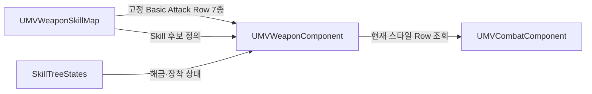
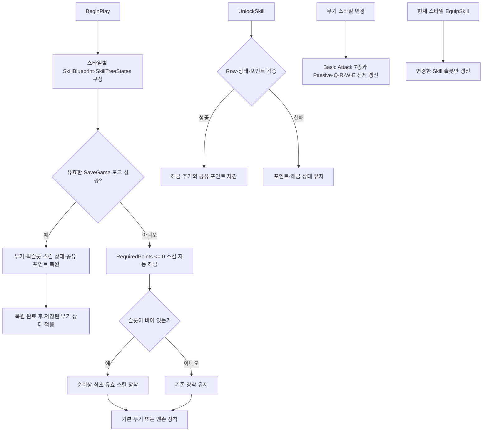

# 무기 스타일별 스킬 트리

## 핵심

- `UMVWeaponSkillMap`은 한 무기 스타일의 Basic Attack과 Skill 정적 정의를 함께 소유
- Basic Attack은 해금·장착 상태 없이 정의된 Row를 그대로 사용
- 해금·장착 상태는 개별 무기가 아닌 `EMVEquippedStyle`별 공유
- `SkillTreeStates`는 Skill 진행 상태만 관리하고 Basic Attack 상태는 저장하지 않음
- 스킬 포인트는 모든 스타일이 함께 사용하는 `UMVWeaponComponent` 소유 재화

## 데이터 소유권

- Basic Attack은 Light, Dodge Light, Sprint Light, Heavy, Dodge Heavy, Sprint Heavy, Charge Attack으로 구성
- `UMVCombatComponent`는 DataTable Row를 직접 선택하지 않고 `UMVWeaponComponent`에 현재 스타일의 Row를 요청

## 초기화와 변경

- 잘못된 스타일·Row, 중복 해금, 포인트 부족 요청은 상태 불변
- 동일 스킬 재장착은 전투 갱신 없이 성공하는 멱등 처리
- 비현재 스타일 장착 변경은 상태만 저장하고 해당 스타일로 무기를 바꿀 때 전체 전투 맵 갱신
- Basic Attack 또는 장착 Skill Row가 비어 있으면 해당 전투 항목도 비운 상태로 유지
- 기존 CombatComponent Chooser·Fallback API와 설정 제거
- 현재 SaveGame 경로는 `if (0)`으로 비활성화하고 복원 범위를 `Todo:`로 유지

## 공개 API

| API | 계약 |
|---|---|
| `GetWeaponSkillState` | 스타일별 `FMVSkillTreeState` 사본 조회, 부재 시 출력 초기화와 `false` 반환 |
| `GetSkillTree` | 스타일별 `UMVWeaponSkillMap` 조회, 부재 시 `nullptr`와 `false` 반환 |
| `GetBasicAttackRow` | 스타일과 전투 액션에 대응하는 고정 Basic Attack Row 조회 |
| `GetEquippedSkill` | 슬롯별 장착 맵 사본 조회, `None`은 현재 무기 스타일 사용 |
| `GetEquippedSkillRow` | 스타일과 슬롯의 현재 장착 Skill Row 조회 |
| `UnlockSkill` | 검증 성공 시 `max(0, RequiredPoints)` 차감과 해금 상태 추가 |
| `EquipSkill` | 해금 Skill의 슬롯 상태 변경, 현재 스타일이면 해당 슬롯만 전투 갱신 |
| `UMVCombatComponent::RefreshSkillSlot` | Passive 또는 Q·R·W·E 한 슬롯만 다시 구성 |
| `GetSkillPoints` | 모든 스타일이 공유하는 현재 스킬 포인트 조회 |
| `AddSkillPoints` | 양수 포인트만 추가, `int32` 초과 요청 거부 |

## 남은 일

- 기존 `UMVWeaponSkillMap` 에셋에 Basic Attack Row 7종 입력
- 스타일별 스킬 상태·공유 포인트·무기 진행 상태 Save/Load 및 변경 이벤트
