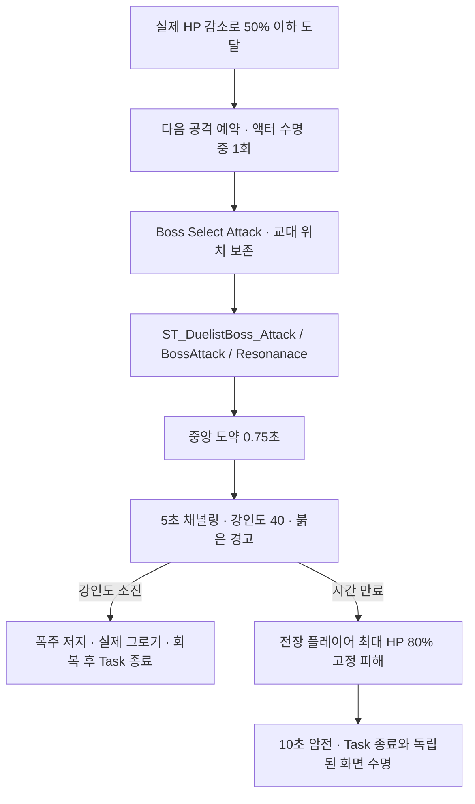

# Duelist 공명 폭주

## 실행 흐름

## 편집 위치

| 대상 | 위치·책임 |
|---|---|
| HP 조건·중앙 이동·채널링·실패 피해 | `BP_Duelist`의 `Resonance` 컴포넌트, `Combat/Duelist/MVDuelistResonanceComponent` |
| StateTree 실행 | `ST_DuelistBoss_Attack.BossAttack.Resonanace`, `FMVDuelistResonanceTask` |
| 예약 우선 선택 | `FMVBossSelectAttackTask.ResonanceState`, 기존 교대 배열에서 제외 |
| 화면 경고·암전 | `UI/BossHUD/MVResonanceScreenWidget`, 입력 미소비 |
| 연출 에셋 | `/Game/DuelistComplete/Resonance`의 몽타주 3개·머티리얼 2개 |

- `ArenaCenter`: 월드 원점 기본값, 실제 지면·캡슐 높이 보정, 전장 변경 시 컴포넌트에서 중심 위치 지정
- `ArenaRadius`: 기본 4000cm, 중심으로부터 수평 거리 기준의 실패 피해 범위
- `JumpDuration` 0.75초·`ChannelDuration` 5초·`ChannelPoise` 40·`FailureDamageRatio` 0.8·`BlackoutDuration` 10초
- 현재 이동: 지정 위치까지 포물선 보간, 경로 충돌 검사 제외; 벽으로 분리되지 않은 보스 전장 배치 전제
- 연출: 기존 회피·페이즈 변경·대기 클립 재사용, 붉은 원형 장판·화면 경고·독성 에너지 구체

## 강인도·피해 계약

- 채널링 중 `BeginPoiseBreakGroggyWindow(40)`: 기존 강인도·추가 강인도·회복 타이머 보관, 자동 회복·공격 Notify의 강인도 보정 차단
- 명시적인 `PoiseDamage > 0` 우선, 그 외 기존 공격의 계산된 `GroggyDamage`를 채널링 강인도 피해로 사용
- 강인도 소진 전 일반 피격 반응·그로기 게이지 누적 제외, 소진 타격을 `Groggy`로 변환하고 실제 그로기 상태 시작
- 저지·실패·중단·사망·EndPlay에서 임시 강인도 구간 정리와 기존 이동 복원, 그로기 중 Task 실행 유지
- 실패: `ResolveDirectDamage`로 살아 있는 전장 플레이어에게 최대 HP의 80% 1회 적용, 방어력·회피 무적과 무관한 전멸 피해
- 암전: 피격 로컬 플레이어 화면에 10초 표시 후 제거, 입력 잠금 제외
- 기존 사슬 `SkillW`와 일반 기본 공격·스킬 교대 순서 유지, 예약된 공명 폭주는 범위 밖 SkillQ보다 우선

## 구성 재생성

1. 에디터 Python에서 `Scripts/Editor/ConfigureDuelistResonance.py`: 전용 연출 에셋·BP 컴포넌트 구성
2. 에디터 종료 후 `UnrealEditor-Cmd Maverick.uproject -run=MaverickBossStateTree -ResonanceOnly`: 전용 Task·선택 링크 구성·공격 트리 컴파일·저장

원본 관측·백업: `Saved/DuelistResonance`, Git 제외

## 구현·에셋 정리 · 2026-10-11

- 공명 폭주 정상 진행·암전 종료의 임시 로그 제거, 화면 위젯의 사용자 이동 경로 `UI/BossHUD` 반영
- 이전 `Resonance` 상태와 몽타주 실행 행 제거, `SkillW` 완료 목적지는 공격 트리 성공 종료
- 전용 `Resonanace` Task·선택 우선 링크·연출 에셋 5개 유지, HP 50% 예약과 강인도 40·5초·80% 피해·10초 암전 계약 보존
- 전투 DataTable의 실행 행은 `BasicAttack1`·`BasicAttack2`·`SkillQ`·`SkillW` 4개, 미선택 `BasicAttack3`·이전 `Resonance` 행 제거
- 사용 중인 사슬 고리는 C++ 생성자에서 직접 로드; Asset Registry 참조 0을 삭제 근거로 단독 사용 금지
- 삭제 전 백업·상세 검증 자료: `Saved/DuelistCleanup`, Git 제외

정리 검증 자료: [cleanup-validation.json](attachments/cleanup-validation.json), 현재 Windows·Codex·Unreal Engine 5.8.3에서 실제 실행

| 대상 | 결과·증명 범위 | 한계 |
|---|---|---|
| C++·전투 자동 검사 | 전체 빌드·3개 검사 통과, 기본 공격·박스 피해·공명 폭주 계약 확인 | 격리 검사 캐릭터의 사망 행 미지정 경고 1개; 실제 화면·전체 AI 검사 제외 |
| Duelist 공격 트리 | 컴파일·저장 통과, 교대 선택 4개·전용 `Resonanace`·`SkillW` 성공 종료 | 공통 AI 트리 전체 정상 여부 증명 제외 |
| 새 프로세스의 대상 에셋 | 삭제 4개·보호 파일 15개 SHA256 보존·사용 중 4행 값 보존·5상태·BP 정상 상태·미저장 콘텐츠 0개 확인 | 대상 단언 통과와 별개로 공통 `ST_BaseAIStateTree.Search`의 기존 바인딩 오류 4건으로 명령 전체 오류 요약 발생 |

- 공통 트리 오류: 변경 전 `Saved/DuelistResonance/setup-assets.log`에도 동일한 `Boss`·`Boss AIController` 경로 오류, 최근 Duelist 정리 대상 밖으로 수정 제외; 해당 `Search` 바인딩 경로 정정·컴파일 필요
- 이번 정리의 PIE·네트워크·패키징 미실행: 사용자 Editor 종료 상태에서 코드·참조 보존 검사 수행, 실제 화면·전체 AI·해당 실행 환경의 동작 보장 제외; 아래 PIE 기록은 이전 구현 검증

## 검증 · 2026-10-11

환경: Windows, Codex, Unreal Engine 5.8.3 Development Editor. 범위별 결과: [검증 자료](attachments/validation.json)

| 대상 | 실제 실행·결과 | 증명 범위·한계 |
|---|---|---|
| C++ 모듈 | Windows 전체 빌드 `Succeeded` | 새 컴포넌트·Task·화면·강인도 변경의 컴파일·링크, 패키징 검증 제외 |
| 공격 에셋 | `ResonanceOnly`에서 대상 트리 컴파일·저장, BP 정상 상태·몽타주 길이 조회 | `Resonanace` 링크·교대 선택 4개·0.75/5/10초 클립 연결, 별도 신규 모션 제작 제외 |
| 자동 검사 | `Maverick.Combat.DuelistResonance` 1개 통과, 오류 0 | HP 초기화·50% 예약·강인도 39+1·기존 그로기 피해 대체·방어력 무시 고정 피해·1회 제한·사망 정리, 격리 게임 월드 기준 |
| PIE 저지 | 기본 공격 중 50% 예약 → 다음 `Resonanace`, 강인도 39 피해 후 잔여 1·추가 1로 실제 그로기 | 일반 공격 종료 대기·중앙 이동·경고 제거·그로기 회복·이동 복원, 교대 위치 1 보존·플레이어 HP 100 유지 |
| PIE 실패 | 채널링 5초 후 HP `100 → 20`, 암전 시작·종료 로그 간격 10초·화면 캡처 확인 | 로컬 플레이어의 경고·전멸 피해·화면 복귀, 교대 위치 0 보존·이동 복원 |

- PIE: 기존 `BaseBossTestLevel`의 실제 Duelist·메인 StateTree 실행, 검증 중 대상 지정·HP·방어력·카메라만 임시 조정, 레벨 저장 제외
- 저지 타격: 실제 `HitResolver`에 검증용 피해 요청 전달; 모든 평타·스킬의 충돌 Notify 및 입력 조합 재현 제외
- 자동 검사 경고: 기존 `AirborneTrace` 추적 로그 9건·격리 캐릭터의 사망 행 미지정 1건, 실패 판정 없음
- 에디터 백그라운드 3 FPS로 자동 검사 시작 지연, 검사 중 CPU 제한 임시 해제 후 실행·원래 설정 복원
- 기존 `/Game/Characters/NPC/BaseBoss/ST_BaseAIStateTree.Search`의 `Boss`·`Boss AIController` 속성 경로 오류: 에셋 구성 명령의 종료 코드 1 원인, 해당 공통 트리 수정 제외; Duelist 대상 트리 컴파일·저장 및 PIE 성공은 별도 확인
- 미검증: 네트워크·다중 로컬 플레이어·패키징·장애물로 분리된 전장, 현재 단일 로컬 플레이어 PIE 결과로 해당 환경 보장 불가
