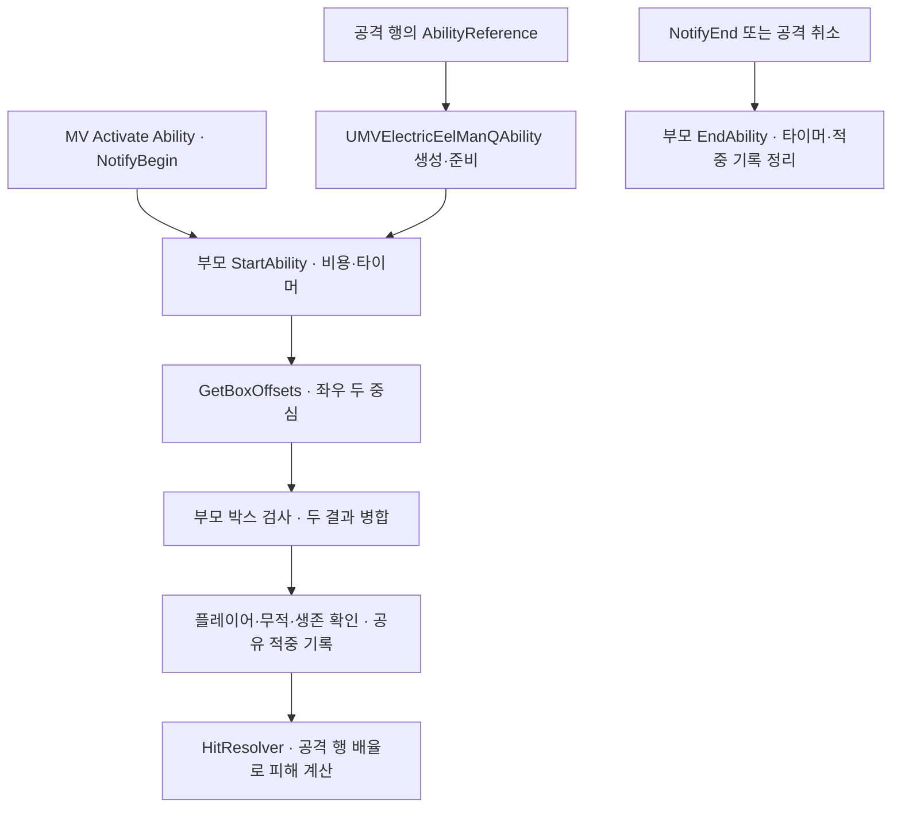

# 전기뱀장어맨 Q

## 책임과 실행

`Source/Maverick/Combat/Boss/ElectricEelMan/MVElectricEelManQAbility.h`·`.cpp`

- `UMVBoxDamageAbility` 상속, Q의 기본 크기·좌우 중심·발동 집계 연결 제공
- 첫 활성화·비용 지불 성공 시 보스의 스킬 사용 횟수 1회 누적, 같은 공격의 추가 Notify 구간은 집계 제외
- 활성 구간당 같은 플레이어에게 한 번 적중, 좌우 중첩과 동일 구간의 꼬리 간 이동에도 기록 공유
- 활성 구간 동안 액터 위치·회전에 맞춰 60Hz 검사, 지연 진입한 플레이어도 판정
- 피해는 장착 무기 공격력·행의 `DamageMultiplier`와 기존 방어 보정 사용
- 기본 `HitReactionType = None`, HP 피해만 요청; 다른 반응 선택 시 부모의 그로기 배율·Launch 처리 사용
- 이번 구현 범위는 Ability·판정, 꼬리 변형과 내려치기 모션은 후속 몽타주 제작 범위

## 조절 값

새 클래스 또는 자식 Blueprint의 `Class Defaults → Attack → Box`

| 속성 | C++ 기본값 | 의미 |
|---|---|---|
| `BoxSize` | `(600, 100, 180)` | 꼬리 하나의 전후·좌우·높이 전체 길이, cm |
| `BoxOffset` | `(350, 0, 0)` | 두 박스 중간 중심, 액터 원점 기준 로컬 좌표 |
| `TailSeparation` | `180` | 좌우 박스 중심 사이 전체 간격, 음수 입력은 0으로 제한 |
| `bDrawDebug` | `true` | 두 박스 표시, 해당 검사에 유효 적중이 있으면 두 박스 모두 초록색 |
| `HitReactionType` | `None` | 기본 HP 피해, 다른 피격 유형 선택 가능 |

기본 로컬 중심은 `(350, -90, 0)`과 `(350, 90, 0)`, 전방 범위는 `50~650cm`
Z는 액터 원점 기준이므로 실제 보스 캡슐·모션 높이에 맞춰 `BoxOffset.Z` 조절

## 후속 몽타주 연결

1. 공격 데이터테이블은 `FMVSkillDataTableColumn` 구조 사용
2. `AbilityReference`에 `MVElectricEelManQAbility` 또는 해당 자식 Blueprint 지정
3. 완성된 내려치기 몽타주를 행의 `Montage`에 지정
4. 몽타주의 실제 타격 구간에 `MV Activate Ability` Notify State 하나 배치
5. 노티파이에 `AbilityClass`를 지정할 때 Q 클래스와 일치, `AbilityIndex = 0`
6. StateTree 실행 태스크가 해당 행을 `CombatComponent`로 실행하도록 연결

판정 지속 시간은 노티파이 구간 길이, 구간을 여러 개 배치하면 각 구간에서 새 적중 허용
현재 단계의 보스 Blueprint·공격 테이블·몽타주 연결과 시각 연출은 후속 적용 대상

## 검증

2026-11-11, Codex·Windows·Unreal Engine 5.8 Development Editor

- 일반 Editor 빌드 성공, 새 Q 클래스 등록·공용 판정 변경·Boss/Duelist include 경로의 컴파일·링크 확인
- `Maverick.Combat.BoxDamageAbility` 성공, 기존 단일 박스와 Q의 좌우·중앙 빈 공간·겹친 박스·재활성·회전·사거리 밖 검증
- `Maverick.Combat.DuelistResonance` 성공, 이동된 클래스의 기존 공명 폭주 자동 검사 통과
- 두 자동 검사는 격리 게임 월드·공용 노티파이 진입 기준, 테스트 캐릭터의 무기 행·사망 행 미지정 경고 포함
- Editor 초기 맵 로딩에서 기존 `ST_BaseAIStateTree.Search`의 Boss·Boss AIController 바인딩 오류 관측, 해당 에셋의 연결·컴파일은 별도 복구 대상
- 새 애니메이션 미준비에 따라 실제 보스 몽타주·StateTree 연계 PIE 미실행, 화면 연출·네트워크·패키징 검증 제외
- 빌드 경고는 기존 PropertyBindingUtils 플러그인 의존성·XGE 라이선스·UButton 직접 속성 접근 항목

원본 결과는 `Saved/ElectricEelManQ/build.log`, `automation.log`, `Automation/index.json`에 보관, Git 제외
