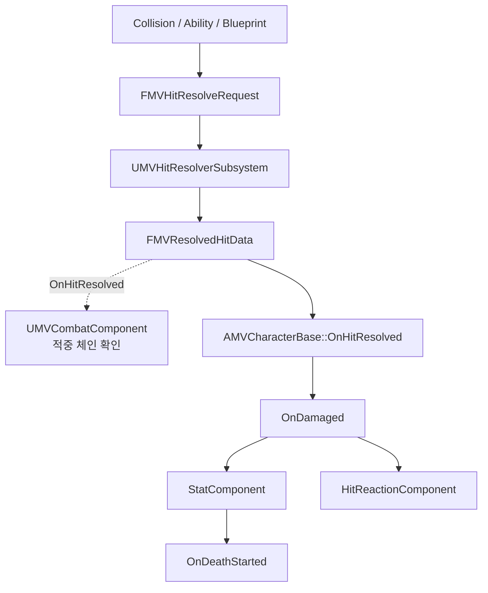
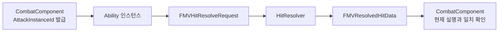

# Hit, Stat, HitReaction

## 실행 흐름

## 책임

| 계층 | 책임 |
|---|---|
| Collision·Ability·Blueprint | 필터링된 `FMVHitResolveRequest` 생성 |
| `UMVHitResolverSubsystem` | 공격자·피격자 Stat, 공격 배율, 무기 Snapshot 기반 `FMVResolvedHitData` 계산 |
| `UMVCombatComponent` | 현재 공격 실행과 일치하는 `OnHitConfirmed` 스킬의 체인 단계 전진 |
| `AMVCharacterBase::OnHitResolved` | CharacterIndex 확인과 `OnDamaged` 방송 |
| StatComponent | 수치 피해, Groggy, Lethal Latch, `OnDeathStarted` 소유 |
| HitReactionComponent | Row·Section, Interrupt, 무적, KD·AB Recovery 표현 |

### 한정된 강인도 소진 구간

- `BeginPoiseBreakGroggyWindow`·`EndPoiseBreakGroggyWindow`: 기존 강인도·추가 강인도·회복 타이머 보관·복원, 구간 중 자동 회복·Notify 보정 차단
- `HitResolver`: 명시적인 `PoiseDamage` 우선, 미지정 시 계산된 `GroggyDamage`를 강인도 감소에 사용
- 소진 전 그로기 게이지 누적·일반 피격 반응 제외, 소진 타격을 실제 `Groggy`로 변환
- 현재 사용처: Duelist 공명 폭주 채널링의 강인도 40, 구간 정리 책임은 실행 컴포넌트

## 무적 적용 범위

- 무적 검사: HitReaction 경로
- Resolver·Stat 피해 적용: 무적 검사와 분리

## 플레이어 피해 로그

- 위치: `UMVStatComponent::HandleDamaged`, 플레이어 제어 Pawn의 수치 피해 처리 후 `UE_LOG(LogTemp, Verbose, ...)` 호출
- 기본 출력 차단, 콘솔 `log LogTemp Verbose` 이후 `Output Log` 검색어 `PlayerDamage`로 수락된 피격 확인, 종료 시 `log LogTemp Log` 복원
- `Damage`: 방어력 반영 후 전달된 최종 HP 피해, `AppliedDamage`: HP 하한을 반영한 실제 감소량
- `HP`: 이번 피격의 차감 전후 값, `Attacker`·`Player`: 액터 이름, `Frame`: 프레임 번호
- 피해 0도 출력, 사망 상태·캐릭터 식별자 불일치로 거절된 처리와 비플레이어 대상은 출력 제외
- HP 소비·회복과 구분되는 피격 경로, 기존 피해 계산·중복 적중·이벤트 처리 유지

### 피해 0 확인 지점

- `Damage=0 AppliedDamage=0`: 플레이어 수치 피해 경로 도달, 방어력 반영 후 최종 HP 피해 0
- 계산 입력: 공격자의 `WeaponComponent.CurrentWeaponState.AttackPower`, 실제 공격 행의 `DamageMultiplier`, 피격자의 `StatComponent.Defence`
- 유효한 무기 Snapshot의 공격력 0도 그대로 사용, 현재 최종 피해 수식에 캐릭터의 `StatComponent.AttackPower` 미포함
- `DefaultWeaponRow` 미지정 시 `BareHandWeapon` 장착, 보스 메시의 무기 외형과 실제 장착 상태는 별도 설정
- 2026-10-08 Windows UE 5.8.3 조사: 사용자 피격 로그와 새 PIE의 실제 Duelist 맨손 공격력 0·플레이어 방어력 1 대조, 기본 공격·Q 배율 100과 W 배율 1에서도 최종 피해 0 확인
- 조절 위치: `BP_Duelist`의 `WeaponComponent.BareHandWeapon.AttackPower`, 공격별 배율은 `DT_DuelistBossCombatAttack`의 `DamageMultiplier`
- 조사 범위: 원본 C++·에디터 설정·PIE 런타임 수치 조회, 설정 변경·새 PIE의 타격 재현·추가 빌드 미실행

### 로그 검증

- 2026-10-08 Windows Codex·Unreal Engine 5.8.3: Live Coding 컴파일·패치 적용 완료, 격리 게임 월드의 `Maverick.Combat.BoxDamageAbility` 실제 실행 통과
- 유효 플레이어 피격 6건에 각각 로그 1줄, 첫 피격의 `Damage=15.00 AppliedDamage=15.00 HP=1000.00->985.00` 확인
- 범위 밖·비플레이어·무적·같은 활성 구간 반복 겹침·종료 이후의 추가 피해와 중복 로그 없음 확인
- 검사 오류 0, 기존 `AirborneTrace` 경고 5건; Live Coding의 `.voltbl` 메타데이터 오류 출력 이후 패치 생성 성공 및 새 로그 실행 확인
- 피해 0·잔여 HP 초과 분기는 코드 확인 범위, 해당 분기의 별도 런타임 재현 미실행
- 일반 Editor 전체 빌드·현재 Duelist 몽타주의 PIE·네트워크·패키징은 이번 로그 변경 범위에서 미실행, 해당 실행 환경의 동작 보장 제외

## 전투 추적 코드 정리 · 2026-10-11

- `HitLaunchTrace`·`HitDirectionTrace`·`AirborneTrace`·`RecoveryTrace`의 임시 보조 함수·호출·비활성 분기 제거
- 방향 계산의 진단용 문자열 출력 인자 제거·동일한 방향 반환 함수 통합, 실제 피격 방향·회전·발사·회복 정책 보존
- 설정 누락·액션 실행 실패 경고와 명시적인 `PlayerDamage` 진단 경로 유지
- 현재 Windows 실제 빌드·전투 자동 검사 3개 통과, 삭제 로그의 출력 부재와 기존 피해·강인도 결과 확인; 네트워크·패키징 검증 제외
- 격리 검사 캐릭터의 사망 행 미지정 경고 1개, 이번 정리의 PIE 재실행 제외; [정리 검증 자료](../Duelist-Resonance/attachments/cleanup-validation.json)

## 공격 실행 식별자

- `AttackInstanceId`: Ability 실행마다 증가하는 일회성 식별자
- Blueprint Ability: 적중 요청 생성 시 현재 Ability의 식별자를 `FMVHitResolveRequest`에 복사
- HitResolver: 요청의 식별자를 `FMVResolvedHitData`로 전달하며 피해 계산에는 미사용
- CombatComponent: 공격자·현재 Ability·활성 상태·식별자 일치 후 `OnHitConfirmed` 단계 전진
- `SkillMap`의 적중 확인 정책만 소비, 기본 공격과 `Immediate` 스킬의 체인 진행에 영향 없음
