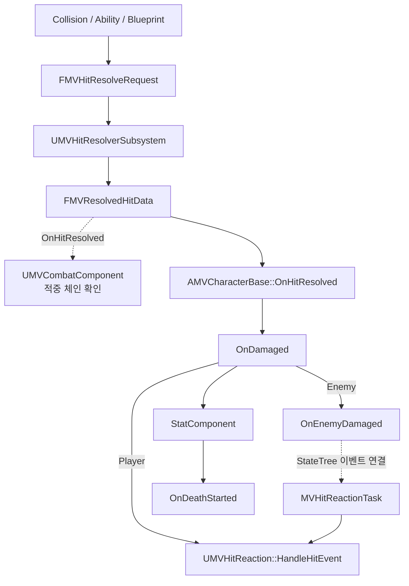
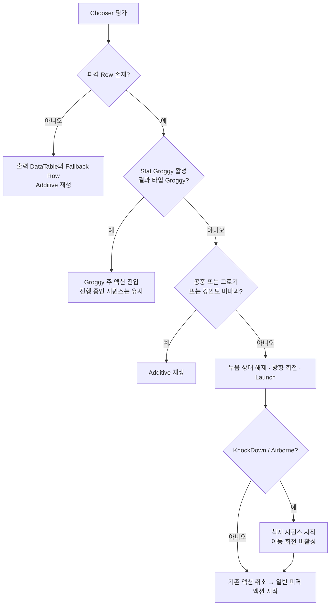
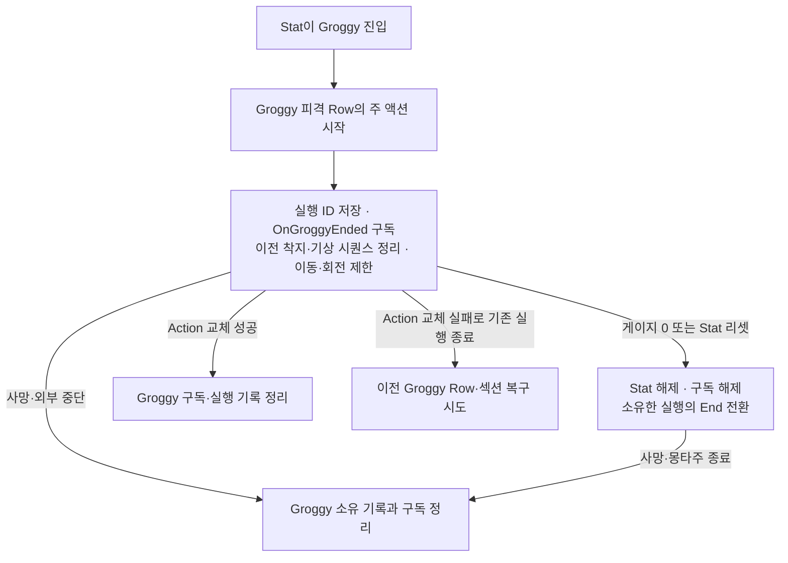
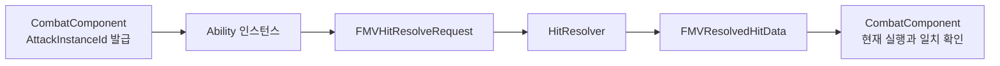

# Hit, Stat, HitReaction

## 실행 흐름

## 책임

| 계층 | 책임 |
|---|---|
| Collision·Ability·Blueprint | 필터링된 `FMVHitResolveRequest` 생성 |
| `UMVHitResolverSubsystem` | 공격자·피격자 Stat, 공격 배율, 무기 Snapshot 기반 `FMVResolvedHitData` 계산 |
| `UMVCombatComponent` | 현재 공격의 `OnHitConfirmed` 체인 단계 전진; 발사체별 원래 공격 기록과 지연 적중·빗나감 결과 관리 |
| `AMVCharacterBase::OnHitResolved` | CharacterIndex 확인과 `OnDamaged` 방송 |
| StatComponent | 수치 피해, Groggy, Lethal Latch, `OnDeathStarted` 소유 |
| `UMVHitReaction` | Chooser Row 선택, 일반·Additive 피격, Groggy와 착지·기상 시퀀스 |

## UMVHitReaction

### 진입과 소유권

- 캐릭터 기본 구성 요소, 플레이어는 `OnDamaged`에서 직접 호출하고 적은 `OnEnemyDamaged`를 받은 StateTree Task에서 호출
- `BeginPlay`에서 Character·Stat·Action·InputManager 캐시와 입력·사망 구독 등록
- `EndPlay`에서 소유한 Groggy 액션과 구독·타이머·입력 등록 정리
- `HandleHitEvent`는 Action·Chooser·Stat 누락, 반응 타입 `None`, 사망 상태에서 종료

### Chooser 계약

| 입력·출력 | 현재 구현 |
|---|---|
| `FMHitReactionChooserInput.HitReactionType` | 전달된 피해 데이터의 반응 타입 |
| `HitReactionDir` | 수평 `-ImpactNormal`과 캐릭터 전방·우측 내적으로 F/B/R/L 분류 |
| `bPoiseBreak` | HitResolver가 계산한 강인도 파괴 예측값 |
| `bIsAir` / `bIsGroggy` | 이동 컴포넌트의 `IsFalling()` / Stat의 `IsGroggy()` |
| Struct 출력 | 피격 Row와 기상 Row의 `FDataTableRowHandle` |
| Object 출력 | 피격 Row가 없을 때 사용할 fallback DataTable |

피격 Row가 없으면 Object 출력을 동기 로드하고 `Fallback` Row를 Additive 재생한 뒤 종료
Stat이 Groggy인 동안 추가 피격은 기존 기상 Row를 보존

### 피격 실행

| 처리 | 현재 계약 |
|---|---|
| 방향 회전 | 공격자 방향 기준, Back 0°·Right 90°·Front 180°·Left 270° 보정 |
| Launch | `HitDirection` 수평 정규화, 수평 속도 `LaunchDistance / LaunchDuration`, 수직 속도 음수 제한 |
| KnockDown·Airborne 시작 | 기존 시퀀스 타이머·구독 정리, 기상 차단, 0.5초 뒤 낙하 상태 검사 |
| 0.5초 후 공중 | 이동 모드·누움 상태 변경 이벤트 구독, 착지 대기 |
| 0.5초 후 지상 또는 착지 | `Land` 섹션 전환, 실패 시 액션 취소; 누움 상태 설정과 기상 지연 시작 |
| 구독 중 다시 낙하 | `Fall` 섹션 전환, 실패 시 액션 취소; 기상 타이머 제거·기상 차단 |
| 기상 입력 | 누워 있고 `bIsFalling == false`, 지연 종료 후 유효한 Dodge 이외 입력 태그로 기상 |
| 기상 실행 | 이동·회전 활성화, 현재 액션 취소 후 저장한 기상 Row 시작, 누움 상태 해제 |

`CanGetupDelay`는 현재 `int32`, 기본값 1초이며 타이머 종료는 기상 허용만 설정
구형 착지 감지·기상 요청 Notify 없이 컴포넌트의 타이머와 이동 모드 이벤트로 진행

### StateTree 연결

- `MVHitReactionEnterCondition`: 현재 `UMVHitReaction` 존재 여부 검사
- `MVHitReactionTask`는 `HandleHitEvent` 호출 전후 실행 ID를 비교해 새 주 액션을 추적
- StateTree 이탈 시 일반 피격 액션은 설정에 따라 취소 가능하며, Groggy 액션의 수명은 HitReaction이 계속 관리
- Additive·fallback에서 Task 결과는 `bFailWhenReactionNotStarted` 설정에 따름

### 검증 경계

현재 C++와 이벤트 바인딩 기준 계약이며, Blueprint의 Chooser Row·Montage Section·StateTree 이벤트 배선은 에디터 검증 대상

## 그로기 상태 계약

- 공격 요청의 `HitReactionType`에는 `Groggy`를 지정하지 않음 — 공격 데이터·호출자가 지키는 입력 계약
- `Groggy`는 HitResolver가 그로기 조건 충족 시 확정하는 결과 타입이며, 요청 시 선택하는 공격 반응 타입이 아님
- 일반 공격의 `BuildResolvedHitData`: `PredictGroggyResult`로 양수 피해 누적 후 최대치 도달을 예측하면 결과 타입을 `Groggy`로 변경
- `StatComponent`: 양수 그로기 피해 누적 후 결과 타입이 `Groggy`이고 게이지가 최대일 때 실제 상태 진입, 사망·기존 그로기 상태는 제외
- `ResolveDirectDamage`는 일반 공격의 예측·타입 변환 경로를 거치지 않음

### Groggy 표현 수명

- 그로기 중 추가 피격의 Groggy 피해는 누적하지 않으며, 남은 지속 시간은 Stat 게이지 감소율로 결정
- 자연 회복 직후 `IsGroggy=false`이며 소유한 액션의 이동·회전 제한은 `End` 전환 시 해제
- 명시적 액션 교체 중에는 종료 기록을 보존하고, ActionComponent가 알린 이전 실행 ID가 일치할 때 교체 결과를 처리
- 사망 시 HitReaction은 기록과 현재 ID가 일치하는 Groggy 액션만 중단하고, Stat은 남은 그로기를 해제
- 이동·회전 제한은 활성 실행에 귀속되며, `ActionComponent`가 해당 실행을 종료할 때 해제

### 한정된 강인도 소진 구간

- `BeginPoiseBreakGroggyWindow`·`EndPoiseBreakGroggyWindow`: 기존 수치·회복 타이머 보관·복원, 구간 중 강인도 자동 회복·액션 보정 차단
- 구간 중 일반 그로기 최대치 예측은 생략하고, 요청의 `PoiseDamage`로 예측한 `PoiseBreak` 발생 시에만 `Groggy` 타입과 최대치 충족 피해량 설정
- 강인도 미파괴 시 요청 반응 타입과 계산된 그로기 피해 유지; 게이지 누적만으로 진입하지 않으며 구간 정리는 호출자 책임

## 피해·방향 계산 계약

- `FMVHitResolveRequest.AttackTypes`: 일반 공격은 `NormalDefence`, 스킬 공격은 `SkillDefence` 선택
- 치명타 적용 전 HP 피해: `max(0, 장착 무기 공격력 × DamageMultiplier − 선택 방어력 × 0.5)`, 소수점 첫째 자리까지 절삭
- `SetNormalDefence`·`SetSkillDefence`로 방어력 변경, 기존 단일 `Defence` 필드 참조 제외
- `ResolveHitDirection`: 공격자·피격자 인수 2개, 수평 방향 정규화; `HitLocation`·`ImpactNormal`은 충돌 문맥 보관용
- `ResolveDirectDamage`: 이미 계산한 최종 피해 전달, 공명 폭주의 최대 HP 80% 고정 피해에 방어력 재적용 제외
- 2026-10-12 머지 이후 정합성: 방향 선언·구현 일치, 일반 방어력 5의 박스 피해 `20−2.5=17.5`와 일반·스킬 방어력 99999의 공명 고정 피해 검사 통과
- 검증 범위·경고·한계: [머지 이후 빌드 복구](attachments/merge-build-validation.json)

## 무적 적용 범위

- 현재 `UMVHitReaction::HandleHitEvent`의 무적 거절 분기는 주석 처리 상태
- Resolver·Stat 피해 적용: 무적 검사와 분리

## 플레이어 피해 로그

- 위치: `UMVStatComponent::HandleDamaged`, 플레이어 제어 Pawn의 수치 피해 처리 후 `UE_LOG(LogTemp, Verbose, ...)` 호출
- 기본 출력 차단, 콘솔 `log LogTemp Verbose` 이후 `Output Log` 검색어 `PlayerDamage`로 수락된 피격 확인, 종료 시 `log LogTemp Log` 복원
- `Damage`: 방어력 반영 후 전달된 최종 HP 피해, `AppliedDamage`: HP 하한을 반영한 실제 감소량
- `HP`: 이번 피격의 차감 전후 값, `Attacker`·`Player`: 액터 이름, `Frame`: 프레임 번호
- 피해 0도 출력, 사망 상태·캐릭터 식별자 불일치로 거절된 처리와 비플레이어 대상은 출력 제외
- HP 소비·회복과 구분되는 피격 경로, 기존 피해 계산·중복 적중·이벤트 처리 유지

### 피해 0 확인 지점

- `Damage=0 AppliedDamage=0`: 플레이어 수치 피해 경로 도달, 방어력 반영 후 최종 HP 피해 0
- 계산 입력: 공격자의 `WeaponComponent.CurrentWeaponState.AttackPower`, 실제 공격 행의 `DamageMultiplier`, 공격 유형에 따른 피격자의 `NormalDefence`·`SkillDefence`
- 유효한 무기 Snapshot의 공격력 0도 그대로 사용, 현재 최종 피해 수식에 캐릭터의 `StatComponent.AttackPower` 미포함
- `DefaultWeaponRow` 미지정 시 `BareHandWeapon` 장착, 보스 메시의 무기 외형과 실제 장착 상태는 별도 설정
- 2026-10-08 Windows UE 5.8.3 조사: 사용자 피격 로그와 새 PIE의 실제 Duelist 맨손 공격력 0·플레이어 방어력 1 대조, 기본 공격·Q 배율 100과 W 배율 1에서도 최종 피해 0 확인
- 조절 위치: `BP_Duelist`의 `WeaponComponent.BareHandWeapon.AttackPower`, 공격별 배율은 `DT_DuelistBossCombatAttack`의 `DamageMultiplier`
- 조사 범위: 원본 C++·에디터 설정·PIE 런타임 수치 조회, 설정 변경·새 PIE의 타격 재현·추가 빌드 미실행

### 로그 검증

- 2026-10-08 Windows Codex·Unreal Engine 5.8.3: Live Coding 컴파일·패치 적용 완료, 격리 게임 월드의 `Maverick.Combat.BoxDamageAbility` 실제 실행 통과
- 유효 플레이어 피격 6건에 각각 로그 1줄, 첫 피격의 `Damage=15.00 AppliedDamage=15.00 HP=1000.00->985.00` 확인
- 범위 밖·비플레이어·무적·같은 활성 구간 반복 겹침·종료 이후의 추가 피해와 중복 로그 없음 확인
- 검사 오류 0, 기존 `AirborneTrace` 경고 5건; Live Coding의 `.voltbl` 메타데이터 오류 출력 이후 패치 생성 성공 및 새 로그 실행 확인
- 피해 0·잔여 HP 초과 분기는 코드 확인 범위, 해당 분기의 별도 런타임 재현 미실행
- 일반 Editor 전체 빌드·현재 Duelist 몽타주의 PIE·네트워크·패키징은 이번 로그 변경 범위에서 미실행, 해당 실행 환경의 동작 보장 제외

## 전투 추적 코드 정리 · 2026-10-11

- `HitLaunchTrace`·`HitDirectionTrace`·`AirborneTrace`·`RecoveryTrace`의 임시 보조 함수·호출·비활성 분기 제거
- 방향 계산의 진단용 문자열 출력 인자 제거·동일한 방향 반환 함수 통합, 실제 피격 방향·회전·발사·회복 정책 보존
- 설정 누락·액션 실행 실패 경고와 명시적인 `PlayerDamage` 진단 경로 유지
- 현재 Windows 실제 빌드·전투 자동 검사 3개 통과, 삭제 로그의 출력 부재와 기존 피해·강인도 결과 확인; 네트워크·패키징 검증 제외
- 격리 검사 캐릭터의 사망 행 미지정 경고 1개, 이번 정리의 PIE 재실행 제외; [정리 검증 자료](../Duelist-Resonance/attachments/cleanup-validation.json)

## 공격 실행 식별자

- `AttackInstanceId`: Ability 실행마다 증가하는 일회성 식별자
- Blueprint Ability: 적중 요청 생성 시 현재 Ability의 식별자를 `FMVHitResolveRequest`에 복사
- HitResolver: 요청의 식별자를 `FMVResolvedHitData`로 전달하며 피해 계산에는 미사용
- CombatComponent: 공격자·현재 Ability·활성 상태·식별자 일치 후 `OnHitConfirmed` 단계 전진
- 발사체: 발사 당시 공격 번호·무기 정보를 보관하고, 늦은 적중을 원래 공격에 귀속: [[Features/Combat/Ranged-Projectile/document|원거리 발사체와 자동 유도 대상 선택]]
- `SkillMap`의 적중 확인 정책만 소비, 기본 공격과 `Immediate` 스킬의 체인 진행에 영향 없음
