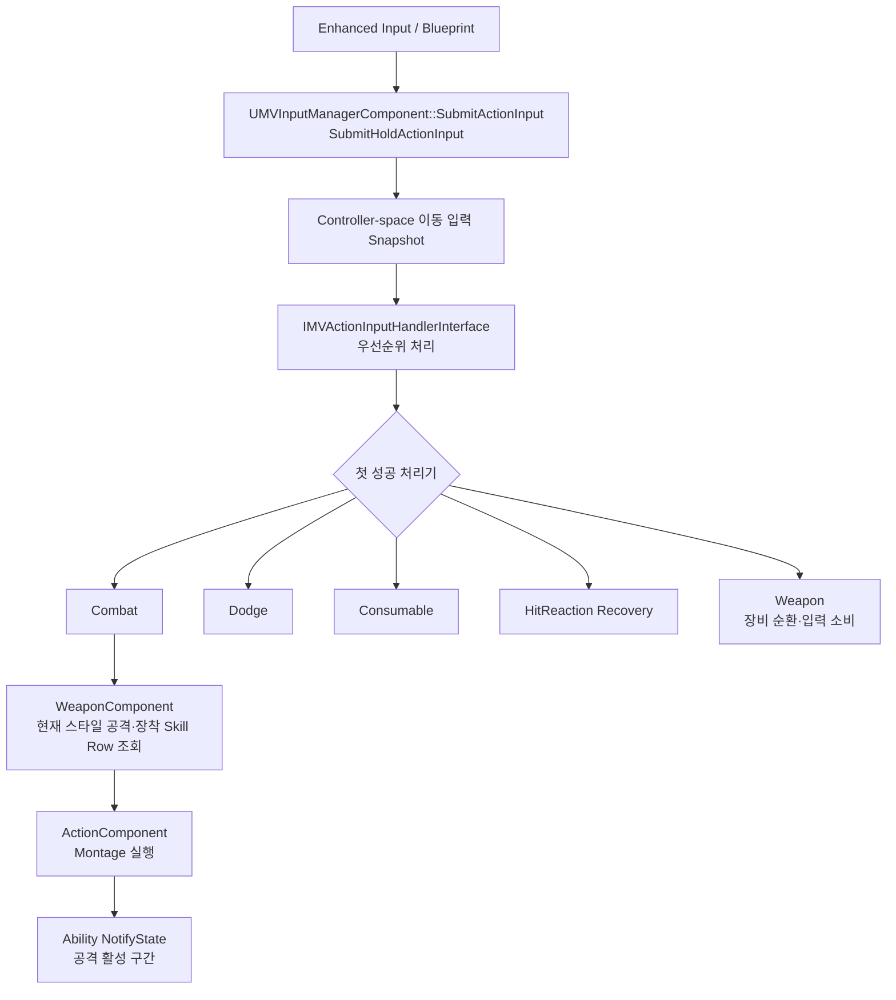

# 입력에서 Action 실행까지

## 실행 흐름

## 책임

| 계층 | 책임 |
|---|---|
| Blueprint·Enhanced Input | 입력 이벤트와 Submit API 연결 |
| InputManager | 이동 입력 Snapshot, 짧은 Buffer, 처리기 우선순위 배분 |
| 도메인 처리기 | Combat·Dodge·Consumable·Recovery·Weapon 규칙과 입력 소비 |
| WeaponComponent | 현재 무기 스타일의 공격·장착 Skill Row 제공 |
| CombatComponent | 공격 입력 규칙, Chain·Ability·쿨다운 런타임과 Action 시작 조정 |
| ActionComponent | Montage, Active Action, 실행 Domain, Interruptibility, 종료 이벤트 소유 |
| Ability NotifyState | Montage의 실제 Ability 시작·종료 구간 소유 |

## 실행 Domain 계약

- 도메인 처리기는 Action 시작·전환 요청에 `EMVActionDomain`을 전달한다. 기존 호출은 기본값 `None`으로 호환한다.
- ActionComponent는 Montage 실행 성공 후 활성 Domain을 저장하고 Action 종료 시 `None`으로 초기화한다.
- Player·Enemy Dodge 처리기는 `Dodge` Domain을 명시한다.
- CombatComponent는 활성 Domain과 Action Instance ID로 회피 공격 문맥을 판정한다.
- DataTable·Row 이름은 콘텐츠 식별자이며 실행 Domain 판정 계약으로 사용하지 않는다. 이름 접두사 검사와 Dodge Attack 이름 예외도 두지 않는다.
- 현재 Action 시작·종료 이벤트는 Domain을 전달하지 않는다. 필요한 소비자는 ActionComponent Getter를 사용하며 이벤트 확장은 후속 범위로 둔다.

## 경계 원칙

무기 교체의 `true` 반환은 장착 성공이 아닌 입력 소비 의미
교체 불가 상태에서도 소비하여 액션 종료 후 지연 실행 방지: [[Features/Combat/Weapon-Swap/document|플레이어 무기 교체]]

- WeaponComponent: 공격·장착 Skill Row 원천
- CombatComponent: 전투 입력 규칙과 Ability 런타임
- ActionComponent: 실행기
- 입력 Buffer: 개별 도메인 규칙 배치 금지
