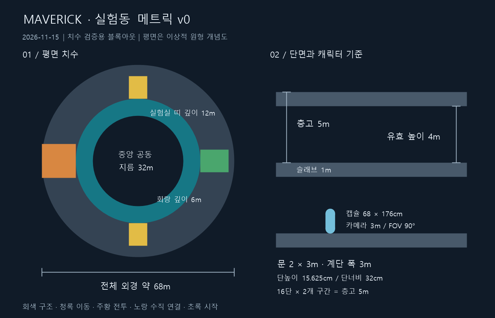

# 실험동 블록아웃 메트릭 v0

- 레벨: `/Game/LevelDesign/Blockout/Maps/Experiment/L_BO_Experiment_Corridor`
- 상태: 6층 진행형 블록아웃, 임시 보스처치 버튼으로 층별 출구 개방
- 단위: 1uu = 1cm, 문·통로·실내 크기는 마감과 소품을 제외한 유효 공간
- 원통은 24분할 다각형 근사, 곡면의 최종 건축 치수와 구분

## 치수 개요

첨부 도면은 최초 메트릭 v0 비교 자료이며 아래의 6층 진행 동선과 방 확장 이전 배치

## 6층 진행 동선

- 층 표기: 1~6층, 바닥 높이 Z=0 / 800 / 1600 / 2400 / 3200 / 4000cm
- 층별 동선: 회랑 → 방 1 → 방 2 → 방 3 보스방 → 출구문 → 계단 B → 다음 층
- 기본 방 18개와 4층 단실 분기 2개로 총 20개 방 구성, 별도 시작실과 메트릭 비교 구역 유지
- 계단 A·B 모두 `BP_BO_Stair_8m` 사용, A는 측면 포털을 벽으로 막고 중간에 고정 잔해 추가
- 계단 B는 회랑에서 출발 구간으로 직접 진입 불가, 보스방 출구로만 접근
- 이전 층 계단 도착부는 독립 전실로 회랑에 접속, 다음 상승 계단은 다른 방향에 배치
- 1~5층에 상승 계단 배치, 6층 출구는 최종 계단참으로 연결되며 7층 없음

### 층별 변주

방향 기준: 월드 +X 동쪽, +Y 북쪽, 회전각은 1층 방 묶음 기준

| 층 | 방 묶음 회전 | 회랑에서 본 주 진입 방향 | 추가 구성 |
| --- | ---: | --- | --- |
| 1 | 0° | 서쪽 | 기준형, 남쪽 붕괴 계단 |
| 2 | 180° | 동쪽 | 보스방 반대편 배치, 서쪽 붕괴 계단 |
| 3 | 45° | 남서쪽 | 사선 배치, 북동쪽 붕괴 계단 |
| 4 | 225° | 북동쪽 | 북쪽·서쪽 12×12m 단실 추가, 주 경로만 3개 방 연결 |
| 5 | 90° | 남쪽 | 서쪽 상승 계단, 동쪽 붕괴 계단 |
| 6 | 270° | 북쪽 | 동쪽 최종 출구, 7층 상승 없음 |

| 방 | 바닥 규격 | 연결 |
| --- | --- | --- |
| 방 1 | 12×12m | 층별 방향의 회랑 출입구 → 방 2 |
| 방 2 | 12×16m | 방 1 → 보스방 |
| 방 3 | 32×32m | 중앙 체크포인트 → 해당 층 출구 → 계단 B |
| 4층 단실 2개 | 각각 12×12m | 회랑에서 개별 진입, 다음 방 연결 없음 |

### 체크포인트와 출구문

- `Ingredients/ExperimentCorridor/Blueprints/BP_CorridorCheckpoint`: 기존 상호작용 컴포넌트를 이용하는 회랑형 전용 액터
- `Ingredients/ExperimentCorridor/UI/WBP_CorridorCheckpoint`: `보스처치(임시)` / `돌아가기` 메뉴
- `CorridorOpenMenu`: 프로젝트 UI 서브시스템의 창 스택으로 메뉴 표시, 메뉴에 해당 체크포인트 참조 전달
- 체크포인트 메시: `BlockAllDynamic` / `WorldDynamic`, 감지기가 조회하는 충돌 채널에 포함하여 E 상호작용 지원
- `CorridorDefeatBoss`: `Cleared` 설정과 메뉴 종료 후 문 전용 카메라로 0.35초 전환, 문을 2초 동안 부드럽게 360cm 상승
- 개방 후 문 충돌 해제, 2.8초부터 원래 시점으로 복귀하고 3.2초에 이동·시점 입력 복원
- 배치 시 `ExitDoor`와 `DoorCamera`에 같은 층 액터 지정, 문 메시 Mobility는 Movable, 클리어된 체크포인트는 재상호작용 해제
- Tick은 문 연출이 진행 중일 때만 시간·문 위치 갱신, 임시 진단 출력 제거
- 실제 보스 사망 연결·저장 파일 영속화 미구현

## 캐릭터 기준: PIE 확인값

| 항목 | 현재 값 | 적용 범위 |
| --- | ---: | --- |
| 충돌 캡슐 | 반지름 34cm, 반높이 88cm | 지름 68cm × 전체 높이 176cm |
| 걷기 / 달리기 / 전력질주 | 200 / 500 / 750cm/s | StatComponent 런타임 값 |
| 현재 MaxWalkSpeed | 500cm/s | 정지 상태에서 조회한 기본 달리기 설정 |
| 카메라 스프링암 | 300cm | 벽 충돌에 따른 실제 카메라 거리 변화와 구분 |
| 카메라 SocketOffset | (0, 0, 30)cm | 스프링암 설정값 |
| FOV / 카메라 ProbeSize | 90° / 12cm | 런타임 설정값 |
| MaxStepHeight | 45cm | 이동 컴포넌트 설정, 계단 권장 단높이와 구분 |
| WalkableFloorAngle | 약 44.77° | 이동 컴포넌트 설정 |

회피 이동량·공격 전진량은 미측정  
10m 직선 이동의 이론 시간: 걷기 5초 / 달리기 2초 / 전력질주 약 1.33초, 가속·충돌 제외

## 공간 규격

| 요소 | v0 기준 | 현재 배치 / 용도 |
| --- | ---: | --- |
| 배치 그리드 | 기본 50cm, 세부 10cm | 원주 배치·계단 단높이는 예외 |
| 일반 문 | 200 × 300cm | 시작실·전투실, 비교 구역은 폭 150 / 200 / 250cm |
| 일반 통로 | 폭 400cm | 비교 구역 300 / 400 / 600cm, 길이 1600cm |
| 전투 회랑 | 방사 방향 깊이 600cm | 실험동 0층·1층 링 |
| 실내 유효 높이 | 695cm | 방 천장 하단, 상층 슬래브와 5cm 면 분리, 최초 v0는 400cm |
| 층고 | 800cm | 회랑형 바닥 상면 간 거리, 최초 v0는 500cm |
| 바닥 / 방 천장 | 100 / 95cm | 방 천장 Z=695~790cm, 상층 바닥 슬래브 Z=700~800cm |
| 시작 실험실 | 800 × 1000cm | 동쪽, 초록 바닥 |
| 연결 방 1 / 방 2 | 1200×1200 / 1200×1600cm | 층별 방향을 바꾸는 우회 동선 |
| 보스방 | 3200 × 3200cm | 각 층의 세 번째 방, 주황 바닥 |
| 비교 전투실 | 1000 / 1200 / 1600cm 정사각형 | 테스트 구역, 천장 없는 비교 공간 |
| 계단 유효 폭 | 300cm | 공용 계단의 상승·복귀 구간 |
| 계단 단높이 / 단너비 | 16 / 32cm | 25단씩 2개 구간, 총 높이 800cm |
| 계단 중간참 | 300 × 650cm | 높이 400cm |
| 중정 난간 | 높이 120cm, 두께 20cm | 하부 2개 층 |

좁은 보조 통로 폭 250cm는 초기 제안값이며 이번 비교 구역에는 미배치  
천장 없는 비교 전투실과 천장이 있는 실험동 전투실을 구분해 카메라 평가

## 원통형 골조

| 항목 | 기준 |
| --- | --- |
| 중앙 공동 | 지름 약 3200cm, 모듈 안쪽 면 기준 |
| 회랑 | 반경 1600~2200cm |
| 실험실 배치 띠 | 반경 2200~3400cm, 전체 면적을 채우지 않음 |
| 회랑 외경 | 약 4400cm, 방 묶음은 층별 방향으로 원통 바깥 확장 |
| 원주 분할 | 24개 × 15° |
| 조립 방식 | 15도 사다리꼴 모듈 접합, 원주 모서리의 중복 표면 제거 |
| 이동 가능 층 | Z=0~4000cm의 6개 층 |
| 상부 외형 | 기존 외형 전용 층을 진행 가능한 층으로 구성, 6층 위 골조 제거 |
| 전체 골조 높이 | 약 48m |
| 층간 연결 | 층별 보스방 출구로 해금하는 계단 B / 다른 방향의 계단 A는 잔해로 차단 |
| 기본 동선 | 시작실 → 회랑 → 방 1 → 방 2 → 보스방 → 해금된 계단 → 상층 회랑 |
| 기준 이동 거리 | 회랑 중심 반경 19m의 이상적 원주 약 119.4m, 실제 다각형 동선과 차이 |

회랑 순환은 유지하되 계단 B의 출발 구간은 분리
실제 보스·적 배치, 낙사 복귀 및 진행 저장은 이번 임시 해금 기능의 범위에서 제외

### 벽·수납부 접합 기준

- 회랑 바닥·외벽·난간은 끝단이 맞는 15도 전용 메시, 중복 교차 기둥 제거
- 방 1·2의 연속 외벽·천장 통합, 보스방 천장과 끝단 접합
- 문 두께 20cm / 수납 상인방·문틀 깊이 50cm, 슬라이드 중 문 표면이 벽 표면과 겹치지 않도록 분리
- 공용 계단 포털 상인방·양옆 벽 추가, 붕괴 계단은 남은 320×330cm 포털도 폐쇄
- 잔해 코어 상단은 해당 층 바닥에서 775cm, 위층 계단 침범 방지
- 방 천장 하단은 상층 바닥 하단보다 5cm 낮춰 겹친 수평면 노출 방지
- 상승 계단 5개는 출발층 기준 높이 800~1500cm의 측벽·중앙벽 연장, 천장 하단 1495cm로 상층 도착부까지 폐쇄
- 기존 도착 전실의 중복 측벽·천장은 제거, 올라온 계단과 상층 회랑 사이 통행 유지

### 회랑 충돌 기준

- 회랑 바닥·외벽·난간 모듈은 `CTF_UseComplexAsSimple`, 렌더링 표면과 캐릭터 지지 표면 일치
- 자동 convex 근사에서 안쪽 가장자리 상면이 최대 약 100cm 낮아지는 경사로 변형된 문제 수정
- `trace_world` 선 검사 통과만으로 캐릭터 충돌 검증 대체 불가, 가장자리·이음새의 실제 캡슐 지지 높이 확인 필요

## 인그리디언트와 컬러 코딩

| 색상 | 역할 | 현재 요소 |
| --- | --- | --- |
| 회색 | 구조체·경계 | 벽·천장·기둥·난간·상부 외형 |
| 청록 | 이동 공간 | 하부 회랑·비교 통로 |
| 주황 | 전투 공간 | 실험동 전투실·비교 전투실 |
| 노랑 | 수직 연결·통과 강조 | 계단·계단참·비교 문 상인방 |
| 초록 | 시작 지점 | 시작 실험실 |

색상은 제작용 의미 구분이며 최종 아트 색상과 무관  
색상과 함께 Outliner 폴더·액터 이름·현장 영문 치수 라벨 사용

## 에디터 사용

| 위치 | 구성 |
| --- | --- |
| 원점 부근 | 실험동, 중앙 공동 중심 (0, 0) |
| PlayerStart | (2800, 0, 110)cm, 공동 방향으로 시선 |
| 동쪽 별도 구역 | 중심 약 (9000, 0)cm, 메트릭 비교 플랫폼 |
| 00_Lighting | 실내 확인용 보조 조명 |
| 01_Structure | 기둥·외벽·상부 외형 |
| 02_Route | 0층·1층 회랑 |
| 03_Rooms | 시작실·전투실 |
| 04_Vertical | 북·남 계단 |
| 05_Metrics | 통로·문·전투실 비교, 1m 간격의 20m 눈금 |
| 06_Labels | 치수·용도 표시 |
| 07_Progression/F1~F6 | 층별 방·문·계단·차단물·체크포인트 |
| 07_Progression/Lighting, Signs | 진행 구역 조명과 안내 표지 |

기본 Play: 시작 실험실에서 진입  
비교 구역은 건물과 물리적으로 분리, 해당 위치에서 에디터의 Play From Here로 별도 검사

## 검증 범위

2026-11-15 층별 변주 후 검증

- 공용 계단 BP 컴파일 및 10개 인스턴스 재배치, 층별 체크포인트·문·카메라 참조 유지
- PIE 회랑 바닥 2,160지점, 상승 계단 발판 250지점·머리 여유 250지점 검사 통과
- 최종 계단 재배치 후 방·도착부·포털 연결 94개, 문·잔해·측벽 차단 72개 선분 검사 통과
- 180도 회전한 2층에서 실제 E → 처치 버튼 → 문 상승 → 시점 복귀 확인, 개방 전후 문 충돌 전환 확인
- 기존 1층·6층 E 메뉴·문 연출 검증 유지, 임시 진단 출력 없음
- 붕괴 계단 양쪽 벽과 포털 전 높이 폐쇄, 문 수납부·외벽·천장 뷰포트 확인
- 전체 동선을 직접 걸어서 완주하는 테스트는 미완료

2026-11-15 가장자리 침하·계단 상부 후속 검증

- 동일 재현점 (1640,185)cm에서 캐릭터 중심 Z=3.66 → 90.15cm로 정상화
- 안쪽·바깥쪽 가장자리와 이음새, 3층·6층 등 7개 위치에서 바닥 대비 중심 높이 90.15cm 확인
- 실제 이동 입력으로 X=1640cm, Y=-185→311.513cm 이동, 145개 프레임 기록에서 Z=90.15cm 유지
- 계단 발판 250·머리 여유 250·연결 79·차단 및 상부 벽/천장 227개 선분 검사 통과
- 2층 도착 계단참에서 실제 캐릭터 지지와 상부 폐쇄 화면 확인, 임시 진단 액터·BP 제거

기존 메트릭 v0 검증 기록

| 검사 | 결과 |
| --- | --- |
| 레벨 생성·저장 | Maps 폴더의 독립 레벨 |
| 게임모드 | BP_MVGamemode 지정 |
| 플레이어 생성 | BP_ThirdPersonCharacter 생성, 위치 (2800, 0, 약 90.15)cm에서 바닥 지지 |
| 시작실 바닥 충돌 | Z=0 확인 |
| 상층 회랑 바닥 충돌 | Z=500 확인 |
| 계단 중간참 충돌 | Z=250 확인 |
| 시작실 문 중앙 | 높이 100cm에서 전후 수평 선분 충돌 없음 |
| 3 / 4 / 6m 비교 통로 | 중심에서 측벽까지 각각 150 / 200 / 300cm 확인 |
| 외형·색상 | 에디터 뷰포트 확인 |
| 회피·락온·전투 체감 | 미검증, 적 배치 후 평가 필요 |
| AI 이동 / 낙사·부활 | 미검증 |

## 플레이 테스트 체크리스트

- [ ] 통로 3 / 4 / 6m에서 방향 전환, 벽 옆 회피, 락온 시점 비교
- [ ] 문 1.5 / 2 / 2.5m에서 달리기·회피 통과와 카메라 밀림 비교
- [ ] 전투실 10 / 12 / 16m에서 적 1기 배치 후 공격·후퇴·측면 회피 비교
- [ ] 방 3개 경유·E 상호작용·임시 처치·계단 B 상승을 6층까지 직접 완주
- [ ] 계단 A 잔해와 계단 B 직통 차단의 회피·점프 우회 가능성 확인
- [ ] 회랑 접합부·기둥·난간 주변 걸림 확인
- [ ] 시작실에서 공동이 처음 보이는 구도와 반대층 목적지 식별 확인
- [ ] 확정값을 문서와 블록아웃에 함께 반영

