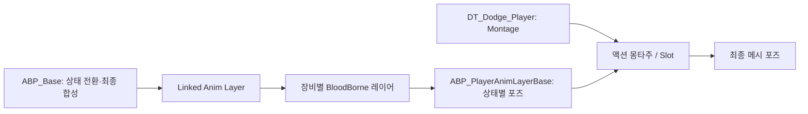

# 플레이어 애니메이션 교체

## 기본 구성

- 메인 애니메이션 클래스: `Characters/AnimBP/ABP_Base`
- 공통 레이어: `AnimLayer/ABP_PlayerAnimLayerBase`, `MainABP`와 Cast 대상은 `ABP_Base`
- 장비별 레이어: `ABP_PlayerOneHand`, `ABP_PlayerDualWield`, `ABP_PlayerMage`, `ABP_PlayerHammer`
- `BP_ThirdPersonCharacter.ApplyWeaponAnimationLayer`의 맨손·양손은 공통 레이어, 나머지 4개 장비 분기는 대응하는 레이어 사용
- 기존 레이어와 테스트 메인 ABP 삭제, 공통 인터페이스 `ALI_PlayerAnimLayer` 유지
- Mage·Hammer의 무기별 자식 설정은 유지, 공통 상태 갱신은 BloodBorne 부모 레이어 사용

## 재생 구조

- `ABP_Base`: 로코모션 상태 머신, Linked Anim Layer 호출, Slot과 가산 포즈 합성
- `ABP_PlayerAnimLayerBase`: 공통 `AnimLayer_*` 구현과 시퀀스 선택
- `ABP_PlayerOneHand`, `ABP_PlayerDualWield`: 부모 레이어를 상속하는 장비별 설정
- 자식 Class Defaults에 지정된 값은 부모 기본값보다 우선

## 모션 편집 위치

장비별 Class Defaults의 오버라이드는 공통 부모 기본값보다 우선

| 동작 | 에셋·위치 | 교체 대상 |
|---|---|---|
| 대기 | `Characters/AnimBP/AnimLayer/ABP_PlayerOneHand` → Class Defaults | `IdleAnimation` |
| 걷기·달리기 | 같은 위치 | `WalkCycle`, `RunCycle`의 F/FR/R/BR/B/BL/L/FL |
| 질주·질주 정지 | 같은 위치 | `SprintCycle`, `SprintStopAnimation` |
| 낙하 | 같은 위치 | `FallStartAnimation`, `FallLoopAnimation` |
| 제자리 회전 | `ABP_PlayerAnimLayerBase` → `AnimLayer_Idle` → `Idle State` → `TurnInPlace_1/2` | 방향별 Select의 시퀀스 |
| 일반 정지 | 같은 레이어 → `AnimLayer_Stop` → `Stop State` → `NormalStop` | Sequence Player의 Sequence |
| 착지 | 같은 레이어 → `AnimLayer_FullBodyAdditive` → `FullBodyAdditive` → `Land` | 가산 착지 Sequence Player |
| 질주 방향 반전 | `ABP_Base` → `Pivot_Sprint` | `Play Slot Animation as Dynamic Montage`의 Asset |
| 구르기·방향 회피 | `Table/Dodge/Player/DT_Dodge_Player` | 해당 행의 `Montage` |

쌍수 설정은 `ABP_PlayerDualWield`의 같은 기본값에서 수정
`ABP_Base`의 `BaseLayer → Locomotion States → Stop → Stop States`에도 정지 시퀀스 직접 참조가 남아 있어 공통 세트 교체 시 함께 확인
현재 Cycle의 실제 재생은 `State_Cycle_Update`가 선택하는 `WalkCycle/RunCycle/SprintCycle`이며 BlendSpace 기본값만 바꿔서는 교체되지 않음

## 일반 포즈와 가산 포즈

### Fall Base Pose

공통 레이어의 `AnimLayer_Fall`에서 `FallBasePose`는 `RightArmBlend` 마스크로 오른팔에 덮어쓰는 고정 자세다. Sequence Evaluator가 첫 프레임을 사용하므로 AnimSequence를 지정한다. 낙하 전체 동작은 `FallStartAnimation`과 `FallLoopAnimation`이 담당한다.

현재 그래프는 `FallBasePose`가 `None`이면 `AS_BB_FallAndLand_004000_Root`를 사용한다. 따라서 기본 낙하 오른팔 자세를 유지하려면 `None`으로 두어도 된다.

- 일반 시퀀스: 전체 자세, 정상 뼈 스케일 1
- 가산 시퀀스: 기준 자세에 대한 차이, 변화 없는 뼈 스케일 차분 0
- 일반 시퀀스를 `Apply Additive` 또는 `Apply Mesh Space Additive`의 Additive 입력에 연결하면 스케일이 뼈 계층을 따라 누적
- BloodBorne 정지는 일반 시퀀스이므로 `Blend Poses by bool → Apply Additive.Base` 사용, 기존 기울기 보정만 Additive 입력 유지
- 회피 시작 시에도 하부 로코모션 포즈가 블렌딩되므로 정지 포즈 오류가 회피 중 나타날 수 있음

## BloodBorne 테스트 세트

- 경로: `/Game/ArtAssets/Animations/PC/Moveset/Test_BloodBorne`
- Idle 000000/000001: Manny의 접지된 대기 자세를 기준으로 발목·발끝 높이 보정, 두 관절 다리 계산으로 무릎과 골반 조정, 뼈 스케일 유지
- Idle 보정은 시퀀스 내부 키 수정이며 공통 스켈레톤·캐릭터 메시 스케일 변경 없음
- Windows UE 5.8.4에서 정지와 회피 몽타주 전환 추적: 수정 전 손 스케일 최대 2048, 수정 후 약 1
- 입력 판정 전체가 아닌 하부 로코모션과 몽타주 합성 경로의 회귀 검증

## 방향별 이동 속도

- `Miscellaneous/Curve/C_CharacterMoveSpeedMap`: 0~180도 배율 1, 원본 CSV는 같은 폴더의 `C_CharacterMoveSpeedMap.csv`
- `AMVCharacterBase.CalculateCharacterMovementSpeed`: 방향 각도의 절댓값으로 커브 평가, 현재 모든 방향에서 선택된 Gait 기본 속도 적용
- 플레이어 기본 속도: 걷기 200cm/s, 달리기 500cm/s, 질주 750cm/s
- 상태 효과 속도 배율·가속·충돌·질주 가능 여부는 별도 적용, Run 폴더의 AnimSequence 20개는 Rate Scale 1.15 적용
- 커브는 공통 CharacterBase 경로에서 사용하므로 같은 경로를 사용하는 캐릭터에도 방향 감속 제거 적용

## 기본 구성 검증

- Windows UE 5.8.4 PIE에서 8방향 달리기 최종 속도 500cm/s, 앞·뒤 대각선 걷기 200cm/s 확인
- 레이어 5종의 런타임 `MainABP`가 `ABP_Base` 인스턴스를 참조, 측정 중 손 뼈 스케일 1 유지
- 저장 에셋 재로드 후 메인·레이어 5종·캐릭터 컴파일 성공, 장비 분기 6개 및 삭제 클래스 참조 제거 확인
- 질주 속도 750cm/s는 기본값 확인, 이번 실행 검증은 달리기·걷기와 레이어 연결 범위

- Run 시퀀스 `Rate Scale`: 1.15, 대각선 혼합본 포함 20개에 적용, 걷기·질주 시퀀스는 기존 배율 유지
