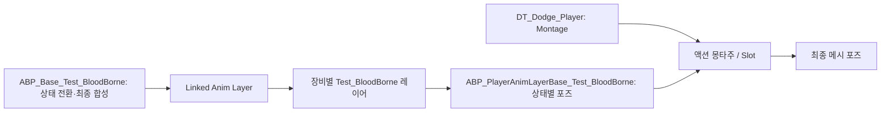

# 플레이어 애니메이션 교체

## 원본과 테스트 구성

- 원본 `ABP_Base`, `ABP_PlayerAnimLayerBase`, `ABP_PlayerOneHand`, `ABP_PlayerDualWield_Test`는 블러드본 연결 이전 상태 유지
- 블러드본 전용 구성: 같은 폴더의 `ABP_Base_Test_BloodBorne`, `ABP_PlayerAnimLayerBase_Test_BloodBorne`, `ABP_PlayerOneHand_Test_BloodBorne`, `ABP_PlayerDualWield_Test_BloodBorne`
- 테스트 레이어의 부모·MainABP 변수·Cast 참조는 테스트 클래스끼리 연결, 인터페이스 `ALI_PlayerAnimLayer` 공유
- `BP_ThirdPersonCharacter`의 Mesh Anim Class는 `ABP_Base_Test_BloodBorne`
- `ApplyWeaponAnimationLayer`의 맨손·한손·쌍수·기본 분기 4개도 테스트 레이어 연결
- 이후 블러드본 모션 수정은 테스트 클래스에서 수행, 원본 클래스는 수정하지 않음

## 재생 구조

- `ABP_Base`: 로코모션 상태 머신, Linked Anim Layer 호출, Slot과 가산 포즈 합성
- `ABP_PlayerAnimLayerBase`: 공통 `AnimLayer_*` 구현과 시퀀스 선택
- `ABP_PlayerOneHand`, `ABP_PlayerDualWield_Test`: 부모 레이어를 상속하는 장비별 설정
- 자식 Class Defaults에 지정된 값은 부모 기본값보다 우선

## 모션 편집 위치

아래 표는 원본 구성의 위치이며, 현재 블러드본 테스트 수정은 위의 대응하는 `Test_BloodBorne` 클래스에서 수행

| 동작 | 에셋·위치 | 교체 대상 |
|---|---|---|
| 대기 | `Characters/AnimBP/AnimLayer/ABP_PlayerOneHand` → Class Defaults | `IdleAnimation` |
| 걷기·달리기 | 같은 위치 | `WalkCycle`, `RunCycle`의 F/FR/R/BR/B/BL/L/FL |
| 질주·질주 정지 | 같은 위치 | `SprintCycle`, `SprintStopAnimation` |
| 낙하 | 같은 위치 | `FallStartAnimation`, `FallLoopAnimation` |
| 제자리 회전 | `ABP_PlayerAnimLayerBase` → `AnimLayer_Idle` → `Idle State` → `TurnInPlace_1/2` | 방향별 Select의 시퀀스 |
| 일반 정지 | 같은 레이어 → `AnimLayer_Stop` → `Stop State` → `NormalStop` | Sequence Player의 Sequence |
| 착지 | 같은 레이어 → `AnimLayer_FullBodyAdditive` → `FullBodyAdditive` → `Land` | 가산 착지 Sequence Player |
| 질주 방향 반전 | `ABP_Base` → `Pivot_Sprint` | `Play Slot Animation as Dynamic Montage`의 Asset |
| 구르기·방향 회피 | `Table/Dodge/Player/DT_Dodge_Player` | 해당 행의 `Montage` |

쌍수 설정은 `ABP_PlayerDualWield_Test`의 같은 기본값에서 수정
`ABP_Base`의 `BaseLayer → Locomotion States → Stop → Stop States`에도 정지 시퀀스 직접 참조가 남아 있어 공통 세트 교체 시 함께 확인
현재 Cycle의 실제 재생은 `State_Cycle_Update`가 선택하는 `WalkCycle/RunCycle/SprintCycle`이며 BlendSpace 기본값만 바꿔서는 교체되지 않음

## 일반 포즈와 가산 포즈

### Fall Base Pose

테스트 레이어의 `AnimLayer_Fall`에서 `FallBasePose`는 `RightArmBlend` 마스크로 오른팔에 덮어쓰는 고정 자세다. Sequence Evaluator가 첫 프레임을 사용하므로 AnimSequence를 지정한다. 낙하 전체 동작은 `FallStartAnimation`과 `FallLoopAnimation`이 담당한다.

현재 테스트 그래프는 `FallBasePose`가 `None`이면 `AS_BB_FallAndLand_004000_Root`를 사용한다. 따라서 기본 낙하 오른팔 자세를 유지하려면 `None`으로 두어도 된다.

- 일반 시퀀스: 전체 자세, 정상 뼈 스케일 1
- 가산 시퀀스: 기준 자세에 대한 차이, 변화 없는 뼈 스케일 차분 0
- 일반 시퀀스를 `Apply Additive` 또는 `Apply Mesh Space Additive`의 Additive 입력에 연결하면 스케일이 뼈 계층을 따라 누적
- 테스트 클래스의 BloodBorne 정지는 일반 시퀀스이므로 `Blend Poses by bool → Apply Additive.Base` 사용, 기존 기울기 보정만 Additive 입력 유지
- 회피 시작 시에도 하부 로코모션 포즈가 블렌딩되므로 정지 포즈 오류가 회피 중 나타날 수 있음

## BloodBorne 테스트 세트

- 경로: `/Game/ArtAssets/Animations/PC/Moveset/Test_BloodBorne`
- Idle 000000/000001: Manny의 접지된 대기 자세를 기준으로 발목·발끝 높이 보정, 두 관절 다리 계산으로 무릎과 골반 조정, 뼈 스케일 유지
- Idle 보정은 시퀀스 내부 키 수정이며 공통 스켈레톤·캐릭터 메시 스케일 변경 없음
- Windows UE 5.8.4에서 정지와 회피 몽타주 전환 추적: 수정 전 손 스케일 최대 2048, 수정 후 약 1
- 입력 판정 전체가 아닌 하부 로코모션과 몽타주 합성 경로의 회귀 검증

## 원본 구성으로 전환

`BP_ThirdPersonCharacter`의 Mesh Anim Class를 `ABP_Base`로 바꾸고, `ApplyWeaponAnimationLayer`의 테스트 레이어 4개를 각각 대응하는 원본 레이어로 변경
회피는 별도 `DT_Dodge_Player`에서 선택되므로 ABP 전환만으로 회피 몽타주까지 바뀌지는 않음
