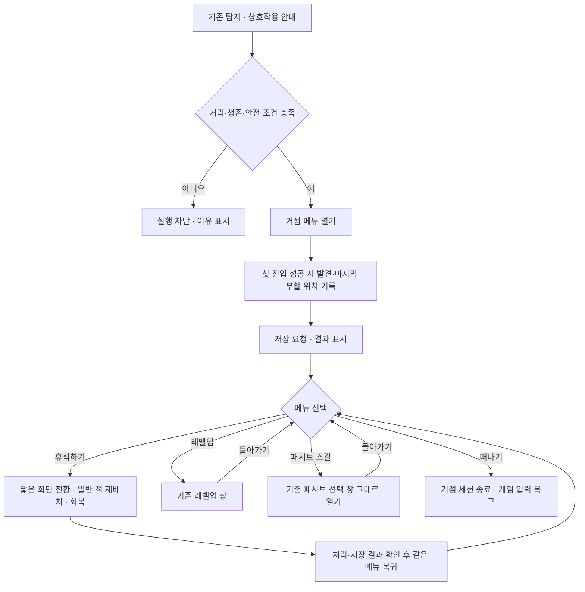
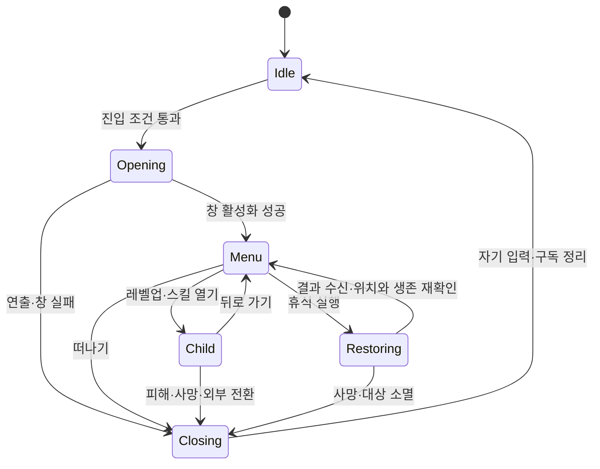
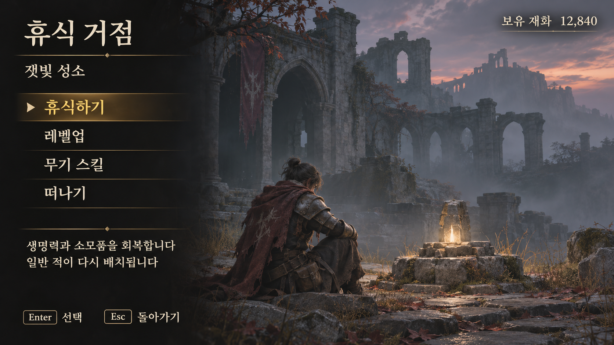
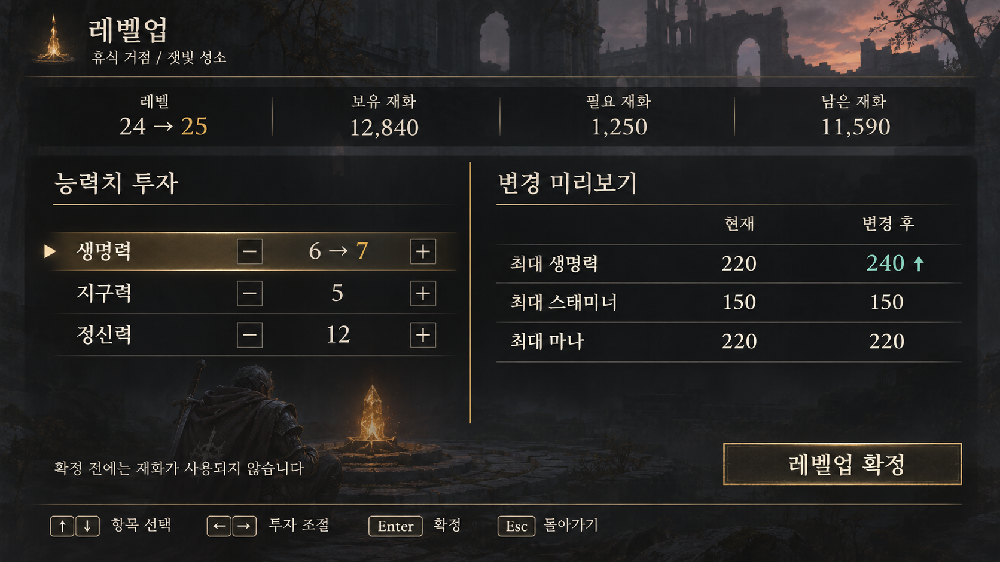
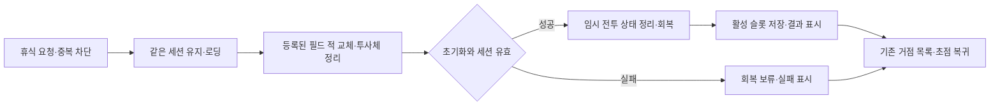

# 휴식 거점 시스템 설계

## 문서 범위

- 구현 계획과 UI 시안, 1~6단계 적용 결과를 아래에 별도 기록
- 조사 기준: 2026-11-09 현재 작업 트리, 커밋되지 않은 기존 변경 포함
- 기능 이름은 `휴식 거점`, 시안의 장소 이름 `잿빛 성소`는 임시 표시 이름
- 1인 플레이 기준, 여러 사람이 함께 접속하는 기능과 다른 맵으로의 이동은 후속 범위
- 기존 레벨업 UI는 기능을 유지하고 [레벨업 시안](attachments/level-up.png)에 맞춰 배치·색·글자·강조 표시 수정
- 기존 패시브 선택 UI는 화면·입력·선택 동작을 그대로 유지, 거점 메뉴에서 기존 열기 API 호출만 연결
- 신규 사용 스킬 선택 화면과 사용 스킬·패시브 통합 탭은 이번 구현 범위에서 제외
- 거점 목록은 새로 제작하고, 기존 상세 화면 중 외형 변경 대상은 레벨업 UI로 한정

## 최초 조사 판정 (2026-11-09)

아래 표는 구현 전 조사 기록, 현재 연결과 검증 범위는 각 단계의 적용 결과 참고

**축복·화톳불처럼 물체 하나에서 휴식·성장·스킬 선택·저장을 묶는 완성된 거점 기능은 확인되지 않음**
상호작용 탐지, 마지막 부활 위치, 레벨업, 패시브 선택 등의 구성 요소는 존재하므로 연결 계층 중심으로 구현

| 영역 | 현재 원본에서 확인한 내용 | 설계에 미치는 영향 |
|---|---|---|
| 상호작용 | `UMVPlayerInteractionDetector`가 주변 후보 탐색·선택·입력·프롬프트 처리 | 탐지 시스템 재사용 |
| 상호작용 물체 계약 | `IMVInteractableInterface`의 가능 여부·실행·문구·우선순위, `UMVInteractableComponent`의 실행 알림 | 거점 전용 Actor가 같은 인터페이스 구현 |
| 부활 위치 | `SetLastCheckpoint`와 `SetLastCheckpointFromActor`, 위치·맵·필드·ID 저장 | 거점 옆의 안전한 부활 위치 연결 |
| 위치 이동 | `StartCheckpointTravelToTransform`, 사망 시 마지막 위치로 이동 | 같은 월드의 위치 이동 기반만 재사용 |
| 회복 | 사망 전환 내부에서 HP·Stamina·MP 회복, Groggy 초기화, 회복약 개수 복원 | 휴식용 명시적 진입점 추가 필요 |
| 필드 초기화 | `BeginLoadingReset`에서 “필드 상태 초기화 생략” 진행 문구, 적 초기화 호출 없음 | 적 재배치를 새 기능으로 구현 |
| 레벨업 | `ShowLevelUpWindow`, 임시 투자·확정·재화 차감·스탯 적용 | 기존 기능 유지, 기존 위젯의 외형만 시안에 맞춰 수정 |
| 패시브 선택 | `ShowWeaponPassiveSelectionWindow`, 후보·미리보기·적용·해제·장착 표시 | 기존 UI 그대로 호출, 재설계·새 탭 추가 없음 |
| 사용 스킬 | `GetSkillTree`·`UnlockSkill`·`EquipSkill`, 스타일별 Q·R·W·E 상태 | 현황 참고, 새 선택 화면은 별도 후속 범위 |
| 무기 진행 저장 | `MVWeaponComponent::BeginPlay`의 저장 복원 조건이 `if (0)`, 패시브도 실행 중 상태만 보유 | 스킬·포인트·선택을 저장 데이터에 연결 |
| 월드 저장 | 실제 저장 버전 3, 초기화 시 기본 슬롯이 있으면 불러오기 수행 | 과거 위키의 버전 2·자동 불러오기 없음 기록과 구분 |
| 이관 휴식 메뉴 | 초기 조사 때 `W_RestMenu`, `W_TimePass`에서 외부 프로젝트 참조 확인 | 1단계에서 사용처를 검사한 뒤 삭제 |

### 근거 파일

행 번호는 조사 당시 기준이며, 아래 링크는 현재 원본으로 연결

| 원본 | 확인 위치 |
|---|---|
| [상호작용 감지](../../../../Source/Maverick/Character/PC/InteractionDetector/MVPlayerInteractionDetector.cpp) | 118행 이후 억제 유지, 363행 이후 상호작용 실행 |
| [상호작용 컴포넌트](../../../../Source/Maverick/Components/MVInteractableComponent.cpp) | 가능 상태 확인과 `OnInteractionRequested` 방송 |
| [필드 전환](../../../../Source/Maverick/System/MVFieldTransitionSubsystem.cpp) | 91행 초기화 생략, 126행 거점 이동, 244행 위치 기록, 412행 이동·회복 |
| [월드 저장](../../../../Source/Maverick/System/MVWorldStateSubsystem.cpp) | 8행 저장 버전, 21행 초기 불러오기, 46행 저장, 188행 거점 기록 |
| [저장 자료형](../../../../Source/Maverick/System/MVWorldStateTypes.h) | `FMVCheckpointSaveData`·`FMVWorldSaveData` |
| [UI 진입점](../../../../Source/Maverick/UI/System/MVUISubsystem.cpp) | 1206행 패시브 창, 1241행 레벨업 창 |
| [무기 상태](../../../../Source/Maverick/Components/MVWeaponComponent.cpp) | 86행 저장 복원 미연결, 460행 해금, 517행 장착, 638행 패시브 선택 |
| [소모품 복원](../../../../Source/Maverick/Character/PC/Consumable/MVPlayerConsumable.cpp) | 173행 월드 초기화용 회복약 복원 |
| [UI 설정](../../../../Config/DefaultGame.ini) | 17행 패시브 창, 28행 레벨업 창 |
| [기존 참고 화면 기록](../../Research/Level-Up-UI-Reference/document.md) | 휴식 메뉴 8개는 당시 복구 범위 밖 |

- `W_RestMenu.uasset`에서 `/Game/SoulslikeFramework/.../B_RestingPoint`, `W_Navigable_InputReader`, 원본 `W_LevelUp` 경로 문자열 확인
- 바이트 안의 문자열은 참조 잔존 증거이며, Unreal Editor의 로드·컴파일·실행 결과를 대신하지 않음
- 초기 C++·설정·문서·에셋 이름 조사에서 연결된 거점 Actor를 찾지 못함. 모든 Blueprint와 배치된 레벨의 동작까지 확인한 것은 아님. 이후 2단계에서 시험 거점을 추가함
- 기존 사망 위키의 Resettable 계약·적 복구 설명은 현재 원본과 다름, 새 구현의 기존 기능으로 계산하지 않음

## 플레이 흐름

`체크포인트`는 사망했을 때 돌아올 장소, `거점 세션`은 물체와 상호작용한 뒤 메뉴를 닫기까지의 한 번의 이용

- 첫 진입 성공 때 거점 등록·부활 위치 변경, 회복과 적 재배치는 `휴식하기` 실행 때만 발생
- 자식 화면에서 돌아올 때 등록·휴식 재실행 없음
- 레벨업은 최대값 증가만 반영, 현재 생명력 등을 가득 채우는 동작은 휴식에만 배치
- 메뉴 탐색 중 세계 시간은 계속 진행, 무적 부여 없음
- 피해·사망·외부 필드 전환·거점 제거·플레이어 교체 시 메뉴 전체 종료
- 메뉴는 `휴식하기 / 레벨업 / 패시브 스킬 / 떠나기` 네 항목, 이동·시간 변경·창고는 후속 기능

## 책임과 구성

아래는 최초 책임 분리안, 실제 구현은 `RestPointDefinition` 없이 고정된 네 항목을 사용하며 초기화는 생성 지점과 기존 필드 전환이 분담

| 구성 | 책임 | 맡기지 않을 일 |
|---|---|---|
| `AMVRestPoint` | 메시·상호작용 충돌·표시 이름·고유 ID·앉을 위치·부활 위치, 기존 상호작용 인터페이스 구현 | 성장 계산·재화 차감·저장 파일 직접 쓰기 |
| `UMVRestPointDefinition` | 메뉴 항목 순서·문구·아이콘·지원 기능, 연출 설정 | 플레이어의 선택·해금 상태 저장 |
| `UMVRestPointSubsystem` | 현재 월드 수명의 거점 세션, 진입 검증·메뉴 명령 분배·휴식 조율·종료 정리 | 성장·무기 상태의 별도 원본 보유 |
| `UMVRestPointWindow` | CommonUI 거점 목록·설명·초점·뒤로 가기 | 실제 회복·초기화 수행 |
| `AMVFieldEnemySpawnPoint` | 현재 월드의 생성 지점 수집·필드별 일반 적 재배치·관련 투사체 정리 | 저장 슬롯·거점 UI 소유 |
| 기존 `UMVFieldTransitionSubsystem` | 사망·휴식의 초기화 호출, 로딩·회복·완료 결과 전달 | 거점 메뉴·필드 영구 진행 소유 |
| 기존 `UMVUISubsystem` | 거점 창 등록·열기와 WindowStack 관리 | 거점 상태의 최종 판단 |
| 기존 `UMVLevelUpWindow`와 하위 위젯 | 기존 계산 결과·입력을 유지하고 레벨업 전용 Blueprint 배치·표시 설정 수정 | 성장 규칙·비용식 재구현 |
| 기존 `UMVWeaponPassiveSelectionWindow` | 기존 화면 그대로 사용, 거점에서 공개 열기 API 호출 | 화면 수정·통합 탭 추가 |
| 기존 `UMVWorldStateSubsystem` | 거점 발견·마지막 위치·성장·무기 진행의 저장 가능한 기록 | Actor·Widget 참조 저장 |
| 기존 성장·무기 도메인 | 레벨업 확정, 스킬 해금·장착·패시브 적용 | 메뉴 배치와 입력 안내 |

- 거점 세션의 Actor·플레이어 참조는 약한 참조 사용, 월드 종료 때 정리
- 메뉴 명령은 `Rest / LevelUp / WeaponPassives / Leave` 식별자로 분배, 화면 문구를 함수 선택에 사용하지 않음
- 항목의 표시 여부와 실행 가능 여부 분리, 실행 불가 항목은 원인 설명 제공
- `CharacterBase`에 거점 정책 추가하지 않음, 필요한 캐릭터 연결만 기존 도메인 경계 사용
- `AMVRestPoint`가 인터페이스를 직접 구현하므로 같은 Actor에 중복 상호작용 컴포넌트를 추가하지 않음
- 거점 목록은 첨부 시안을 바탕으로 프로젝트 CommonUI 부모를 가진 새 `WBP_RestPoint` 제작
- 주요 신규 C++ 타입은 책임·수명·중복 실행 방지 조건을 선언 앞 문서 블록에 기록

## 거점 배치 계약

| 설정 | 기준 |
|---|---|
| `RestPointId` | 맵 이름과 조합해 유일한 값, 배치 복제 후 중복 검사 |
| `FieldId` | 일반 적 초기화 범위, 비어 있으면 거점 휴식 비활성 |
| 상호작용 충돌 | 기존 탐지 대상인 `WorldDynamic`, 탐지 반경·시야 조건 재사용 |
| `RestTransform` | 앉기 연출 위치·방향, 거점 메시 중심과 분리 |
| `RespawnTransform` | 벽·바닥·다른 Actor와 겹치지 않는 안전한 캡슐 위치 |
| 안전 판정 영역 | 살아 있는 적이 영역 안에 있으면 진입·휴식 차단, 벽 뒤도 포함하는 보수적 판정 |
| 진입 연출 | 실패·누락 시 메뉴를 여는 간단한 표시로 대체, 입력 잠금이 남지 않게 처리 |

- 부활 위치를 저장할 때 거점 Actor 원점 대신 명시된 `RespawnTransform` 사용
- 기존 `SetLastCheckpointFromActor`는 Actor 원점 저장이므로 새 거점에서 그대로 호출하지 않음
- 초기 버전은 현재 맵 안의 거점만 지원, 저장된 `MapName`이 다르면 현재 맵의 기본 시작점 사용
- 현재 이동 함수는 저장된 맵으로 이동하지 않고 위치만 적용하므로 맵 일치 검사를 새 연결에 포함
- 부활 위치가 막혔으면 근처 검증된 후보 → 해당 맵 기본 시작점 순으로 대체
- 전투 중이 아니라는 근거로 `IsActionRunning == false`만 사용하지 않음

## 세션과 입력

- 진입과 명령 확정 직전에 같은 검증 수행: 로컬 플레이어·기본 스탯 준비·생존·거리·거점 유효·전환 없음·행동 실행 없음
- 추가 안전 조건: 안전 영역에 살아 있는 적 없음·최근 5초 피격 없음·보스 등장 연출 없음, 5초는 조정 가능한 초기 설계값
- 이미 열린 다른 대화·모달 화면은 거점 진입 차단, 중복 상호작용은 기존 세션을 유지
- 세션 번호로 늦게 도착한 창 닫기·연출 완료·저장 결과를 구분, 끝난 세션을 다시 열지 않음
- 이동·전투 입력과 상호작용 감지를 세션 동안 차단, 플레이어 Tick 자체를 끄지 않음
- 기존 탐지기의 억제 유지는 대화·시험 패널 중심이므로, 휴식 메뉴를 대화로 속이지 않고 세션별 차단 연결 추가
- 레벨업·무기 창은 부모 위에 올림, 자식 창 종료 후 이전 메뉴 항목으로 초점 복귀
- 부모 창의 일시 비활성화와 최종 제거를 구분, 자식 화면을 열었다는 이유로 거점 세션을 닫지 않음
- HUD 숨김·커서·입력은 세션이 획득한 차단만 해제, 패시브 창의 기존 처리와 맞물리는 복귀는 거점 부모·세션 쪽에서 조율
- 패시브 창의 내부 입력·HUD 처리와 위젯 자산은 수정하지 않음, 거점 연결 후 기존 동작이 유지되는지 확인
- 메뉴 진입에 사용한 확인 키는 놓은 뒤 다음 명령 허용, 열자마자 첫 항목이 실행되는 현상 방지
- 뒤로 가기: 상세 화면 → 거점 목록 → 게임, 미확정 레벨업 투자는 기존 취소 동작으로 폐기
- 키보드·마우스·게임패드 입력과 안내 아이콘은 CommonUI 입력 설정에서 함께 공급, 시안의 Enter·Esc는 예시

## 휴식과 적 재배치

- 기존 `CheckpointTravel`은 `bRestorePlayerStats = false`, 호출만으로 휴식 기능이 되지 않음
- 필드 전환에 명시적 `Rest` 사유와 초기화·회복·메뉴 복귀 요청을 추가
- 기존 사망 전환에도 같은 필드 초기화 진입점을 연결, 사망 전용 연출과 휴식 연출은 분리
- 전환 결과는 성공·실패와 요청 번호를 전달, 현재의 단계 변경 알림만으로 성공을 추측하지 않음
- `CompleteTransition`은 로딩 단계에서 한 번만 적용, 휴식 결과는 요청 번호와 함께 세션에 전달
- 자기 휴식 전환은 세션 유지, 다른 전환은 종료, 완료 직후 무조건 새 메뉴를 열지 않음

| 순서 | 처리 |
|---|---|
| 1 | 진입 조건·필드·부활 위치·필수 생성 자산 사전 검사, 중복 요청 차단 |
| 2 | 입력 차단 상태 유지, 짧은 화면 전환, 필요 시 앉기 연출 |
| 3 | 해당 `FieldId`의 등록 지점별 정책에 따라 일반 적·일시 오브젝트 재배치 |
| 4 | 생존·위치 재검사, HP·Stamina·MP 최대 회복, Groggy 초기화 |
| 5 | 회복약을 `DefaultCount`까지 복원, 모든 인벤토리 아이템을 늘리지 않음 |
| 6 | 거점·무기 진행 기록 동기화와 저장 요청 |
| 7 | 처리 결과 표시, 유효한 같은 세션이면 메뉴 복귀 |

- 생성 지점은 `MapName + FieldId + SpawnId`, 원래 클래스·위치·초기 설정을 보유하는 별도 Actor 또는 등록 컴포넌트로 구성
- 살아 있는 적도 기존 전투·AI·상태 효과를 정리한 뒤 새 인스턴스로 재생성, 죽어서 제거된 Actor의 존재에 의존하지 않음
- 같은 생성 지점에서 한 번에 한 개체만 유지, 반복 휴식 중 개체·보상·투사체 중복 방지
- 한 번만 얻는 보상·열린 상자·문·완료 퀘스트·처치한 보스는 저장 기록으로 유지
- 보스는 재생성 대상에서 기본 제외, 아직 처치하지 않은 보스의 전투 초기화는 별도 보스 시작 계약으로 처리
- 일시 투사체와 전투용 효과는 정리, 선택한 패시브는 유지하고 이전 전투에서 쌓인 일시 중첩·표식만 초기화
- 초기화 도중 일부 지점이 실패하면 부분 실패로 보고, 성공 표시·회복 완료 처리를 하지 않음
- 이미 바뀐 월드를 전부 되돌린다는 보장은 두지 않음, 실패 지점을 기록하고 같은 ID로 재시도해 중복 생성 방지
- 휴식은 재화를 소비하지 않으며, 메뉴 복귀나 저장 재시도에서 적 재배치를 재실행하지 않음

## 기존 상세 화면 연결

### 레벨업

- 기존 `UMVLevelUpWindow`와 `UMVProgressionSubsystem`의 미리보기·변경 번호 검사·확정 경로 사용
- 거점 세션 유효 여부는 창 열기와 확정 직전에 검사, UI 표시만으로 휴식 장소 제한을 구현하지 않음
- 기존 독립 개발 명령은 개발 빌드에서 유지 가능, 일반 플레이 진입은 거점 문맥으로 제한
- 확정 성공 시 저장 요청, 저장 실패가 확정 재시도와 추가 재화 차감을 일으키지 않게 분리
- 거점 진입·저장 연결은 아래 외형 수정 단계와 분리, 레벨업 외형 변경만으로 성장 규칙을 바꾸지 않음

### 패시브 선택

- 거점의 `패시브 스킬` 선택 → `UMVUISubsystem::ShowWeaponPassiveSelectionWindow()` 호출
- 기존 `WBP_WeaponPassiveSelection`, `WBP_PassiveCandidateEntry`, `BPS_PassiveSelectionRow`와 관련 C++ 유지
- 보유 무기·후보·설명 배치, 미리보기·장착 중·잠금 표시, 적용·해제와 입력 방식 유지
- 기존 창이 닫히면 거점 부모에서 `패시브 스킬` 항목으로 초점 복귀
- 거점 이탈·피격·사망 때 세션 쪽에서 기존 닫기 API 사용, 패시브 창에 거점 전용 탭·버튼·검증 코드 추가 없음
- 선택 저장·복원은 WeaponComponent와 WorldState에서 처리, 패시브 UI를 수정하는 작업과 분리

## 레벨업 UI 외형 수정 계획

대상: 기존 `/Game/UI/LevelUp/RestMenu/LevelUpMenu/W_LevelUp`와 해당 화면의 하위 위젯
기존 창을 대체하는 새 레벨업 시스템을 만들지 않고, 현재 데이터 연결을 보존한 채 UMG 배치·표시 설정 수정

### 시안과 기존 위젯 대응

| 시안 영역 | 기존 위젯·연결 | 수정할 표시 |
|---|---|---|
| 상단 제목·장소 | `W_LevelUp`의 제목 영역 | 큰 제목 `레벨업`, 작은 거점 이름, 얇은 금색 구분선 |
| 상단 네 칸 요약 | `W_LevelCurrencyBlock_LevelUp` / `LevelAndCurrencyBlock` | 레벨·보유 재화·필요 재화·남은 재화를 같은 가로줄에 정렬 |
| 왼쪽 투자 목록 | `W_StatBlock_LevelUp` / `AttributeBlock` | `능력치 투자` 제목, 행 간격·폭 정리, 선택 행 금색 배경 |
| 투자 행 | `W_StatEntry_LevelUp` | 이름·감소 버튼·현재/예상 투자·증가 버튼 정렬, 버튼 크기와 비활성 표시 통일 |
| 오른쪽 비교 목록 | `W_StatBlock_LevelUp` / `ComparisonBlock`, `Stats/W_StatEntry` | `변경 미리보기`와 현재·변경 후 머리글, 수치 오른쪽 정렬, 증가값 청록색 강조 |
| 오른쪽 아래 확정 | `ConfirmButton` | `레벨업 확정` 문구, 금색 테두리, 실행 가능·불가·초점 상태 구분 |
| 하단 조작 안내 | `ConfirmInputHint`, `CancelInputHint`, 기존 입력 안내 | 화면 아래 한 줄 정렬, 실제 입력 장치의 키 표시 |
| 배경·안내 문구 | `W_LevelUp`의 장식 영역 | 게임 배경 위 어두운 반투명 패널, `확정 전에는 재화가 사용되지 않습니다` 표시 |

- 시안의 배경 그림을 UI 전체에 붙이는 방식이 아니라 기존 위젯을 각 영역에 배치
- `잿빛 성소`를 고정 문자열로 넣지 않음, 거점 연결 단계에서 실제 표시 이름을 공급하고 독립 실행에서는 장소 줄 숨김
- 기본 외형은 Blueprint의 배치·글꼴·여백·브러시·색상 속성으로 구현
- 현재 비교 행의 `UnchangedValueColor`·`ImprovedValueColor`·`ReducedValueColor`, 투자 행의 `SelectedBackgroundColor` 재사용
- 증가 화살표 등 현재 속성으로 표현할 수 없는 표시만 레벨업 전용 표시 이벤트·속성으로 최소 확장, 계산·확정 경로는 유지
- 시안에서 값이 같은 투자 행은 현재/예상 값을 하나처럼 보이게 처리하되, 연결된 텍스트 위젯 자체는 삭제하지 않음
- 시안의 모든 감소 버튼을 활성 상태로 복제하지 않음, 추가 투자 0·재화 부족·상한 등 기존 판정을 그대로 시각화

### 보존할 연결과 기능

`BindWidget`은 C++이 이름과 타입으로 화면 요소를 찾는 연결, 배치 변경 중 이름·타입·부모 클래스 보존

| 대상 | 보존할 연결 |
|---|---|
| 창 | `UMVLevelUpWindow` 부모, `LevelAndCurrencyBlock`·`AttributeBlock`·`ComparisonBlock`·`ConfirmButton` |
| 요약 | `Level_Current`·`Level_New`·`CurrencyCurrent`·`CurrencyRequired`·`CurrencyNew` |
| 목록 | `StatBox`, `AttributeEntryClass`·`ComparisonEntryClass`를 통한 실행 중 행 생성 |
| 투자 행 | `StatNameWidget`·`StatValueOld`·`StatValueNew`·`ButtonDecrease`·`ButtonIncrease`, 선택용 `SelectionBorder` |
| 비교 행 | `StatNameWidget`·`StatValueOld`·`StatValueNew`, 현재값·예상값 전달 |
| 입력 | 마우스·방향키·확인·취소 등록, CommonUI의 활성화·초점·게임 입력 복귀 |
| 계산 | 임시 투자, 비용식·상한·변경 번호 검사, 확정 1회 차감, 취소 시 임시 투자 폐기 |

- 레벨업 외형 변경 대상은 `Content/UI/LevelUp/` 아래 실제 사용 위젯으로 한정
- 기존 공용 폰트·버튼 스타일·재질의 원본 수정 대신 레벨업 위젯의 개별 속성이나 전용 자산 사용
- `Stats/W_StatEntry` 등 하위 위젯이 다른 화면에도 쓰이면 참조를 먼저 확인하고, 레벨업 전용 사본을 행 클래스에 연결
- 패시브 UI와 공유하는 자산을 바꿔 패시브 외형이 함께 바뀌는 작업 금지
- 실제 위젯 트리·현재 속성값은 Unreal Editor에서 구현 시작 전에 확인, 이번 문서 작업은 C++ 선언과 기존 문서 대조 범위

## 저장·불러오기

| 저장 항목 | 내용 |
|---|---|
| 거점 | 발견한 거점 ID 목록, 마지막 거점·맵·필드·부활 위치 |
| 성장 | 기존 확정 투자·재화·변경 번호 |
| 무기 진행 | 소유 무기·퀵슬롯·장착 무기, 스타일별 해금·슬롯 선택, 종류별 패시브 선택, 공통 스킬 포인트 |
| 월드 진행 | 기존 필드 물체·플래그·퀘스트와 보스 처치 상태 |
| 저장 제외 | 열린 창·미리보기·Actor 참조·실행 중 Ability·피격·일시 효과와 중첩 |

- 저장 버전 4 사용, 이전 파일에 없는 거점 목록·무기 진행은 기본값으로 복원
- 스킬 저장 키는 데이터 에셋 식별자·행 이름 등 안정된 식별자 사용, 사라진 후보는 건너뛰고 로그 기록
- 불러오기 순서: 월드 기록 → 무기 정의 준비 → 소유·해금·선택 복원 → 최종 장착 → 현재 패시브 한 번 적용
- 초기화의 기본 선택이 저장된 선택을 덮어쓰지 않도록 `BeginPlay` 복원 경로 연결
- 실행 중 판단 원본은 기존 WeaponComponent, 저장 가능한 복사본은 WorldState, 메뉴에 세 번째 원본을 만들지 않음
- 거점 첫 등록·마지막 거점 변경·레벨업 확정·기존 패시브 선택 변경·휴식 완료 때 활성 슬롯 저장
- 무기 진행 저장은 현재 상태 보존 작업, 새로운 사용 스킬·해금 화면 추가는 포함하지 않음
- 기본 슬롯 자동 불러오기는 이미 존재, 슬롯 선택 후에는 기본 슬롯이 아닌 활성 슬롯으로 저장하는 공통 진입점 추가
- 디스크 저장 성공 후에만 `저장 완료` 표시, 실패 시 `저장하지 못했습니다 · 다시 시도`와 미저장 상태 유지
- 저장 재시도는 최신 확정 기록만 다시 기록, 레벨업·해금·휴식 명령을 재실행하지 않음
- 저장 실패 때 현재 플레이 상태는 유지, 게임을 종료하면 마지막 저장 이후 진행을 잃을 수 있음을 해당 오류 화면에서 안내
- 메모리 변경과 디스크 저장, 적 재배치 전체를 하나의 원자적 처리로 보장하지 않음

## UI 참고와 적용

아래는 자료에 보이는 화면 구조에서 가져온 설계 판단
작품별 기능 개방 조건·버전별 메뉴 구성은 Maverick의 규칙으로 복제하지 않음

| 자료 | 관찰·참고 범위 | 이번 시안의 적용 |
|---|---|---|
| [엘든링 축복 화면](https://www.pushsquare.com/guides/elden-ring-all-sites-of-grace-locations) | 게임 배경 위 왼쪽 목록·장소 이름·하단 입력 안내 | 거점 첫 화면의 얇은 세로 목록 |
| [엘든링 공식 시작 안내](https://en.bandainamcoent.eu/elden-ring/news/elden-ring-starter-guide-tips-know-playing-the-game) | 축복에서의 자원 회복과 게임 내 조작 설명 | 회복을 메뉴 탐색과 구분하는 기능 참고 |
| [다크소울 리마스터 아노르 론도 화면](https://makaimuranotami.livedoor.blog/archives/75917576.html) | 화톳불 배경을 남긴 간결한 작업 목록 | 짧은 항목 이름·절제된 테두리 |
| [피의 거짓 별바라기·리전 암 화면](https://www.gamepressure.com/lies-of-p/legion-arm/ze10d6c) | 별바라기의 장비 변경 진입과 선택 강조 | 거점에서 장비 상세 화면으로 이동 |

- 검색 이미지 결과와 공개 페이지를 참조, 외부 스크린샷을 프로젝트에 복사하지 않음
- 새 거점 메뉴와 레벨업에 반투명 먹색 배경·상아색 글자·금색 초점 적용, 레벨업 증가값은 청록색 보조
- 아래 외형 기준은 새 거점 메뉴와 레벨업에 적용, 기존 패시브 선택 UI의 스타일은 유지
- 색만으로 구분하지 않고 삼각형·체크·자물쇠·문구를 함께 사용
- 16:9 기준 화면 가장자리 여백 5%, 1920×1080 기준 본문 26~30px·목록 34~40px 목표
- 긴 한국어·영문 제목, 글자 확대 125%·150%, 21:9에서는 배경만 확장하고 필수 UI는 안전 영역 유지
- 그림 안 숫자·무기 보유 목록·장소는 설명용 예시, 현재 플레이 데이터 캡처가 아님
- 생성 결과 3장 모두 1672×941 PNG, 요청한 1920×1080과 크기가 다르므로 배치 비율 참고용으로 사용

### 거점 목록

- 휴식의 효과와 일반 적 재배치를 선택 설명에 함께 표시
- 메뉴 자체를 여는 동작은 회복·적 재배치를 하지 않는다는 설계 유지
- 제작 단계에서 회복 항목 설명은 HP·Stamina·MP·회복약 범위를 정확히 표시
- 기존 시안의 `무기 스킬` 항목은 실제 연결 대상에 맞춰 `패시브 스킬`로 표시

### 레벨업

- 왼쪽 임시 투자, 오른쪽 현재값·변경 후 값, 위쪽 비용·남은 재화
- 예시: 기준 레벨 1 + 투자 6·5·12 = 레벨 24, 생명력 1점 추가 후 25
- 기본 비용식 `100 + 50 × (24 - 1) = 1,250`, 재화 `12,840 - 1,250 = 11,590`
- 기본 최대값 100 가정 시 생명력 `220 → 240`, Stamina 150·MP 220 유지
- 시안의 투자 감소 버튼은 이미 확정한 투자를 환불하지 않음, 실제 화면에서는 추가 투자 0인 항목의 감소 버튼 비활성

### 패시브 UI 유지

- 구현 기준은 현재 `WBP_WeaponPassiveSelection`, 생성한 [무기 스킬 시안](attachments/weapon-skill-selection.png)은 적용 대상에서 제외
- 위 시안의 탭·배치·색·문구를 기존 패시브 화면에 이식하지 않음
- 기존 이미지 파일은 참고 자료로 보존하며, 패시브 UI 재작업의 근거로 사용하지 않음
- 생성 도구: 내장 `image_gen`, 최종 요청문: [이미지 생성 요청문](attachments/image-prompts.md)

## 구현 순서와 완료 조건

각 단계의 계획과 적용 결과를 함께 기록, 장치·실행 환경별 미검증 범위는 6단계 결과 표 참고

| 단계 | 작업 | 주된 대상 | 완료 조건 |
|---|---|---|---|
| 1 | 기존 레벨업 UI의 외형 수정 | `W_LevelUp`·요약·투자·비교 하위 위젯 | 시안 배치 반영, 기존 계산·입력 유지, 패시브 화면 불변 |
| 2 | 거점 물체와 메뉴 제작 | `AMVRestPoint`·거점 세션·`WBP_RestPoint` | 접근 안내·목록 표시·떠나기·중복 진입 차단 |
| 3 | 기존 상세 화면 연결 | 거점 명령 처리·`UMVUISubsystem` | 레벨업·기존 패시브 창 왕복과 부모 초점 복귀 |
| 4 | 거점 기록·부활 위치·저장 연결 | `WorldState`·무기 진행·부활 흐름 | 재시작 후 기록 유지, 저장 실패 재시도와 안전 위치 확인 |
| 5 | 휴식·회복·일반 적 재배치 | `MVFieldEnemySpawnPoint`·필드 전환·소모품 | 반복 휴식·사망에서 일반 적 복귀, 영구 진행 보존 |
| 6 | 전체 흐름과 표시 확인 | 거점·레벨업·기존 패시브의 연결 경계 | 정상·실패·중단·입력 장치별 동작 확인 |

### 1단계 — 기존 레벨업 UI 외형 수정

- 수정 전 `W_LevelUp`과 실제 하위 위젯의 부모·이름·타입·행 클래스·공유 참조 확인
- 위의 대응표 순서로 상단 요약 → 좌우 목록 → 확정 버튼·하단 안내 → 배경·글자·강조 표시 수정
- 동작하는 현재 UI를 기반으로 수정, `LevelUpWindowClass`와 기존 열기·닫기 경로 유지
- 확인: 변경 전후 같은 투자 입력으로 비용·현재값·예상값 일치, 취소 시 미차감·확정 시 1회 차감
- 확인: 재화 부족·추가 투자 없음·상한·반복 열기에서 버튼 상태와 초점·입력 복귀 유지
- 확인: 패시브 UI·행·스타일 자산의 변경 없음, 실제 패시브 화면도 기존과 동일

#### 적용 결과 — 2026-11-09

- `W_LevelUp`에 상단 요약, 좌우 투자·비교 목록, 하단 입력 안내와 확정 버튼 배치
- `W_LevelCurrencyBlock_LevelUp`·`W_StatBlock_LevelUp`·`W_StatEntry_LevelUp`·`W_StatEntry` 재배치, 기존 위젯 연결과 실행 중 행 생성 사용
- 실제 플레이에서 확인한 비교 행 겹침과 한글 글꼴 문제 수정
- 레벨업 창 활성화 동안 현재 HUD를 숨기고, 종료 때 동일한 HUD의 기존 표시 상태 복구
- 레벨업 외형은 어두운 반투명 패널·금색 선택 행·청록색 증가 수치로 구현, 수치와 능력치 이름은 기존 성장 정의에서 공급
- 패시브 선택 화면·관련 공용 자산의 수정 없이 레벨업 범위에서 적용

| 삭제한 이관 위젯 | 개수 |
|---|---|
| 옛 휴식 메뉴 `W_RestMenu`·`W_RestMenu_Button`·`W_RestMenu_TimeEntry`·`W_TimePass` | 4 |
| 옛 공용 위젯 `W_GenericButton`·`W_GenericError`·`W_Navigable`·`W_Navigable_InputReader` | 4 |
| 레벨업 보조 위젯 `W_LevelUpCost`·`W_LevelEntry`·`W_CurrencyEntry`·`W_CategoryEntry` | 4 |

- Unreal Asset Registry와 프로젝트 파일 검색에서 사용처가 확인되지 않은 위젯 12개 삭제

| 검증 결과 | 실행 환경과 확인 범위 | 남은 확인 |
|---|---|---|
| 통과 | Windows / Unreal 5.8.1, 레벨업 위젯 5개 컴파일 및 MaverickEditor Win64 Development 빌드 | 패키지 빌드와 다른 운영체제 미실행 |
| 통과 | 같은 환경의 TestMap PIE, 창을 열면 HUD 숨김, `MV.UI.LevelUp.Hide`로 닫으면 HUD 복귀 | 사망·필드 전환 때의 복구는 이번 실행 범위 밖 |
| 통과 | 같은 PIE에서 최대 HP 100→120 미리보기 후 닫고 재진입, 임시 투자 0점·레벨 1·재화 10,000·최대 HP 100 유지 | 닫기 명령 경로 검증, Esc 입력과 실물 게임패드 미검증 |
| 통과 | 같은 PIE에서 오른쪽 방향키로 HP 1점 투자 후 Enter 확정, 레벨 2·재화 9,900·최대 HP 120을 화면과 실행 로그로 확인 | HP 1점과 키보드 확정 범위, 다른 항목·상한·재화 부족은 별도 확인 |

- Esc는 앞선 PIE에서 에디터의 플레이 종료로 처리되어, 임시 투자 폐기와 HUD 복귀는 닫기 명령으로 검증
- 실행 근거는 로컬 `Saved/Logs/LevelUpUI-Final.log`의 레벨업 열기·닫기와 성장 상태 기록

### 2단계 — 상호작용 거점과 목록

- 거점 ID·이름·상호작용 충돌·앉을 위치·부활 위치를 가진 물체와 세션 추가
- `휴식하기 / 레벨업 / 패시브 스킬 / 떠나기` 목록과 선택 설명 구성
- 미연결 명령은 이유와 함께 비활성, 휴식은 5단계 완료 전까지 회복 완료로 표시하지 않음
- 확인: 거리·안전 조건·키 연타·물체 제거 시 창과 입력 차단이 남지 않음

#### 적용 결과 (2026-11-09)

- `AMVRestPoint`가 기존 상호작용 감지기에 거점 안내를 제공한다. `UMVRestPointSubsystem`은 이용 조건을 확인하고 열린 창과 입력 차단을 관리한다. `UMVRestPointWindow`는 선택 설명을 표시하고, 창을 닫을 때 플레이 중 정보를 표시하는 HUD를 복구한다.
- `BP_RestPoint`와 `WBP_RestPoint`를 연결했다. `TestMap`의 시작 위치 앞에 임시 원통으로 표시한 `잿빛 성소`가 하나 있으며, ID는 `TestMap.AshenSanctuary`다. `휴식하기`, `레벨업`, `패시브 스킬`은 준비 중 안내를 표시하고 `떠나기`는 목록을 닫는다.
- Windows의 Unreal Engine 5.8.1에서 `MaverickEditor Win64 Development` 빌드가 통과했다. 에디터 내 플레이에서 `E`로 열기, `E` 반복 입력 시 창 하나 유지, Enter로 닫기, 닫은 뒤 다시 열기를 확인했다. 목록에서 클릭해도 공격이 나가지 않았다.
- 에디터 내 플레이에서 거점 범위를 벗어나면 창이 닫히고 먼 곳에서 다시 열리지 않았다. 거점 근처에 살아 있는 적을 배치하자 안내가 바뀌고 `E`로 열리지 않았다. 메뉴를 연 채 시험 거점을 제거하면 창이 닫히고 HUD와 공격 입력이 복구됐다. 에디터 내 플레이 종료 후 저장된 지도에 시험 거점이 남아 있는 것도 확인했다.
- Unreal의 UI 검사 도구로 `떠나기` 버튼을 눌러 닫힘을 확인했다. Windows 자동화의 좌표 클릭은 버튼을 작동시키지 못해 실제 마우스 조작은 확인이 필요하다. 게임패드·Esc, 최근 피격·사망·필드 전환에 따른 종료는 이번 에디터 내 플레이에서 따로 재현하지 않았다.

### 3단계 — 기존 레벨업·패시브 화면 연결

- 레벨업 선택 시 `ShowLevelUpWindow()`, 패시브 선택 시 `ShowWeaponPassiveSelectionWindow()` 호출
- 레벨업 제목에 실제 거점 이름 전달, 자식 창 종료 시 부모의 직전 선택 항목 복구
- 부모·세션 쪽에서 HUD·입력 차단 수명과 피해·사망·전환 종료를 조율
- 패시브 화면·입력·선택 코드는 변경하지 않고 기존 공개 API와 창 종료 알림 사용
- 확인: 각 창을 20회 왕복해 휴식·재화 차감 중복 없음, 패시브 적용·해제·장착 표시의 기존 동작 유지

#### 적용 결과 (2026-11-10)

- 거점 목록의 `레벨업`과 `패시브 스킬`에서 기존 상세 창 열기. 상세 창을 닫으면 목록의 직전 항목으로 초점 복귀. `휴식하기`는 회복 기능 연결 예정 표시
- `W_LevelUp`의 기존 제목 위젯을 `LevelUpTitle`로 연결. 거점에서 열면 `레벨업 · 잿빛 성소`처럼 거점 이름을 표시하고, 독립 개발 명령은 기존 제목을 사용
- 거점 세션이 목록과 상세 창을 오가는 동안 게임 입력 차단과 HUD 숨김을 유지. 세션 종료 시 목록을 먼저 제거해 상세 창을 닫아도 거점 목록이 다시 열리지 않도록 처리
- 레벨업 확정 직전에 플레이어·거리·생존·전환·적 근접을 확인하고 기존 투자 확정 경로 사용. 패시브 화면과 적용·해제 코드는 기존 경로 사용

Windows의 Unreal Engine 5.8.1에서 `MaverickEditor Win64 Development` 빌드와 `TestMap` 에디터 내 플레이 검증

| 항목 | 결과 |
|---|---|
| 목록 이동과 상세 창 왕복 | 최종 빌드에서 방향키로 떠나기 → 패시브 스킬 → 레벨업 이동. 상세 창 각각 20회 왕복, 직전 항목 초점 복귀, 목록과 상세 창 사이에 HUD 표시 없음. 떠나기 후 HUD와 거점 안내 복구 |
| 레벨업 | HP 투자 미리보기 후 취소 시 재화 10,000 유지, 1점 확정 후 레벨 2·최대 HP 120·재화 9,900, 확인 입력 반복 시 추가 차감 없음 |
| 패시브 | `TestSword`의 `피 흘린 만큼..` 적용 후 장착 표시, 선택 해제 후 미선택 표시 |
| 강제 종료 | 패시브 화면에서 거점 범위 이탈 시 두 창 종료와 HUD 복구, 레벨업 화면에서 HP를 0으로 설정해 사망 처리 시 두 창 종료 |

- 왕복·패시브 적용 검증에 Unreal UI 검사 도구의 입력 사용. 실물 게임패드·마우스는 미검증. PIE에서 Esc는 에디터의 플레이 종료로 처리됨
- 피격 시험은 실제 HP 감소를 확인하지 못했고, 별도 필드 전환 시험은 Python에서 월드 서브시스템을 가져오지 못해 전환을 시작하지 못함
- 시험 중 `TestMap` 시작 로직이 기본 로컬 슬롯에 `TestMap_Start`를 다시 기록. 시험 재화 지급·투자 확정·패시브 적용은 해당 기록 이후 실행. 원본 슬롯의 변경 전 파일은 확보하지 못했고, 이후 시험은 별도 `UserDir`로 분리

### 4단계 — 저장과 부활 위치 연결

- 거점 발견·마지막 부활 위치 기록, 맵 일치·충돌 검사와 기본 시작점 대체 연결
- 기존 레벨업 확정과 패시브 선택 결과를 저장 도메인에서 받아 활성 슬롯에 기록
- 현재 무기 진행 복원 경로 연결, 저장 버전 이관과 삭제된 후보의 기본 처리 구현
- 확인: 재시작 뒤 거점·재화·투자·선택 유지, 저장 실패 재시도에서 추가 결제·선택 재실행 없음

#### 적용 결과 (2026-11-10)

- 월드 저장 버전을 4로 올림. 버전 3 이하의 체크포인트와 기존 성장 자료를 유지하고, 거점 목록과 무기 진행이 없으면 빈 거점 기록과 캐릭터의 기본 무기 구성으로 시작
- 첫 이용과 마지막 이용 거점 변경 시 맵 패키지 경로·필드·거점 ID와 부활 위치를 활성 슬롯에 기록. 일반 체크포인트 기록은 별도 유지
- 사망 시 같은 맵에서 저장된 ID와 필드가 일치하는 현재 거점의 부활 위치 검사. 위치를 사용할 수 없으면 맵 기본 시작점 사용. 거점 기록이 없는 이전 슬롯은 같은 맵의 일반 체크포인트 우선
- 레벨업 확정과 패시브 선택 변경 후 활성 슬롯에 저장. 소유 무기·퀵슬롯·장착·스타일별 해금과 장착 스킬·패시브·스킬 포인트는 같은 기록에 포함
- 무기와 스킬 행은 테이블 경로와 행 이름으로 기록. 불러올 때 현재 정의로 확인한 항목을 복원하고 마지막에 장착 상태와 패시브 효과를 반영
- 슬롯 쓰기 실패 시 확정된 값과 미저장 상태 유지. 거점 목록의 `저장 다시 시도`는 현재 기록만 다시 저장

Windows의 Unreal Engine 5.8.1에서 `MaverickEditor Win64 Development` 빌드 통과. `TestMap` 검증은 실제 슬롯과 분리된 시험용 저장 경로에서 실행

| 항목 | 확인 결과 |
|---|---|
| 이전 저장 이관 | 버전 3 복사본을 버전 4로 불러옴. 빈 거점 기록에서 잿빛 성소 이용 후 발견 1개와 맵·필드·거점 ID 기록 |
| 저장 실패와 재시도 | 시험 슬롯 쓰기 차단 상태에서 HP 1점 확정. 차단 해제 후 목록에서 재시도, 디스크에 재화 9,900·변경 번호 2·발견 1개 기록. 추가 차감 없음 |
| 에디터 재시작과 자동 불러오기 | 시험 기본 슬롯을 읽어 잿빛 성소·HP 1점·재화 9,900·두 번째 퀵슬롯의 `TestSword`·스킬 포인트 7·활성 패시브 `BloodPrice` 확인 |
| 사라진 후보 | 복사한 시험 파일에서 패시브 행 이름을 없는 이름으로 바꾼 뒤 불러옴. 경고 기록과 활성 패시브 없음 확인 |
| 사망 후 위치 | 잿빛 성소 부활 위치 `(440, -70, 100)`. 시험 중 거점 제거 후 기본 시작점 `(450, 0, 92)` |

- 막힌 부활 위치와 다른 맵에 있는 거점의 대체 경로는 별도 플레이 시험 미실행. 실제 로컬 슬롯 두 파일은 검증 전후 해시 일치

### 5단계 — 휴식과 일반 적 재배치

- 필드별 생성 지점 등록과 초기화 정책 추가, 사망·휴식에서 같은 초기화 경로 사용
- 휴식 선택 시 재배치 → 회복·소모품 복원 → 기록 저장 → 거점 메뉴 복귀 연결
- 임시 전투 상태 정리와 보스·상자·문·퀘스트 보존 분리
- 확인: 일반 적 개체 중복 없음, 이미 얻은 보상 재지급 없음, 부분 실패 시 성공 표시 없음

#### 적용 결과 (2026-11-11)

- `AMVFieldEnemySpawnPoint`가 명시적으로 연결한 일반 적만 관리, 클래스·초기 위치·순찰 경로를 보관하고 살아 있거나 제거된 개체를 클래스 기본 상태로 교체
- 지점은 `FieldId + SpawnId`로 구분하며 `SpawnId`에 맵 이름 포함, 초기화 전 빈 ID·중복 ID·중복 개체 소유·잘못된 클래스를 검사
- `TestMap`의 `FieldSpawn_TestMap_Carcass`: 필드 `TestMap`, 지점 `TestMap.CarcassTraining`, 최초 적 `BP_Carcass3` 연결, 나머지 두 일반 적은 미등록 상태 유지
- 휴식은 위치 이동과 새 앉기 연출 없이 기존 로딩창 사용, 같은 세션이 숨긴 HUD를 유지하고 떠나기 때 원래 표시 상태 복구
- 회복 전에 선택 패시브를 해제·재적용하고 만료 시간이 있는 효과·최근 피해 누적·Groggy 정리, HP·Stamina·MP와 회복약 `DefaultCount` 복원
- 사망도 같은 필드 초기화 사용, 저장된 부활 필드가 등록돼 있으면 우선 사용하고 없으면 단일 등록 필드 선택, 여러 필드 중 대상을 결정할 수 없으면 필드 적 초기화 생략
- 일회성 소비 기록이 있는 지점과 보스 연출에 연결된 적은 재생성에서 제외, 소비한 최초 배치 적은 재시작 때도 제거하며 상자·문·퀘스트·보상 기록은 변경하지 않음
- 실패 시 이미 바뀐 월드 전체를 되돌리지 않으며 회복·성공 저장을 보류, 다음 요청은 지점이 추적하는 개체를 교체, 회복 후 저장만 실패하면 별도 안내와 기존 저장 재시도 사용

Windows / Unreal Engine 5.8.1에서 실제 실행, 원본 슬롯과 분리된 `UserDir`·시험 저장 경로 사용

| 결과 | 실제 확인 범위 | 증명하지 못한 범위 |
|---|---|---|
| 통과 | `MaverickEditor Win64 Development` 빌드, 최종 HUD 수정 포함 | 패키지 빌드·다른 운영체제 미실행 |
| 통과 | 저장한 `TestMap`을 새 에디터에서 다시 열어 생성 지점과 최초 적 연결 확인 | 다른 맵 배치·여러 필드 동시 로드 미실행 |
| 통과 | 등록 적 제거 후 휴식 1회와 살아 있는 적의 연속 교체 3회, 매회 확인 키 2회 입력, 전체 적 3개·미등록 두 개체 유지 | 실제 전투 처치 보상·다수 생성 지점의 처리 순서 미실행 |
| 통과 | 같은 반복 시험에서 HP·Stamina·MP 100, Groggy 0, 회복약 0→3, 재화 123과 `BloodPrice` 선택·효과 1개 유지, 떠나기 후 HUD·상호작용 안내 복구 | 모든 패시브의 임시 중첩·시간제 효과·투사체 소멸은 별도 플레이 시험 미실행 |
| 통과 | HP를 0으로 설정해 실제 사망 전환 실행, 같은 등록 적 교체와 위 회복 값 확인 | 다중 필드에서의 사망·필드 복원 실패 후 사망 복귀는 미실행 |
| 통과 | 휴식 로딩 중 생성 클래스를 비워 초기화 거절, HP 40·회복약 0·재화 123 유지와 실패 안내, 클래스 복구 후 재시도 성공 | 적 제거 전에 실패한 범위, 일부 적 교체 이후의 실패는 미재현 |
| 통과 | 소비 기록을 직접 설정하고 등록 적 제거 후 휴식·저장·PIE 재시작, 소비 기록 유지와 전체 적 2개 확인 | 보스·상자·문·퀘스트의 실제 획득과 보상 재지급은 미실행 |
| 통과 | 생성 위치에 장애물 배치 시 엔진이 빈 옆자리로 조정해 적 1개 복원, 실제 저장 슬롯 두 파일과 저장된 지도 해시 유지 | 완전히 막힌 적 생성 위치에서의 실패는 미재현 |
| 제한 있음 | 키보드 입력을 Unreal UI 검사 도구로 전달, 로딩과 메뉴 초점 복귀 확인 | 실물 마우스·게임패드·Esc·로딩 중 피해와 거점 제거는 이번 단계 미실행 |
| 통과·제한 있음 | Graphify 0.9.38 직접 증분 갱신, 7,499 노드·14,441 연결 | `HostName` 인자 오류가 있는 프로젝트 조회 스크립트는 미수정, 구문 분석 경고 247개·무노드 파일 39개·스킬 버전 경고로 그래프 완전성 미보장 |

- 실행 근거: 로컬 `Saved/Logs/RestPointStage5-HUDFix-Build.log`, `RestPointStage5-Final.log`의 `REST5_RECOVERY_PASS`·`REST5_FAILURE_PASS`·`REST5_CONSUMED_RELOAD_PASS`
- 기존 패시브 선택 화면과 자산의 변경 없이 공통 전투 상태 정리만 연결, 이 단계 이후의 입력·중단 통합 결과는 6단계 참고

### 6단계 — 통합 확인과 마무리

- 접근 → 메뉴 → 레벨업 또는 기존 패시브 → 휴식 → 떠나기 → 사망·부활 → 재시작 순서 확인
- 새 거점·레벨업의 화면 크기·글자 확대·키 안내 점검, 패시브는 기존 화면의 연결 회귀 확인
- 에셋 수정은 Editor 로드·Blueprint 컴파일·PIE로 확인, C++ 연결 변경은 프로젝트 빌드 포함
- 기존에 미검증인 게임패드·PIE 취소·저장 실패는 실제 실행한 범위만 결과에 기록

- 사용 스킬 선택 화면·통합 탭·패시브 외형 변경은 위 단계에 포함하지 않음
- 거점 이동·시간 변경·창고·장비 강화는 별도 후속 범위

#### 적용 결과 (2026-11-11)

- `MVMenuInputHint`가 현재 장치별 실제 키를 문구로 변환, 입력 그림이 없을 때도 확인·취소 키 표시와 장치 변경 반영, 창 종료 때 구독 해제
- `W_LevelUp`의 기존 문구 `OkText`·`Text`를 `ConfirmInputLabel`·`CancelInputLabel`로 연결, 입력 그림이 있으면 기존 그림을 사용하고 없으면 `[Enter]`·`[Esc]`처럼 실제 키를 표시
- 별도 게임 첫 실행에서 UI 객체는 정상이지만 그려지지 않던 문제 수정, 월드 초기화 중 즉시 부착을 없애고 첫 HUD·안내 요청에서 레이어 생성
- 거점 목록에 이동·선택·돌아가기 안내 추가, 그림 없는 기본 게임패드 키는 `아래 버튼`·`오른쪽 버튼`으로 표시, 짧은 메뉴 이름은 한 줄 유지
- 휴식 로딩이 0초이거나 즉시 완료되면 로딩창 활성화 뒤 다음 프레임에서 처리, 이 대기는 같은 거점 스택을 유지하는 `Rest`에만 적용하고 사망 전환의 기존 완료 흐름 유지
- 기존 패시브 선택 화면·자산과 실제 저장 슬롯 유지, 시험용 저장·임시 화면 설정을 사용하고 종료 때 설정 복구

Windows / Unreal Engine 5.8.1의 `TestMap`, 같은 시험 `UserDir`의 연속 실행으로 검증
키보드·버튼 사건은 Unreal UI 검사 도구, Windows 마우스·키보드는 `computer-use`로 전달하며 실물 게임패드와 구분

| 결과 | 실제 확인 범위 | 증명하지 못한 범위 |
|---|---|---|
| 통과 | `MaverickEditor Win64 Development` 빌드, `W_LevelUp` Blueprint 컴파일, 메뉴 줄바꿈·별도 게임의 첫 UI 수정까지 실행 확인 | 패키지 빌드·다른 운영체제 미실행, 기존 `PropertyBindingUtils` 의존성 경고와 별도 `-game`의 실험 도구·시험 StateTree 초기화 오류는 범위 밖 |
| 통과 | 별도 `-game` 시작 때 수동 UI 초기화 없이 HUD·거점 안내 표시, `E` 진입과 휴식·사망 후 HUD 복구 | PIE와 Windows 개발 실행 범위, 패키지의 첫 화면·모든 맵 이동 조합은 미실행 |
| 통과 | 같은 시험 슬롯에서 거점 → 레벨업 취소·확정 → 기존 패시브 적용 → 휴식 → 떠나기 → 사망 → 재시작 연결 확인 | 모든 경우를 한 번의 중단 없는 플레이로 실행한 것은 아님 |
| 통과 | 첫 HP 1점 확정에서 확인 입력 반복 후 레벨 2·최대 HP 120·재화 9,900, 마지막 빌드에서 레벨 3·비용 150 미리보기 취소 후 확정 값 유지 | 첫 확인 반복은 UI 검사 키 입력, 실제 전투 중 성장과 모든 능력치 상한은 미실행 |
| 통과 | 기존 패시브 창의 적용·닫기 버튼으로 `BloodPrice` 선택과 거점 복귀, 휴식 뒤 HP 120·회복약 3개·재화 9,900·패시브 효과 1개 확인 | 패시브 화면 외형 변경 없음, 전체 후보·다중 무기 회귀를 이번에 반복하지 않음 |
| 통과 | 시험 `.sav` 경로를 일시적으로 쓸 수 없게 한 뒤 휴식, 회복 유지와 저장 실패 안내, 차단 해제 후 저장 재시도에서 재화·적 개체 이름 집합 유지 | 실제 디스크 용량 부족·장치 분리·저장 파일 손상은 미실행 |
| 통과 | 0초 휴식에서 회복·저장·메뉴 복귀, 완료 후 로딩창 없음과 전환 대기 해제 | 다른 맵의 로딩·수동 완료를 사용하는 모든 전환 조합은 미실행 |
| 통과 | 5초 지속 시험 효과를 적용하고 휴식, 약 1.1초 뒤 효과 제거와 선택 패시브 1개 유지 | 모든 종류의 중첩·투사체·표식 조합은 미실행 |
| 통과 | HP를 0으로 설정해 사망 전환 실행, `(440, -70, 100)` 부활과 최대 HP 120·회복약 3개·재화 9,900·패시브·일반 적 3개 확인 | 다중 필드·막힌 부활 위치·실제 적에게 받은 치명타는 이번 단계 미실행 |
| 통과 | 4초 휴식 로딩 중 이용 중 거점 제거, HP 40·회복약 0·재화 9,900·기존 적 개체 유지, 로딩·거점 창 제거와 HUD 복구 | 로딩 중 실제 피격·플레이어 교체·월드 종료는 별도 미실행 |
| 통과 | 저장 API로 만든 시험용 열린 문·상자 소비·월드 플래그·퀘스트 기록이 휴식 뒤 메모리와 디스크에 동일하게 유지 | 실제 보스 처치·상자 보상·문 상호작용·퀘스트 수행은 미실행 |
| 통과 | 에디터 재실행과 PIE 재시작 후 거점 1개·HP 투자 1점·재화 9,900·활성 `BloodPrice` 복원 | 새 저장 버전 이관과 삭제된 스킬 행은 4단계 범위, 이번에는 재실행하지 않음 |
| 통과 | 1280×720·100%, 960×540·125%, 1920×1080·100%에서 거점·레벨업 확인, 작은 확대 화면의 장치별 안내와 큰 화면의 버튼 한 줄 표시 확인 | 125%는 UI 전체 배율이며 글자만 확대하는 별도 설정·초광각·4K는 미실행 |
| 통과·제한 있음 | Windows 마우스로 떠나기와 `E` 재진입 확인, 장치 종류 강제 변경 시 기본 게임패드 안내가 짧은 버튼 이름으로 갱신 | 실물 게임패드 없음, 뒤로 가기 사건 주입은 메뉴 복귀를 확인하지 못해 게임패드 입력 통과로 계산하지 않음 |
| 통과·제한 있음 | 별도 `-game`에서 Windows 방향키로 최대 HP 140·비용 150 미리보기 후 `Esc`로 거점 복귀, 재진입 때 레벨 2·최대 HP 120·재화 9,900·비용 0, 다시 `Esc` 두 번으로 게임 복귀 확인 | PIE의 `Esc`는 에디터 플레이 종료로 처리, 패키지·실물 게임패드의 취소는 미실행 |
| 통과·제한 있음 | Graphify 0.9.38 증분 갱신과 관련 원본 대조, 7,509 노드·14,460 연결 | 프로젝트 조회 스크립트의 `HostName` 오류·구문 분석 경고 247개·무노드 파일 39개·스킬 버전 경고 유지 |

실제 저장 슬롯 두 파일과 `TestMap`은 작업 전후 SHA-256 일치, 패시브 선택 창 원본과 자산의 변경 없음
적 일부를 교체한 뒤의 실패·실제 보상 재지급·실물 게임패드는 별도 확인 범위로 유지

- 빌드·실행 근거: 로컬 `Saved/Logs/RestPointStage6-Complete-Build.log`, `RestPointStage6-Integration.log`, `RestPointStage6-Final.log`, `RestPointStage6-Verified.log`, `RestPointStage6-LayoutFinal.log`, `RestPointStage6-StartupFixed.log`, `RestPointStage6-EscapeFinal.log`
- 표시 근거: 로컬 `Saved/Logs/RestPointStage6-*.png`와 별도 게임 시각 확인, 핵심 로그 `REST6_SAVE_RETRY_PASS`·`REST6_TIMED_CLEANUP_PASS`·`REST6_CANCEL_LOADING_PASS`·`REST6_MENU_SINGLE_LINE_PASS`·`REST6_STANDALONE_ESC_PASS`·`REST6_STANDALONE_REST_PASS`·`REST6_STANDALONE_DEATH_PASS`

## 달리기 중 메뉴 커서 수정 (2026-11-11)

- 원인: 상호작용 감지 정리에서 `HidePIEActionTestPanel()` 호출, 실제 시험 패널이 없어도 커서 숨김과 게임 입력 모드 적용
- 거점의 CommonUI 입력 설정 뒤 정리가 실행되면 메뉴만 남고 커서가 사라짐, 상세 창의 입력 설정이 다시 적용되면 커서 복구
- 수정: 실제로 화면에 있던 시험 패널을 제거할 때만 게임 입력 복원, 대기 요청·남은 참조 정리는 계속 수행
- 거점·레벨업·기존 패시브 화면과 보스 시험 HUD의 별도 커서 강제 변경 없음, 임시 추적 로그 제거

Windows / Unreal Engine 5.8.1 / `TestMap`, 분리된 `UserDir`와 `Saved_RestPointCursor` 저장 경로에서 실행
달리기는 Enhanced Input에 이동·달리기 값을 전달해 실제 `Gait.SPRINTING`과 속도를 확인, Windows 마우스는 `computer-use`로 전달

| 결과 | 실제 확인 범위 | 증명하지 못한 범위 |
|---|---|---|
| 재현 | 추적 빌드에서 거점 커서가 켜진 뒤 패널 없는 닫기 함수를 직접 호출, 커서 꺼짐·게임용 캡처 전환·메뉴 유지와 패시브 진입 시 커서 복구 확인 | 손으로 달리며 E를 누르는 원래 입력 순서의 일정한 재현은 확보하지 못함, 지연 정리 경로를 직접 실행한 결과 |
| 통과 | 수정 후 실제 달리기 상태에서 `TryInteract()`로 진입 2회, 활성 메뉴·커서 확인과 늦은 닫기 10회 반복 후 커서 유지 | 물리 키를 계속 누르는 방식과 실물 게임패드는 미실행 |
| 통과 | 거점의 레벨업·패시브·떠나기 버튼과 패시브 닫기를 Windows 마우스로 조작, 상세 왕복 뒤 거점 커서 유지, 떠나기 후 이동·시점 차단 해제와 커서 숨김 확인 | 레벨업 복귀는 창 비활성화 함수를 호출, PIE의 Esc는 에디터 종료 키라 이번 왕복 검사에서 사용하지 않음 |
| 통과 | 실제 시험 패널을 열면 커서 표시, 닫으면 패널 제거·게임 커서 숨김 유지 | 다른 메뉴와 실제 시험 패널을 동시에 여는 조합은 미실행 |
| 통과 | `Maverick.Cinematics.BossIntro` 자동 검사 실행, 열지 않은 시험 패널 닫기에서 표시·숨김 커서 보존과 기존 보스 연출 검사 통과 | 전체 자동 검사 묶음은 미실행, 첫 실행의 오래된 저장 버전 기대값 3을 현재 버전 4로 맞춘 뒤 재실행 |
| 통과 | `MaverickEditor Win64 Development` 빌드, 임시 추적 로그 제거 확인 | 패키지 빌드·다른 운영체제 미실행, 기존 의존성·버튼 사용 중단 예정 경고 유지 |
| 통과·제한 있음 | Graphify 0.9.38 증분 갱신, 7,510 노드·14,462 연결과 관련 원본 대조 | 기존 구문 분석 경고 247개·무노드 파일 39개·스킬 버전 경고와 프로젝트 조회 스크립트 오류는 범위 밖 |

실제 기본 저장은 첫 시험 시작 때 저장 시각만 재기록된 것을 확인하고 작업 전 SHA-256과 완전히 같은 바이트로 복구
이후 시험은 분리 경로에서만 실행, 종료 검사에서 실제 저장 두 파일과 `TestMap`의 작업 전 해시 일치 확인
기존 패시브 선택 코드·자산의 이번 작업 수정 없음

- 실행 근거: 로컬 `Saved/Logs/RestPointCursor-Trace2.log`, `RestPointCursor-Final.log`, `RestPointCursor-Verified-Build.log`, `RestPointCursor-Verified.log`
- 핵심 결과: `CURSOR_MOVING_AND_LATE_CLEANUP_PASS`, `CURSOR_LEVELUP_RETURN_PASS`, `CURSOR_PASSIVE_MOUSE_ROUNDTRIP_PASS`, `CURSOR_LEAVE_GAME_INPUT_PASS`, `CURSOR_REAL_DEBUG_PANEL_PASS`

## 구현 시 인수 검사

| 상황 | 기대 결과 |
|---|---|
| 물체가 여럿 겹침·상호작용 키 연타 | 기존 후보 선택 유지, 거점 세션·창은 하나 |
| 공격·피격 직후·주변 적·보스 연출 중 | 진입과 확정 차단, 이유 표시 |
| 메뉴에서 자식 화면 왕복 20회 | 휴식 재실행 없음, 초점·HUD·입력 복구, 구독 누적 없음 |
| 레벨업 미리보기 후 취소 | 재화·실제 스탯·저장 기록 불변 |
| 확정 후 저장 실패·저장 재시도 | 재화 1회 차감, 저장만 재시도 |
| 레벨업 UI 배치 변경 | 위젯 연결·행 생성·계산·확정·취소 동작 유지 |
| 패시브 창 열기·닫기·미리보기·적용 | 기존 화면·입력·선택 동작 동일, 부모 복귀만 추가 |
| 같은 종류·다른 종류 무기 교체 | 기존 패시브 공유·적용 규칙 유지 |
| 적 처치·투사체 발사 후 반복 휴식 | 지점별 일반 적 1개, 이전 투사체·일시 효과 없음 |
| 보스 처치·상자 획득·문 개방 뒤 휴식 | 완료 기록 유지, 보상 재지급 없음 |
| 거점 메뉴 중 사망·물체 제거·플레이어 교체 | 관련 창 정리, 기존 사망·전환 흐름만 수행 |
| 막힌 부활 위치·다른 맵의 저장 위치 | 검증된 대체 위치 사용, 다른 맵 좌표로 순간이동하지 않음 |
| 재시작·이전 저장 버전·삭제된 스킬 행 | 이관·기본값 적용, 중복 패시브·포인트 복제 없음 |
| 새 거점·레벨업의 게임패드·마우스 전환·글자 확대 | 안내와 실제 입력 일치, 잘림·초점 소실 없음 |

## 이번 작업의 확인 범위

초기 조사·이미지 생성 결과와 이번 설계 범위 수정을 구분, 아래 초기 조사 결과는 새 빌드·Editor 실행 결과가 아님

| 결과 | 실제 실행과 환경 | 증명하는 범위 | 증명하지 못한 범위 |
|---|---|---|---|
| 통과 | Codex / Windows, 의존성 확인 스크립트 실행 | Graphify 패키지 0.9.38 사용 가능 | 스킬 파일 내용과 설치 표시의 완전한 일치 |
| 실패·우회 | 같은 환경, 프로젝트 Graphify 조회 스크립트의 `HostName` 인자 오류 후 직접 CLI 실행 | 직접 갱신·조회 성공, 7,287 노드·14,058 연결 | 프로젝트 실행 스크립트 정상 동작, 이번 범위에서 수정 없음 |
| 제한 있음 | 같은 환경, 그래프 갱신 시 243개 구문 분석 경고·39개 무노드 파일 경고, 스킬 0.9.36 경고 | 관련 원본을 직접 대조한 항목 | 그래프 전체의 완전성, 경고가 C++ 빌드 오류라는 의미는 아님 |
| 통과 | 같은 환경, C++·설정·문서·에셋 경로와 휴식 메뉴 문자열 정적 조사 | 표에 적은 현재 코드와 참조 존재 | 모든 Blueprint 내부·레벨 배치의 실행 연결 |
| 통과 | 내장 image_gen 실행, Codex에서 이미지 3장 시각 검토 | 목록·상세·장착 구분, 한글과 주요 예시 수치 | 실제 UMG 렌더링·게임패드·접근성 검사 |
| 통과 | Codex / Windows, 생성 파일 직접 검사 | 내부 파일 링크 14개 존재·Frontmatter 필수 항목·PNG 3장 형식/크기·예시 레벨/비용 계산 | 외부 페이지 지속 접근·실제 게임 수치와 최종 화면 품질 |
| 미실행 | Windows UE 빌드·Editor·PIE 실행 없음, 설계·문서만 변경 | 코드·게임 자산 미변경 범위 | 거점 기능·휴식·저장·적 재배치의 실제 동작 |
| 통과 | Codex / Windows, 설계 수정 시 레벨업 창·요약·투자·비교 위젯 헤더와 기존 위키 대조, 문서 검사 실행 | 외형 수정에 보존할 연결 이름·타입, 6단계 구현 순서·패시브 유지 원칙·내부 파일 링크 15개·문서 형식 | 실제 Blueprint 트리·속성·화면 배치와 수정 후 동작, 이번에는 문서만 변경 |
