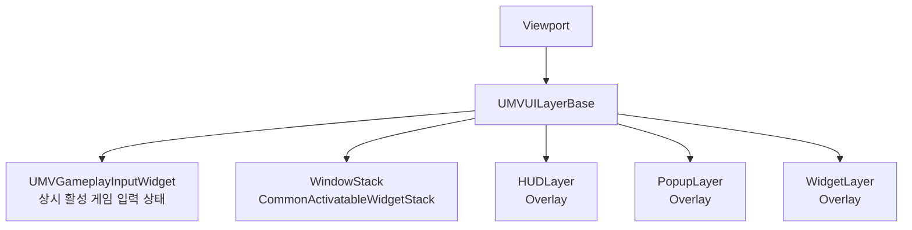

# UI와 CommonUI

`UMVUISubsystem`: GameInstance 수명의 UI 진입점

## 계층

## 책임

| 계층 | 책임 |
|---|---|
| GameplayInput | WindowStack 밖에서 기본 게임 입력 상태와 게임 화면 초점 복귀 제공 |
| Window | CommonUI Activatable Stack, Modal, Back, Focus, Input 수명주기 |
| Popup·HUD | 단일 Overlay, Stack Activation 비소유 |
| WBP Blueprint | Widget Tree, Animation, 화면 Binding |

## QWER 전투 표시

- `UMVPlayerSkillHUDWidget`: 공통 슬롯 정의 순서로 Q·W·E·R 표시, 현재 전투 스타일의 선택 행을 무기 컴포넌트에서 조회
- `MVSkillHUDPresentation`: 선택 행·연계 행을 읽어 단계별 그림과 준비 상태 구성, 그림 누락도 같은 인덱스에 대체 그림 유지
- `UMVSkillSlotWidget`: 사각 그림·슬롯 문자·상태와 그림 아래 사용 키 표시, 미완성은 `준비 중`, 빈 선택은 `미선택`
- 선택·무기·입력 장치·키 설정 변경 때 고정 자료 갱신, 매 프레임에는 대기시간·Q 연계 시간·R 게이지만 반영
- `SkillInputBindings`: 슬롯과 실제 `UInputAction`·보조키 동작 연결, 적용된 Enhanced Input 키 조회로 안내 구성
- 기본 W·E는 `IA_SkillModifier`와 약공격·강공격 동작의 조합, 문자 W·E를 사용 키로 고정하지 않음
- 현재 장치에 키가 없거나 보조키 연결이 없으면 `미지정`, 터치 사용 키 안내는 미지원
- Construct에서 알림 구독, Destruct·컴포넌트 교체에서 해제, 새 플레이어 소유 시 새 컴포넌트에 연결
- `WBP_PlayerSkillHUD`·`WBP_SkillSlot`과 C++ 기본 배치 모두 지원, 전투 입력·선택·저장 규칙 변경 없음
- 구현 결과·검증 범위: [[Features/Combat/Weapon-Skill-Selection/document|통합 스킬 선택 설계]]의 6단계 적용 결과

## 필드 메뉴와 인벤토리

- `I`로 필드 메뉴를 열고 닫음. 인벤토리 페이지의 뒤로 가기는 먼저 필드 메뉴로 복귀
- 키보드·마우스로 열면 CommonUI가 게임 화면의 마우스 캡처를 풀고 포인터를 표시. 첫 클릭부터 인벤토리 진입·분류·아이템·뒤로 가기 조작 가능
- 공통 확인 입력은 초점을 가진 인벤토리 진입·분류·아이템·뒤로 가기 중 해당 항목에 전달
- 필드 메뉴와 인벤토리를 오갈 때 현재 페이지를 0.08초 동안 숨기고 새 페이지를 0.10초 동안 표시. 투명도는 페이지에만 적용
- 페이드 중에는 창이 초점을 유지하고 페이지 버튼 입력을 막음. 전환이 끝나면 대상 페이지의 기본 항목으로 초점 이동
- `I`·피격·사망·필드 전환으로 창을 닫으면 진행 중인 페이드를 즉시 취소. 다시 열면 원래 밝기의 필드 메뉴에서 시작
- Windows UE 5.8.1 TestMap의 에디터 플레이와 독립 게임에서 전환 자동 검사 각각 30개 통과. 왕복·연타·전환 중 `I`와 피격·기존 커서 복구 확인. 실제 장치 수동 조작과 맵 이동은 미실행
- 활성 창은 플레이어의 게임 입력을 차단하고 월드 시간을 유지
- 아이템 이름과 `Information` 본문은 기존 영문 서체에 엔진의 한글 대체 글꼴을 연결
- 설명은 본문 너비에 맞춰 줄바꿈하고 긴 내용은 스크롤. 내용이 바뀌면 첫 줄로 복귀하고 빈 설명에는 `No description available.` 표시
- Windows UE 5.8.1 TestMap의 에디터 플레이와 960×540 독립 게임에서 글자·줄바꿈·스크롤 자동 검사 각각 9개 통과. 배포용 패키지는 미실행
- 포션은 `1`로 사용. `TestMap`의 공중 피격 시험은 `Alt+1`로 실행
- Windows UE 5.8.1 TestMap의 에디터 플레이·독립 게임에서 자동 입력으로 각각 13개 검사 통과. 첫 클릭·분류·아이템·장치 전환·닫기·적중 후 입력 복귀 확인. 실제 장치 수동 조작은 미실행

### 아이템 분류 데이터

- `DT_InventoryGroups`의 행 이름으로 아이템의 `InventoryGroupId`를 연결. 분류 행에는 상위 탭, 표시 이름, 하위 분류 순서 지정
- `InventorySortOrder`는 같은 하위 분류에서 아이템 순서를 지정. 분류 키가 없거나 유효하지 않으면 원본 표의 기본 분류 사용
- 무기 조회와 포션 보유 한도·수량 변경은 원본 행 종류를 사용. 저장에는 기존 아이템 태그와 수량 사용
- 탭 순서는 전체·무기·소모품·소재·기타. 각 탭의 목록은 상위 분류, 하위 분류 순서, 아이템 순서로 정렬
- 목록은 고정 6열. 다음 하위 분류는 새 줄의 첫 칸에 배치하고 남은 칸은 입력을 받지 않는 이미지로 표시
- 기존 세로 스크롤을 사용하고 탭을 바꾸면 목록 첫 줄로 이동. 아이템 그림은 최대 72×72 UI 단위로 표시
- 방향키·D패드의 좌우 이동은 현재 줄의 아이템, 위아래 이동은 인접 줄에서 같은 열 또는 가장 가까운 아이템 지정. 첫 줄에서 위로 가면 현재 탭으로 이동
- 초점이 바뀌면 해당 아이템의 상세를 표시하고 목록을 스크롤. 수량·정의 갱신 후 선택 태그 유지. 소진 시 현재 탭의 첫 아이템, 빈 탭은 탭 버튼에 초점 복구
- 넓은 화면에서도 목록과 상세 열의 최대 폭을 유지해 두 열 사이 간격을 일정하게 표시
- 아이템이 있는 칸은 아래쪽만 은은하게 밝히고, 선택한 칸은 같은 영역을 더 밝게 표시. 수량은 강조 위 오른쪽에 표시
- Windows UE 5.8.1 에디터 플레이에서 방향키·D패드 자동 입력, 끝 줄 자동 스크롤, 갱신·소진 뒤 초점 복구 검사. DirectX 12 화면 밖 렌더링 1280×720·960×540에서 영역과 그림·수량의 배치 확인. 물리 입력 장치와 배포용 패키지는 미실행

## 사망과 필드 전환

- DeathRespawnFlow: Death Overlay 표시
- FieldTransition: Loading Window와 화면 전환 오케스트레이션
- 전환 전후 `ClearAllUI`, `ResetToDefaultUI` 사용

## 창 종료 후 게임 입력 복구

- `UMVGameplayInputWidget`은 `RootOverlay`에 창 목록과 별도로 배치, 마지막 창 종료 후에도 활성 유지
- 기본 입력: `Game`, `CapturePermanently_IncludingInitialMouseDown`, `LockOnCapture`, 이동·시점 차단 해제
- CommonUI가 활성 창의 메뉴 입력에서 기본 게임 입력으로 전환해 커서·마우스 잡기·게임 화면 초점 복구
- 기본 창 스택은 전환 대상이 제거되면 바로 아래 창으로 복귀. 남은 창이 없으면 기본 게임 입력 복구
- Windows UE 5.8.1 사용자 PIE 확인과 기존 로그에서 `Hide` 후 입력 전환·카메라 회전·반복 열기 확인, 이번 문서 작업은 새 실행 없음

## 레벨업 창과 재화 HUD

| 구성 | 연결 |
|---|---|
| 창 등록 | `UMVUISettings.LevelUpWindowClass` → `W_LevelUp` / `UMVLevelUpWindow` |
| 창 열기·닫기 | `UMVUISubsystem.ShowLevelUpWindow`·`HideLevelUpWindow`, 중복 창 검사와 임시 투자 폐기 |
| 확인 | `GenericForward` 기본 확인 동작, 창에서 등록한 Enter 처리 |
| 취소 | `GenericBack`, PIE Esc는 실행 종료와 충돌하여 미검증 |
| 키 안내 | `CommonActionWidget`은 표시 담당, 동작 실행은 활성 창 책임 |
| 재화 HUD | `UMVMainHUDWidget`이 영구 성장 변경 구독 → `UMVCurrencyStatusWidget.SetCurrency(int64)` |

성장·미리보기·위젯 부모·저장·검증 범위: [[Features/Progression/Level-Up/document|레벨업 프로토타입]]

## 패시브 선택 창

| 구성 | 연결 |
|---|---|
| 창 등록 | `UMVUISettings.WeaponPassiveSelectionWindowClass` → `WBP_WeaponPassiveSelection` |
| 창 열기·닫기 | `UMVUISubsystem.ShowWeaponPassiveSelectionWindow`·`HideWeaponPassiveSelectionWindow` |
| 목록 행 | 보유 무기와 패시브 후보에서 `WBP_PassiveCandidateEntry` 재사용. `BPS_PassiveSelectionRow`가 어두운 배경과 마우스 상태별 색을 제공 |
| 입력 | 방향키로 초점 이동. 후보에 초점이 있을 때 CommonUI 기본 확인 입력은 화면의 `적용`과 같은 경로 실행 |
| 화면 갱신 | 무기 소유·장착, 후보 해금·선택, 활성 효과 변경 알림을 다음 틱에 모아 재조회 |
| HUD와 종료 | 창 활성화 시 메인 HUD를 숨기고, 종료 시 같은 HUD의 이전 표시 상태 복구 |

- 피격·사망·행동 시작·필드 전환·조종 캐릭터 변경 시 창 종료. 종료 시 등록한 입력·구독·갱신 타이머 정리
- 창의 빈 영역을 누르면 현재 미리보기 행으로 키보드 초점 복귀. 후보가 비면 조회 중인 무기 또는 닫기 버튼으로 이동
- Windows UE 5.8 TestMap에서 한손 시험 무기의 적용·장착 표시와 빈 영역 클릭 뒤 방향키 이동 확인
- 화면 동작과 패시브 선택 기준은 [[Features/Combat/Weapon-Passives/document#패시브 선택 창|패시브 선택 창]] 참조

## 보스 공격 시험 패널

- 기존 `WBP_MainHUD`의 `WBP_BossAttackTest`에서 기본 공격·Q·W·공명 폭주 수동 실행
- `UMVBossAttackTestWidget`: 버튼 구독·보스 탐색·수동 AI 제어·입력 복구 소유, 공격 판정은 기존 전투 경로 재사용
- 시험 패널의 마우스: 게임 배경 좌클릭으로 커서 숨김·게임 내부 고정, `J` 키로 커서 표시·UI 조작 상태(`GameAndUI`) 선택; 자동 AI·수동 시험 전환 중 선택 상태 유지
- `MVBossAttackTestWidget::EnsureMouseInput`에서 선택 상태 적용. CommonUI가 메뉴 입력을 적용했다면 기본 위젯이 활성 창 교체를 기다리는 동안에도 시험 패널은 마우스 설정을 건드리지 않음
- 시험 UI 버튼 클릭은 게임 배경 클릭 판정에서 제외
- 보스 등장 대기에는 시험 허용, 실제 재생의 `bBossIntroBlocked` 활성 시 수동 공격 차단·패널의 마우스 입력 강제 설정 제외; 연출 입력·카메라 복구는 [[Features/Boss-Intro/document|최초 보스 등장 연출]] 소유
- 버튼 연결·공명 반복 시험·검증 범위: [[Features/Boss-Attack-Test/document|보스 공격 시험 UI]]
