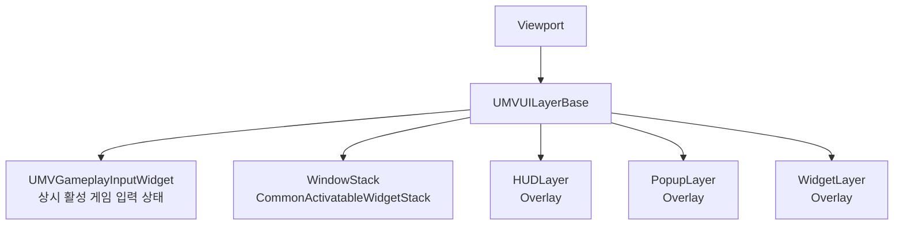

# UI와 CommonUI

`UMVUISubsystem`: GameInstance 수명의 UI 진입점

## 계층

## 책임

| 계층 | 책임 |
|---|---|
| GameplayInput | WindowStack 밖에서 기본 게임 입력 상태와 게임 화면 초점 복귀 제공 |
| Window | CommonUI Activatable Stack, Modal, Back, Focus, Input 수명주기 |
| Popup·HUD | 단일 Overlay, Stack Activation 비소유 |
| WBP Blueprint | Widget Tree, Animation, 화면 Binding |

## 사망과 필드 전환

- DeathRespawnFlow: Death Overlay 표시
- FieldTransition: Loading Window와 화면 전환 오케스트레이션
- 전환 전후 `ClearAllUI`, `ResetToDefaultUI` 사용

## 창 종료 후 게임 입력 복구

- `UMVGameplayInputWidget`은 `RootOverlay`에 창 목록과 별도로 배치, 마지막 창 종료 후에도 활성 유지
- 기본 입력: `Game`, `CapturePermanently_IncludingInitialMouseDown`, `LockOnCapture`, 이동·시점 차단 해제
- CommonUI가 활성 창의 메뉴 입력에서 기본 게임 입력으로 전환해 커서·마우스 잡기·게임 화면 초점 복구
- Windows UE 5.8.1 사용자 PIE 확인과 기존 로그에서 `Hide` 후 입력 전환·카메라 회전·반복 열기 확인, 이번 문서 작업은 새 실행 없음

## 레벨업 창과 재화 HUD

| 구성 | 연결 |
|---|---|
| 창 등록 | `UMVUISettings.LevelUpWindowClass` → `W_LevelUp` / `UMVLevelUpWindow` |
| 창 열기·닫기 | `UMVUISubsystem.ShowLevelUpWindow`·`HideLevelUpWindow`, 중복 창 검사와 임시 투자 폐기 |
| 확인 | `GenericForward` 기본 확인 동작, 창에서 등록한 Enter 처리 |
| 취소 | `GenericBack`, PIE Esc는 실행 종료와 충돌하여 미검증 |
| 키 안내 | `CommonActionWidget`은 표시 담당, 동작 실행은 활성 창 책임 |
| 재화 HUD | `UMVMainHUDWidget`이 영구 성장 변경 구독 → `UMVCurrencyStatusWidget.SetCurrency(int64)` |

성장·미리보기·위젯 부모·저장·검증 범위: [[Features/Progression/Level-Up/document|레벨업 프로토타입]]

## 패시브 선택 창

| 구성 | 연결 |
|---|---|
| 창 등록 | `UMVUISettings.WeaponPassiveSelectionWindowClass` → `WBP_WeaponPassiveSelection` |
| 창 열기·닫기 | `UMVUISubsystem.ShowWeaponPassiveSelectionWindow`·`HideWeaponPassiveSelectionWindow` |
| 목록 행 | 보유 무기와 패시브 후보에서 `WBP_PassiveCandidateEntry` 재사용. `BPS_PassiveSelectionRow`가 어두운 배경과 마우스 상태별 색을 제공 |
| 입력 | 방향키로 초점 이동. 후보에 초점이 있을 때 CommonUI 기본 확인 입력은 화면의 `적용`과 같은 경로 실행 |
| 화면 갱신 | 무기 소유·장착, 후보 해금·선택, 활성 효과 변경 알림을 다음 틱에 모아 재조회 |
| HUD와 종료 | 창 활성화 시 메인 HUD를 숨기고, 종료 시 같은 HUD의 이전 표시 상태 복구 |

- 피격·사망·행동 시작·필드 전환·조종 캐릭터 변경 시 창 종료. 종료 시 등록한 입력·구독·갱신 타이머 정리
- 창의 빈 영역을 누르면 현재 미리보기 행으로 키보드 초점 복귀. 후보가 비면 조회 중인 무기 또는 닫기 버튼으로 이동
- Windows UE 5.8 TestMap에서 한손 시험 무기의 적용·장착 표시와 빈 영역 클릭 뒤 방향키 이동 확인
- 화면 동작과 패시브 선택 기준은 [[Features/Combat/Weapon-Passives/document#패시브 선택 창|패시브 선택 창]] 참조

## 보스 공격 시험 패널

- 기존 `WBP_MainHUD`의 `WBP_BossAttackTest`에서 기본 공격·Q·W·공명 폭주 수동 실행
- `UMVBossAttackTestWidget`: 버튼 구독·보스 탐색·수동 AI 제어·입력 복구 소유, 공격 판정은 기존 전투 경로 재사용
- 시험 패널의 마우스: 게임 배경 좌클릭으로 커서 숨김·게임 내부 고정, `J` 키로 커서 표시·UI 조작 상태(`GameAndUI`) 선택; 자동 AI·수동 시험 전환 중 선택 상태 유지
- `MVBossAttackTestWidget::EnsureMouseInput`에서 선택 상태 적용, CommonUI의 다른 활성 창은 입력 우선권 보유; 시험 UI 버튼 클릭은 게임 배경 클릭 판정에서 제외
- 보스 등장 대기에는 시험 허용, 실제 재생의 `bBossIntroBlocked` 활성 시 수동 공격 차단·패널의 마우스 입력 강제 설정 제외; 연출 입력·카메라 복구는 [[Features/Boss-Intro/document|최초 보스 등장 연출]] 소유
- 버튼 연결·공명 반복 시험·검증 범위: [[Features/Boss-Attack-Test/document|보스 공격 시험 UI]]
